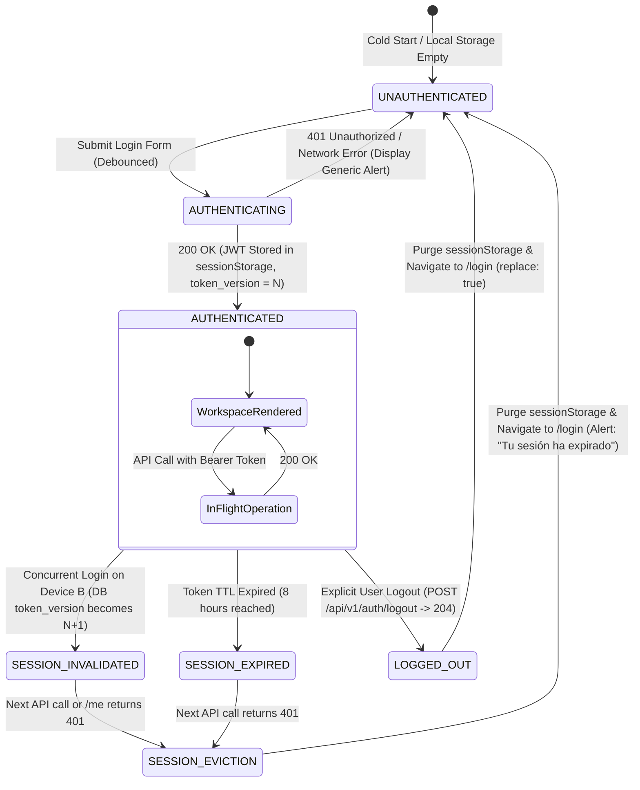

# Phase 1 Data Model: Staff Authentication Views and Automatic Role-Based Redirect Guards

**Feature**: `002-staff-auth-redirect-guards`  
**Date**: 2026-10-23  
**Status**: Completed  
**Constitution Compliance**: v1.1.0 (Principle X: Full-Stack Vertical Slice Integrity)  

---

## 1. Backend Persistence Entities (Spring Data JPA / PostgreSQL)

### Entity: `User` (`users` table)

Represents an identity within the EasyEat platform (comensal, counter manager, kitchen chef, or administrator). Defined in `001-central-auth-recovery` and consumed by this feature without modifications.

| Field Name | Type | Nullable | Default | Description |
|---|---|---|---|---|
| `id` | `UUID` | No | `gen_random_uuid()` | Primary key. Unique account identifier. |
| `email` | `VARCHAR(255)` | No | N/A | Normalized lowercase email address. Unique index. |
| `password_hash` | `VARCHAR(255)` | No | N/A | Salted BCrypt cryptographic password hash (cost 12). |
| `role` | `VARCHAR(50)` | No | `'COMENSAL'` | Assigned system role: `COMENSAL`, `ENCARGADO`, `CHEF`, `ADMINISTRADOR`. |
| `status` | `VARCHAR(50)` | No | `'ACTIVE'` | Operational status: `ACTIVE`, `SUSPENDED`, `UNVERIFIED`. |
| `tenant_id` | `UUID` | Yes | `NULL` | Establishment identifier. Mandatory for staff roles; null for platform comensales. |
| `token_version` | `INTEGER` | No | `0` | Session version sequence (from `V1__create_users.sql`). Incremented on login & logout. |
| `created_at` | `TIMESTAMPTZ` | No | `NOW()` | Account creation timestamp. |
| `updated_at` | `TIMESTAMPTZ` | No | `NOW()` | Last profile update timestamp. |

#### Database Constraints & Invariants (Inherited from `V1__create_users.sql` in Spec 001)
- `uq_users_email`: Unique constraint on `email`.
- `idx_users_email`: B-tree index on `email` for O(log n) login lookup.
- `chk_users_role`: Check constraint `CHECK (role IN ('COMENSAL','ENCARGADO','CHEF','ADMINISTRADOR'))`.
- `chk_users_status`: Check constraint `CHECK (status IN ('ACTIVE','SUSPENDED','UNVERIFIED'))`.

---

## 2. Security Token Structure (JWT Claims)

The issued Bearer JWT access token includes standard and custom claims validating identity, role authorization, tenant isolation, and single active session epoch.

```json
{
  "sub": "3fa85f64-5717-4562-b3fc-2c963f66afa6",
  "email": "carlos.chef@comedorcentral.com",
  "role": "CHEF",
  "tenant_id": "8bb12c8a-2d4e-4f76-a0b2-9a0910f13341",
  "token_version": 4,
  "iat": 1729728000,
  "exp": 1729756800
}
```

| Claim | Key | Type | Description |
|---|---|---|---|
| Subject | `sub` | `String (UUID)` | Authenticated user ID. |
| Email | `email` | `String` | Normalized email address. |
| Role | `role` | `String` | Role claim (`COMENSAL`, `ENCARGADO`, `CHEF`, `ADMINISTRADOR`). |
| Tenant ID | `tenant_id` | `String (UUID)` | Associated establishment for staff multi-tenant partitioning. |
| Token Version | `token_version` | `Integer` | Version counter validating single active session integrity. |
| Issued At | `iat` | `Integer` | Timestamp of issuance. |
| Expiration | `exp` | `Integer` | Expiration timestamp (8 hours = 28,800 seconds from issuance). |

---

## 3. Frontend Client Models (TypeScript)

### Type: `Role`
```typescript
export type Role = 'COMENSAL' | 'ENCARGADO' | 'CHEF' | 'ADMINISTRADOR';
```

### Interface: `AuthenticatedUser`
```typescript
export interface AuthenticatedUser {
  userId: string;
  email: string;
  role: Role;
  tenantId: string | null;
  tokenVersion?: number;
}
```

### Interface: `AuthContextState`
```typescript
export interface AuthContextState {
  user: AuthenticatedUser | null;
  accessToken: string | null;
  isAuthenticated: boolean;
  isLoading: boolean;
  login: (email: string, password: string) => Promise<void>;
  logout: () => Promise<void>;
}
```

### Interface: `LoginRequest`
```typescript
export interface LoginRequest {
  email: string;
  password: string;
}
```

### Interface: `LoginResponse` (Wire format matching Spec 001)
```typescript
export interface LoginResponse {
  access_token: string;
  token_type: 'Bearer';
  expires_in: number; // 28800 (8 hours)
}
```

### Interface: `AuthenticatedUserResponse` (Wire format from `GET /api/v1/auth/me`)
```typescript
export interface AuthenticatedUserResponse {
  id: string;
  email: string;
  role: Role;
  tenant_id: string | null;
  token_version: number;
}
```

### Interface: `JwtClaims` (Decoded payload from access_token)
```typescript
export interface JwtClaims {
  sub: string; // userId (UUID)
  email: string;
  role: Role;
  tenant_id: string | null;
  token_version: number;
  iat: number;
  exp: number;
}
```

---

## 4. Route Access Matrix & Canonical Mapping

Defines the declarative mapping between application routes, authorized roles, and landing policies. All paths follow the official Spanish roadmap convention from `spec.md`.

| Route Path | Allowed Roles | Default For Role | Public / Protected | Redirect On Mismatch / Unauth |
|---|---|---|---|---|
| `/login` | All (when unauthenticated) | None | Public | If authenticated → Redirect to role default workspace (`replace: true`) |
| `/mostrador` | `['ENCARGADO']` | `ENCARGADO` | Protected | Unauth → `/login` (preserve path in `state.from`)<br>Cross-role → Role default workspace (`replace: true`) |
| `/cocina` | `['CHEF']` | `CHEF` | Protected | Unauth → `/login` (preserve path in `state.from`)<br>Cross-role → Role default workspace (`replace: true`) |
| `/admin` | `['ADMINISTRADOR']` | `ADMINISTRADOR` | Protected | Unauth → `/login` (preserve path in `state.from`)<br>Cross-role → Role default workspace (`replace: true`) |
| `/catalogo` | `['COMENSAL', 'ENCARGADO', 'CHEF', 'ADMINISTRADOR']` | `COMENSAL` / Fallback | Protected / Public diner | Unauth → `/login` (preserve path in `state.from`)<br>Cross-role → Role default workspace (`replace: true`) |
| `*` | Any | None | Catch-all | If auth → Role default workspace (`replace: true`)<br>If unauth → `/login` (`replace: true`) |

---

## 5. Session State Transitions

The application enforces deterministic transitions across the authentication and operational lifecycle:



### Invalidation & Eviction Invariants
1. **Single Active Session**: Every backend request passes through `JwtAuthenticationFilter`, which verifies `claim.token_version == user.token_version`. If another session was opened, the database version was incremented, rendering earlier tokens invalid immediately.
2. **Dual-Tier Logout**: Explicit logout invokes `POST /api/v1/auth/logout` (incrementing `token_version` on the server) and executes `sessionStorage.clear()` on the client, replacing navigation history with `/login`.
3. **401 Interception**: The HTTP client interceptor (`apiClient.ts`) intercepts any 401 response, discards in-flight requests, clears local state, and forces navigation to `/login` with `{ state: { sessionExpired: true } }`.
