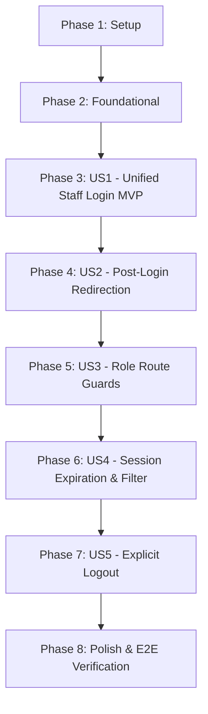

# Tasks: Staff Authentication Views and Automatic Role-Based Redirect Guards

**Input**: Design documents from `/specs/002-staff-auth-redirect-guards/` (`spec.md`, `plan.md`, `data-model.md`, `research.md`, `contracts/openapi.yaml`, `quickstart.md`)  
**Prerequisites**: `spec.md` (required), `plan.md` (required), `data-model.md`, `contracts/openapi.yaml`  
**Tests**: Strict TDD methodology applied (Unit & security tests before implementation, Backend-first, then Frontend-first).  
**Organization**: Tasks are grouped by User Story ([US1] to [US5]) to enable independent implementation and incremental testing.

---

## Format: `- [ ] [TaskID] [P?] [Story?] Description with file path`

- **[P]**: Can run in parallel (different files, no conflicting dependencies)
- **[Story]**: Belongs to user story phase (`[US1]`, `[US2]`, `[US3]`, `[US4]`, `[US5]`)
- Every task includes the exact target file path

---

## Phase 1: Setup (Shared Monorepo Infrastructure)

**Purpose**: Monorepo scaffolding, configuration files, and project boundaries.

- [ ] T001 Initialize backend Maven build structure with Spring Boot 3.3.4, Spring Security, jjwt, and PostgreSQL in `easyeat/backend/pom.xml`
- [ ] T002 [P] Configure backend environment profiles for development and test in `easyeat/backend/src/main/resources/application.yml` and `easyeat/backend/src/main/resources/application-dev.yml`
- [ ] T003 Initialize frontend React 18, Vite 5, Tailwind CSS, and React Router v6 setup in `easyeat/frontend/package.json` and `easyeat/frontend/vite.config.ts`

---

## Phase 2: Foundational (Blocking Prerequisites)

**Purpose**: Core data layer, baseline security configuration, and shared exception handling required before any user story can execute.

**⚠️ CRITICAL**: No user story implementation or integration can begin until this foundational phase is complete.

- [ ] T004 Define Flyway migration for users table including role, status, tenant_id, and token_version sequence in `easyeat/backend/src/main/resources/db/migration/V1__create_users.sql`
- [ ] T005 [P] Create JPA User entity with token_version, status, and role mappings in `easyeat/backend/src/main/java/com/easyeat/auth/entity/User.java`
- [ ] T006 [P] Create UserRepository interface with findByEmail lookup in `easyeat/backend/src/main/java/com/easyeat/auth/repository/UserRepository.java`
- [ ] T007 Implement RFC 9457 ProblemDetail GlobalExceptionHandler for anti-enumeration and auth failures in `easyeat/backend/src/main/java/com/easyeat/exception/GlobalExceptionHandler.java`
- [ ] T008 Configure base SecurityConfig with stateless session management and BCrypt password encoder bean in `easyeat/backend/src/main/java/com/easyeat/config/SecurityConfig.java`

**Checkpoint**: Foundation ready — database schema, user repository, and baseline security filter chain established.

---

## Phase 3: User Story 1 - Unified Staff Login via Shared Interface (Priority: P1) 🎯 MVP

**Goal**: Deliver the shared staff credential authentication gateway with email normalization, anti-enumeration protection, and JWT issuance containing required claims (`user_id`, `role`, `tenant_id`, `token_version`).

**Independent Test**: Execute `AuthControllerTest` and `LoginForm.test.tsx` verifying successful token issuance for valid staff accounts, generic failure responses for incorrect credentials, client-side input trimming/lowercasing, and submit button debouncing.

### Tests for User Story 1 (TDD - Backend First) ⚠️

- [ ] T009 [P] [US1] Unit test JWT generation and validation with custom claims (user_id, role, tenant_id, token_version) in `easyeat/backend/src/test/java/com/easyeat/auth/security/JwtServiceTest.java`
- [ ] T010 [P] [US1] Unit test AuthService authentication, email trimming/lowercasing, inactive account rejection, and anti-enumeration handling in `easyeat/backend/src/test/java/com/easyeat/auth/service/AuthServiceTest.java`
- [ ] T011 [US1] WebMvc integration test for POST /api/v1/auth/login endpoint and RFC 9457 error contracts in `easyeat/backend/src/test/java/com/easyeat/auth/controller/AuthControllerTest.java`

### Backend Implementation for User Story 1

- [ ] T012 [P] [US1] Create LoginRequest DTO with validation annotations (@NotBlank, @Email) in `easyeat/backend/src/main/java/com/easyeat/auth/dto/LoginRequest.java`
- [ ] T013 [P] [US1] Create LoginResponse DTO matching OpenAPI contract (access_token, token_type, expires_in) in `easyeat/backend/src/main/java/com/easyeat/auth/dto/LoginResponse.java`
- [ ] T014 [US1] Implement JwtService for token issuance with role, tenant_id, and token_version claims in `easyeat/backend/src/main/java/com/easyeat/auth/security/JwtService.java`
- [ ] T015 [US1] Implement AuthService login method verifying credentials, normalizing email, checking status, and incrementing token_version in `easyeat/backend/src/main/java/com/easyeat/auth/service/AuthService.java`
- [ ] T016 [US1] Implement AuthController POST /api/v1/auth/login endpoint in `easyeat/backend/src/main/java/com/easyeat/auth/controller/AuthController.java`

### Tests for User Story 1 (TDD - Frontend) ⚠️

- [ ] T017 [P] [US1] Unit and interaction tests for LoginForm (validation, email normalization, submission debouncing, anti-enumeration error display, network failure) in `easyeat/frontend/tests/components/LoginForm.test.tsx`

### Frontend Implementation for User Story 1

- [ ] T018 [P] [US1] Create Axios HTTP client instance with base URL configuration in `easyeat/frontend/src/api/apiClient.ts`
- [ ] T019 [US1] Create auth API service method invoking POST /api/v1/auth/login in `easyeat/frontend/src/api/authApi.ts`
- [ ] T020 [US1] Implement LoginForm component with client-side validation, trim/lowercase transformation, and submission debouncing in `easyeat/frontend/src/components/auth/LoginForm.tsx`
- [ ] T021 [US1] Implement LoginPage view wrapping LoginForm in `easyeat/frontend/src/pages/LoginPage.tsx`

**Checkpoint**: User Story 1 functional — credentials can be submitted, backend issues valid JWTs, and the frontend form enforces all validation rules.

---

## Phase 4: User Story 2 - Automatic Post-Login Workspace Redirection (Priority: P1)

**Goal**: Automatically route authenticated staff immediately to their role-specific operational workspace (`/counter`, `/kds`, `/admin`) or catalog fallback (`/catalog`), while preserving authorized deep links and discarding unauthorized targets.

**Independent Test**: Execute `postAuthRouting.test.ts` verifying exact route destination mapping per role and deep link resolution logic.

### Tests for User Story 2 (TDD) ⚠️

- [ ] T022 [P] [US2] Unit tests for role-to-route mapping and deep link resolution policy in `easyeat/frontend/tests/router/postAuthRouting.test.ts`

### Implementation for User Story 2

- [ ] T023 [P] [US2] Implement pure post-auth routing helper (getRoleDefaultRoute and resolvePostAuthRedirect) in `easyeat/frontend/src/router/postAuthRouting.ts`
- [ ] T024 [US2] Implement AuthContext with token decoding, sessionStorage synchronization, and reactive auth state in `easyeat/frontend/src/context/AuthContext.tsx`
- [ ] T025 [P] [US2] Implement useAuth custom hook exposing auth state and dispatch actions in `easyeat/frontend/src/hooks/useAuth.ts`
- [ ] T026 [P] [US2] Create WorkspaceLayout common component with role badge, tenant display, and logout slot in `easyeat/frontend/src/components/common/WorkspaceLayout.tsx`
- [ ] T027 [P] [US2] Create CounterWorkspacePage landing view for ENCARGADO in `easyeat/frontend/src/pages/CounterWorkspacePage.tsx`
- [ ] T028 [P] [US2] Create KitchenWorkspacePage landing view for CHEF in `easyeat/frontend/src/pages/KitchenWorkspacePage.tsx`
- [ ] T029 [P] [US2] Create AdminWorkspacePage landing view for ADMINISTRADOR in `easyeat/frontend/src/pages/AdminWorkspacePage.tsx`
- [ ] T030 [P] [US2] Create CatalogPage landing view for COMENSAL / fallback in `easyeat/frontend/src/pages/CatalogPage.tsx`
- [ ] T031 [US2] Integrate post-auth redirection in LoginForm upon successful login in `easyeat/frontend/src/components/auth/LoginForm.tsx`

**Checkpoint**: User Story 2 functional — staff members authenticate and are instantly redirected to their assigned workspace without intermediate prompts.

---

## Phase 5: User Story 3 - Role-Based Route Protection and Cross-Role Isolation (Priority: P1)

**Goal**: Guard staff workspaces against unauthenticated access and enforce silent redirection on cross-role navigation attempts with history replacement (`replace: true`).

**Independent Test**: Execute `RoleRouteGuard.test.tsx` verifying unauthenticated redirection to `/login` with preserved target, silent cross-role redirection, and browser back-button entrapment prevention.

### Tests for User Story 3 (TDD) ⚠️

- [ ] T032 [P] [US3] Component tests for RoleRouteGuard (unauthenticated redirection with state.from, cross-role silent redirect, replace: true history replacement) in `easyeat/frontend/tests/router/RoleRouteGuard.test.tsx`

### Implementation for User Story 3

- [ ] T033 [US3] Implement RoleRouteGuard component with allowedRoles check, state.from preservation, and silent redirect in `easyeat/frontend/src/router/RoleRouteGuard.tsx`
- [ ] T034 [US3] Assemble full declarative route tree with RoleRouteGuard wrappers in `easyeat/frontend/src/router/AppRoutes.tsx`

**Checkpoint**: User Story 3 functional — perimeter security actively isolates `/counter`, `/kds`, `/admin`, and `/catalog` against unauthorized direct navigation and history tampering.

---

## Phase 6: User Story 4 - Session Expiration Handling and Action Protection (Priority: P2)

**Goal**: Enforce single active session verification via `token_version` on every backend request and client-side 401 interception redirecting expired or invalidated sessions to login with an explicit alert notice.

**Independent Test**: Execute `JwtAuthenticationFilterTest` and `SessionLifecycle.test.tsx` verifying immediate rejection of stale `token_version` requests and client-side session eviction.

### Tests for User Story 4 (TDD - Backend First) ⚠️

- [ ] T035 [P] [US4] Security filter test verifying rejection of requests with stale token_version claim in `easyeat/backend/src/test/java/com/easyeat/auth/security/JwtAuthenticationFilterTest.java`

### Backend Implementation for User Story 4

- [ ] T036 [US4] Implement JwtAuthenticationFilter verifying token signature, expiration, and database token_version match in `easyeat/backend/src/main/java/com/easyeat/auth/security/JwtAuthenticationFilter.java`
- [ ] T037 [US4] Register JwtAuthenticationFilter before UsernamePasswordAuthenticationFilter in `easyeat/backend/src/main/java/com/easyeat/config/SecurityConfig.java`

### Tests for User Story 4 (TDD - Frontend) ⚠️

- [ ] T038 [P] [US4] Session lifecycle integration test validating 401 interception, in-flight action cancellation, and expiration notice in `easyeat/frontend/tests/session/SessionLifecycle.test.tsx`

### Frontend Implementation for User Story 4

- [ ] T039 [US4] Add response interceptor in apiClient to capture HTTP 401 responses, clear sessionStorage, and trigger session expired event in `easyeat/frontend/src/api/apiClient.ts`
- [ ] T040 [US4] Add session expiration banner and state eviction handling in `easyeat/frontend/src/context/AuthContext.tsx`

**Checkpoint**: User Story 4 functional — concurrent login on a second terminal immediately revokes the first terminal's access, and expired sessions cannot execute workspace actions.

---

## Phase 7: User Story 5 - Explicit Logout and History Invalidation (Priority: P2)

**Goal**: Terminate staff shift sessions via `POST /api/v1/auth/logout`, incrementing the database `token_version`, clearing client storage, and preventing cached back-button history navigation.

**Independent Test**: Execute logout tests verifying database `token_version` incrementation, HTTP 204 response, local session purge, and redirection to `/login`.

### Tests for User Story 5 (TDD - Backend First) ⚠️

- [ ] T041 [P] [US5] WebMvc test for POST /api/v1/auth/logout validating token_version incrementation and HTTP 204 No Content in `easyeat/backend/src/test/java/com/easyeat/auth/controller/AuthControllerTest.java`

### Backend Implementation for User Story 5

- [ ] T042 [US5] Implement logout method in AuthService executing atomic token_version incrementation for the authenticated user in `easyeat/backend/src/main/java/com/easyeat/auth/service/AuthService.java`
- [ ] T043 [US5] Add POST /api/v1/auth/logout endpoint in `easyeat/backend/src/main/java/com/easyeat/auth/controller/AuthController.java`

### Frontend Implementation for User Story 5

- [ ] T044 [P] [US5] Add logoutApi function calling POST /api/v1/auth/logout in `easyeat/frontend/src/api/authApi.ts`
- [ ] T045 [US5] Implement logout handler in AuthContext that calls logoutApi, clears sessionStorage, and navigates to /login with replace: true in `easyeat/frontend/src/context/AuthContext.tsx`
- [ ] T046 [US5] Wire "Cerrar sesión" action button in WorkspaceLayout to useAuth().logout in `easyeat/frontend/src/components/common/WorkspaceLayout.tsx`

**Checkpoint**: User Story 5 functional — staff can explicitly log out, session tokens are permanently invalidated on the server, and browser back navigation remains on `/login`.

---

## Phase 8: Polish & Cross-Cutting Concerns

**Purpose**: End-to-end scenario verification, cache headers, and final quality checks across both monorepo modules.

- [ ] T047 [P] Execute end-to-end manual validation scenarios following quickstart guide in `specs/002-staff-auth-redirect-guards/quickstart.md`
- [ ] T048 Verify Cache-Control: no-store headers on auth endpoints to prevent browser caching of protected views in `easyeat/backend/src/main/java/com/easyeat/config/SecurityConfig.java`
- [ ] T049 [P] Run linter and formatting checks across backend (`mvn checkstyle:check`) and frontend (`npm run lint`) to ensure zero warnings

---

## Dependencies & Execution Order

### Phase Dependencies

- **Setup (Phase 1)**: Can start immediately.
- **Foundational (Phase 2)**: Depends on Setup; BLOCKS all user stories.
- **User Story 1 (Phase 3 - MVP)**: Can start once Foundational is complete.
- **User Story 2 (Phase 4)**: Depends on User Story 1 (consumes token and auth context).
- **User Story 3 (Phase 5)**: Depends on User Story 2 (guards protect the routes created in US2).
- **User Story 4 (Phase 6)**: Depends on User Story 3 (intercepts 401 across guarded routes).
- **User Story 5 (Phase 7)**: Depends on User Story 4 (completes token invalidation lifecycle).
- **Polish (Phase 8)**: Depends on all user stories complete.

---

## Parallel Execution Opportunities

### Within Phase 1 (Setup)
- `T002` (Backend configuration) and `T003` (Frontend setup) can run in parallel.

### Within Phase 2 (Foundational)
- `T005` (`User.java`) and `T006` (`UserRepository.java`) can run in parallel.

### Within Phase 3 (US1 - Staff Login)
- **Backend Tests in parallel**: `T009` (`JwtServiceTest.java`) and `T010` (`AuthServiceTest.java`).
- **Backend DTOs in parallel**: `T012` (`LoginRequest.java`) and `T013` (`LoginResponse.java`).
- **Frontend client in parallel**: `T018` (`apiClient.ts`) and `T017` (`LoginForm.test.tsx`).

### Within Phase 4 (US2 - Workspace Redirection)
- **Frontend Workspace views in parallel**: `T026` (`WorkspaceLayout.tsx`), `T027` (`CounterWorkspacePage.tsx`), `T028` (`KitchenWorkspacePage.tsx`), `T029` (`AdminWorkspacePage.tsx`), and `T030` (`CatalogPage.tsx`).

### Within Phase 6 & 7 (US4 & US5 - Session Lifecycle & Logout)
- Tests `T035`, `T038`, and `T041` can be authored in parallel with their respective contract tests.

---

## Implementation Strategy

### MVP First (Phases 1, 2, and 3 - User Story 1)

1. Scaffold backend and frontend projects (Phase 1).
2. Execute migration and base JPA entities (Phase 2).
3. Author backend unit tests for JWT, AuthService, and AuthController (TDD).
4. Implement backend authentication services and endpoints.
5. Author frontend `LoginForm.test.tsx` and implement `LoginForm.tsx` and `LoginPage.tsx`.
6. **STOP and VALIDATE**: Verify end-to-end credential authentication and token issuance.

### Incremental Delivery (Phases 4 through 7)

1. Deliver **User Story 2**: Add role routing policy, `AuthContext`, and workspace landing views.
2. Deliver **User Story 3**: Add `RoleRouteGuard` and register protected routes in `AppRoutes.tsx`.
3. Deliver **User Story 4**: Add `JwtAuthenticationFilter` single active session enforcement and client 401 interceptor.
4. Deliver **User Story 5**: Add logout endpoint, database `token_version` invalidation, and UI logout button.
5. Deliver **Polish**: Execute `quickstart.md` manual validation suite.
