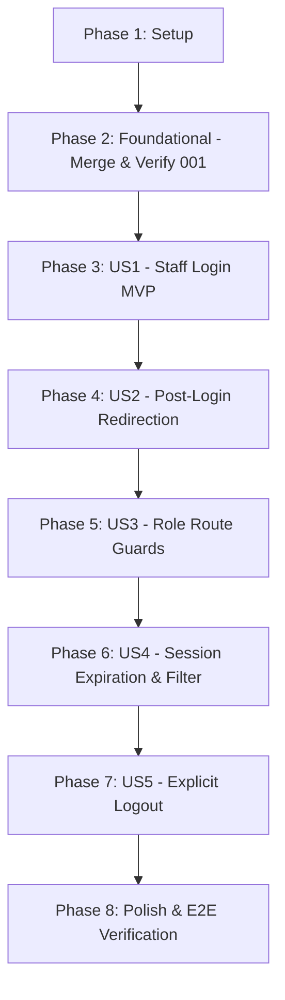

# Tasks: Staff Authentication Views and Automatic Role-Based Redirect Guards

**Input**: Design documents from `/specs/002-staff-auth-redirect-guards/` (`spec.md`, `plan.md`, `data-model.md`, `research.md`, `contracts/openapi.yaml`, `quickstart.md`)  
**Prerequisites**: `spec.md` (required), `plan.md` (required), `data-model.md`, `contracts/openapi.yaml`  
**External Dependency**: Feature `001-central-auth-recovery` must be merged into branch `002-staff-auth-redirect-guards` before executing Phase 2 backend verification.  
**Tests**: Strict TDD methodology applied (Unit, component & security tests before implementation; Frontend-first for UI stories, Backend-first for filter and logout extensions).  
**Organization**: Tasks are grouped by User Story ([US1] to [US5]) to enable independent implementation and incremental testing.

---

## Format: `- [ ] [TaskID] [P?] [Story?] Description with file path`

- **[P]**: Can run in parallel (different files, no conflicting dependencies)
- **[Story]**: Belongs to user story phase (`[US1]`, `[US2]`, `[US3]`, `[US4]`, `[US5]`)
- Every task includes the exact target file path

---

## Phase 1: Setup (Frontend Scaffolding & Backend Baseline Check)

**Purpose**: Initialize frontend application and verify backend build configuration from `001-central-auth-recovery`.

- [x] T001 Initialize frontend React 18, Vite 5, Tailwind CSS, and React Router v6 setup in `easyeat/frontend/package.json` and `easyeat/frontend/vite.config.ts`
- [x] T002 [P] Verify or extend backend Maven build configuration from 001 to ensure `jjwt` (api, impl, jackson) and Spring Security dependencies exist in `easyeat/backend/pom.xml`
- [x] T003 [P] Verify or configure backend environment profiles (`jwt.secret`, `jwt.expiration`) for dev and test in `easyeat/backend/src/main/resources/application.yml` and `easyeat/backend/src/main/resources/application-dev.yml`

---

## Phase 2: Foundational (Branch Integration & Baseline Verification)

**Purpose**: Integrate `001-central-auth-recovery` artifacts and verify core data model and security configuration required before user stories proceed.

**⚠️ CRITICAL**: Merge of branch `001-central-auth-recovery` is a mandatory gate before backend tasks in this phase and subsequent stories can execute. Frontend work in Phase 3 can proceed in parallel against mocked contracts.

- [x] T004 Merge branch `001-central-auth-recovery` into `002-staff-auth-redirect-guards` to incorporate backend authentication baseline
- [x] T005 [P] Verify Flyway migration `V1__create_users.sql` from 001 defines `users` table with `role`, `status`, `tenant_id`, and `token_version` in `easyeat/backend/src/main/resources/db/migration/V1__create_users.sql`
- [x] T006 [P] Verify JPA `User` entity from 001 exposes `tokenVersion`, `status`, `role`, and `tenantId` fields in `easyeat/backend/src/main/java/com/easyeat/auth/entity/User.java`
- [x] T007 [P] Verify `UserRepository` from 001 provides `findByEmail` lookup in `easyeat/backend/src/main/java/com/easyeat/auth/repository/UserRepository.java`
- [x] T008 [P] Verify base `SecurityConfig` from 001 configures stateless session management and BCrypt password encoder in `easyeat/backend/src/main/java/com/easyeat/config/SecurityConfig.java`
- [x] T009 [P] Verify RFC 9457 ProblemDetail `GlobalExceptionHandler` from 001 handles authentication exceptions without user enumeration in `easyeat/backend/src/main/java/com/easyeat/exception/GlobalExceptionHandler.java`

**Checkpoint**: Baseline verified — data layer, entity contracts, and base security configuration from 001 confirmed ready for consumption.

---

## Phase 3: User Story 1 - Unified Staff Login via Shared Interface (Priority: P1) 🎯 MVP

**Goal**: Deliver the shared staff credential authentication gateway with email normalization, anti-enumeration protection, submission debouncing, and token contract verification against 001's login endpoint.

**Independent Test**: Execute `LoginForm.test.tsx` verifying client-side trimming/lowercasing, submit button debouncing, anti-enumeration error handling, and `AuthControllerContractTest.java` verifying JWT claim conformance (`user_id`, `role`, `tenant_id`, `token_version`).

### Tests for User Story 1 (TDD - Frontend & Contract First) ⚠️

- [x] T010 [P] [US1] Backend contract integration test verifying `POST /api/v1/auth/login` issues JWT with all four required claims (`user_id`, `role`, `tenant_id`, `token_version`) in `easyeat/backend/src/test/java/com/easyeat/auth/controller/AuthControllerContractTest.java`
- [x] T011 [P] [US1] Unit and interaction tests for `LoginForm` (input validation, trim/lowercase transformation, submit debouncing, generic 401 error message, network failure display) in `easyeat/frontend/tests/components/LoginForm.test.tsx`

### Implementation for User Story 1

- [x] T012 [P] [US1] Verify or consume `LoginRequest.java` and `LoginResponse.java` DTOs from 001 in `easyeat/backend/src/main/java/com/easyeat/auth/dto/LoginRequest.java` and `LoginResponse.java`
- [x] T013 [US1] Create Axios HTTP client instance with base URL, standard JSON headers, and credentials configuration in `easyeat/frontend/src/api/apiClient.ts`
- [x] T014 [US1] Create auth API service method invoking `POST /api/v1/auth/login` with typed request and response in `easyeat/frontend/src/api/authApi.ts`
- [x] T015 [US1] Implement `LoginForm` component with client-side validation, trim/lowercase transformation, and submission debouncing in `easyeat/frontend/src/components/auth/LoginForm.tsx`
- [x] T016 [US1] Implement `LoginPage` view wrapping `LoginForm` with responsive brand layout in `easyeat/frontend/src/pages/LoginPage.tsx`

**Checkpoint**: User Story 1 functional — staff credentials submitted via UI are validated, debounced, authenticated by 001 endpoint, and return conforming tokens.

---

## Phase 4: User Story 2 - Automatic Post-Login Workspace Redirection (Priority: P1)

**Goal**: Automatically route authenticated staff immediately to their role-specific operational workspace (`/counter`, `/kds`, `/admin`) or catalog fallback (`/catalog`), preserving authorized deep links and discarding unauthorized targets.

**Independent Test**: Execute `postAuthRouting.test.ts` verifying exact destination mapping per role and deep link resolution policy.

### Tests for User Story 2 (TDD) ⚠️

- [x] T017 [P] [US2] Unit tests for role-to-route mapping policy and deep link resolution in `easyeat/frontend/tests/router/postAuthRouting.test.ts`
- [x] T018 [P] [US2] Unit tests for `AuthContext` token decoding, payload extraction (`role`, `tenant_id`, `user_id`), and `sessionStorage` synchronization in `easyeat/frontend/tests/context/AuthContext.test.tsx`

### Implementation for User Story 2

- [x] T019 [P] [US2] Implement pure post-auth routing functions (`getRoleDefaultRoute`, `resolvePostAuthRedirect`) in `easyeat/frontend/src/router/postAuthRouting.ts`
- [x] T020 [US2] Implement `AuthContext` with JWT decoding, `sessionStorage` persistence, and reactive auth state in `easyeat/frontend/src/context/AuthContext.tsx`
- [x] T021 [P] [US2] Implement `useAuth` custom hook exposing auth state and dispatch actions in `easyeat/frontend/src/hooks/useAuth.ts`
- [x] T022 [P] [US2] Create `WorkspaceLayout` common wrapper with role badge, tenant display, and logout slot in `easyeat/frontend/src/components/common/WorkspaceLayout.tsx`
- [x] T023 [P] [US2] Create `CounterWorkspacePage` landing view for `ENCARGADO` in `easyeat/frontend/src/pages/CounterWorkspacePage.tsx`
- [x] T024 [P] [US2] Create `KitchenWorkspacePage` landing view for `CHEF` in `easyeat/frontend/src/pages/KitchenWorkspacePage.tsx`
- [x] T025 [P] [US2] Create `AdminWorkspacePage` landing view for `ADMINISTRADOR` in `easyeat/frontend/src/pages/AdminWorkspacePage.tsx`
- [x] T026 [P] [US2] Create `CatalogPage` landing view for `COMENSAL` / fallback in `easyeat/frontend/src/pages/CatalogPage.tsx`
- [x] T027 [US2] Integrate post-auth redirection in `LoginForm` upon successful login in `easyeat/frontend/src/components/auth/LoginForm.tsx`

**Checkpoint**: User Story 2 functional — staff members authenticate and are instantly routed to their assigned operational workspace without intermediate prompts.

---

## Phase 5: User Story 3 - Role-Based Route Protection and Cross-Role Isolation (Priority: P1)

**Goal**: Guard staff workspaces against unauthenticated access and enforce silent redirection on cross-role navigation attempts with history replacement (`replace: true`).

**Independent Test**: Execute `RoleRouteGuard.test.tsx` verifying unauthenticated redirection to `/login` with preserved target, silent cross-role redirection, and browser back-button entrapment prevention.

### Tests for User Story 3 (TDD) ⚠️

- [x] T028 [P] [US3] Component tests for `RoleRouteGuard` (unauthenticated redirect with `state.from`, cross-role silent redirect to assigned workspace, `replace: true` history replacement) in `easyeat/frontend/tests/router/RoleRouteGuard.test.tsx`

### Implementation for User Story 3

- [x] T029 [US3] Implement `RoleRouteGuard` component with `allowedRoles` check, `state.from` preservation, and silent redirect in `easyeat/frontend/src/router/RoleRouteGuard.tsx`
- [x] T030 [US3] Assemble full declarative route tree with `RoleRouteGuard` wrappers in `easyeat/frontend/src/router/AppRoutes.tsx`

**Checkpoint**: User Story 3 functional — perimeter security actively isolates `/counter`, `/kds`, `/admin`, and `/catalog` against unauthorized direct navigation and history tampering.

---

## Phase 6: User Story 4 - Session Expiration Handling and Action Protection (Priority: P2)

**Goal**: Enforce single active session verification via `token_version` on every backend request and client-side 401 interception redirecting expired or invalidated sessions to login with an explicit alert notice.

**Independent Test**: Execute `JwtAuthenticationFilterTest.java` and `SessionLifecycle.test.tsx` verifying immediate rejection of stale `token_version` requests and client-side session eviction.

### Tests for User Story 4 (TDD - Backend First) ⚠️

- [x] T031 [P] [US4] Security filter test verifying rejection of requests with stale or mismatched `token_version` in `easyeat/backend/src/test/java/com/easyeat/auth/security/JwtAuthenticationFilterTest.java`
- [x] T032 [P] [US4] Session lifecycle integration test validating 401 interception, in-flight action cancellation, and expiration banner display in `easyeat/frontend/tests/session/SessionLifecycle.test.tsx`

### Backend Implementation for User Story 4 (NEW in 002)

- [x] T033 [US4] Implement `JwtAuthenticationFilter` verifying token signature, expiration, and database `token_version` match in `easyeat/backend/src/main/java/com/easyeat/auth/security/JwtAuthenticationFilter.java`
- [x] T034 [US4] Register `JwtAuthenticationFilter` before `UsernamePasswordAuthenticationFilter` in `easyeat/backend/src/main/java/com/easyeat/config/SecurityConfig.java`

### Frontend Implementation for User Story 4

- [x] T035 [US4] Add response interceptor in `apiClient` to capture HTTP 401 responses, clear `sessionStorage`, and dispatch session-expired event in `easyeat/frontend/src/api/apiClient.ts`
- [x] T036 [US4] Add session expiration banner and state eviction handling in `easyeat/frontend/src/context/AuthContext.tsx`

**Checkpoint**: User Story 4 functional — concurrent login on a second terminal immediately revokes the first terminal's access, and expired sessions cannot execute workspace actions.

---

## Phase 7: User Story 5 - Explicit Logout and History Invalidation (Priority: P2)

**Goal**: Terminate staff shift sessions via `POST /api/v1/auth/logout`, incrementing the database `token_version`, clearing client storage, and preventing cached back-button history navigation.

**Independent Test**: Execute logout tests verifying database `token_version` incrementation, HTTP 204 response, local session purge, and redirection to `/login`.

### Tests for User Story 5 (TDD - Backend First) ⚠️

- [x] T037 [P] [US5] WebMvc test for `POST /api/v1/auth/logout` validating atomic `token_version` incrementation and HTTP 204 No Content in `easyeat/backend/src/test/java/com/easyeat/auth/controller/AuthControllerLogoutTest.java`
- [x] T038 [P] [US5] Frontend logout interaction test verifying API call, storage purge, and navigation with `replace: true` in `easyeat/frontend/tests/session/LogoutFlow.test.tsx`

### Backend Implementation for User Story 5 (NEW in 002)

- [x] T039 [US5] Implement `logout` method in `AuthService` executing atomic `token_version` incrementation for the authenticated user in `easyeat/backend/src/main/java/com/easyeat/auth/service/AuthService.java`
- [x] T040 [US5] Add `POST /api/v1/auth/logout` endpoint in `AuthController` in `easyeat/backend/src/main/java/com/easyeat/auth/controller/AuthController.java`

### Frontend Implementation for User Story 5

- [x] T041 [P] [US5] Add `logoutApi` function calling `POST /api/v1/auth/logout` in `easyeat/frontend/src/api/authApi.ts`
- [x] T042 [US5] Implement `logout` action in `AuthContext` that calls `logoutApi`, clears `sessionStorage`, and navigates to `/login` with `replace: true` in `easyeat/frontend/src/context/AuthContext.tsx`
- [x] T043 [US5] Wire "Cerrar sesión" action button in `WorkspaceLayout` to `useAuth().logout` in `easyeat/frontend/src/components/common/WorkspaceLayout.tsx`

**Checkpoint**: User Story 5 functional — staff can explicitly log out, session tokens are permanently invalidated on the server, and browser back navigation remains on `/login`.

---

## Phase 8: Polish & Cross-Cutting Concerns

**Purpose**: End-to-end scenario verification, cache headers, and final quality checks across both monorepo modules.

- [ ] T044 [P] Execute end-to-end manual validation scenarios following quickstart guide in `specs/002-staff-auth-redirect-guards/quickstart.md`
- [ ] T045 Verify `Cache-Control: no-store` headers on auth endpoints to prevent browser caching of protected views in `easyeat/backend/src/main/java/com/easyeat/config/SecurityConfig.java`
- [ ] T046 [P] Run linter and formatting checks across backend (`mvn checkstyle:check`) and frontend (`npm run lint`) to ensure zero warnings

---

## Dependencies & Execution Order

### Phase Dependencies

- **Setup (Phase 1)**: Can start immediately. Frontend scaffolding and backend baseline verification can run in parallel.
- **Foundational (Phase 2)**: Depends on branch `001-central-auth-recovery` merge; BLOCKS backend user stories. Frontend UI tasks in Phase 3 can proceed against mocked API endpoints if 001 merge is pending.
- **User Story 1 (Phase 3 - MVP)**: Can start once Foundational verification is complete.
- **User Story 2 (Phase 4)**: Depends on User Story 1 (consumes token and auth context).
- **User Story 3 (Phase 5)**: Depends on User Story 2 (guards protect the routes created in US2).
- **User Story 4 (Phase 6)**: Depends on User Story 3 (intercepts 401 across guarded routes).
- **User Story 5 (Phase 7)**: Depends on User Story 4 (completes token invalidation lifecycle).
- **Polish (Phase 8)**: Depends on all user stories complete.

---

## Parallel Execution Opportunities

### Within Phase 1 (Setup)
- `T001` (Frontend setup), `T002` (Backend pom check), and `T003` (Backend config check) can run in parallel.

### Within Phase 2 (Foundational)
- `T005`, `T006`, `T007`, `T008`, and `T009` (verifications of 001 code) can all run in parallel once `T004` (merge) is done.

### Within Phase 3 (US1 - Staff Login)
- Contract test `T010` and Frontend UI tests `T011` can run in parallel.
- Frontend API client `T013` and DTO verification `T012` can run in parallel.

### Within Phase 4 (US2 - Workspace Redirection)
- All workspace landing views in parallel: `T022` (`WorkspaceLayout`), `T023` (`CounterWorkspacePage`), `T024` (`KitchenWorkspacePage`), `T025` (`AdminWorkspacePage`), and `T026` (`CatalogPage`).

### Within Phase 6 & 7 (US4 & US5 - Session Lifecycle & Logout)
- Tests `T031`, `T032`, `T037`, and `T038` can be authored in parallel with their respective contract tests.

---

## Implementation Strategy

### MVP First (Phases 1, 2, and 3 - User Story 1)

1. Scaffold frontend project and check backend dependencies (Phase 1).
2. Merge 001 and verify schema, JPA User entity, and base security (Phase 2).
3. Author frontend `LoginForm.test.tsx` and backend contract test (TDD).
4. Implement `LoginForm.tsx`, `LoginPage.tsx`, and API client.
5. **STOP and VALIDATE**: Verify end-to-end credential authentication and token issuance against 001 contract.

### Incremental Delivery (Phases 4 through 7)

1. Deliver **User Story 2**: Add role routing policy, `AuthContext`, and workspace landing views.
2. Deliver **User Story 3**: Add `RoleRouteGuard` and register protected routes in `AppRoutes.tsx`.
3. Deliver **User Story 4**: Add `JwtAuthenticationFilter` single active session enforcement and client 401 interceptor.
4. Deliver **User Story 5**: Add `POST /api/v1/auth/logout`, database `token_version` invalidation, and UI logout button.
5. Deliver **Polish**: Execute `quickstart.md` manual validation suite.
