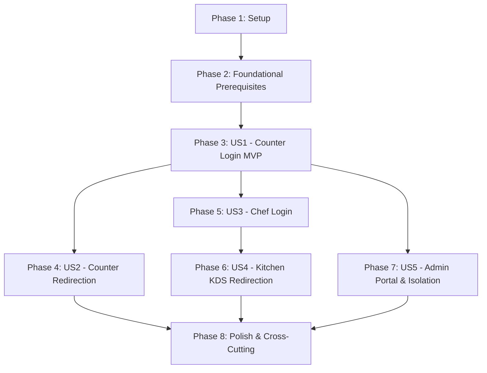

# Tasks: Staff Authentication Views and Automatic Role-Based Redirect Guards

**Input**: Design documents from `/specs/002-staff-auth-redirect-guards/` (`spec.md`, `plan.md`, `data-model.md`, `research.md`, `contracts/openapi.yaml`, `quickstart.md`)  
**Prerequisites**: `spec.md` (approved), `plan.md` (approved), `data-model.md`, `contracts/openapi.yaml`, `quickstart.md`  
**Constitution Compliance**: v1.1.0 (Principle X: Full-Stack Vertical Slice Integrity)  
**External Dependency**: Reuses centralized authentication service delivered in `001-central-auth-recovery` (`POST /api/v1/auth/login`, `GET /api/v1/auth/me`, `POST /api/v1/auth/logout`, `token_version` on `User` entity).  
**Tests**: Strict TDD methodology applied (Unit, component, router guard & security tests authored and failing before implementation; frontend-first for UI components, backend-first for filters and isolation).  
**Organization**: Tasks are grouped chronologically by Setup, Foundational, User Stories ([US1] through [US5]), and Polish to enable independent delivery and verifiable checkpoints.

---

## Format: `- [ ] [TaskID] [P?] [Story?] Description with exact file path`

- **[P]**: Can run in parallel (different files, no conflicting dependencies)
- **[Story]**: Belongs to user story phase (`[US1]`, `[US2]`, `[US3]`, `[US4]`, `[US5]`)
- Every task includes the exact target file path

---

## Phase 1: Setup (Frontend Scaffolding & Shared Client Baseline)

**Purpose**: Initialize frontend application dependencies, test runner, styling tokens, and HTTP client baseline.

- [X] T001 Configure frontend dependencies (React 18.3, Vite 5.4, React Router v6.27, Tailwind CSS 3.4, Lucide React, Vitest 2.1) in `easyeat/frontend/package.json`
- [X] T002 [P] Configure Vite application build and Vitest testing environment settings in `easyeat/frontend/vite.config.ts`
- [X] T003 [P] Configure TypeScript compiler options, JSX transform, and module resolution in `easyeat/frontend/tsconfig.json`
- [X] T004 [P] Configure Tailwind CSS utility classes and design tokens in `easyeat/frontend/tailwind.config.js` and `easyeat/frontend/src/index.css`
- [X] T005 Configure Axios HTTP client instance with base URL, standard JSON headers, and Bearer token injection in `easyeat/frontend/src/api/apiClient.ts`

---

## Phase 2: Foundational (Blocking Prerequisites)

**Purpose**: Verify backend authentication baseline from `001-central-auth-recovery` and implement shared reactive auth context, types, routing policies, decoupled login form, and common workspace shell.

**⚠️ CRITICAL**: Must complete before any user story work can execute.

- [X] T006 [P] Verify backend authentication baseline endpoints (`/login`, `/me`, `/logout`) and database token versioning in `easyeat/backend/src/main/java/com/easyeat/auth/controller/AuthController.java`
- [X] T007 [P] Verify backend SecurityConfig registers stateless session management, BCrypt cost 12, and `JwtAuthenticationFilter` in `easyeat/backend/src/main/java/com/easyeat/config/SecurityConfig.java`
- [X] T008 [P] Define frontend TypeScript types and interfaces (`Role`, `AuthenticatedUser`, `AuthContextState`, `LoginRequest`, `LoginResponse`, `JwtClaims`) in `easyeat/frontend/src/types/auth.ts`
- [X] T009 Implement pure role mapping and post-auth routing policy functions (`getRoleDefaultRoute`, `resolvePostAuthRedirect`) in `easyeat/frontend/src/router/postAuthRouting.ts`
- [X] T010 Implement `AuthContext` reactive state provider managing user identity, synchronous JWT decoding from `sessionStorage`, and logout state in `easyeat/frontend/src/context/AuthContext.tsx`
- [X] T011 [P] Implement `useAuth` custom hook exposing reactive auth state and action dispatchers in `easyeat/frontend/src/hooks/useAuth.ts`
- [X] T012 [P] Implement decoupled, role-agnostic controlled `LoginForm` component with validation, email normalization, submit debouncing, and anti-enumeration error handling in `easyeat/frontend/src/components/auth/LoginForm.tsx`
- [X] T013 [P] Implement `LoginPage` public route view wrapping `LoginForm` with responsive brand container in `easyeat/frontend/src/pages/LoginPage.tsx`
- [X] T014 [P] Implement `WorkspaceLayout` common wrapper component with role badge, tenant scope display, and logout action slot in `easyeat/frontend/src/components/common/WorkspaceLayout.tsx`
- [X] T015 [P] Implement diner catalog fallback view `CatalogPage` for role `COMENSAL` in `easyeat/frontend/src/pages/CatalogPage.tsx`

**Checkpoint**: Foundation ready — reactive state, types, routing helpers, decoupled login form, and common layouts are verified and ready for user story integration.

---

## Phase 3: User Story 1 — Counter Manager Credential Login (ENC-1.1.1) [US1] 🎯 MVP

**Goal**: Validate the shared staff credential authentication gateway for counter managers, verifying email normalization (trim/lowercase), anti-enumeration protection, and token contract verification against the login endpoint.

**Independent Test**: Execute `LoginForm.test.tsx` verifying client-side trimming/lowercasing, submit button debouncing, anti-enumeration generic 401 handling, and `AuthControllerContractTest.java` verifying JWT claim conformance (`user_id`, `role: ENCARGADO`, `tenant_id`, `token_version`).

### Tests for User Story 1 (TDD - Contract & Frontend First) ⚠️

- [X] T016 [P] [US1] Backend contract integration test verifying `POST /api/v1/auth/login` returns JWT carrying `role: ENCARGADO`, `user_id`, `tenant_id`, and `token_version` in `easyeat/backend/src/test/java/com/easyeat/auth/controller/AuthControllerContractTest.java`
- [X] T017 [P] [US1] Unit and interaction tests for `LoginForm` (email syntax check, whitespace trim, lowercasing, button debouncing, generic 401 error message, network failure display) in `easyeat/frontend/tests/components/LoginForm.test.tsx`

### Implementation for User Story 1

- [X] T018 [US1] Implement authentication service client function calling `POST /api/v1/auth/login` with typed request and response in `easyeat/frontend/src/api/authApi.ts`
- [X] T019 [US1] Verify end-to-end credential submission for `maria.encargada@laesquina.com` asserting valid token receipt and context initialization in `easyeat/frontend/tests/components/LoginForm.test.tsx`

**Checkpoint**: User Story 1 functional (MVP achieved) — counter staff credentials submitted via UI are validated, debounced, authenticated by the backend, and issue conforming identity tokens.

---

## Phase 4: User Story 2 — Automatic Redirection to Counter Workspace (ENC-1.2.1) [US2]

**Goal**: Automatically route authenticated counter managers immediately to their operational workspace (`/mostrador`), preserving authorized deep links and discarding unauthorized destination targets.

**Independent Test**: Execute `postAuthRouting.test.ts` verifying `/mostrador` destination mapping for `ENCARGADO` and `AppRoutes.test.tsx` asserting instant history replacement (`replace: true`).

### Tests for User Story 2 (TDD) ⚠️

- [X] T020 [P] [US2] Unit tests for `resolvePostAuthRedirect` verifying resolution to `/mostrador`, deep link preservation for counter paths, and discarding out-of-role targets in `easyeat/frontend/tests/router/postAuthRouting.test.ts`
- [X] T021 [P] [US2] Router navigation tests asserting instant transition to `/mostrador` with history replacement (`replace: true`) upon successful login in `easyeat/frontend/tests/router/AppRoutes.test.tsx`

### Implementation for User Story 2

- [X] T022 [US2] Implement `CounterWorkspacePage` landing view for `ENCARGADO` wrapped in `WorkspaceLayout` in `easyeat/frontend/src/pages/CounterWorkspacePage.tsx`
- [X] T023 [US2] Register `/mostrador/*` route perimeter in `easyeat/frontend/src/router/AppRoutes.tsx`

**Checkpoint**: User Story 2 functional — counter managers authenticate and are instantly routed to `/mostrador` without intermediate prompts or history pollution.

---

## Phase 5: User Story 3 — Kitchen Chef Credential Login (CHF-1.1.1) [US3]

**Goal**: Enable kitchen chefs to authenticate using their employee credentials through the shared portal, verifying active status and emitting structured security audit logs.

**Independent Test**: Execute backend tests asserting `role: CHEF` token claims and audit log emission, and verify inactive/suspended chef accounts are blocked with HTTP 403.

### Tests for User Story 3 (TDD) ⚠️

- [X] T024 [P] [US3] Backend test verifying chef authentication against `POST /api/v1/auth/login`, asserting `role: CHEF` claim and structured audit log emission in `easyeat/backend/src/test/java/com/easyeat/auth/controller/AuthControllerLoginTest.java`
- [X] T025 [P] [US3] Backend test asserting that suspended or unverified chef accounts receive HTTP 403 Forbidden with RFC 9457 ProblemDetail in `easyeat/backend/src/test/java/com/easyeat/auth/controller/AuthControllerLoginTest.java`

### Implementation for User Story 3

- [X] T026 [US3] Frontend integration test asserting chef login via shared `LoginForm` initializes active session state with `role: CHEF` in `easyeat/frontend/tests/context/AuthContext.test.tsx`

**Checkpoint**: User Story 3 functional — kitchen chefs authenticate securely through shared login form, suspended accounts are rejected, and audit logs record shift access.

---

## Phase 6: User Story 4 — Automatic Redirection to Kitchen Display System (CHF-1.2.1) [US4]

**Goal**: Automatically route authenticated chefs to `/cocina` (KDS view), resolving chef deep links and silently redirecting cross-role access attempts with history replacement.

**Independent Test**: Execute `RoleRouteGuard.test.tsx` proving non-chef roles attempting to access `/cocina` are silently routed to their own workspace without error banners.

### Tests for User Story 4 (TDD) ⚠️

- [ ] T027 [P] [US4] Unit tests for `RoleRouteGuard` verifying silent cross-role redirection to user's assigned workspace with `replace: true` in `easyeat/frontend/tests/router/RoleRouteGuard.test.tsx`
- [ ] T028 [P] [US4] Routing tests verifying deep link resolution for chef station URLs and fallback to `/cocina` in `easyeat/frontend/tests/router/postAuthRouting.test.ts`

### Implementation for User Story 4

- [ ] T029 [US4] Implement `KitchenWorkspacePage` landing view for `CHEF` wrapped in `WorkspaceLayout` in `easyeat/frontend/src/pages/KitchenWorkspacePage.tsx`
- [ ] T030 [US4] Implement declarative `RoleRouteGuard` component checking `allowedRoles`, preserving `state.from` on unauth, and executing silent redirect with `replace: true` in `easyeat/frontend/src/router/RoleRouteGuard.tsx`
- [ ] T031 [US4] Register protected `/cocina/*` route perimeter enforcing `allowedRoles={['CHEF']}` in `easyeat/frontend/src/router/AppRoutes.tsx`

**Checkpoint**: User Story 4 functional — chefs land directly on `/cocina`, and unauthorized cross-role access is silently redirected to the user's home workspace.

---

## Phase 7: User Story 5 — Back-Office Administrator Portal Access and Tenant Isolation (ADM-1.1.1) [US5]

**Goal**: Authenticate restaurant administrators into the back-office panel (`/admin`), enforcing strict multi-tenant scoping (`tenant_id`), standardized `ADMINISTRADOR` RBAC rules, and blocking cross-role access attempts.

**Independent Test**: Execute `TenantIsolationIntegrationTest.java` verifying tenant-scoped isolation in backend, and frontend tests asserting `ADMINISTRADOR` login redirection to `/admin`.

### Tests for User Story 5 (TDD) ⚠️

- [ ] T032 [P] [US5] Backend integration test execution verifying administrator endpoint access authorization and tenant-scoped query filtering by `tenant_id` in `easyeat/backend/src/test/java/com/easyeat/security/TenantIsolationIntegrationTest.java`
- [ ] T033 [P] [US5] Frontend test verifying administrator credential submission via shared `LoginForm` authenticates and routes to `/admin` in `easyeat/frontend/tests/components/AdminLogin.test.tsx`
- [ ] T034 [P] [US5] Routing test verifying administrator login redirects to `/admin` and cross-role attempts by non-admins are blocked in `easyeat/frontend/tests/router/RoleRouteGuard.test.tsx`

### Implementation for User Story 5

- [ ] T035 [US5] Implement `AdminWorkspacePage` landing view for `ADMINISTRADOR` displaying tenant scope in `easyeat/frontend/src/pages/AdminWorkspacePage.tsx`
- [ ] T036 [US5] Register protected `/admin/*` route perimeter enforcing `allowedRoles={['ADMINISTRADOR']}` in `easyeat/frontend/src/router/AppRoutes.tsx`
- [ ] T037 [US5] Standardize Spring Security RBAC rule `.requestMatchers("/api/v1/admin/**").hasRole("ADMINISTRADOR")` in `easyeat/backend/src/main/java/com/easyeat/config/SecurityConfig.java`

**Checkpoint**: User Story 5 functional — administrators access `/admin` with guaranteed multi-tenant data boundaries, and non-admins receive HTTP 403 on API routes.

---

## Phase 8: Polish & Cross-Cutting System Verification

**Purpose**: Implement single active session eviction on HTTP 401, dual-tier shift logout, OpenAPI contract conformance testing, and execute end-to-end quickstart scenarios.

- [ ] T038 [P] Integration test for single active session invalidation (stale `token_version` returns HTTP 401) in `easyeat/backend/src/test/java/com/easyeat/auth/security/JwtAuthenticationFilterTest.java`
- [ ] T039 [P] Integration test for client-side HTTP 401 interception, `sessionStorage` clearance, and expiration alert banner display in `easyeat/frontend/tests/session/SessionLifecycle.test.tsx`
- [ ] T040 Add Axios response interceptor in `apiClient` to intercept HTTP 401, clear `sessionStorage`, and dispatch session eviction event in `easyeat/frontend/src/api/apiClient.ts`
- [ ] T041 [P] Integration test for dual-tier logout verifying client storage purge and navigation in `easyeat/frontend/tests/session/LogoutFlow.test.tsx`
- [ ] T042 Implement `logout` method in `AuthContext` calling `authApi.logout()`, clearing `sessionStorage`, and navigating to `/login` with `replace: true` in `easyeat/frontend/src/context/AuthContext.tsx`
- [ ] T043 Wire "Cerrar sesión" action button in `WorkspaceLayout` to `useAuth().logout` in `easyeat/frontend/src/components/common/WorkspaceLayout.tsx`
- [ ] T044 [P] Contract conformance test validating live requests against `contracts/openapi.yaml` schemas in `easyeat/backend/src/test/java/com/easyeat/auth/contract/OpenApiContractTest.java`
- [ ] T045 [P] Execute end-to-end manual validation scenarios following quickstart guide in `specs/002-staff-auth-redirect-guards/quickstart.md`
- [ ] T046 Verify `Cache-Control: no-store` headers on protected auth and workspace endpoints in `easyeat/backend/src/main/java/com/easyeat/config/SecurityConfig.java`

---

## Dependencies & Execution Order

### Phase Dependencies

- **Setup (Phase 1)**: Independent — configures frontend dependencies, build settings, and HTTP client.
- **Foundational (Phase 2)**: Depends on Phase 1 — BLOCKS all user stories. Establishes types, routing resolver, reactive auth context, and workspace layout shell.
- **User Story 1 (Phase 3 - MVP)**: Depends on Phase 2. Establishes the login form and backend authentication.
- **User Story 2 (Phase 4)**: Depends on Phase 3 (consumes authenticated session). Establishes counter landing and post-auth redirect.
- **User Story 3 (Phase 5)**: Depends on Phase 3 (shares login form). Verifies chef authentication, audit logs, and account status.
- **User Story 4 (Phase 6)**: Depends on Phase 4 and Phase 5. Establishes kitchen workspace landing and declarative route guards.
- **User Story 5 (Phase 7)**: Depends on Phase 2 and Phase 3. Establishes admin panel landing and multi-tenant scoping.
- **Polish (Phase 8)**: Depends on all user story phases complete. Finalizes 401 session eviction, dual-tier logout, and OpenAPI validation.

---

## Parallel Opportunities Matrix

| Phase | Parallel Group A | Parallel Group B | Parallel Group C |
|---|---|---|---|
| **Phase 1** | `T002` (Vite config) | `T003` (tsconfig) | `T004` (Tailwind config) |
| **Phase 2** | `T006` (Backend baseline check) | `T007` (SecurityConfig check) | `T008` (TypeScript types) |
| **Phase 2** | `T011` (useAuth hook) | `T012` (LoginForm) | `T014` (WorkspaceLayout) |
| **Phase 3** | `T016` (Backend contract test) | `T017` (LoginForm test) | — |
| **Phase 4** | `T020` (Routing unit test) | `T021` (AppRoutes test) | — |
| **Phase 5** | `T024` (Chef login test) | `T025` (Suspended account test) | — |
| **Phase 6** | `T027` (Route guard test) | `T028` (Station deep link test) | — |
| **Phase 7** | `T032` (Tenant isolation test) | `T033` (Admin login test) | `T034` (Admin routing test) |
| **Phase 8** | `T038` (Filter test) | `T039` (Lifecycle test) | `T041` (Logout test) |
| **Phase 8** | `T044` (OpenAPI test) | `T045` (Quickstart manual scenarios) | — |

---

## Implementation & Verification Checkpoints

1. **Checkpoint 1 (Phase 2 Completion)**:
   - Verify `AuthContext`, `LoginForm`, `postAuthRouting`, and `types/auth.ts` compile without TypeScript errors (`npm run lint`).
2. **Checkpoint 2 (Phase 3 MVP Gate)**:
   - Run `LoginForm.test.tsx` and `AuthControllerContractTest.java`.
   - Confirm valid credentials authenticate and return token with `role: ENCARGADO`.
3. **Checkpoint 3 (Phase 4 Counter Routing Gate)**:
   - Run `postAuthRouting.test.ts` and `AppRoutes.test.tsx`.
   - Confirm automatic transition to `/mostrador` executes with history replacement.
4. **Checkpoint 4 (Phase 6 Kitchen KDS & Guard Gate)**:
   - Run `RoleRouteGuard.test.tsx`.
   - Confirm silent redirection prevents cross-role access to `/cocina` and back-button entrapment.
5. **Checkpoint 5 (Phase 7 Admin & Multi-Tenant Gate)**:
   - Run `TenantIsolationIntegrationTest.java` and `AdminLogin.test.tsx`.
   - Confirm administrator operations scope records strictly by `tenant_id` and non-admins receive HTTP 403.
6. **Checkpoint 6 (Final Feature Completion)**:
   - Run full frontend test suite (`npm test`).
   - Run full backend test suite (`mvn test`).
   - Execute all 5 manual scenarios from `quickstart.md`.
