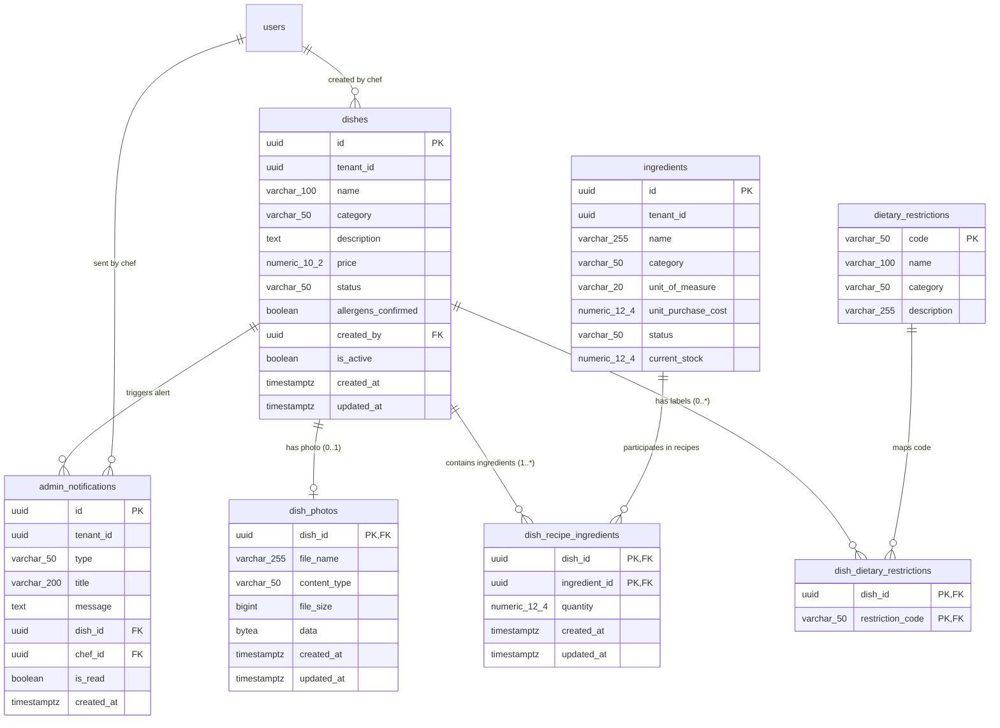
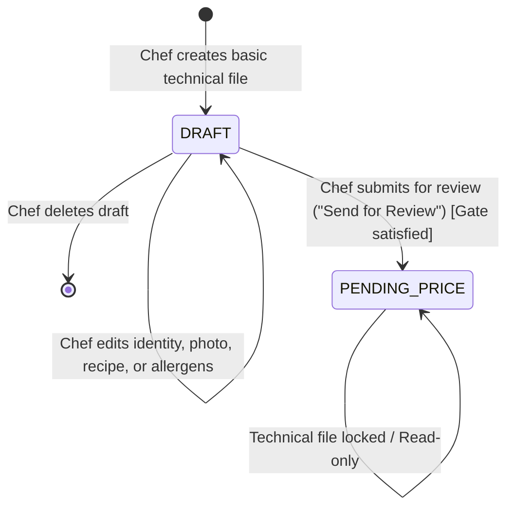

# Data Model: Chef Dish Technical File Management

**Branch**: `005-chef-dish-management` | **Date**: 25/10/2026 | **Specification**: [spec.md](file:///f:/ALL/PROGRAMACION/Proyectos/SDD/sdd%20-%20gdsi%20-%20grupo%2012/specs/005-chef-dish-management/spec.md)

---

## 1. Domain entities

### 1.1. Dish / Technical File (`Dish`)
Represents the culinary technical file authored by kitchen staff.

| Attribute | Data type | Nullable | Description and rules |
|---|---|---|---|
| `id` | UUID | No | Primary key automatically generated (`gen_random_uuid()`). |
| `tenant_id` | UUID | No | Restaurant establishment identifier (multi-tenant isolation). |
| `name` | VARCHAR(100) | No | Dish name (maximum 100 characters). Must be unique per tenant after applying case-insensitive trimming (`LOWER(TRIM(name))`). |
| `category` | VARCHAR(50) | No | Closed culinary category: `'Entradas'`, `'Platos principales'`, `'Postres'`, `'Bebidas'`, `'Ensaladas'`. |
| `description` | TEXT / VARCHAR(500) | Yes | Diner-facing description (maximum 500 characters). |
| `status` | VARCHAR(50) | No | Dish lifecycle status: `'DRAFT'` or `'PENDING_PRICE'`. Default `'DRAFT'`. |
| `allergens_confirmed` | BOOLEAN | No | Indicates whether the Chef explicitly confirmed the allergen declaration. Default `FALSE`. |
| `created_by` | UUID | Yes | Identifier of the Chef user who created the draft (`users.id`). |
| `price` | NUMERIC(10, 2) | Yes | Selling price. Null during `DRAFT` and `PENDING_PRICE`. Assigned by Administrator in later stages. |
| `is_active` | BOOLEAN | No | Maintained for backward compatibility with spec 003. Default `FALSE` on new drafts. |
| `created_at` | TIMESTAMPTZ | No | Creation timestamp (`NOW()`). Immutable. |
| `updated_at` | TIMESTAMPTZ | No | Last modification timestamp (`NOW()`). |

### 1.2. Dish Photo (`DishPhoto`)
Stores the binary and metadata of the optional dish photo in PostgreSQL.

| Attribute | Data type | Nullable | Description and rules |
|---|---|---|---|
| `dish_id` | UUID | No | Primary key and foreign key referencing `dishes(id)` with `ON DELETE CASCADE`. 1:1 or 1:0 relationship. |
| `file_name` | VARCHAR(255) | No | Original uploaded filename. |
| `content_type` | VARCHAR(50) | No | Validated MIME type: `'image/jpeg'`, `'image/png'`, `'image/webp'`. |
| `file_size` | BIGINT | No | Size in bytes. Maximum 5 MB (`5242880` bytes). |
| `data` | BYTEA | No | Binary image payload. |
| `created_at` | TIMESTAMPTZ | No | Initial upload timestamp. |
| `updated_at` | TIMESTAMPTZ | No | Last update timestamp. |

### 1.3. Recipe Ingredient Line (`DishRecipeIngredient`)
Composite relational relationship in third normal form (3NF) between the dish and a master inventory supply item.

| Attribute | Data type | Nullable | Description and rules |
|---|---|---|---|
| `dish_id` | UUID | No | Composite primary key and foreign key referencing `dishes(id)` with `ON DELETE CASCADE`. |
| `ingredient_id` | UUID | No | Composite primary key and foreign key referencing `ingredients(id)` with `ON DELETE RESTRICT`. |
| `quantity` | NUMERIC(12, 4) | No | Required per-portion quantity. Must be strictly positive (`> 0`). Integer if unit is `'u'`; up to 4 decimal places if continuous. |
| `created_at` | TIMESTAMPTZ | No | Timestamp of addition to recipe. |
| `updated_at` | TIMESTAMPTZ | No | Timestamp of quantity modification. |

*Note on 3NF*: Unit of measure (`unit_of_measure`) is not persisted in this table, as it depends functionally on `ingredient_id`. It is resolved via `JOIN` with the `ingredients` table.

### 1.4. Dietary & Allergen Label (`DishDietaryRestriction`)
Association between the dish and the existing taxonomy in `dietary_restrictions` (created in migration V5).

| Attribute | Data type | Nullable | Description and rules |
|---|---|---|---|
| `dish_id` | UUID | No | Foreign key referencing `dishes(id)` with `ON DELETE CASCADE`. |
| `restriction_code` | VARCHAR(50) | No | Foreign key referencing `dietary_restrictions(code)` with `ON DELETE RESTRICT`. |

Composite primary key: `(dish_id, restriction_code)`.

### 1.5. Internal Administrator Notification (`AdminNotification`)
Relational alert generated automatically upon submitting a dish for review.

| Attribute | Data type | Nullable | Description and rules |
|---|---|---|---|
| `id` | UUID | No | Primary key (`gen_random_uuid()`). |
| `tenant_id` | UUID | No | Destination establishment identifier. |
| `type` | VARCHAR(50) | No | Notification type: `'DISH_SUBMITTED_FOR_REVIEW'`. |
| `title` | VARCHAR(200) | No | Alert title (e.g., `'Nuevo plato enviado a revisión'`). |
| `message` | TEXT | No | Detailed description including dish name and Chef name/email. |
| `dish_id` | UUID | No | Foreign key referencing `dishes(id)` with `ON DELETE CASCADE`. |
| `chef_id` | UUID | No | Foreign key referencing `users(id)` with `ON DELETE RESTRICT`. |
| `is_read` | BOOLEAN | No | Read status. Default `FALSE`. |
| `created_at` | TIMESTAMPTZ | No | Notification dispatch timestamp. |

---

## 2. Entity-Relationship diagram (Mermaid)



---

## 3. Dish state machine (`DishStatus`)



### Transition rules
1. **Initial creation**:
   - `DRAFT`: The dish is created upon completing name and category.
2. **Editing and deletion in `DRAFT`**:
   - Arbitrary modifications to name, category, description, photo, recipe, and allergen confirmation are permitted.
   - Physical deletion (`DELETE`) cascades to child tables.
3. **Transition gate `DRAFT` -> `PENDING_PRICE`**:
   - The 4 completeness conditions are evaluated:
     1. Non-empty name and valid category.
     2. At least 1 ingredient in the recipe with quantity `> 0`.
     3. All ingredients in the recipe in `'ACTIVE'` status in the `ingredients` table.
     4. Allergen section formally confirmed (`allergens_confirmed = TRUE`).
   - If one or more fail: The dish remains in `DRAFT` and an error `422 Unprocessable Entity` is returned with failure details.
   - If all pass: The dish transitions to `PENDING_PRICE`, the alert is issued in `admin_notifications`, and the technical file is locked.
4. **Immutability in `PENDING_PRICE`**:
   - Any modification attempt (`PUT`, `DELETE`, photo upload, recipe alteration, or allergen update) is rejected with error `409 Conflict`.

---

## 4. Flyway migration design (`V7__chef_dish_management.sql`)

```sql
-- ====================================================================
-- EasyEat V7: Chef Dish Management - Schema Evolution and BOM Model
-- ====================================================================

-- 1. Modificar tabla dishes existente
ALTER TABLE dishes
    ALTER COLUMN price DROP NOT NULL,
    ALTER COLUMN name TYPE VARCHAR(100),
    ADD COLUMN IF NOT EXISTS category VARCHAR(50),
    ADD COLUMN IF NOT EXISTS status VARCHAR(50) NOT NULL DEFAULT 'DRAFT',
    ADD COLUMN IF NOT EXISTS allergens_confirmed BOOLEAN NOT NULL DEFAULT FALSE,
    ADD COLUMN IF NOT EXISTS created_by UUID REFERENCES users(id);

-- Restricciones CHECK para dishes
ALTER TABLE dishes
    ADD CONSTRAINT chk_dishes_category
        CHECK (category IS NULL OR category IN ('Entradas', 'Platos principales', 'Postres', 'Bebidas', 'Ensaladas')),
    ADD CONSTRAINT chk_dishes_status
        CHECK (status IN ('DRAFT', 'PENDING_PRICE')),
    ADD CONSTRAINT chk_dishes_name_length
        CHECK (LENGTH(TRIM(name)) > 0 AND LENGTH(name) <= 100);

-- Indice unico insensible a mayusculas y recortado por tenant
CREATE UNIQUE INDEX IF NOT EXISTS uq_dishes_tenant_lower_trimmed_name
    ON dishes (tenant_id, LOWER(TRIM(name)));

-- Indice para listado y ordenamiento del Chef
CREATE INDEX IF NOT EXISTS idx_dishes_chef_list
    ON dishes (tenant_id, status, updated_at DESC);

-- 2. Tabla para almacenamiento de fotos en base de datos (PostgreSQL BYTEA)
CREATE TABLE IF NOT EXISTS dish_photos (
    dish_id      UUID         PRIMARY KEY REFERENCES dishes(id) ON DELETE CASCADE,
    file_name    VARCHAR(255) NOT NULL,
    content_type VARCHAR(50)  NOT NULL,
    file_size    BIGINT       NOT NULL,
    data         BYTEA        NOT NULL,
    created_at   TIMESTAMPTZ  NOT NULL DEFAULT NOW(),
    updated_at   TIMESTAMPTZ  NOT NULL DEFAULT NOW(),
    CONSTRAINT chk_dish_photos_content_type
        CHECK (content_type IN ('image/jpeg', 'image/png', 'image/webp')),
    CONSTRAINT chk_dish_photos_file_size
        CHECK (file_size > 0 AND file_size <= 5242880)
);

-- 3. Tabla relacional de receta / Bill of Materials (3NF estricta)
CREATE TABLE IF NOT EXISTS dish_recipe_ingredients (
    dish_id       UUID           NOT NULL REFERENCES dishes(id) ON DELETE CASCADE,
    ingredient_id UUID           NOT NULL REFERENCES ingredients(id) ON DELETE RESTRICT,
    quantity      NUMERIC(12, 4) NOT NULL,
    created_at    TIMESTAMPTZ    NOT NULL DEFAULT NOW(),
    updated_at    TIMESTAMPTZ    NOT NULL DEFAULT NOW(),
    CONSTRAINT pk_dish_recipe_ingredients PRIMARY KEY (dish_id, ingredient_id),
    CONSTRAINT chk_recipe_quantity_positive CHECK (quantity > 0)
);

CREATE INDEX IF NOT EXISTS idx_recipe_ingredients_lookup
    ON dish_recipe_ingredients (ingredient_id);

-- 4. Tabla de notificaciones administrativas internas
CREATE TABLE IF NOT EXISTS admin_notifications (
    id         UUID         PRIMARY KEY DEFAULT gen_random_uuid(),
    tenant_id  UUID         NOT NULL,
    type       VARCHAR(50)  NOT NULL,
    title      VARCHAR(200) NOT NULL,
    message    TEXT         NOT NULL,
    dish_id    UUID         NOT NULL REFERENCES dishes(id) ON DELETE CASCADE,
    chef_id    UUID         NOT NULL REFERENCES users(id) ON DELETE RESTRICT,
    is_read    BOOLEAN      NOT NULL DEFAULT FALSE,
    created_at TIMESTAMPTZ  NOT NULL DEFAULT NOW()
);

CREATE INDEX IF NOT EXISTS idx_admin_notifications_tenant_read
    ON admin_notifications (tenant_id, is_read, created_at DESC);
```
