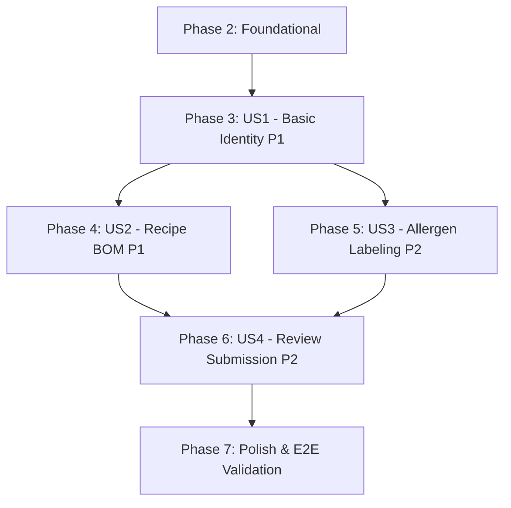

# Implementation Tasks: Chef Dish Management — Technical File Creation and Submission

**Feature**: Chef Dish Management — Technical File Creation and Submission  
**Branch**: `005-chef-dish-management`  
**Spec**: [spec.md](./spec.md) | **Plan**: [plan.md](./plan.md)  
**Data Model**: [data-model.md](./data-model.md) | **Contracts**: [contracts/](./contracts/) | **Quickstart**: [quickstart.md](./quickstart.md)  
**GitHub Issues**: [#128](https://github.com/ValentinoCarmonaS/G12---GDSI/issues/128), [#129](https://github.com/ValentinoCarmonaS/G12---GDSI/issues/129), [#130](https://github.com/ValentinoCarmonaS/G12---GDSI/issues/130), [#131](https://github.com/ValentinoCarmonaS/G12---GDSI/issues/131), [#132](https://github.com/ValentinoCarmonaS/G12---GDSI/issues/132), [#133](https://github.com/ValentinoCarmonaS/G12---GDSI/issues/133), [#134](https://github.com/ValentinoCarmonaS/G12---GDSI/issues/134)  

---

## Phase 1: Setup (Shared Infrastructure & Test Fixtures) — [Issue #128](https://github.com/ValentinoCarmonaS/G12---GDSI/issues/128)

**Purpose**: Set up test fixtures, declare custom domain exceptions, map RFC 7807 ProblemDetail responses, and establish shared frontend TypeScript types.

- [X] T001 [P] Create base test support fixtures and builders for dishes and tenant in `easyeat/backend/src/test/java/com/easyeat/dish/DishTestFixtures.java`
- [X] T002 [P] Create base web test support class with security helpers in `easyeat/backend/src/test/java/com/easyeat/dish/controller/DishControllerTestBase.java`
- [X] T003 [P] Create frontend API mock handlers and server setup for dishes in `easyeat/frontend/tests/mocks/dishHandlers.ts`
- [X] T004 [P] Create domain exceptions (`DishNotFoundException`, `DishLockedException`, `DuplicateDishNameException`, `IncompleteDishException`, `InvalidIngredientException`, `InvalidQuantityException`, `PhotoStorageException`) in `easyeat/backend/src/main/java/com/easyeat/dish/exception/`
- [X] T005 Update `GlobalExceptionHandler.java` in `easyeat/backend/src/main/java/com/easyeat/auth/controller/GlobalExceptionHandler.java` mapping custom dish exceptions to RFC 7807/9457 `ProblemDetail` responses with status codes 400, 404, 409, and 422
- [X] T006 [P] Create shared TypeScript interfaces and enums for dishes, recipe lines, and notifications in `easyeat/frontend/src/types/dish.ts` and `easyeat/frontend/src/types/notification.ts`

---

## Phase 2: Foundational (Database Migrations, Core Entities & Security) — [Issue #129](https://github.com/ValentinoCarmonaS/G12---GDSI/issues/129)

**Purpose**: Database schema evolution, dev seed data adaptation, baseline JPA entities, and security filter permissions blocking all user stories.

**⚠️ CRITICAL**: No user story implementation can proceed until this phase is complete and verified.

- [X] T007 [P] Create Flyway migration script `V7__chef_dish_management.sql` in `easyeat/backend/src/main/resources/db/migration/V7__chef_dish_management.sql` (evolving `dishes` to make price nullable, adding category, status, allergens_confirmed, created_by, unique index, creating `dish_photos`, `dish_recipe_ingredients`, and `admin_notifications` tables)
- [X] T008 [P] Update dev seed script `R__seed_dev_dishes_and_dietary.sql` in `easyeat/backend/src/main/resources/db/dev/R__seed_dev_dishes_and_dietary.sql` populating categories, `allergens_confirmed = true`, `created_by = admin`, and `status = 'PENDING_PRICE'` for the 5 existing seed dishes
- [X] T009 [P] Create domain enums `DishCategory` and `DishStatus` in `easyeat/backend/src/main/java/com/easyeat/dish/domain/DishCategory.java` and `easyeat/backend/src/main/java/com/easyeat/dish/domain/DishStatus.java`
- [X] T010 [P] Update `Dish` entity in `easyeat/backend/src/main/java/com/easyeat/catalog/domain/Dish.java` mapping new columns `category`, `status`, `allergens_confirmed`, `created_by`, and making `price` nullable
- [X] T011 [P] Create `DishPhoto` JPA entity in `easyeat/backend/src/main/java/com/easyeat/dish/domain/DishPhoto.java` mapping `dish_id`, `file_name`, `content_type`, `file_size`, `data` (BYTEA), `created_at`, and `updated_at`
- [X] T012 [P] Create `DishRecipeIngredient` and composite PK `DishRecipeIngredientId` in `easyeat/backend/src/main/java/com/easyeat/dish/domain/DishRecipeIngredient.java` and `easyeat/backend/src/main/java/com/easyeat/dish/domain/DishRecipeIngredientId.java`
- [X] T013 [P] Create `AdminNotification` entity and `NotificationType` enum in `easyeat/backend/src/main/java/com/easyeat/notification/domain/AdminNotification.java` and `easyeat/backend/src/main/java/com/easyeat/notification/domain/NotificationType.java`
- [X] T014 [P] Create repository interfaces `DishPhotoRepository`, `DishRecipeIngredientRepository`, and `AdminNotificationRepository` in `easyeat/backend/src/main/java/com/easyeat/dish/repository/` and `easyeat/backend/src/main/java/com/easyeat/notification/repository/`
- [ ] T015 Update `DishRepository` in `easyeat/backend/src/main/java/com/easyeat/catalog/repository/DishRepository.java` adding tenant-scoped paginated queries and case-insensitive trimmed name uniqueness check (`existsByTenantIdAndNameLowerTrimmed`)
- [ ] T016 Update `SecurityConfig.java` in `easyeat/backend/src/main/java/com/easyeat/config/SecurityConfig.java` configuring role boundaries (`/api/v1/dishes/**` requires `CHEF`, `/api/v1/admin/notifications/**` requires `ADMINISTRADOR`)
- [ ] T017 Integration test `V7MigrationAndSeedDevTest` in `easyeat/backend/src/test/java/com/easyeat/dish/migration/V7MigrationAndSeedDevTest.java` running against Testcontainers PostgreSQL to verify V7 schema migration and seed compatibility

**Checkpoint**: Foundational database schema, entity mappings, and security boundaries verified.

---

## Phase 3: User Story 1 — Basic Dish Identity & Photo (Priority: P1) 🎯 MVP — [Issue #130](https://github.com/ValentinoCarmonaS/G12---GDSI/issues/130)

**Goal**: Allow Chefs to create, view, edit, delete, and list draft technical files with name, category, description, and optional photo (max 5 MB JPEG/PNG/WebP), enforcing whitespace-trimmed case-insensitive name uniqueness within the establishment.

**Independent Test**: Log in as Chef, create a dish draft with name and category (description and photo optional), verify it appears in draft list with status "Draft", verify name collision rejection on trimmed duplicate, upload/delete a 2.5 MB photo, and confirm permanent draft deletion.

### Tests for User Story 1 (TDD & Behavioral Acceptance - Write First) ⚠️

- [ ] T018 [P] [US1] Unit test `DishBasicServiceTest` in `easyeat/backend/src/test/java/com/easyeat/dish/service/DishBasicServiceTest.java` validating name whitespace trimming, tenant uniqueness constraint, closed category validation, draft deletion, and character limits (100 name, 500 description)
- [ ] T019 [P] [US1] Unit test `DishPhotoServiceTest` in `easyeat/backend/src/test/java/com/easyeat/dish/service/DishPhotoServiceTest.java` validating MIME types (JPEG, PNG, WebP), 5 MB file size limit rejection, and photo deletion in draft status
- [ ] T020 [P] [US1] Web contract test `DishControllerBasicTest` in `easyeat/backend/src/test/java/com/easyeat/dish/controller/DishControllerBasicTest.java` verifying `POST /api/v1/dishes`, `GET /api/v1/dishes`, `GET /api/v1/dishes/{id}`, `PUT /api/v1/dishes/{id}`, and `DELETE /api/v1/dishes/{id}` against OpenAPI schema
- [ ] T021 [P] [US1] Web contract test `DishPhotoControllerTest` in `easyeat/backend/src/test/java/com/easyeat/dish/controller/DishPhotoControllerTest.java` verifying `POST /api/v1/dishes/{id}/photo`, `GET /api/v1/dishes/{id}/photo`, and `DELETE /api/v1/dishes/{id}/photo`
- [ ] T022 [P] [US1] Behavioral acceptance test `DishBasicAcceptanceTest` in `easyeat/backend/src/test/java/com/easyeat/dish/acceptance/DishBasicAcceptanceTest.java` covering User Story 1 acceptance scenarios using JUnit 5 and Testcontainers
- [ ] T023 [P] [US1] Frontend component test `BasicIdentityStep.test.tsx` in `easyeat/frontend/tests/components/dish/BasicIdentityStep.test.tsx` verifying form inputs, live validation, character counter, and photo upload/removal preview
- [ ] T024 [P] [US1] Frontend page test `ChefDishesPage.test.tsx` in `easyeat/frontend/tests/pages/ChefDishesPage.test.tsx` verifying paginated table rendering (20 items/page), sorting by `updated_at DESC`, and status filter dropdown
- [ ] T025 [P] [US1] Frontend user journey integration test `us1_basic_identity.test.tsx` in `easyeat/frontend/tests/integration/us1_basic_identity.test.tsx` verifying draft creation, photo upload, and listing flow using Vitest

### Implementation for User Story 1

- [ ] T026 [P] [US1] Create basic dish DTOs (`CreateDishRequest`, `UpdateDishRequest`, `DishSummaryResponse`, `DishDetailResponse`, `DishPageResponse`, `PhotoUploadResponse`) in `easyeat/backend/src/main/java/com/easyeat/dish/dto/` matching OpenAPI contract
- [ ] T027 [US1] Implement `DishPhotoService` in `easyeat/backend/src/main/java/com/easyeat/dish/service/DishPhotoService.java` handling binary image validation (MIME, 5 MB limit), persistence in `dish_photos`, byte streaming, and deletion
- [ ] T028 [US1] Implement core `DishService` basic identity methods in `easyeat/backend/src/main/java/com/easyeat/dish/service/DishService.java` for creating drafts, updating basic info, deleting drafts, fetching details, and paginating establishment dishes
- [ ] T029 [US1] Implement `DishController` basic endpoints and `DishPhotoController` in `easyeat/backend/src/main/java/com/easyeat/dish/controller/` guarded with `@PreAuthorize("hasRole('CHEF')")`
- [ ] T030 [P] [US1] Implement frontend API client `dishApi.ts` in `easyeat/frontend/src/api/dishApi.ts` with methods for draft CRUD, photo upload/retrieval/deletion, and paginated listing
- [ ] T031 [P] [US1] Implement `DishStatusBadge.tsx` in `easyeat/frontend/src/components/dish/DishStatusBadge.tsx` displaying visual status badges for `Draft` and `Pending Price`
- [ ] T032 [P] [US1] Implement `BasicIdentityStep.tsx` in `easyeat/frontend/src/components/dish/BasicIdentityStep.tsx` with name trimming, category selector, description counter, and photo dropzone with preview/delete
- [ ] T033 [US1] Implement `ChefDishesPage.tsx` in `easyeat/frontend/src/pages/ChefDishesPage.tsx` with 20 items/page pagination, status filter ("All", "Draft", "Pending Price"), and new dish creation action
- [ ] T034 [US1] Configure route definitions `/cocina/platos`, `/cocina/platos/nuevo`, `/cocina/platos/:id` in `easyeat/frontend/src/router/AppRoutes.tsx` and add dish management navigation card in `easyeat/frontend/src/pages/KitchenWorkspacePage.tsx`

**Checkpoint**: User Story 1 (MVP) fully functional and testable independently.

---

## Phase 4: User Story 2 — Recipe Definition (BOM) (Priority: P1) — [Issue #131](https://github.com/ValentinoCarmonaS/G12---GDSI/issues/131)

**Goal**: Allow Chefs to compose the dish recipe by selecting Active ingredients from the establishment catalog (20/page, A-Z), specifying strictly positive quantities with unit-of-measure precision enforcement, and rejecting duplicate ingredients.

**Independent Test**: Open a draft recipe, search Active ingredients, add ingredients with valid positive quantities, verify unit precision (integers for 'u', decimals for 'g'/'kg'/'ml'/'l'), attempt to add a duplicate ingredient and verify warning/update offer, and delete a recipe line.

### Tests for User Story 2 (TDD & Behavioral Acceptance - Write First) ⚠️

- [ ] T035 [P] [US2] Unit test `DishRecipeServiceTest` in `easyeat/backend/src/test/java/com/easyeat/dish/service/DishRecipeServiceTest.java` validating strictly positive quantity rejection (<= 0), discrete unit integer scaling ('u'), continuous unit decimal scaling, active ingredient validation, duplicate rejection, and line deletion
- [ ] T036 [P] [US2] Web contract test `DishRecipeControllerTest` in `easyeat/backend/src/test/java/com/easyeat/dish/controller/DishRecipeControllerTest.java` verifying `PUT /api/v1/dishes/{id}/recipe` and `DELETE /api/v1/dishes/{id}/recipe/ingredients/{ingredientId}` against OpenAPI schema
- [ ] T037 [P] [US2] Behavioral acceptance test `DishRecipeAcceptanceTest` in `easyeat/backend/src/test/java/com/easyeat/dish/acceptance/DishRecipeAcceptanceTest.java` covering User Story 2 acceptance scenarios using JUnit 5 and Testcontainers
- [ ] T038 [P] [US2] Frontend component test `IngredientSelectorModal.test.tsx` in `easyeat/frontend/tests/components/dish/IngredientSelectorModal.test.tsx` verifying search by name, category filtering, 20 items per page pagination, and exclusion of discontinued ingredients
- [ ] T039 [P] [US2] Frontend component test `RecipeBOMStep.test.tsx` in `easyeat/frontend/tests/components/dish/RecipeBOMStep.test.tsx` verifying quantity entry masking, duplicate ingredient alert, and recipe line removal
- [ ] T040 [P] [US2] Frontend user journey integration test `us2_recipe_definition.test.tsx` in `easyeat/frontend/tests/integration/us2_recipe_definition.test.tsx` verifying end-to-end recipe composition using Vitest

### Implementation for User Story 2

- [ ] T041 [P] [US2] Create Recipe DTOs (`RecipeUpdateRequest`, `RecipeResponse`, `RecipeIngredientItem`) in `easyeat/backend/src/main/java/com/easyeat/dish/dto/` matching OpenAPI contract
- [ ] T042 [US2] Implement recipe management logic in `DishService` in `easyeat/backend/src/main/java/com/easyeat/dish/service/DishService.java` (upserting recipe lines, joining `unit_of_measure` dynamically in 3NF from `ingredients`, validating positive quantities and discrete vs continuous precision, and removing recipe lines)
- [ ] T043 [US2] Add recipe endpoints `PUT /api/v1/dishes/{id}/recipe` and `DELETE /api/v1/dishes/{id}/recipe/ingredients/{ingredientId}` to `DishController` in `easyeat/backend/src/main/java/com/easyeat/dish/controller/DishController.java`
- [ ] T044 [P] [US2] Implement `IngredientSelectorModal.tsx` in `easyeat/frontend/src/components/dish/IngredientSelectorModal.tsx` querying Chef active ingredients catalog (20/page, A-Z) with category and text filters
- [ ] T045 [P] [US2] Implement `RecipeBOMStep.tsx` in `easyeat/frontend/src/components/dish/RecipeBOMStep.tsx` with recipe ingredients table, unit display, input masks (integer/decimal), duplicate warning banner, and delete actions
- [ ] T046 [US2] Integrate `RecipeBOMStep.tsx` and `IngredientSelectorModal.tsx` into `ChefDishEditorPage.tsx` in `easyeat/frontend/src/pages/ChefDishEditorPage.tsx`

**Checkpoint**: User Stories 1 and 2 fully functional. Dishes can be authored with full BOM recipes.

---

## Phase 5: User Story 3 — Allergen and Dietary Labeling (Priority: P2) — [Issue #132](https://github.com/ValentinoCarmonaS/G12---GDSI/issues/132)

**Goal**: Allow Chefs to tag dishes with dietary lifestyle claims (`VEGAN`, `VEGETARIAN` positive; `CELIAC` warning) and common allergen warnings (`DAIRY`, `PEANUTS`, etc.) from the platform taxonomy, with an explicit required confirmation action (`allergens_confirmed = true`).

**Independent Test**: Open the allergen section of a draft, select warning labels and/or lifestyle tags, verify zero labels is a valid state, trigger explicit "Confirm allergen section" action, and confirm that `allergens_confirmed = true` is persisted.

### Tests for User Story 3 (TDD & Behavioral Acceptance - Write First) ⚠️

- [ ] T047 [P] [US3] Unit test `DishAllergenServiceTest` in `easyeat/backend/src/test/java/com/easyeat/dish/service/DishAllergenServiceTest.java` verifying taxonomy code mapping against `dietary_restrictions`, zero-label confirmed validity, explicit `allergens_confirmed` persistence, and edit rejection when not in `DRAFT`
- [ ] T048 [P] [US3] Web contract test `DishAllergenControllerTest` in `easyeat/backend/src/test/java/com/easyeat/dish/controller/DishAllergenControllerTest.java` verifying `PUT /api/v1/dishes/{id}/allergens` against OpenAPI schema
- [ ] T049 [P] [US3] Behavioral acceptance test `DishAllergenAcceptanceTest` in `easyeat/backend/src/test/java/com/easyeat/dish/acceptance/DishAllergenAcceptanceTest.java` covering User Story 3 acceptance scenarios using JUnit 5 and Testcontainers
- [ ] T050 [P] [US3] Frontend component test `AllergenStep.test.tsx` in `easyeat/frontend/tests/components/dish/AllergenStep.test.tsx` verifying grouping into Dietary Lifestyles and Common Allergens, multi-selection, and explicit confirmation toggle behavior
- [ ] T051 [P] [US3] Frontend user journey integration test `us3_allergen_labeling.test.tsx` in `easyeat/frontend/tests/integration/us3_allergen_labeling.test.tsx` verifying allergen labeling and explicit confirmation flow using Vitest

### Implementation for User Story 3

- [ ] T052 [P] [US3] Create Allergen DTOs (`AllergenUpdateRequest`, `AllergenResponse`) in `easyeat/backend/src/main/java/com/easyeat/dish/dto/` matching OpenAPI contract
- [ ] T053 [US3] Implement allergen update and confirmation logic in `DishService` in `easyeat/backend/src/main/java/com/easyeat/dish/service/DishService.java` managing `dish_dietary_restrictions` join table and `allergens_confirmed` flag
- [ ] T054 [US3] Add allergen endpoint `PUT /api/v1/dishes/{id}/allergens` to `DishController` in `easyeat/backend/src/main/java/com/easyeat/dish/controller/DishController.java`
- [ ] T055 [P] [US3] Implement `AllergenStep.tsx` in `easyeat/frontend/src/components/dish/AllergenStep.tsx` rendering Dietary Lifestyles and Common Allergens groups with clear warning indicators and explicit "Confirm allergen section" button
- [ ] T056 [US3] Integrate `AllergenStep.tsx` into `ChefDishEditorPage.tsx` in `easyeat/frontend/src/pages/ChefDishEditorPage.tsx`

**Checkpoint**: User Stories 1, 2, and 3 functional. Fiche technique contains identity, recipe BOM, and confirmed allergen tags.

---

## Phase 6: User Story 4 — Submission for Administrator Review (Priority: P2) — [Issue #133](https://github.com/ValentinoCarmonaS/G12---GDSI/issues/133)

**Goal**: Evaluate completeness conditions, transition complete drafts to `PENDING_PRICE`, lock dishes against all Chef modifications, generate internal administrator alerts, and allow Administrators to query notifications and mark them as read.

**Independent Test**: Complete all draft sections, verify that "Send for Review" is blocked with detailed condition feedback if any criterion is unmet, submit complete draft, verify status changes to "Pending Price", confirm all edit/delete actions return 409 Conflict, verify new alert in Administrator panel, and mark alert as read.

### Tests for User Story 4 (TDD & Behavioral Acceptance - Write First) ⚠️

- [ ] T057 [P] [US4] Unit test `DishSubmissionServiceTest` in `easyeat/backend/src/test/java/com/easyeat/dish/service/DishSubmissionServiceTest.java` validating completeness gate (name, category, >=1 recipe line with quantity > 0, all ingredients Active, allergens confirmed), atomic transition to `PENDING_PRICE`, notification generation, and strict edit/delete rejection on locked dishes
- [ ] T058 [P] [US4] Unit test `AdminNotificationServiceTest` in `easyeat/backend/src/test/java/com/easyeat/notification/service/AdminNotificationServiceTest.java` validating notification creation, tenant-scoped unread queries, and mark-as-read updates
- [ ] T059 [P] [US4] Web contract test `DishSubmissionControllerTest` in `easyeat/backend/src/test/java/com/easyeat/dish/controller/DishSubmissionControllerTest.java` verifying `POST /api/v1/dishes/{id}/submit-review` against OpenAPI schema
- [ ] T060 [P] [US4] Web contract test `AdminNotificationControllerTest` in `easyeat/backend/src/test/java/com/easyeat/notification/controller/AdminNotificationControllerTest.java` verifying `GET /api/v1/admin/notifications` and `PATCH /api/v1/admin/notifications/{id}/read`
- [ ] T061 [P] [US4] Behavioral acceptance test `DishSubmissionAcceptanceTest` in `easyeat/backend/src/test/java/com/easyeat/dish/acceptance/DishSubmissionAcceptanceTest.java` covering User Story 4 acceptance scenarios using JUnit 5 and Testcontainers
- [ ] T062 [P] [US4] Frontend component test `ReviewSubmitStep.test.tsx` in `easyeat/frontend/tests/components/dish/ReviewSubmitStep.test.tsx` verifying completeness checklist indicators, reactive enable/disable of "Send for Review", and submission confirmation
- [ ] T063 [P] [US4] Frontend component test `AdminNotificationBell.test.tsx` in `easyeat/frontend/tests/components/notification/AdminNotificationBell.test.tsx` verifying unread alert badge, notifications dropdown, and mark-as-read click trigger
- [ ] T064 [P] [US4] Frontend user journey integration test `us4_review_submission.test.tsx` in `easyeat/frontend/tests/integration/us4_review_submission.test.tsx` verifying end-to-end submission, lock enforcement, and admin alert flow using Vitest

### Implementation for User Story 4

- [ ] T065 [P] [US4] Create Notification DTOs (`NotificationResponse`, `NotificationPageResponse`) in `easyeat/backend/src/main/java/com/easyeat/notification/dto/` matching OpenAPI contract
- [ ] T066 [US4] Implement `submitForReview` in `DishService` in `easyeat/backend/src/main/java/com/easyeat/dish/service/DishService.java` with `@Transactional` pessimistic locking, completeness condition evaluation, status transition to `PENDING_PRICE`, immutability check interceptor, and notification dispatch
- [ ] T067 [US4] Implement `AdminNotificationService` in `easyeat/backend/src/main/java/com/easyeat/notification/service/AdminNotificationService.java` managing notification persistence, tenant retrieval with `unreadOnly` filter, and mark-as-read updates
- [ ] T068 [US4] Add submission endpoint `POST /api/v1/dishes/{id}/submit-review` to `DishController` and implement `AdminNotificationController` in `easyeat/backend/src/main/java/com/easyeat/notification/controller/AdminNotificationController.java` guarded with `@PreAuthorize("hasRole('ADMINISTRADOR')")`
- [ ] T069 [P] [US4] Implement `adminNotificationApi.ts` in `easyeat/frontend/src/api/adminNotificationApi.ts` with methods for querying notifications and marking them as read
- [ ] T070 [P] [US4] Implement `ReviewSubmitStep.tsx` in `easyeat/frontend/src/components/dish/ReviewSubmitStep.tsx` displaying section completeness checklist, validation feedback, and "Send for Review" action
- [ ] T071 [US4] Implement `DishStepper.tsx` in `easyeat/frontend/src/components/dish/DishStepper.tsx` coordinating the 4 sequential steps with disabled read-only view when status is `PENDING_PRICE`
- [ ] T072 [US4] Implement `AdminNotificationBell.tsx` in `easyeat/frontend/src/components/notification/AdminNotificationBell.tsx` and integrate it into `easyeat/frontend/src/pages/AdminWorkspacePage.tsx` displaying unread count badge and notification items

**Checkpoint**: All User Stories (1 through 4) fully functional and verified end-to-end.

---

## Phase 7: Polish & Cross-Cutting Concerns — [Issue #134](https://github.com/ValentinoCarmonaS/G12---GDSI/issues/134)

**Purpose**: Full regression execution, end-to-end verification, code hygiene, and cross-artifact consistency checks.

- [ ] T073 [P] Execute full backend regression test suite via `mvn clean test` in `easyeat/backend` verifying zero test failures
- [ ] T074 [P] Execute full frontend test suite via `npm run test` in `easyeat/frontend` verifying linting, type checks, and zero test failures
- [ ] T075 Execute end-to-end quickstart validation scenarios from `specs/005-chef-dish-management/quickstart.md`
- [ ] T076 Run `speckit-analyze` consistency analysis verifying cross-artifact alignment across `spec.md`, `plan.md`, and `tasks.md`

---

## Dependencies & Execution Order

### Phase Dependencies

- **Setup (Phase 1)**: No dependencies — can start immediately.
- **Foundational (Phase 2)**: Depends on Setup completion — BLOCKS all user stories.
- **User Stories (Phase 3+)**: All depend on Foundational phase completion.
  - Phase 3 (US1 - Identity): Can start immediately after Foundational.
  - Phase 4 (US2 - Recipe BOM): Depends on US1 dish creation capability.
  - Phase 5 (US3 - Allergens): Depends on US1 dish draft record.
  - Phase 6 (US4 - Review Submission): Depends on US1, US2, and US3 being functional.
- **Polish (Phase 7)**: Depends on all user stories being completed.

### User Story Dependencies



### Within Each User Story

1. Tests (Unit, MockMvc, and Testcontainers acceptance) MUST be written and fail before implementation.
2. DTOs and entities before services.
3. Services before controllers.
4. Backend API verified before frontend component integration.
5. Frontend components before page assembly.
6. Story verified independently against its independent test criteria before progressing.

### Parallel Opportunities

- All tasks marked `[P]` within a phase can execute in parallel.
- In Phase 3: T018, T019, T020, T021, T022, T023, T024, T025 can be authored in parallel by developers before implementation.
- In Phase 4: T035, T036, T037, T038, T039, T040 can be authored in parallel.
- In Phase 5: T047, T048, T049, T050, T051 can be authored in parallel.
- In Phase 6: T057, T058, T059, T060, T061, T062, T063, T064 can be authored in parallel.

---

## Parallel Example: User Story 1

```bash
# Launch backend unit and contract tests in parallel:
Task: "Unit test DishBasicServiceTest in easyeat/backend/src/test/java/com/easyeat/dish/service/DishBasicServiceTest.java"
Task: "Unit test DishPhotoServiceTest in easyeat/backend/src/test/java/com/easyeat/dish/service/DishPhotoServiceTest.java"
Task: "Web contract test DishControllerBasicTest in easyeat/backend/src/test/java/com/easyeat/dish/controller/DishControllerBasicTest.java"
Task: "Web contract test DishPhotoControllerTest in easyeat/backend/src/test/java/com/easyeat/dish/controller/DishPhotoControllerTest.java"

# Launch frontend component and integration tests in parallel:
Task: "Frontend component test BasicIdentityStep.test.tsx in easyeat/frontend/tests/components/dish/BasicIdentityStep.test.tsx"
Task: "Frontend page test ChefDishesPage.test.tsx in easyeat/frontend/tests/pages/ChefDishesPage.test.tsx"
Task: "Frontend user journey test us1_basic_identity.test.tsx in easyeat/frontend/tests/integration/us1_basic_identity.test.tsx"
```

---

## Implementation Strategy

### MVP First (User Story 1 Only)

1. Complete Phase 1: Setup (fixtures, exceptions, types).
2. Complete Phase 2: Foundational (V7 migration, seed adaptation, entities, security).
3. Complete Phase 3: User Story 1 (Basic Identity & Photo).
4. **STOP and VALIDATE**: Verify Chef can create, edit, delete, and list drafts with photos.

### Incremental Delivery

1. Setup + Foundational → Database and security baseline ready.
2. Add User Story 1 → Chefs can manage dish drafts (MVP).
3. Add User Story 2 → Chefs can compose recipe BOMs with active ingredients.
4. Add User Story 3 → Chefs can declare and confirm allergens.
5. Add User Story 4 → Chefs can submit completed dishes to Administrator, locking edits and issuing alerts.
6. Phase 7 Polish → Full regression and quickstart validation.

---

## Notes

- All tasks follow the mandatory checklist format `- [ ] [TaskID] [P?] [Story?] Description with exact file path`.
- Strict TDD and behavioral acceptance: tests must be written first and fail before corresponding implementation.
- Commit frequently with descriptive messages referencing task IDs.
