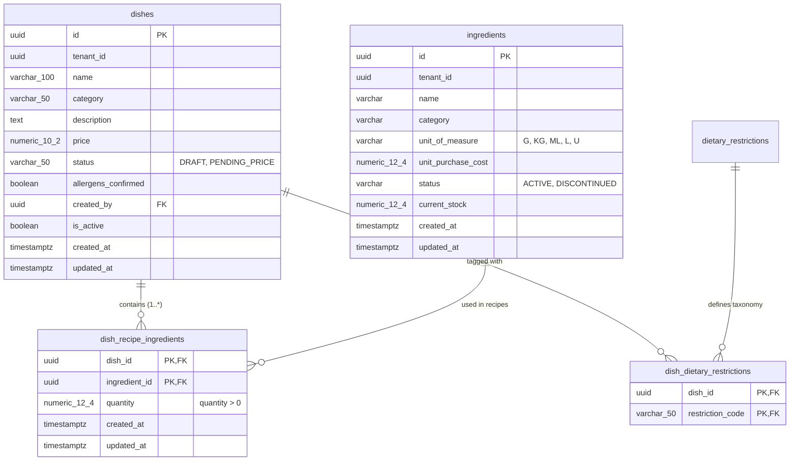

# Data Model & Persistence Specification: Recipe Many-to-Many Model and Automated Food Cost Engine

**Feature**: `006-recipe-food-cost`  
**Date**: 25/10/2026  
**Status**: Approved (Aligned with Spec 005)

This document specifies the relational schema, JPA entity mapping, domain rules, state invariants, and traceability matrix for recipe persistence and the automated food cost engine, fully integrated with the schema established in feature 005 (`005-chef-dish-management`).

---

## 1. Entity-Relationship Diagram



---

## 2. Relational Schema Reused from Feature 005

The relational tables utilized by this feature are established via migration `V6__chef_dish_management.sql` (defined in feature 005). Feature 006 reuses these tables directly:

```sql
-- Reused table: dish_recipe_ingredients (3NF)
-- Unit of measure is resolved functionally via JOIN with ingredients.unit_of_measure

CREATE TABLE IF NOT EXISTS dish_recipe_ingredients (
    dish_id UUID NOT NULL,
    ingredient_id UUID NOT NULL,
    quantity NUMERIC(12, 4) NOT NULL,
    created_at TIMESTAMPTZ NOT NULL DEFAULT CURRENT_TIMESTAMP,
    updated_at TIMESTAMPTZ NOT NULL DEFAULT CURRENT_TIMESTAMP,

    CONSTRAINT pk_dish_recipe_ingredients
        PRIMARY KEY (dish_id, ingredient_id),

    CONSTRAINT fk_dri_dish
        FOREIGN KEY (dish_id) REFERENCES dishes(id) ON DELETE CASCADE,

    CONSTRAINT fk_dri_ingredient
        FOREIGN KEY (ingredient_id) REFERENCES ingredients(id) ON DELETE RESTRICT,

    CONSTRAINT chk_dri_quantity_positive
        CHECK (quantity > 0)
);

CREATE INDEX IF NOT EXISTS idx_dri_dish_id
    ON dish_recipe_ingredients(dish_id);

CREATE INDEX IF NOT EXISTS idx_dri_ingredient_id
    ON dish_recipe_ingredients(ingredient_id);
```

---

## 3. JPA Domain Entities

### `DishRecipeIngredient.java` (`com.easyeat.dish.domain.DishRecipeIngredient`)

```java
package com.easyeat.dish.domain;

import com.easyeat.catalog.domain.Dish;
import com.easyeat.inventory.entity.Ingredient;
import jakarta.persistence.*;
import java.io.Serializable;
import java.math.BigDecimal;
import java.time.Instant;
import java.util.Objects;
import java.util.UUID;

@Entity
@Table(name = "dish_recipe_ingredients")
@IdClass(DishRecipeIngredientId.class)
public class DishRecipeIngredient {

    @Id
    @Column(name = "dish_id", nullable = false)
    private UUID dishId;

    @Id
    @Column(name = "ingredient_id", nullable = false)
    private UUID ingredientId;

    @ManyToOne(fetch = FetchType.LAZY, optional = false)
    @JoinColumn(name = "dish_id", insertable = false, updatable = false)
    private Dish dish;

    @ManyToOne(fetch = FetchType.EAGER, optional = false)
    @JoinColumn(name = "ingredient_id", insertable = false, updatable = false)
    private Ingredient ingredient;

    @Column(name = "quantity", nullable = false, precision = 12, scale = 4)
    private BigDecimal quantity;

    @Column(name = "created_at", nullable = false, updatable = false)
    private Instant createdAt = Instant.now();

    @Column(name = "updated_at", nullable = false)
    private Instant updatedAt = Instant.now();

    public DishRecipeIngredient() {}

    public DishRecipeIngredient(UUID dishId, UUID ingredientId, BigDecimal quantity) {
        this.dishId = dishId;
        this.ingredientId = ingredientId;
        this.quantity = quantity;
    }

    // Getters, setters, equals, hashCode
}
```

---

## 4. Food Cost Calculation & Auditing Engine

### Formula & Decimal Precision
The food cost is computed dynamically directly against the inventory acquisition prices:

$$\text{Line Subtotal} = \text{quantity} \times \text{unit\_purchase\_cost}$$
$$\text{Total Food Cost} = \sum_{i=1}^{n} \text{Line Subtotal}_i$$

- **Arithmetic Type**: `java.math.BigDecimal`
- **Unit Price Scale**: 4 decimal places (`scale = 4`)
- **Rounding Mode**: `RoundingMode.HALF_UP`
- **Output Monetary Scale**: 2 decimal places (`scale = 2`) for line subtotals and total Food Cost.
- **Invariance**: $\text{Total Food Cost} = \sum \text{Line Subtotal}$, guaranteeing zero cent drift.

### State-Machine Gate:
- If `dish.status == 'DRAFT'`: Request to `/cost-audit` returns `409 Conflict` (dish has not been submitted for review).
- If `dish.status == 'PENDING_PRICE'`: Request to `/cost-audit` computes and returns the audit breakdown.
- If recipe is empty: Request returns `400 Bad Request`.

---

## 5. Traceability Matrix

| Requirement | Entity / Field | Validation / Rule | HTTP Code / Outcome |
|:---|:---|:---|:---|
| **FR-001** (Multi-tenant isolation) | `dish.tenant_id`, `ingredient.tenant_id` | Security check: `dish.tenantId == user.tenantId && ingredient.tenantId == user.tenantId` | `403 Forbidden` / `404 Not Found` |
| **FR-002** (Normalized 3NF persistence) | `dish_recipe_ingredients` | Full-replacement PUT via `@Transactional` block | `200 OK` on success |
| **FR-003** (Strictly positive quantity) | `dish_recipe_ingredients.quantity` | Database check `quantity > 0` and Bean Validation `@Positive` | `400 Bad Request` |
| **FR-004** (Duplicate item rejection) | `pk_dish_recipe_ingredients` | Primary key `(dish_id, ingredient_id)` rejects duplicate items | `400 Bad Request` / `409 Conflict` |
| **FR-005** (Discontinued restriction) | `ingredient.status` | Pre-persistence check: `ingredient.status == ACTIVE` | `422 Unprocessable Entity` / `400 Bad Request` |
| **FR-006** (Draft-only recipe editing) | `dish.status` | Recipe update rejected if `dish.status != 'DRAFT'` | `409 Conflict` |
| **FR-007** (PENDING_PRICE audit gate) | `dish.status` | Audit query allowed only when `dish.status == 'PENDING_PRICE'` | `409 Conflict` if in `DRAFT` |
| **FR-008** (Exact Food Cost calculation) | `FoodCostEngine` | Dynamic sum of `quantity * unitPurchaseCost` with `BigDecimal` | Exact 2 decimal scale |
| **FR-009** (Real-time price reflection) | `FoodCostAuditService` | Recomputed on-the-fly from inventory table on each query | Always reflects fresh inventory prices |
| **FR-010** (RBAC audit restriction) | `AdminDishCostAuditController` | `@PreAuthorize("hasRole('ADMIN')")` | `403 Forbidden` for non-admin |
| **FR-011** (Itemized audit & dietary tags) | `FoodCostAuditResponse` | Returns breakdown + `dish.restrictionCodes` list | `200 OK` |
| **FR-012** (Unpriced ingredient flag) | `FoodCostAuditResponse.hasUnpricedIngredients` | If `unitPurchaseCost == 0` or null: subtotal = 0.00, flag = true, note appended | `200 OK` with warning |
| **FR-013** (Empty recipe rejection) | `dish_recipe_ingredients` | Throws `EmptyRecipeException` if no items linked | `400 Bad Request` |
