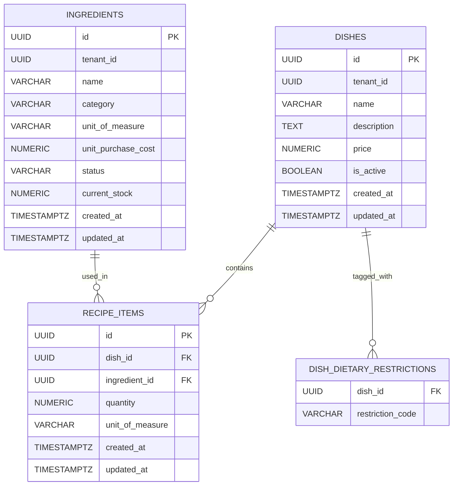

# Data Model & Persistence Specification: Recipe Many-to-Many Model and Automated Food Cost Engine

**Feature**: `006-recipe-food-cost`  
**Date**: 25/10/2026  
**Status**: Approved

This document specifies the relational schema, JPA entity mapping, domain rules, state invariants, and traceability matrix for recipe persistence and the automated food cost engine.

---

## 1. Entity-Relationship Diagram



---

## 2. Relational Schema (Flyway Migration: `V6__create_recipe_items.sql`)

```sql
-- Migration: V6__create_recipe_items.sql
-- Description: Create recipe_items table for Many-to-Many dish-ingredient relationship

CREATE TABLE IF NOT EXISTS recipe_items (
    id UUID PRIMARY KEY DEFAULT gen_random_uuid(),
    dish_id UUID NOT NULL,
    ingredient_id UUID NOT NULL,
    quantity NUMERIC(12, 4) NOT NULL,
    unit_of_measure VARCHAR(20) NOT NULL,
    created_at TIMESTAMPTZ NOT NULL DEFAULT CURRENT_TIMESTAMP,
    updated_at TIMESTAMPTZ NOT NULL DEFAULT CURRENT_TIMESTAMP,

    CONSTRAINT fk_recipe_items_dish
        FOREIGN KEY (dish_id) REFERENCES dishes(id) ON DELETE CASCADE,

    CONSTRAINT fk_recipe_items_ingredient
        FOREIGN KEY (ingredient_id) REFERENCES ingredients(id) ON DELETE RESTRICT,

    CONSTRAINT uk_recipe_items_dish_ingredient
        UNIQUE (dish_id, ingredient_id),

    CONSTRAINT chk_recipe_items_quantity_positive
        CHECK (quantity > 0),

    CONSTRAINT chk_recipe_items_unit_valid
        CHECK (unit_of_measure IN ('G', 'KG', 'ML', 'L', 'U'))
);

CREATE INDEX IF NOT EXISTS idx_recipe_items_dish_id
    ON recipe_items(dish_id);

CREATE INDEX IF NOT EXISTS idx_recipe_items_ingredient_id
    ON recipe_items(ingredient_id);
```

---

## 3. JPA Domain Entities

### `RecipeItem.java` (`com.easyeat.recipe.domain.RecipeItem`)

```java
package com.easyeat.recipe.domain;

import com.easyeat.catalog.domain.Dish;
import com.easyeat.inventory.dto.UnitOfMeasure;
import com.easyeat.inventory.entity.Ingredient;
import jakarta.persistence.*;
import java.math.BigDecimal;
import java.time.Instant;
import java.util.UUID;

@Entity
@Table(name = "recipe_items", uniqueConstraints = {
    @UniqueConstraint(name = "uk_recipe_items_dish_ingredient", columnNames = {"dish_id", "ingredient_id"})
})
public class RecipeItem {

    @Id
    @GeneratedValue(strategy = GenerationType.UUID)
    private UUID id;

    @ManyToOne(fetch = FetchType.LAZY, optional = false)
    @JoinColumn(name = "dish_id", nullable = false)
    private Dish dish;

    @ManyToOne(fetch = FetchType.LAZY, optional = false)
    @JoinColumn(name = "ingredient_id", nullable = false)
    private Ingredient ingredient;

    @Column(name = "quantity", nullable = false, precision = 12, scale = 4)
    private BigDecimal quantity;

    @Enumerated(EnumType.STRING)
    @Column(name = "unit_of_measure", nullable = false, length = 20)
    private UnitOfMeasure unitOfMeasure;

    @Column(name = "created_at", nullable = false, updatable = false)
    private Instant createdAt = Instant.now();

    @Column(name = "updated_at", nullable = false)
    private Instant updatedAt = Instant.now();

    // Constructors, getters, setters, lifecycle hooks
}
```

---

## 4. Domain Invariants and Conversion Matrix

### Metric Unit Conversion Table

| Recipe Unit | Inventory Unit | Dimension | Conversion Multiplier (Recipe $\to$ Inventory) | Resulting Formula |
|:---|:---|:---|:---|:---|
| `G` | `G` | Mass | $1.0$ | $\text{Subtotal} = \text{qty} \times \text{cost}$ |
| `G` | `KG` | Mass | $0.001$ ($1/1000$) | $\text{Subtotal} = (\text{qty} \times 0.001) \times \text{cost}$ |
| `KG` | `G` | Mass | $1000.0$ | $\text{Subtotal} = (\text{qty} \times 1000) \times \text{cost}$ |
| `KG` | `KG` | Mass | $1.0$ | $\text{Subtotal} = \text{qty} \times \text{cost}$ |
| `ML` | `ML` | Volume | $1.0$ | $\text{Subtotal} = \text{qty} \times \text{cost}$ |
| `ML` | `L` | Volume | $0.001$ ($1/1000$) | $\text{Subtotal} = (\text{qty} \times 0.001) \times \text{cost}$ |
| `L` | `ML` | Volume | $1000.0$ | $\text{Subtotal} = (\text{qty} \times 1000) \times \text{cost}$ |
| `L` | `L` | Volume | $1.0$ | $\text{Subtotal} = \text{qty} \times \text{cost}$ |
| `U` | `U` | Discrete | $1.0$ | $\text{Subtotal} = \text{qty} \times \text{cost}$ |
| *Any cross-dimension* | *Any cross-dimension* | Incompatible | **REJECTED** | **Throws `IncompatibleUnitException` (HTTP 400)** |

### Precision & Rounding Rules
- Intermediate converted quantities: calculated with `scale = 6` or higher precision.
- Ingredient line subtotal: rounded to 2 decimal places using `RoundingMode.HALF_UP`.
- Total Food Cost: sum of rounded line subtotals, guaranteeing that $\text{Total} = \sum \text{Line Subtotals}$ with zero fractional-cent drift.

---

## 5. Traceability Matrix

| Requirement | Entity / Field | Validation / Mechanism | HTTP Code / Outcome |
|:---|:---|:---|:---|
| **FR-001** (Multi-tenant isolation) | `dish.tenant_id`, `ingredient.tenant_id` | Security context check: `dish.tenantId == user.tenantId && ingredient.tenantId == user.tenantId` | `403 Forbidden` / `404 Not Found` |
| **FR-002** (Atomic full replace) | `RecipeService.setRecipe()` | `@Transactional` block: synchronize desired vs current items in single transaction | `200 OK` on success; atomic rollback on failure |
| **FR-003** (Positive quantities) | `recipe_items.quantity` | Database check `quantity > 0` and Bean Validation `@Positive` | `400 Bad Request` |
| **FR-004** (No duplicate items) | `uk_recipe_items_dish_ingredient` | Unique DB constraint and Set deduplication validator in DTO | `400 Bad Request` |
| **FR-005** (Discontinued restriction) | `ingredient.status` | Pre-persistence check: `ingredient.status == ACTIVE` | `400 Bad Request` |
| **FR-006** (Active dish modification lock) | `dish.isActive` | Pre-persistence check: reject if `dish.isActive == true` | `409 Conflict` |
| **FR-007** (Dynamic Food Cost sum) | `FoodCostEngine` | $\sum (\text{converted\_qty} \times \text{unit\_cost})$ using `BigDecimal` | Exact 2 decimal scale |
| **FR-008** (Dimensional UOM compatibility) | `UnitConversionService` | Strict dimensional verification (`G`/`KG`, `ML`/`L`, `U`/`U`) | `400 Bad Request` |
| **FR-009** (Fixed-point arithmetic) | `BigDecimal` | Scale 4 for rates, scale 2 for currency, `HALF_UP` rounding | Zero cent drift |
| **FR-010** (Real-time dynamic recalculation) | `FoodCostAuditService` | Recomputed on-the-fly from inventory table on each query | Always reflects fresh inventory prices |
| **FR-011** (RBAC audit & label aggregation) | `AdminDishCostAuditController` | `@PreAuthorize("hasRole('ADMIN')")`, union of dietary labels | `403 Forbidden` for non-admin |
| **FR-012** (Empty recipe rejection) | `RecipeItemRepository.findByDishId` | Throws `EmptyRecipeException` if no items found for dish | `400 Bad Request` |
