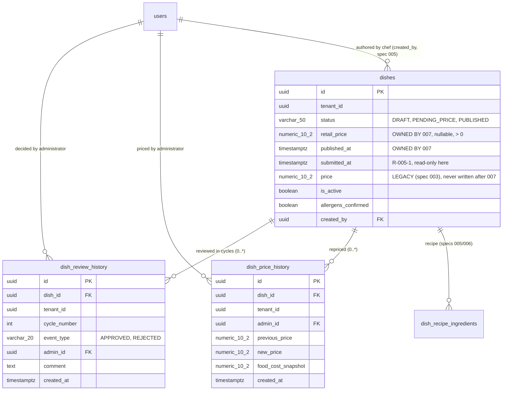
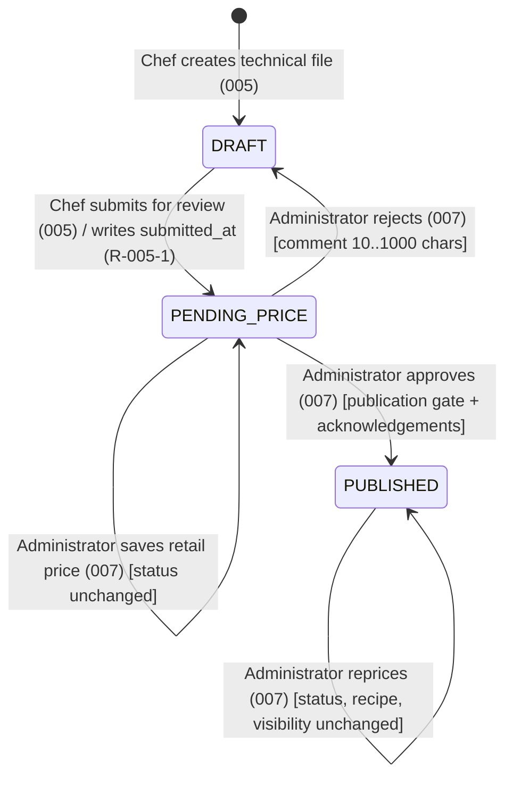

# Data Model & Persistence: Administrative Back-Office for Dish Audit, Retail Pricing (PVP) and Catalog Approval

**Feature**: `007-admin-dish-approval-pricing`
**Date**: 2026-10-26
**Specification**: [spec.md](./spec.md) · **Decisions**: [research.md](./research.md) · **Contracts**: [contracts/openapi.yaml](./contracts/openapi.yaml)

Scope of ownership: this feature owns `dishes.retail_price`, `dishes.published_at`, the `dish_review_history` and `dish_price_history` tables, and the indexes serving the inbox and history queries. It owns **no** object of spec 005's `V6` migration. Everything it needs from 005 or 006 and does not own is an [Upstream Requirement](./plan.md#upstream-requirements).

---

## 1. Entities

### 1.1. `Dish` — extended, not redefined (`com.easyeat.catalog.domain.Dish`)

**Revised 2026-10-28, after spec 005 merged (PR #160).** This section previously named `com.easyeat.dish.domain.Dish` as the entity to extend. **That class does not exist.** Spec 005 did not introduce a second entity: it added `category`, `status`, `allergens_confirmed`, `created_by` and `submitted_at` to the pre-existing `com.easyeat.catalog.domain.Dish` (spec 003), importing `DishStatus` from `com.easyeat.dish.domain`. There is exactly **one** JPA entity over `dishes`, it lives in `catalog.domain`, and four classes write to it: `DishService`, `DishPhotoService`, `CatalogComplianceService` and `DishRepository`. Decision **D3** is withdrawn — see §1.2.

Columns added by **this** feature:

| Attribute | Type | Nullable | Rules |
|---|---|---|---|
| `retail_price` | `NUMERIC(10,2)` | Yes | The PVP. `NULL` means "not yet priced". When present MUST be `> 0` (FR-013). Written only by the pricing path; scale 2, `HALF_UP`. |
| `published_at` | `TIMESTAMPTZ` | Yes | Set on the `PENDING_PRICE → PUBLISHED` transition. `NULL` for every dish never approved. Never cleared by this feature (unpublishing is Sprint 3). |

Columns **consumed** from upstream (never created here): `status`, `category`, `allergens_confirmed`, `created_by`, `submitted_at` (all delivered by 005's `V7`; `submitted_at` added by issue #137 / PR #138, closing **R-005-1**); `name`, `description`, `tenant_id`, `is_active`, `created_at`, `updated_at`, `price` (V5, spec 003).

Fields added to the entity class (ordinary incremental work on an existing class, permitted by D1): `retailPrice` and `publishedAt`, and **nothing else**. No `@Version` field is added — see §1.2. They are added to `com.easyeat.catalog.domain.Dish`, which already carries no `retail_price` and no `published_at`.

### 1.2. D3 withdrawn — one entity, guarded by review instead of by `@Immutable`

**Superseded 2026-10-28.** D3 called for two JPA mappings over `dishes`: a writable `dish.domain.Dish` holding `@Version`, and the catalog mapping demoted to `@org.hibernate.annotations.Immutable` so that no future write could bypass optimistic locking. Spec 005 took a different route and the code is now merged, so the premise is gone.

**Why the original plan is not merely inconvenient but impossible**: `@Immutable` cannot be applied to `catalog.domain.Dish`, because it is the **only** entity over `dishes` and spec 005 already writes through it (`DishService` sets `submitted_at` on the submit transition). Annotating it would break spec 005's own feature, not just this one.

**First revision, also superseded**: add `@Version` to the single entity and accept that optimistic locking becomes a property shared by every writer of `dishes`. That was escalated as `R-005-4`, because it changes failure behaviour for spec 003 and spec 005 — a concurrent write that previously overwrote silently would now raise a conflict.

**Revised decision as of 2026-10-28**: no version column and no `@Version` field. `R-005-4` is withdrawn. FR-025's three operations are each applied as a conditional `UPDATE` that restates the state the Administrator acted upon, and are accepted only if they affect exactly one row — the source status for approval and rejection, the previously read price for repricing. The guarantee is identical where FR-025 asks for it, and the cost is confined to this feature:

- nothing changes for spec 003's catalog writes or spec 005's submit transition, so no agreement from their owners is needed and their tests keep asserting the semantics they assert today;
- the shared table gains only this feature's own columns, so the migration is narrower;
- the guard lives in this feature's repository methods, which is inside D1's boundary rather than across it.

Two guarantees still replace the structural one `@Immutable` would have given, and both are weaker than a compiler check:

- The diner read path stays read-only by construction: `catalog/repository/DishRepository` declares reads only, and `CatalogComplianceService` only reads. This is a **review-enforced** invariant, and the loss of enforcement is registered as debt in `plan.md` Complexity Tracking. **Corrected 2026-10-28**: this clause used to say that repository declares only `findByTenantIdAndIsActiveTrue` and `findByIdIn`. That was true before spec 005 extended it; it now declares seven methods, including a paged `findByTenantIdAndStatus`. All of them are reads, so the invariant holds — but the enumeration did not, and an invariant stated against a stale list is unverifiable. What matters is the property, not the count: **no write path may be added to that interface**, and this feature adds none, keeping its own inbox queries in `dish/repository/DishReviewInboxRepository`.
- The concurrency guard is **per operation, not per row**. A write path added to `dishes` later, outside FR-025's three operations, inherits no protection — which a version column would have given it automatically. This is the one respect in which the withdrawn design was stronger, it is registered as debt beside the item above, and the two share one mitigation: any new write path through `catalog/repository/DishRepository` must carry its own predicate.

### 1.3. `DishReviewHistory` (`dish_review_history`) — immutable administrative decisions

| Attribute | Type | Nullable | Rules |
|---|---|---|---|
| `id` | `UUID` | No | PK, `gen_random_uuid()`. |
| `dish_id` | `UUID` | No | FK → `dishes(id)` `ON DELETE CASCADE` (§4.1). |
| `tenant_id` | `UUID` | No | Denormalised from the dish so every audit query is tenant-filtered without a join and a cross-tenant read is impossible even if a query forgets the join. |
| `cycle_number` | `INTEGER` | No | Monotonic from 1 per dish. `CHECK (cycle_number >= 1)`, `UNIQUE (dish_id, cycle_number)` (§4.2). |
| `event_type` | `VARCHAR(20)` | No | `CHECK (event_type IN ('APPROVED','REJECTED'))` (§4.3). |
| `admin_id` | `UUID` | No | FK → `users(id)` `ON DELETE RESTRICT` — an audit row never loses its actor. |
| `comment` | `TEXT` | Yes | Mandatory for `REJECTED`, 10–1000 characters after trimming, never whitespace-only (FR-021). Optional for `APPROVED`. Enforced in the domain and by a table `CHECK`. Stored as literal text; any HTML/script markup is never interpreted (the frontend renders it as text, React escapes by default). |
| `created_at` | `TIMESTAMPTZ` | No | `DEFAULT NOW()`. Sole temporal field: a row that cannot change has no `updated_at`. |

### 1.4. `DishPriceHistory` (`dish_price_history`) — immutable PVP audit trail

| Attribute | Type | Nullable | Rules |
|---|---|---|---|
| `id` | `UUID` | No | PK, `gen_random_uuid()`. |
| `dish_id` | `UUID` | No | FK → `dishes(id)` `ON DELETE CASCADE`. |
| `tenant_id` | `UUID` | No | Denormalised, as above. |
| `admin_id` | `UUID` | No | FK → `users(id)` `ON DELETE RESTRICT`. |
| `previous_price` | `NUMERIC(10,2)` | Yes | `NULL` on the first pricing of a dish (FR-010). |
| `new_price` | `NUMERIC(10,2)` | No | `CHECK (new_price > 0)`. |
| `food_cost_snapshot` | `NUMERIC(10,2)` | No | The prevailing Food Cost at the instant of the change, obtained from spec 006 inside the same transaction (§5.4). `CHECK (food_cost_snapshot >= 0)` — 0.00 is legitimate for a fully unpriced recipe. |
| `created_at` | `TIMESTAMPTZ` | No | `DEFAULT NOW()`. |

### 1.5. Relationships



---

## 2. Extended state machine (`DishStatus`)

`DRAFT` and `PENDING_PRICE` and their transitions belong to spec 005. This feature adds `PUBLISHED` and the three transitions out of `PENDING_PRICE`.



| # | Transition | Trigger | Guard (evaluated server-side, inside the transaction) | Effects | Loser / failure |
|---|---|---|---|---|---|
| T1 | `PENDING_PRICE → PUBLISHED` | `POST /admin/dishes/{id}/approval` | `status = PENDING_PRICE`; **publication gate** (FR-015): `retail_price > 0` **and** ≥ 1 recipe line whose ingredient is `ACTIVE` **and** `allergens_confirmed = TRUE`; required acknowledgements present (FR-017) | `status = PUBLISHED`, `published_at = NOW()`, `is_active = TRUE` (§3.4), one `dish_review_history` row (`APPROVED`, `cycle_number = MAX+1`). The `UPDATE` carries `AND status = 'PENDING_PRICE'`; zero rows affected → **409** `dish-already-decided` with the prevailing `currentStatus` and `decidedAt` | gate unmet → **422** `publication-gate-failed` with `unmetConditions[]`; missing acknowledgement → **422** `acknowledgement-required`; `status = DRAFT` → **409** `dish-invalid-state` (FR-019); `status = PUBLISHED` → **200 idempotent no-op** (FR-018) |
| T2 | `PENDING_PRICE → DRAFT` | `POST /admin/dishes/{id}/rejection` | `status = PENDING_PRICE`; comment valid | `status = DRAFT`, one `dish_review_history` row (`REJECTED`, `cycle_number = MAX+1`, comment). `published_at` untouched; recipe, labels and `retail_price` untouched. The `UPDATE` carries `AND status = 'PENDING_PRICE'`; zero rows affected → **409** `dish-already-decided` | invalid comment → **400** `invalid-rejection-comment` (dish stays `PENDING_PRICE`); `status = PUBLISHED` → **409** `dish-invalid-state` (FR-024); `status = DRAFT` → **409** `dish-invalid-state` (FR-019) |
| T3 | pricing, status-preserving | `PUT /admin/dishes/{id}/retail-price` | `status ∈ {PENDING_PRICE, PUBLISHED}` (FR-009); `expectedRetailPrice` matches the stored value; price valid; negative margin acknowledged (FR-014) | `retail_price` set, one `dish_price_history` row. Status, recipe, `is_active` and `published_at` unchanged (FR-011). The `UPDATE` carries `AND retail_price IS NOT DISTINCT FROM :expectedRetailPrice` — `IS NOT DISTINCT FROM`, not `=`, because the first assignment compares against `NULL` | `status = DRAFT` → **409** `dish-invalid-state`; zero rows affected → **409** `dish-stale-price` with `currentRetailPrice`; `expectedRetailPrice` absent from the body → **400** bound to that field (an explicit `null` is not absence: it asserts "the dish was unpriced when I read it"); invalid price → **400** `invalid-retail-price`; unacknowledged negative margin → **422** `acknowledgement-required` |

**Idempotent approval (FR-018)**: when `status` is already `PUBLISHED`, the transaction writes nothing — no status change, no audit row — and returns `200 OK` with `alreadyPublished: true` plus the original `publishedAt`, so the UI reports "ya estaba publicado" instead of a fresh publication.

---

## 3. Flyway migration owned by this feature

**File**: `easyeat/backend/src/main/resources/db/migration/V8__admin_dish_approval_pricing.sql`
**Version rationale and renumbering rule**: see [research.md §2(b)](./research.md) and the project registry at [`.specify/memory/migrations.md`](../../.specify/memory/migrations.md). The version is **not reserved in advance** — it is the next free sequential number confirmed against `db/migration/` when the file is authored. **Confirmed 2026-10-28**: the integration branch holds `V1`–`V7` (`V7` landed with spec 005 via PR #160), so this feature takes **`V8`**.
**On spec 008's competing claim**: spec 008 has written `V8__create_establishments.sql` on its own feature branch (PRs #168, #169, both merged into `008-diner-catalog-multi-tenant`, none into the integration branch). By rule 4 of the registry a claim in flight reserves nothing, and whichever branch merges first keeps the number; the other renames its file. Taking `V9` instead would not spare spec 008, because Flyway runs with `outOfOrder` disabled: if this feature merged `V9` first, 008's `V8` would be below the highest applied version and would be rejected outright on every database not recreated — so 008 would have to renumber anyway, and a gap would be left behind. The two migrations are independent in content — this one alters `dishes`, 008's creates `establishments` and does not touch `dishes.status` — so renumbering either is a rename plus a registry row, with no semantic consequence.
**Applies on top of**: `V1..V7`, all present on the integration branch.

```sql
-- ====================================================================
-- EasyEat: Administrative Back-Office - PVP, Approval and Audit
-- Owns: dishes.retail_price / published_at, dish_review_history,
--       dish_price_history, inbox indexes, retail_price backfill.
-- Owns NOTHING of spec 005's or spec 008's migrations.
-- ====================================================================

-- 1. Columns owned by this feature
ALTER TABLE dishes
    ADD COLUMN IF NOT EXISTS retail_price NUMERIC(10, 2),
    ADD COLUMN IF NOT EXISTS published_at TIMESTAMPTZ;
-- No version column: FR-025 is enforced by conditional UPDATEs, not by a
-- row version. See §1.2 and plan.md R-005-4 (withdrawn).

ALTER TABLE dishes
    ADD CONSTRAINT chk_dishes_retail_price_positive
        CHECK (retail_price IS NULL OR retail_price > 0);

COMMENT ON COLUMN dishes.price IS
    'DEPRECATED by spec 007: superseded by retail_price. Retained for backward '
    'compatibility with spec 003 artifacts; never written by application code '
    'after 007. Removal owned by the Sprint 3 catalog-lifecycle feature (CHF-2.2.5).';

-- 2. Backfill the PVP from the legacy price (D2).
--    price may be NULL (005 drops NOT NULL) and may be 0.00 (V5 allows >= 0);
--    neither can become a retail_price, so those rows stay unpriced.
UPDATE dishes
   SET retail_price = price
 WHERE retail_price IS NULL
   AND price IS NOT NULL
   AND price > 0;

-- 3. Status domain extension -- see research.md 3.2.
--    PRIMARY PATH (R-005-2): spec 005 widens its own chk_dishes_status to include
--    'PUBLISHED' and this block ships empty.
--    FALLBACK (requires human approval, registered in Complexity Tracking):
-- ALTER TABLE dishes DROP CONSTRAINT IF EXISTS chk_dishes_status;
-- ALTER TABLE dishes ADD  CONSTRAINT chk_dishes_status
--     CHECK (status IN ('DRAFT', 'PENDING_PRICE', 'PUBLISHED'));

-- 4. Immutable administrative review history
CREATE TABLE IF NOT EXISTS dish_review_history (
    id           UUID         PRIMARY KEY DEFAULT gen_random_uuid(),
    dish_id      UUID         NOT NULL REFERENCES dishes(id) ON DELETE CASCADE,
    tenant_id    UUID         NOT NULL,
    cycle_number INTEGER      NOT NULL,
    event_type   VARCHAR(20)  NOT NULL,
    admin_id     UUID         NOT NULL REFERENCES users(id) ON DELETE RESTRICT,
    comment      TEXT,
    created_at   TIMESTAMPTZ  NOT NULL DEFAULT NOW(),
    CONSTRAINT uq_drh_dish_cycle UNIQUE (dish_id, cycle_number),
    CONSTRAINT chk_drh_cycle_positive CHECK (cycle_number >= 1),
    CONSTRAINT chk_drh_event_type CHECK (event_type IN ('APPROVED', 'REJECTED')),
    CONSTRAINT chk_drh_rejection_comment CHECK (
        event_type <> 'REJECTED'
        OR (comment IS NOT NULL AND LENGTH(BTRIM(comment)) BETWEEN 10 AND 1000)
    )
);

CREATE INDEX IF NOT EXISTS idx_drh_dish_created
    ON dish_review_history (dish_id, created_at);
CREATE INDEX IF NOT EXISTS idx_drh_tenant_created
    ON dish_review_history (tenant_id, created_at DESC);

-- 5. Immutable retail price history
CREATE TABLE IF NOT EXISTS dish_price_history (
    id                 UUID         PRIMARY KEY DEFAULT gen_random_uuid(),
    dish_id            UUID         NOT NULL REFERENCES dishes(id) ON DELETE CASCADE,
    tenant_id          UUID         NOT NULL,
    admin_id           UUID         NOT NULL REFERENCES users(id) ON DELETE RESTRICT,
    previous_price     NUMERIC(10, 2),
    new_price          NUMERIC(10, 2) NOT NULL,
    food_cost_snapshot NUMERIC(10, 2) NOT NULL,
    created_at         TIMESTAMPTZ  NOT NULL DEFAULT NOW(),
    CONSTRAINT chk_dph_new_price_positive CHECK (new_price > 0),
    CONSTRAINT chk_dph_food_cost_non_negative CHECK (food_cost_snapshot >= 0)
);

CREATE INDEX IF NOT EXISTS idx_dph_dish_created
    ON dish_price_history (dish_id, created_at DESC);

-- 6. Index for the published tab. The FIFO pending index
--    idx_dishes_review_inbox_pending (tenant_id, status, submitted_at)
--    is created by spec 005's V7 (issue #137) and is consumed here, not
--    re-declared: two owners of one index object would violate D1.
CREATE INDEX IF NOT EXISTS idx_dishes_review_inbox_published
    ON dishes (tenant_id, status, published_at DESC);
```

### 3.1. Index justification

`idx_dishes_tenant (tenant_id, is_active)` (V5) and `idx_dishes_chef_list (tenant_id, status, updated_at DESC)` (005's `V7`) serve neither the FIFO pending query nor the published tab's chronology. Two composite indexes are needed, one per ordering, because a single index cannot serve both sort directions on different columns. **Only one of them is owned here**: `idx_dishes_review_inbox_pending (tenant_id, status, submitted_at)` is created by 005's `V7` (issue #137) and consumed as-is; this feature adds `idx_dishes_review_inbox_published` alone. The history tab needs no new index: it is an `EXISTS` over `dish_review_history` resolved by `uq_drh_dish_cycle`.

### 3.2. `cycle_number` without a race

The value is computed as `COALESCE(MAX(cycle_number), 0) + 1` for the dish **inside the same transaction** that performs the status transition. Two concurrent decisions cannot both commit, because each one also issues the conditional `UPDATE` on the `dishes` row carrying `AND status = 'PENDING_PRICE'`: the second matches zero rows and its transaction is rolled back before its audit row can commit. Under PostgreSQL's default `READ COMMITTED` the second statement blocks on the row lock, then re-evaluates its predicate against the committed row and finds the status no longer matches, so the window where both read `PENDING_PRICE` is closed by the statement itself rather than by a version comparison. `UNIQUE (dish_id, cycle_number)` is therefore the **proof** of the invariant rather than its mechanism: if it is ever violated, a write path exists that bypasses the status predicate, which is exactly the defect we want to fail loudly.

### 3.3. How immutability is actually enforced

Append-only service paths: `DishReviewHistoryRepository` and `DishPriceHistoryRepository` expose only `save` and query methods — no `delete*`, no `@Modifying` update. The entities expose no setters after construction and declare no `@PreUpdate`. Neither table has an `updated_at` column, so an update has nothing to say. **A database trigger or a `REVOKE UPDATE` is deliberately *not* added**: a single application writes this schema with one role, and a rule enforced in two places that can disagree is worse than one enforced where the writes happen (Principle IV). This is recorded as the chosen trade-off, not an oversight.

### 3.4. `is_active` at publication

The approval transition sets `is_active = TRUE` in the same atomic update, because 005 defaults new drafts to `FALSE` and D4's diner predicate requires both flags. See [research.md §3.9](./research.md). No other path in this feature writes `is_active`; Sprint 3's pause flips it without touching `status`.

---

### 3.5. A dish with no recipe lines (FR-037)

Spec 006's `FoodCostAuditService.auditDishCost` raises `EmptyRecipeException` when a dish has no rows in `dish_recipe_ingredients`, rather than returning a zero cost. FR-012 recomputes the margin on **every** consultation, so this feature's read paths reach that condition for any dish submitted without a recipe.

**Rule**: every read path catches it and renders the recipe-absent state — no itemization, no margin, and the publication gate reported as unmet on condition 2 — while still rendering identity, status, author attribution, the assigned price if any, and the review history. It is never propagated as a failed request, because the absence of a recipe is a fact about the dish, not a fault in the consultation. The write paths need no special handling: FR-015 condition 2 already blocks approval, and repricing is legal on a dish with no recipe (the margin is simply not computable, which FR-014's acknowledgement already covers).

**Why this is not spec 006's defect**: its endpoint answers "itemize this dish's cost", and for a dish with no recipe that request has no answer. This feature's detail view answers a broader question, so the same condition is information rather than an error.

### 3.6. `IngredientStatus` is not in the audit payload (FR-015, condition 2)

`RecipeItemAuditResponse` carries the ingredient's id, name, quantity, unit of measure, unit cost, line subtotal and unpriced flag — but **not** its `IngredientStatus` — and `FoodCostAuditService` does not exclude discontinued lines from the total. FR-015 condition 2 requires at least one recipe line whose ingredient is `ACTIVE`, so **the gate cannot be evaluated from the audit payload**: this feature evaluates it with its own query, counting the dish's recipe lines joined to `ingredients` on `status = 'ACTIVE'`.

The two artifacts answer different questions and both are right: the Food Cost projects what the recipe costs as written, including lines whose ingredient has since been discontinued; the gate asks whether the dish can be produced today. Deriving one from the other would corrupt whichever lost.

## 4. Deletion, typing and author semantics

### 4.1. `ON DELETE CASCADE` on `dish_id`, and its cost

Spec 005 permits physical deletion of a dish only while in `DRAFT`. A chef may therefore delete a draft that was previously rejected, and the cascade erases that dish's review history with it. This is chosen deliberately: orphaned audit rows would describe an artifact that no longer exists and would surface a deleted dish's identity in administrative views. **Consequence stated plainly**: SC-005's "100% reconstructible" holds for every dish that exists; it does not survive the author deleting the dish. If the business needs audit immutability across deletion, 005 must move to soft deletion — recorded as a note to 005, not as a blocking upstream requirement for this feature.

### 4.2. Event typing, and why price changes are not review events

`dish_review_history.event_type ∈ {APPROVED, REJECTED}` — administrative *decisions* only. Price changes live exclusively in `dish_price_history`. Mixing them would make `cycle_number` mean two different things (a review round and a price revision) and would make the review-cycle chronology unreadable for the Chef-facing feedback view. The two tables are joined only at the presentation layer, in the administrative history view.

### 4.3. FR-026 — a deactivated author must not invalidate a dish

Deactivation sets `users.status = 'SUSPENDED'`; it never deletes the row (verified: `V3__extend_users_staff.sql:13`, `StaffService:170-177`). Consequences: `dishes.created_by` (FK to `users`, 005) never breaks; **no query in this feature filters, joins or orders by the author's status**; the inbox and detail views render the author's name with a neutral *"cuenta desactivada"* chip so the Administrator knows who to chase, and every action — audit, price, approve, reject — stays enabled. `admin_id` on both audit tables is `ON DELETE RESTRICT` so a decision keeps its attribution permanently. When `created_by` is `NULL` (possible for pre-005 rows and for the dev seed, see §5.3) the UI renders *"Autor no registrado"*.

---

## 5. Money, precision and the margin

### 5.1. Conventions

`java.math.BigDecimal` everywhere, `RoundingMode.HALF_UP`; scale **2** for monetary values (`retail_price`, `food_cost`, line subtotals, both history tables), scale **4** for recipe quantities and unit acquisition costs (spec 006's convention, already implemented in `Ingredient`/`StockAuditEntry`). No binary floating point touches a monetary or margin invariant on the server. DTOs expose bare `BigDecimal` with no Jackson annotation, matching the inventory and catalog DTOs; Jackson serialises them as JSON numbers preserving scale.

### 5.2. The two derivations, and which one is lossy

$$\text{margin\_pct} = \frac{\text{retail\_price} - \text{food\_cost}}{\text{retail\_price}} \times 100 \qquad \text{retail\_price} = \frac{\text{food\_cost}}{1 - \text{margin\_pct}/100}$$

- **price → margin is exact**: both inputs are already 2-decimal values; `margin_pct` is computed and returned at **scale 4** (`HALF_UP`) and formatted to 2 decimals for display.
- **margin → price is lossy**: the quotient is rounded to scale 2, perturbing any margin re-derived from the stored price.

### 5.3. The invariants this feature actually enforces (replacing FR-008's unconditional claim)

- **INV-1, unconditional**: `retail_price = HALF_UP₂(food_cost / (1 − margin_pct/100))`.
- **INV-2, conditional**: `|m' − m| ≤ 0.5·food_cost / (p'·(p' − 0.005))` pp, which is `≤ 0.01` pp **iff** `retail_price ≥ 50·(1 − margin_pct/100)` (equivalently `retail_price ≥ √(50·food_cost)`). Derivation, verified counter-examples (`3.33 @ 60% → 8.33 → 60.0240%`, `1.25 @ 70% → 4.17 → 70.0240%`, `0.07 @ 60% → 0.18 → 61.1111%`) and the per-margin thresholds are in [research.md §3.1](./research.md). FR-008 and SC-002 are flagged for amendment; **±0.01 pp is not an unconditional guarantee**.

### 5.4. Boundaries, and why the Food Cost snapshot does not contradict FR-012

`margin_pct ≥ 100.00` → derivation blocked (division by zero / negative price). `margin_pct ≤ −500.00` → blocked. `margin_pct = 0` → `retail_price = food_cost`. Negative margin → permitted behind explicit acknowledgement (FR-014). `food_cost = 0.00` with `has_unpriced_ingredients` → margin-to-price derivation disabled, direct price entry required (FR-013).

FR-012 forbids **persisting the margin** or caching it: the displayed margin is always recomputed from the live Food Cost on every consultation. `dish_price_history.food_cost_snapshot` is a different thing — an audit fact answering *"what did raw materials cost when this price was decided?"*, obtained from spec 006 inside the pricing transaction and **never read back to compute a displayed margin**. No margin value is stored anywhere in the schema.

### 5.5. Price validation ownership

More-than-two-decimals is detected as `price.stripTrailingZeros().scale() > 2` on the parsed `BigDecimal` — never by string inspection. Sign, zero and precision are validated in the domain layer, which throws `InvalidRetailPriceException` → **400** with a field-bound `errors[]` extension (see [research.md §3.4](./research.md) for why not the project's default 422).

---

## 6. Dev seed and its test (D5 — **WITHDRAWN 2026-10-28**)

D5 called for the five seeded dishes to land `status = 'PUBLISHED'` with `retail_price` backfilled, `published_at = NOW()`, `created_by = NULL` and one synthetic `APPROVED` review row each, so that the diner catalog would not be empty in dev under D4's predicate. **It is withdrawn**; the reasoning is recorded in [research.md §3.6](./research.md), and in short: its premise was measurably false, executing it would have broken a green test belonging to spec 005, and `PENDING_PRICE` is the state this feature's own inbox and quickstart need.

**What the seed does instead.** `status`, `is_active`, `allergens_confirmed` and `created_by` are left exactly as spec 005 wrote them. The seed states `retail_price` and `published_at` explicitly as `NULL`, in the `INSERT` and in the `ON CONFLICT … DO UPDATE`, so the five dishes are deterministically **unpriced and never approved**. That is not cosmetic: `V8`'s backfill copies `price` into `retail_price` for rows already present on a developer's existing database, so without the explicit `NULL`s the dev state would differ between an existing database and a fresh clone. Being a repeatable migration it still runs after every versioned one, so it may reference this feature's columns; it therefore depends on `V7` and `V8` together.

**Effect on `DevSeedDishesMigrationTest`**: every existing assertion keeps passing unchanged. It gains assertions that the five rows carry `retail_price IS NULL`, `published_at IS NULL`, no `dish_review_history` row, and `status = 'PENDING_PRICE'` — the last one duplicated from spec 005's own test on purpose, so this feature records the state it depends on rather than trusting another spec to preserve it.

**Consequence accepted**: the dev diner catalog is empty under D4's predicate until an Administrator approves something, and `SC-001` is therefore verified by this feature's integration tests rather than by seeded data. Populating it with published dev rows is a decision for specs 003 and 008.

---

## 7. Traceability: FR → artifact

| FR | Satisfied by |
|---|---|
| FR-001 | `/api/v1/admin/**` filter-chain gate (`SecurityConfig:78`) + `@PreAuthorize("hasRole('ADMIN') or hasRole('ADMINISTRADOR')")`; `TenantContextHolder.getRequiredTenantId()` on every query; `TenantViolationException` → 403 |
| FR-002 | `GET /admin/dishes/review-inbox?tab=PENDING\|PUBLISHED\|HISTORY` |
| FR-003 | `pendingCount` in the page payload; `ORDER BY submitted_at ASC` (R-005-1) with `idx_dishes_review_inbox_pending`; `@PageableDefault(size = 20)` |
| FR-004 | `DishReviewInboxItemResponse` (id, name, category, authorName, authorDeactivated, submittedAt, status, isResubmission, reviewCycleCount) |
| FR-005 | Empty `items[]` with accurate metadata; per-tab empty states in the UI |
| FR-006 | `GET /admin/dishes/{id}/review-detail` embedding spec 006's `FoodCostAuditResponse` (R-006-1) |
| FR-007 | `RetailPricingCalculator` (pure component) + mirrored formulas in the UI; server authoritative |
| FR-008 | §5.1–5.3 — INV-1 unconditional, INV-2 conditional; **amendment requested** |
| FR-009 | `dishes.retail_price`; `PUT /admin/dishes/{id}/retail-price` guard `status ∈ {PENDING_PRICE, PUBLISHED}` |
| FR-010 | `dish_price_history` row per change (actor, timestamp, previous, new, `food_cost_snapshot`) |
| FR-011 | T3: status, recipe, `is_active`, `published_at` untouched |
| FR-012 | No margin column anywhere; margin recomputed per consultation from 006's live cost; §5.4 |
| FR-013 | `chk_dishes_retail_price_positive` + domain validation → 400 (§5.5) |
| FR-014 | `acknowledgeNegativeMargin` in the pricing request; absent → 422 `acknowledgement-required` |
| FR-015 | T1 publication gate, re-evaluated at approval time, incl. recipes emptied or discontinued after submission |
| FR-016 | T1 single atomic transaction: `status`, `published_at`, `is_active`, audit row |
| FR-017 | `acknowledgeUnpricedIngredients` / `acknowledgeNegativeMargin` in the approval request |
| FR-018 | T1 idempotent branch: 200 OK, `alreadyPublished: true`, no audit row, no state change |
| FR-019 | T1/T2 guard on `DRAFT` → 409 `dish-invalid-state` |
| FR-020 | T2: `status = DRAFT`, dish leaves the pending tab, 005's edit lock releases |
| FR-021 | `chk_drh_rejection_comment` + domain validation (trim, 10..1000) → 400 |
| FR-022 | `dish_review_history` (dish, actor, timestamp, reason, `cycle_number`), append-only (§3.3) |
| FR-023 | `GET /dishes/{id}/review-feedback` (CHEF) — response type carries **no** financial field at all (structural omission, §contracts) |
| FR-024 | T2 guard on `PUBLISHED` → 409 `dish-invalid-state` |
| FR-025 | Conditional `UPDATE` per operation: `AND status = 'PENDING_PRICE'` for T1/T2, `AND retail_price IS NOT DISTINCT FROM :expectedRetailPrice` for T3; zero affected rows → 409 taxonomy |
| FR-037 | §3.5: `EmptyRecipeException` from 006's audit service is caught on every read path and rendered as the dish's recipe-absent state, never propagated |
| FR-026 | §4.3 — no author-status filter anywhere; FK intact; `RESTRICT` on audit actors |
