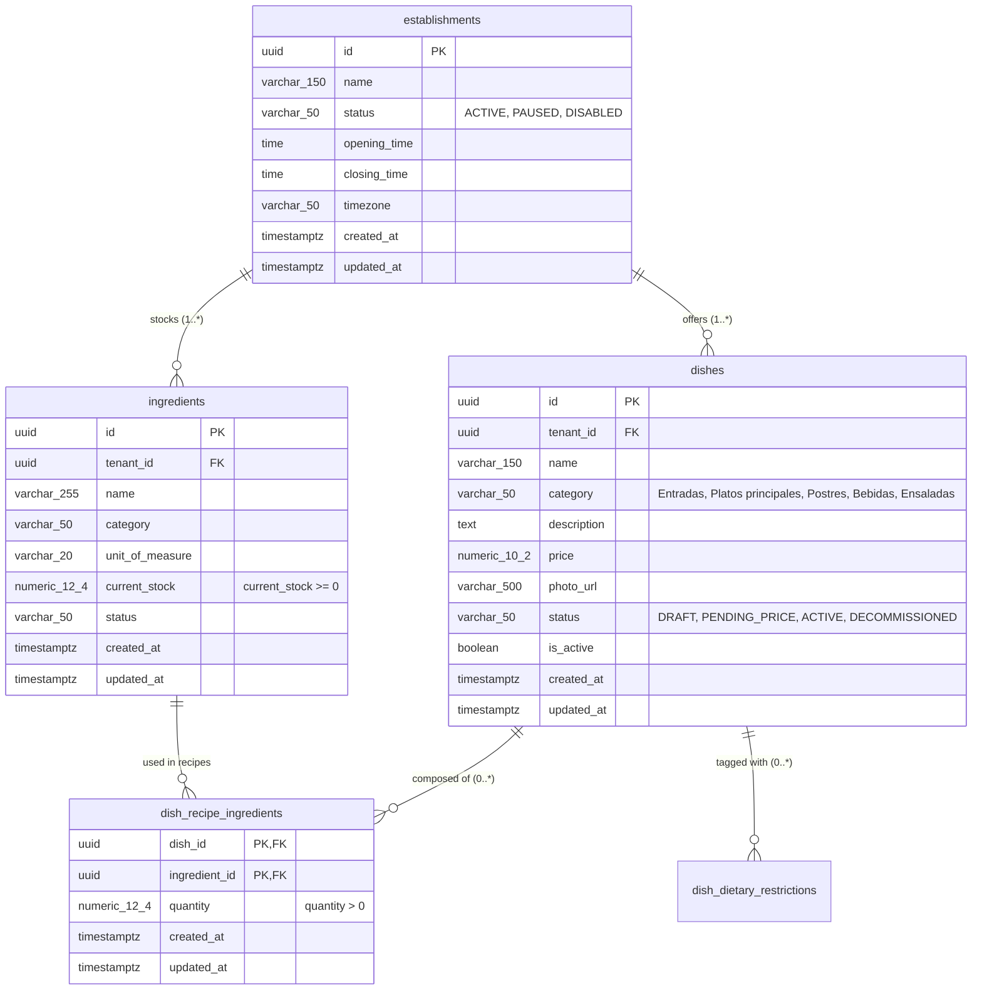

# Data Model: Diner Real-Time Catalog & Multi-Tenant Establishment Discovery

**Feature Branch**: `008-diner-catalog-multi-tenant`  
**Date**: 26/10/2026  
**Status**: Completed  
**Spec Reference**: [spec.md](file:///c:/Users/seeba/OneDrive/Documentos/FIUBA/git/G12---GDSI/specs/008-diner-catalog-multi-tenant/spec.md)

---

## 1. Domain Entities & Persistence Mappings

### 1.1. Establishment (`Establishment`)
Represents a physical restaurant location with its operational status and operating schedule.

| Attribute | Data Type | Nullable | Constraints & Rules |
|---|---|---|---|
| `id` | UUID | No | Primary key, automatically generated (`gen_random_uuid()`). Serves as the `tenantId`. |
| `name` | VARCHAR(150) | No | Establishment commercial name. Case-insensitive and diacritic-insensitive search target. |
| `status` | VARCHAR(50) | No | Enum: `'ACTIVE'`, `'PAUSED'`, `'DISABLED'`. Default `'ACTIVE'`. Autocomplete exposes only `'ACTIVE'`. |
| `opening_time` | TIME | No | Daily opening hour (e.g., `'11:00:00'`). |
| `closing_time` | TIME | No | Daily closing hour (e.g., `'23:00:00'`). |
| `timezone` | VARCHAR(50) | No | Canonical timezone identifier (default `'America/Argentina/Buenos_Aires'`). |
| `created_at` | TIMESTAMPTZ | No | Timestamp of creation (`NOW()`). Immutable. |
| `updated_at` | TIMESTAMPTZ | No | Timestamp of last modification (`NOW()`). |

### 1.2. Dish (`Dish`)
Represents a culinary item available in the establishment's menu.

| Attribute | Data Type | Nullable | Constraints & Rules |
|---|---|---|---|
| `id` | UUID | No | Primary key (`gen_random_uuid()`). |
| `tenant_id` | UUID | No | References `establishments(id)`. Strict multi-tenant isolation. |
| `name` | VARCHAR(150) | No | Dish name. Matching target for in-catalog search. |
| `category` | VARCHAR(50) | No | Closed gastronomic category: `'Entradas'`, `'Platos principales'`, `'Postres'`, `'Bebidas'`, `'Ensaladas'`. |
| `description` | TEXT | Yes | Diner-facing culinary description. |
| `price` | NUMERIC(10, 2) | No | Unit sales price in ARS. Must be `>= 0`. |
| `photo_url` | VARCHAR(500) | Yes | URL to high-resolution dish image. Fallback to placeholder if missing or failed load. |
| `status` | VARCHAR(50) | No | Lifecycle status: `'DRAFT'`, `'PENDING_PRICE'`, `'ACTIVE'`, `'DECOMMISSIONED'`. Only `'ACTIVE'` dishes are visible to diners. |
| `is_active` | BOOLEAN | No | Backward-compatible boolean flag. Maintained as `TRUE` when `status = 'ACTIVE'`. |
| `created_at` | TIMESTAMPTZ | No | Creation timestamp. |
| `updated_at` | TIMESTAMPTZ | No | Last update timestamp. |

### 1.3. Recipe Ingredient Line (`DishRecipeIngredient`)
Composite entity in 3NF linking a dish to an inventory supply item with required per-portion quantity.

| Attribute | Data Type | Nullable | Constraints & Rules |
|---|---|---|---|
| `dish_id` | UUID | No | Composite PK and FK referencing `dishes(id)` with `ON DELETE CASCADE`. |
| `ingredient_id` | UUID | No | Composite PK and FK referencing `ingredients(id)` with `ON DELETE RESTRICT`. |
| `quantity` | NUMERIC(12, 4) | No | Required per-portion quantity in ingredient's `unit_of_measure`. Must be strictly `> 0`. |
| `created_at` | TIMESTAMPTZ | No | Timestamp when ingredient was added to recipe. |
| `updated_at` | TIMESTAMPTZ | No | Timestamp when quantity was updated. |

### 1.4. Ingredient (`Ingredient` - Reused from Spec 004 / Migration V4)
Raw inventory supply item tracking kitchen stock.

| Attribute | Data Type | Nullable | Constraints & Rules |
|---|---|---|---|
| `id` | UUID | No | Primary key. |
| `tenant_id` | UUID | No | Establishment identifier. |
| `name` | VARCHAR(255) | No | Ingredient name (e.g., `'Harina 000'`, `'Carne de res'`). Included in dish recipe search. |
| `current_stock` | NUMERIC(12, 4) | No | Authoritative stock level. Must be `>= 0`. Updated by kitchen operations. |
| `unit_of_measure` | VARCHAR(20) | No | `'g'`, `'kg'`, `'ml'`, `'l'`, `'u'`. |
| `status` | VARCHAR(50) | No | `'ACTIVE'`, `'DISCONTINUED'`, `'ARCHIVED'`. |

---

## 2. Entity-Relationship Diagram (Mermaid)



---

## 3. Relational DDL Specification (`V7__create_establishments_and_dish_catalog.sql`)

```sql
-- 1. Create establishments table
CREATE TABLE IF NOT EXISTS establishments (
    id           UUID         PRIMARY KEY DEFAULT gen_random_uuid(),
    name         VARCHAR(150) NOT NULL,
    status       VARCHAR(50)  NOT NULL DEFAULT 'ACTIVE',
    opening_time TIME         NOT NULL DEFAULT '11:00:00',
    closing_time TIME         NOT NULL DEFAULT '23:00:00',
    timezone     VARCHAR(50)  NOT NULL DEFAULT 'America/Argentina/Buenos_Aires',
    created_at   TIMESTAMPTZ  NOT NULL DEFAULT NOW(),
    updated_at   TIMESTAMPTZ  NOT NULL DEFAULT NOW(),
    CONSTRAINT chk_establishment_status CHECK (status IN ('ACTIVE', 'PAUSED', 'DISABLED'))
);

CREATE INDEX IF NOT EXISTS idx_establishments_search
    ON establishments(status, LOWER(name));

-- 2. Extend dishes table with category, photo_url, and lifecycle status
ALTER TABLE dishes
    ADD COLUMN IF NOT EXISTS category  VARCHAR(50)  NOT NULL DEFAULT 'Platos principales',
    ADD COLUMN IF NOT EXISTS photo_url VARCHAR(500),
    ADD COLUMN IF NOT EXISTS status    VARCHAR(50)  NOT NULL DEFAULT 'ACTIVE';

ALTER TABLE dishes
    ADD CONSTRAINT chk_dishes_category
        CHECK (category IN ('Entradas', 'Platos principales', 'Postres', 'Bebidas', 'Ensaladas')),
    ADD CONSTRAINT chk_dishes_status
        CHECK (status IN ('DRAFT', 'PENDING_PRICE', 'ACTIVE', 'DECOMMISSIONED'));

CREATE INDEX IF NOT EXISTS idx_dishes_diner_catalog
    ON dishes(tenant_id, status, category);

-- 3. Create dish_recipe_ingredients join table in 3NF
CREATE TABLE IF NOT EXISTS dish_recipe_ingredients (
    dish_id       UUID           NOT NULL,
    ingredient_id UUID           NOT NULL,
    quantity      NUMERIC(12, 4) NOT NULL,
    created_at    TIMESTAMPTZ    NOT NULL DEFAULT NOW(),
    updated_at    TIMESTAMPTZ    NOT NULL DEFAULT NOW(),
    CONSTRAINT pk_dish_recipe_ingredients
        PRIMARY KEY (dish_id, ingredient_id),
    CONSTRAINT fk_dri_dish
        FOREIGN KEY (dish_id) REFERENCES dishes(id) ON DELETE CASCADE,
    CONSTRAINT fk_dri_ingredient
        FOREIGN KEY (ingredient_id) REFERENCES ingredients(id) ON DELETE RESTRICT,
    CONSTRAINT chk_dri_quantity_positive
        CHECK (quantity > 0)
);

CREATE INDEX IF NOT EXISTS idx_dri_dish_id
    ON dish_recipe_ingredients(dish_id);

CREATE INDEX IF NOT EXISTS idx_dri_ingredient_id
    ON dish_recipe_ingredients(ingredient_id);
```

---

## 4. State Invariants and Business Rules

1. **Multi-Tenant Isolation (FR-026, SC-002)**:
   - All queries filter by `tenant_id = :tenantId`.
   - Dishes, ingredients, and recipe lines belonging to Tenant A are never accessible or computable within Tenant B context.

2. **Establishment Discovery Scope (FR-003, FR-005)**:
   - Autocomplete returns only establishments with `status = 'ACTIVE'`.
   - Paused or disabled establishments can be selected by direct ID only to display a full-page blocking notice without menu data exposure.

3. **Dish Visibility Invariant (FR-009, FR-015, SC-005, SC-006)**:
   - A dish is included in the catalog if and only if `dish.status = 'ACTIVE'`. Dishes in `DRAFT`, `PENDING_PRICE`, or `DECOMMISSIONED` are completely omitted.
   - A category is included in the catalog and navigation bar if and only if it contains at least one dish with `status = 'ACTIVE'`.

4. **Dynamic Stock Availability Formula (FR-013, FR-014, FR-019, SC-003, SC-004)**:
   - A dish has `isAvailable = true` if and only if:
     1. `dish.status == 'ACTIVE'`
     2. `establishment.status == 'ACTIVE'` and current server time in establishment's timezone is within `[opening_time, closing_time)`.
     3. The dish has at least one recipe line (`count(recipeLines) > 0`).
     4. For every recipe line: `ingredient.current_stock >= line.quantity`.
   - If any required ingredient has `current_stock < line.quantity`, `isAvailable = false`.
   - If a dish has zero recipe lines, `isAvailable = false`.
   - Availability is strictly binary; internal numeric counts are never revealed to diners.

5. **Real-time Stock Invalidation & ETag Generation (FR-016)**:
   - The ETag for `GET /api/v1/establishments/{tenantId}/catalog/availability` is computed as a SHA-256 hash over the sorted tuples of `(ingredient.id, ingredient.current_stock, ingredient.updated_at)` for the tenant.
   - When no ingredient stock changes, the ETag remains identical and Spring responds with `304 Not Modified`.
