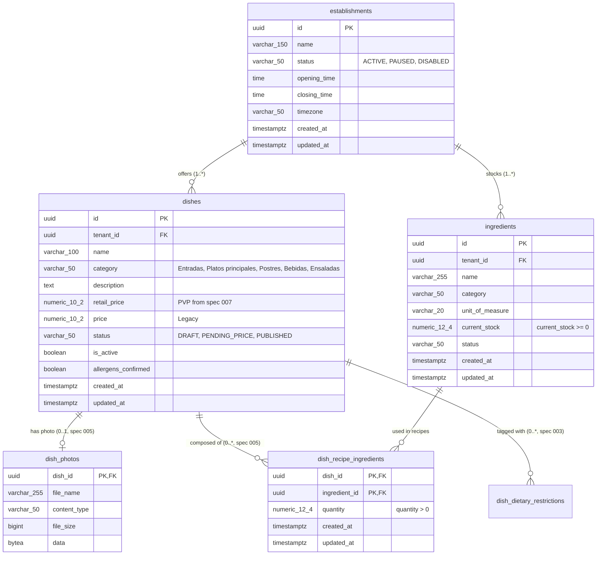

# Data Model: Diner Real-Time Catalog & Multi-Tenant Establishment Discovery

**Feature Branch**: `008-diner-catalog-multi-tenant`  
**Date**: 26/10/2026  
**Status**: Completed  
**Spec Reference**: [spec.md](file:///c:/Users/seeba/OneDrive/Documentos/FIUBA/git/G12---GDSI/specs/008-diner-catalog-multi-tenant/spec.md)

---

## 1. Domain Entities & Persistence Mappings

### 1.1. Establishment (`Establishment`)
Represents a physical restaurant location with its operational status and operating schedule.

| Attribute | Data Type | Nullable | Constraints & Rules |
|---|---|---|---|
| `id` | UUID | No | Primary key, automatically generated (`gen_random_uuid()`). Serves as the `tenantId`. |
| `name` | VARCHAR(150) | No | Establishment commercial name. Case-insensitive and diacritic-insensitive search target. |
| `status` | VARCHAR(50) | No | Enum: `'ACTIVE'`, `'PAUSED'`, `'DISABLED'`. Default `'ACTIVE'`. Autocomplete exposes only `'ACTIVE'`. |
| `opening_time` | TIME | No | Daily opening hour (e.g., `'11:00:00'`). |
| `closing_time` | TIME | No | Daily closing hour (e.g., `'23:00:00'`). |
| `timezone` | VARCHAR(50) | No | Canonical timezone identifier (default `'America/Argentina/Buenos_Aires'`). |
| `created_at` | TIMESTAMPTZ | No | Timestamp of creation (`NOW()`). Immutable. |
| `updated_at` | TIMESTAMPTZ | No | Timestamp of last modification (`NOW()`). |

### 1.2. Dish (`Dish` - Consumed from Spec 005 / Spec 007 / Migration V5)
Represents a culinary item available in the establishment's menu. Owned by spec 005 and extended by spec 007; consumed by spec 008 for catalog rendering.

| Attribute | Data Type | Nullable | Constraints & Rules |
|---|---|---|---|
| `id` | UUID | No | Primary key (`gen_random_uuid()`). |
| `tenant_id` | UUID | No | References `establishments(id)`. Strict multi-tenant isolation. |
| `name` | VARCHAR(100) | No | Dish name (spec 005). Matching target for in-catalog search. |
| `category` | VARCHAR(50) | No | Closed gastronomic category: `'Entradas'`, `'Platos principales'`, `'Postres'`, `'Bebidas'`, `'Ensaladas'` (spec 005). |
| `description` | TEXT | Yes | Diner-facing culinary description. |
| `retail_price` | NUMERIC(10, 2) | Yes | Authoritative retail sale price (PVP) assigned by Administrator upon approval (spec 007). Fallback to `price` if null. |
| `price` | NUMERIC(10, 2) | Yes | Legacy sale price from spec 003. |
| `status` | VARCHAR(50) | No | Lifecycle status: `'DRAFT'`, `'PENDING_PRICE'`, `'PUBLISHED'`. Only `'PUBLISHED'` dishes (with `is_active = true`) are visible to diners. |
| `is_active` | BOOLEAN | No | Active flag. Maintained as `TRUE` when `status = 'PUBLISHED'`. |
| `allergens_confirmed` | BOOLEAN | No | Confirmed by Chef in spec 005; publication gate prerequisite in spec 007. |
| `created_at` | TIMESTAMPTZ | No | Creation timestamp. |
| `updated_at` | TIMESTAMPTZ | No | Last update timestamp. |

### 1.3. Dish Photo (`DishPhoto` - Consumed from Spec 005)
Stores binary image payload and metadata in the `dish_photos` table (`dish_id`, `data`, `content_type`, `file_name`).
- Diners consume photos via `GET /api/v1/dishes/{dishId}/photo`.
- If a dish has no photo or its load fails, the frontend immediately renders the lightweight placeholder fallback.

### 1.4. Recipe Ingredient Line (`DishRecipeIngredient` - Consumed from Spec 005)
Composite entity in 3NF linking a dish to an inventory supply item with required per-portion quantity. Table `dish_recipe_ingredients` is owned by spec 005; read by spec 008 to compute stock availability.

| Attribute | Data Type | Nullable | Constraints & Rules |
|---|---|---|---|
| `dish_id` | UUID | No | Composite PK and FK referencing `dishes(id)` with `ON DELETE CASCADE`. |
| `ingredient_id` | UUID | No | Composite PK and FK referencing `ingredients(id)` with `ON DELETE RESTRICT`. |
| `quantity` | NUMERIC(12, 4) | No | Required per-portion quantity in ingredient's `unit_of_measure`. Must be strictly `> 0`. |
| `created_at` | TIMESTAMPTZ | No | Timestamp when ingredient was added to recipe. |
| `updated_at` | TIMESTAMPTZ | No | Timestamp when quantity was updated. |

### 1.5. Ingredient (`Ingredient` - Consumed from Spec 004 / Migration V4 & V6)
Raw inventory supply item tracking kitchen stock.
- `ingredients.current_stock` is the authoritative kitchen inventory quantity evaluated against recipe lines.
- `ingredients.updated_at` serves as the basis for real-time stock ETag hashing.

---

## 2. Entity-Relationship Diagram (Mermaid)



---

## 3. Relational DDL Specification (`V7__create_establishments.sql`)

> [!NOTE]
> Spec 008 owns **only** the `establishments` table and its seed data. It does **not** alter `dishes` (owned by specs 005 and 007) and does **not** create `dish_recipe_ingredients` (owned by spec 005).

```sql
-- 1. Create establishments table
CREATE TABLE IF NOT EXISTS establishments (
    id           UUID         PRIMARY KEY DEFAULT gen_random_uuid(),
    name         VARCHAR(150) NOT NULL,
    status       VARCHAR(50)  NOT NULL DEFAULT 'ACTIVE',
    opening_time TIME         NOT NULL DEFAULT '11:00:00',
    closing_time TIME         NOT NULL DEFAULT '23:00:00',
    timezone     VARCHAR(50)  NOT NULL DEFAULT 'America/Argentina/Buenos_Aires',
    created_at   TIMESTAMPTZ  NOT NULL DEFAULT NOW(),
    updated_at   TIMESTAMPTZ  NOT NULL DEFAULT NOW(),
    CONSTRAINT chk_establishment_status CHECK (status IN ('ACTIVE', 'PAUSED', 'DISABLED'))
);

CREATE INDEX IF NOT EXISTS idx_establishments_search
    ON establishments(status, LOWER(name));

-- 2. Seed development establishments
INSERT INTO establishments (id, name, status, opening_time, closing_time, timezone)
VALUES
    ('a0eebc99-9c0b-4ef8-bb6d-6bb9bd380a11', 'Café Central Palermo', 'ACTIVE', '08:00:00', '23:30:00', 'America/Argentina/Buenos_Aires'),
    ('b1eebc99-9c0b-4ef8-bb6d-6bb9bd380a22', 'Trattoria Bella Vista', 'ACTIVE', '11:30:00', '23:00:00', 'America/Argentina/Buenos_Aires'),
    ('c2eebc99-9c0b-4ef8-bb6d-6bb9bd380a33', 'Bistró San Telmo', 'PAUSED', '12:00:00', '22:00:00', 'America/Argentina/Buenos_Aires')
ON CONFLICT (id) DO NOTHING;
```

---

## 4. State Invariants and Business Rules

1. **Multi-Tenant Isolation (FR-026, SC-002)**:
   - All queries filter by `tenant_id = :tenantId`.
   - Dishes, ingredients, and recipe lines belonging to Tenant A are never accessible or computable within Tenant B context.

2. **Establishment Discovery Scope (FR-003, FR-005)**:
   - Autocomplete returns only establishments with `status = 'ACTIVE'`.
   - Paused or disabled establishments can be selected by direct ID only to display a full-page blocking notice without menu data exposure.

3. **Dish Visibility Invariant (FR-009, FR-015, SC-005, SC-006)**:
   - A dish is included in the catalog if and only if `dish.status = 'PUBLISHED' AND dish.is_active = true`. Dishes in `DRAFT` or `PENDING_PRICE` are completely omitted.
   - A category is included in the catalog and navigation bar if and only if it contains at least one dish with `status = 'PUBLISHED' AND is_active = true`.
   - Catalog price displays `retail_price` (PVP from spec 007) with fallback to `price` for legacy rows.

4. **Dynamic Stock Availability Formula (FR-013, FR-014, FR-019, SC-003, SC-004)**:
   - A dish has `isAvailable = true` if and only if:
     1. `dish.status == 'PUBLISHED' && dish.is_active == true`
     2. `establishment.status == 'ACTIVE'` and current server time in establishment's timezone is within `[opening_time, closing_time)`.
     3. The dish has at least one recipe line in `dish_recipe_ingredients` (`count(recipeLines) > 0`).
     4. For every recipe line: `ingredient.current_stock >= line.quantity`.
   - If any required ingredient has `current_stock < line.quantity`, `isAvailable = false`.
   - If a dish has zero recipe lines, `isAvailable = false`.
   - Availability is strictly binary; internal numeric counts are never revealed to diners.

5. **Dietary Compliance Integration (Spec 003)**:
   - Each `DishCatalogItem` in the catalog response is evaluated against the authenticated diner's active dietary restrictions (from spec 003).
   - If the diner has active restrictions, `isCompliant` and `conflictingRestrictions` are populated; otherwise `isCompliant = true` and `conflictingRestrictions = []`.

6. **Real-time Stock Invalidation & ETag Generation (FR-016)**:
   - The ETag for `GET /api/v1/establishments/{tenantId}/catalog/availability` is computed based on `MAX(updated_at)` or a SHA-256 hash over `(ingredient.id, ingredient.current_stock, ingredient.updated_at)` for the tenant.
   - When no ingredient stock changes, the ETag remains identical and Spring responds with `304 Not Modified`.

