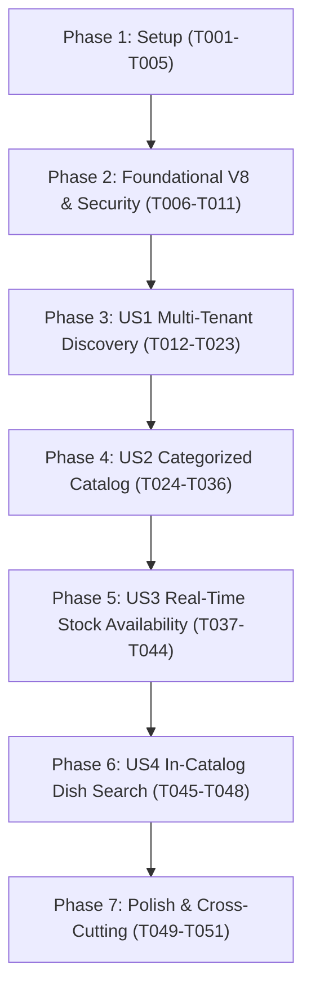

# Implementation Tasks: Diner Real-Time Catalog & Multi-Tenant Establishment Discovery

**Feature**: Diner Real-Time Catalog & Multi-Tenant Establishment Discovery  
**Branch**: `008-diner-catalog-multi-tenant`  
**Spec**: [spec.md](./spec.md) | **Plan**: [plan.md](./plan.md)  
**Data Model**: [data-model.md](./data-model.md) | **Contracts**: [contracts/openapi.yaml](./contracts/openapi.yaml) | **Quickstart**: [quickstart.md](./quickstart.md)  
**GitHub Issues**: [#161](https://github.com/ValentinoCarmonaS/G12---GDSI/issues/161), [#162](https://github.com/ValentinoCarmonaS/G12---GDSI/issues/162), [#163](https://github.com/ValentinoCarmonaS/G12---GDSI/issues/163), [#164](https://github.com/ValentinoCarmonaS/G12---GDSI/issues/164), [#165](https://github.com/ValentinoCarmonaS/G12---GDSI/issues/165), [#166](https://github.com/ValentinoCarmonaS/G12---GDSI/issues/166), [#167](https://github.com/ValentinoCarmonaS/G12---GDSI/issues/167)  

---

## Phase 1: Setup (Shared Infrastructure & Test Fixtures) — [Issue #161](https://github.com/ValentinoCarmonaS/G12---GDSI/issues/161)

**Purpose**: Set up test fixtures, domain exceptions, RFC 7807 problem responses, and shared frontend TypeScript types.

- [x] T001 [P] Create base test support fixtures and builders for establishments, dishes, recipes, and tenants in `easyeat/backend/src/test/java/com/easyeat/catalog/CatalogTestFixtures.java`
- [x] T002 [P] Create frontend API mock handlers for establishment discovery and diner catalog in `easyeat/frontend/src/test/mocks/dinerCatalogHandlers.ts`
- [x] T003 [P] Create domain exceptions (`EstablishmentNotFoundException`, `EstablishmentInactiveException`) in `easyeat/backend/src/main/java/com/easyeat/catalog/exception/`
- [x] T004 Update `GlobalExceptionHandler.java` in `easyeat/backend/src/main/java/com/easyeat/auth/controller/GlobalExceptionHandler.java` mapping custom catalog exceptions to RFC 7807/9457 `ProblemDetail` responses with status codes 400, 401, 403, and 404
- [x] T005 [P] Create shared TypeScript interfaces and DTOs in `easyeat/frontend/src/types/dinerCatalog.ts` (`EstablishmentSummary`, `EstablishmentDetail`, `DishCatalogItem`, `CategoryGroup`, `CatalogResponse`, `AvailabilityMap`)

---

## Phase 2: Foundational (Database Migrations, Core Entities & Security) — [Issue #162](https://github.com/ValentinoCarmonaS/G12---GDSI/issues/162)

**Purpose**: Database schema evolution, baseline JPA entities, repositories, and role-based security boundaries blocking all user stories.

**⚠️ CRITICAL**: No user story implementation can proceed until this phase is complete and verified.

- [x] T006 [P] Create Flyway migration script `V8__create_establishments.sql` in `easyeat/backend/src/main/resources/db/migration/V8__create_establishments.sql` (enabling `unaccent` extension, creating `establishments` table with UUID, name, status, opening_time, closing_time, timezone, audit timestamps, functional index on `(status, unaccent(LOWER(name)))`, and dev seed establishments)
- [x] T007 [P] Create `EstablishmentStatus` enum in `easyeat/backend/src/main/java/com/easyeat/catalog/domain/EstablishmentStatus.java` (`ACTIVE`, `PAUSED`, `DISABLED`)
- [x] T008 [P] Create `Establishment` JPA entity in `easyeat/backend/src/main/java/com/easyeat/catalog/domain/Establishment.java`
- [x] T009 [P] Create `EstablishmentRepository` in `easyeat/backend/src/main/java/com/easyeat/catalog/repository/EstablishmentRepository.java` with autocomplete unaccent/ILIKE search queries
- [x] T010 Update `SecurityConfig.java` in `easyeat/backend/src/main/java/com/easyeat/config/SecurityConfig.java` configuring role boundaries: `/api/v1/establishments/search`, `/api/v1/establishments/*/catalog`, and `/api/v1/establishments/*/catalog/availability` require `hasRole('COMENSAL')`
- [x] T011 Integration test `V8EstablishmentsMigrationTest` in `easyeat/backend/src/test/java/com/easyeat/catalog/migration/V8EstablishmentsMigrationTest.java` running against Testcontainers PostgreSQL verifying V8 schema migration and seed data

**Checkpoint**: Foundational database schema, entity mappings, and security boundaries verified.

---

## Phase 3: User Story 1 — Multi-Tenant Establishment Discovery (COM-1.5.1) (Priority: P1) 🎯 MVP — [Issue #163](https://github.com/ValentinoCarmonaS/G12---GDSI/issues/163)

**Goal**: Authenticated diners find restaurant establishments by name with a central autocomplete search bar (>= 3 chars), view active venues, switch multi-tenant context to explore the live menu, and receive an explicit warning to empty their cart when switching venues.

**Independent Test**: Log in as `ROLE_COMENSAL`, type `>= 3` chars in `/descubrimiento`, verify autocomplete displays matching active branches, select a venue to set active tenant and redirect to `/catalogo`, verify paused establishments show temporary inactivity blocking screen, and verify cart clearing confirmation modal when switching venues with items in cart.

### Tests for User Story 1 (TDD & Behavioral Acceptance - Write First) ⚠️

- [x] T012 [P] [US1] Unit test `EstablishmentDiscoveryServiceTest` in `easyeat/backend/src/test/java/com/easyeat/catalog/service/EstablishmentDiscoveryServiceTest.java` validating `>= 3` character threshold, diacritic stripping, case folding, and inactive establishment exclusion
- [x] T013 [P] [US1] Web contract test `EstablishmentDiscoveryControllerTest` in `easyeat/backend/src/test/java/com/easyeat/catalog/controller/EstablishmentDiscoveryControllerTest.java` verifying `GET /api/v1/establishments/search?q={query}` against OpenAPI schema and HTTP 401 unauthenticated guard
- [x] T014 [P] [US1] Frontend component test `EstablishmentSearchBar.test.tsx` in `easyeat/frontend/src/test/catalog/EstablishmentSearchBar.test.tsx` verifying autocomplete dropdown, 300 ms debounce, cart clear warning dialog, and empty states

### Implementation for User Story 1

- [x] T015 [P] [US1] Implement `EstablishmentSummaryResponse` DTO and `EstablishmentDiscoveryService` in `easyeat/backend/src/main/java/com/easyeat/catalog/service/EstablishmentDiscoveryService.java`
- [x] T016 [US1] Implement `EstablishmentDiscoveryController` in `easyeat/backend/src/main/java/com/easyeat/catalog/controller/EstablishmentDiscoveryController.java`
- [x] T017 [P] [US1] Implement frontend API client method `searchEstablishments` in `easyeat/frontend/src/api/dinerCatalogApi.ts`
- [x] T018 [P] [US1] Create `TenantContext.tsx` and hook `useTenant.ts` in `easyeat/frontend/src/context/TenantContext.tsx` and `easyeat/frontend/src/hooks/useTenant.ts` managing active establishment state and session storage
- [x] T019 [P] [US1] Create `EstablishmentSwitchModal.tsx` in `easyeat/frontend/src/components/catalog/EstablishmentSwitchModal.tsx` displaying the interactive confirmation dialog alerting diners before emptying their active cart upon tenant switch (COM-1.5.1 CA 5 / FR-029)
- [x] T020 [US1] Create `EstablishmentSearchBar.tsx` in `easyeat/frontend/src/components/catalog/EstablishmentSearchBar.tsx` with debounced search, autocomplete dropdown, and cart switch interceptor
- [x] T021 [P] [US1] Create `EstablishmentBlockingNotice.tsx` in `easyeat/frontend/src/components/catalog/EstablishmentBlockingNotice.tsx` rendering full-screen blocking screen for paused/disabled venues
- [x] T022 [US1] Create `EstablishmentDiscoveryPage.tsx` in `easyeat/frontend/src/pages/EstablishmentDiscoveryPage.tsx`
- [x] T023 [US1] Update `AppRoutes.tsx` and `postAuthRouting.ts` registering `/descubrimiento` route protected by `RoleRouteGuard allowedRoles={['COMENSAL']}` and routing diners with no active tenant to discovery

**Checkpoint**: User Story 1 fully functional and independently verifiable.

---

## Phase 4: User Story 2 — Real-Time Gastronomic Catalog Exploration (COM-4.1.1) (Priority: P1) — [Issue #164](https://github.com/ValentinoCarmonaS/G12---GDSI/issues/164)

**Goal**: Authenticated diners explore the selected establishment's menu grouped by closed gastronomic categories (`Entradas`, `Platos principales`, `Postres`, `Bebidas`, `Ensaladas`), view high-res photos (with placeholder fallback), names, retail prices, and dietary flags, jump sections with a sticky category bar, and view read-only mode with schedule banner when outside operating hours.

**Independent Test**: Access `/catalogo` for an active establishment, verify dishes appear under category headers, verify categories with zero published dishes are hidden from both the view and sticky nav, verify smooth scroll navigation, test placeholder fallback on missing image, and verify read-only presentation when outside operating schedule.

### Tests for User Story 2 (TDD & Behavioral Acceptance - Write First) ⚠️

- [x] T024 [P] [US2] Unit test `DinerCatalogServiceTest` in `easyeat/backend/src/test/java/com/easyeat/catalog/service/DinerCatalogServiceTest.java` validating category grouping, exclusion of unpublished dishes, operating hours evaluation, photo URL formatting, and retail price fallback
- [x] T025 [P] [US2] Web contract test `DinerCatalogControllerTest` in `easyeat/backend/src/test/java/com/easyeat/catalog/controller/DinerCatalogControllerTest.java` verifying `GET /api/v1/establishments/{tenantId}/catalog` and HTTP 401/403/404 RFC 7807 responses
- [x] T026 [P] [US2] Frontend component tests `DishCard.test.tsx` and `CatalogPage.test.tsx` in `easyeat/frontend/src/test/catalog/` verifying image fallback, sticky nav, category hiding, and read-only mode

### Implementation for User Story 2

- [x] T027 [P] [US2] Implement catalog DTOs (`DinerCatalogResponse`, `DishCatalogItemDto`, `CategoryGroupDto`, `EstablishmentDetailDto`) in `easyeat/backend/src/main/java/com/easyeat/catalog/dto/`
- [x] T028 [US2] Update `DishRepository` in `easyeat/backend/src/main/java/com/easyeat/catalog/repository/DishRepository.java` adding query for dishes with `tenantId`, `status = PUBLISHED`, and `isActive = true`
- [x] T029 [US2] Implement `DinerCatalogService` in `easyeat/backend/src/main/java/com/easyeat/catalog/service/DinerCatalogService.java` assembling categorized menu, checking timezone schedule, and integrating dietary compliance via `CatalogComplianceService`
- [x] T030 [US2] Implement `DinerCatalogController` in `easyeat/backend/src/main/java/com/easyeat/catalog/controller/DinerCatalogController.java`
- [x] T031 [P] [US2] Implement frontend API client method `getEstablishmentCatalog` in `easyeat/frontend/src/api/dinerCatalogApi.ts`
- [x] T032 [P] [US2] Create `StickyCategoryNav.tsx` in `easyeat/frontend/src/components/catalog/StickyCategoryNav.tsx` with smooth scrolling and active indicator
- [x] T033 [P] [US2] Refactor `DishCard.tsx` in `easyeat/frontend/src/components/catalog/DishCard.tsx` displaying name, price, dietary flags, photo with lightweight SVG placeholder fallback, and full color vs greyscale styling
- [x] T034 [P] [US2] Create `DishDetailModal.tsx` in `easyeat/frontend/src/components/catalog/DishDetailModal.tsx` showing enlarged photo, recipe ingredients, and outside-hours state notice
- [x] T035 [P] [US2] Create `OperatingHoursBanner.tsx` in `easyeat/frontend/src/components/catalog/OperatingHoursBanner.tsx` displaying schedule notice and read-only banner
- [x] T036 [US2] Refactor `CatalogPage.tsx` in `easyeat/frontend/src/pages/CatalogPage.tsx` to render the categorized catalog, sticky navigation, and handle missing tenant redirection

**Checkpoint**: User Story 2 fully functional and independently verifiable.

---

## Phase 5: User Story 3 — Stock-Aware Real-Time Dish Availability (COM-4.1.2) (Priority: P1) — [Issue #165](https://github.com/ValentinoCarmonaS/G12---GDSI/issues/165)

**Goal**: Dynamically evaluate dish availability against live kitchen inventory (`currentStock >= recipeQuantity`), automatically grey out and disable unavailable dishes with an "Agotado" badge, synchronize stock changes in real time (<= 3s SLA) via lightweight 2.5s conditional polling with HTTP ETags (`304 Not Modified`), and pause polling in inactive browser tabs.

**Independent Test**: Modify kitchen inventory stock in database/service for a critical ingredient, verify conditional polling returns updated availability map within <= 3 seconds, verify affected dishes in the catalog smoothly toggle to greyscale with "Agotado" badge without page flicker, verify replenishing ingredient re-enables dishes, and verify tab visibility pause.

### Tests for User Story 3 (TDD & Behavioral Acceptance - Write First) ⚠️

- [x] T037 [P] [US3] Unit test `DishAvailabilityEngineTest` in `easyeat/backend/src/test/java/com/easyeat/catalog/service/DishAvailabilityEngineTest.java` (pure in-memory test covering decimal boundaries, fractional shortfalls, negative stock handling, empty recipe guard, inactive ingredients, shared ingredient N:M matrix, and simultaneous invalidation)
- [x] T038 [P] [US3] Web contract test `DinerAvailabilityControllerTest` in `easyeat/backend/src/test/java/com/easyeat/catalog/controller/DinerAvailabilityControllerTest.java` verifying `GET /api/v1/establishments/{tenantId}/catalog/availability` with ETag and `304 Not Modified`
- [ ] T039 [P] [US3] Integration test `MultiTenantCatalogIntegrationTest` in `easyeat/backend/src/test/java/com/easyeat/catalog/integration/MultiTenantCatalogIntegrationTest.java` verifying homonymous dishes and ingredients between Tenant A and Tenant B, cross-tenant isolation, and 401/403/404 codes with PostgreSQL Testcontainers
- [ ] T040 [P] [US3] Frontend hook test `useRealtimeAvailability.test.ts` in `easyeat/frontend/src/test/catalog/useRealtimeAvailability.test.ts` verifying polling interval, 304 handling, visibilitychange pause/resume, and network error resilience

### Implementation for User Story 3

- [ ] T041 [US3] Implement `DishAvailabilityEngine` in `easyeat/backend/src/main/java/com/easyeat/catalog/service/DishAvailabilityEngine.java` calculating binary availability `{ [dishId]: boolean }` and generating stable ETag hashes (SHA-256) from the availability map
- [ ] T042 [US3] Add availability endpoint `GET /api/v1/establishments/{tenantId}/catalog/availability` to `DinerCatalogController.java` with conditional ETag validation and `304 Not Modified`
- [ ] T043 [P] [US3] Implement frontend hook `useRealtimeAvailability.ts` in `easyeat/frontend/src/hooks/useRealtimeAvailability.ts` with 2.5s conditional polling, ETag caching, graceful network degradation (3-failure banner), and Page Visibility API pausing
- [ ] T044 [US3] Integrate availability hook into `CatalogPage.tsx` smoothly toggling greyscale classes and "Agotado" badges on affected dish cards without layout shift or image reloading

**Checkpoint**: User Story 3 fully functional and verified against <= 3s real-time SLA.

---

## Phase 6: User Story 4 — In-Catalog Rapid Dish Search (COM-4.2.3) (Priority: P2) — [Issue #166](https://github.com/ValentinoCarmonaS/G12---GDSI/issues/166)

**Goal**: Filter catalog dishes in real time by name or recipe ingredients, case- and diacritic-insensitive, showing matching dishes across active categories, handling invalid inputs gracefully, and showing an empty state with spelling check suggestion when no dishes match.

**Independent Test**: Type a dish name (e.g. `"jamon"` matching `"Jamón Serrano"`), verify instant filtering in full catalog and within category views, type an ingredient name (e.g. `"cheddar"`), verify dishes containing cheddar in recipe are returned, type whitespace or special chars and verify catalog maintains state, and verify empty state message on non-matching query.

### Tests for User Story 4 (TDD & Behavioral Acceptance - Write First) ⚠️

- [ ] T045 [P] [US4] Frontend unit test `CatalogSearchFilter.test.tsx` in `easyeat/frontend/src/test/catalog/CatalogSearchFilter.test.tsx` verifying case- and diacritic-insensitive filtering, title and ingredient matching, empty input preservation, and spelling suggestion prompt

### Implementation for User Story 4

- [ ] T046 [P] [US4] Create `CatalogSearchFilter.tsx` in `easyeat/frontend/src/components/catalog/CatalogSearchFilter.tsx` with search input and clear button
- [ ] T047 [US4] Integrate in-catalog search filter in `CatalogPage.tsx`, combining text matching across dish name and `recipeIngredients` with active category filters
- [ ] T048 [US4] Add empty search state view in `CatalogPage.tsx` with no-results message and spelling check suggestion prompt

**Checkpoint**: User Story 4 fully functional and verified.

---

## Phase 7: Polish & Cross-Cutting Concerns — [Issue #167](https://github.com/ValentinoCarmonaS/G12---GDSI/issues/167)

**Purpose**: Backward compatibility preservation, end-to-end verification, and documentation consistency.

- [ ] T049 Maintain backward compatibility by keeping deprecated `GET /api/v1/establishments/{tenantId}/dishes` in `CatalogController.java` delegating to new service logic, and verify all existing spec 003 tests pass without regression
- [ ] T050 End-to-end execution of validation scenarios from `quickstart.md`
- [ ] T051 Run full backend test suite (`mvn test`) and frontend test suite (`npm test`)

---

## Dependencies & Story Execution Order

## Parallel Execution Examples

- **Backend / Frontend Split**:
  - In Phase 3: T012-T016 (Backend search service & controller) can be implemented in parallel with T017-T021 (Frontend search bar, modal, and context).
  - In Phase 4: T024-T030 (Backend catalog assembly service & controller) can be implemented in parallel with T031-T035 (Frontend sticky nav, dish card, detail modal, hours banner).
  - In Phase 5: T037-T042 (Backend stock availability engine & ETag controller) can be implemented in parallel with T043-T044 (Frontend polling hook & visibility listener).

