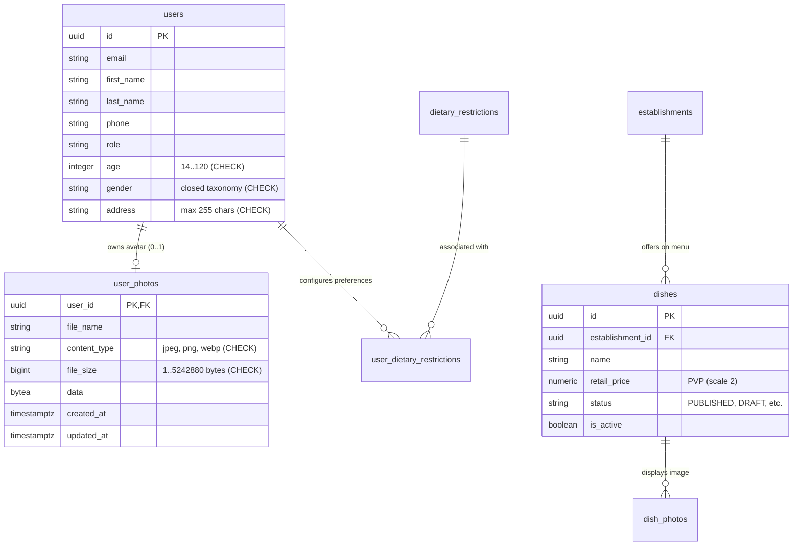
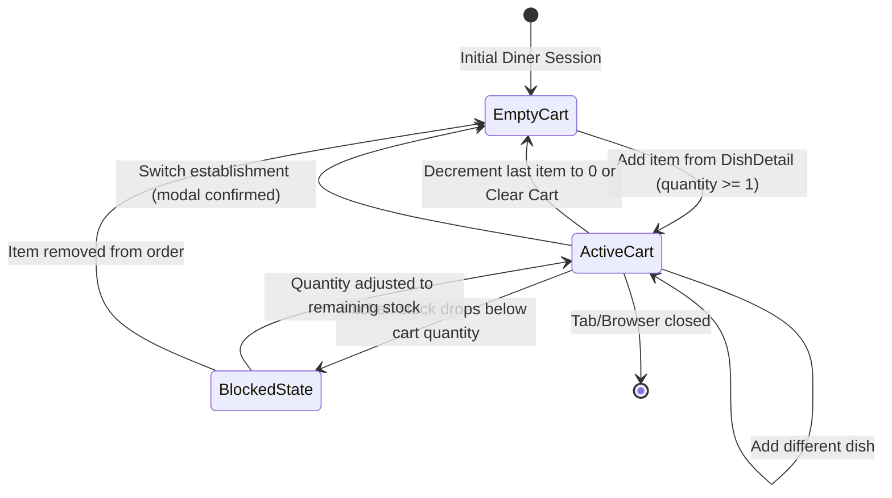
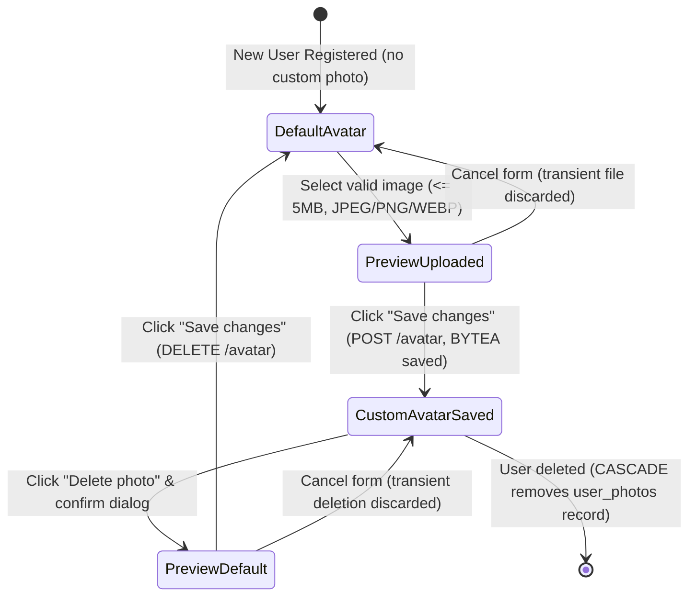

# Conceptual Data Model & Database Schema: Shopping Cart & Diner Demographics

**Feature Branch**: `009-shopping-cart`  
**Date**: 2026-10-31  
**Status**: Completed  
**Specification Reference**: [spec.md](./spec.md) | [research.md](./research.md)

---

## 1. Conceptual Data Dictionaries

### 1.1. Shopping Cart (`ShoppingCart` - Client Session)
Transient container managing dishes selected by the diner during their browsing session in an active establishment. Persisted locally in browser `sessionStorage` under key `'easyeat_cart'`.

| Attribute | Type | Required | Domain Rules and Constraints |
|---|---|---|---|
| `tenantId` | UUID / String | Yes | Identifier of the active establishment. Strict isolation: switching establishment requires flushing or user confirmation. |
| `items` | `CartItem[]` | Yes | List of line items in the cart. Maximum recommended capacity: 50 items. |
| `totalCount` | Integer | Yes | Total quantity of units in the order: $\text{totalCount} = \sum_{i=1}^{n} q_i$ (INV-1). |
| `totalAmount` | Number (2 decimals) | Yes | Grand monetary total in fixed-point cents: $\text{totalAmount} = \sum_{i=1}^{n} (\text{price}_i \times q_i)$ (INV-2). |
| `isFloatingButtonVisible` | Boolean | Yes | Derived status: strictly true if $\text{totalCount} \ge 1$ and currently in catalog view (INV-6, INV-7). |

---

### 1.2. Cart Line Item (`CartItem`)
Individual product line within the shopping cart.

| Attribute | Type | Required | Domain Rules and Constraints |
|---|---|---|---|
| `dishId` | UUID / String | Yes | Unique dish identifier referencing catalog dish (`dishes.id`). |
| `name` | String | Yes | Name of the dish for UI display. |
| `price` | Number (2 decimals) | Yes | Approved unit retail price (`dishes.retail_price`) at time of addition. |
| `quantity` | Integer | Yes | Quantity of units: $1 \le \text{quantity} \le \text{availableStock}$ (INV-3). |
| `subtotal` | Number (2 decimals) | Yes | Line subtotal: $\text{subtotal} = \text{price} \times \text{quantity}$ computed in integer cents (INV-2). |
| `availableStock` | Integer | Yes | Real available kitchen stock at addition/validation time. |
| `dietaryWarnings` | `DietaryRisk[]` | No | Dietary warning badges inherited from diner profile (Spec 003). |
| `isStockSufficient` | Boolean | Yes | False if kitchen stock falls below `quantity` (FR-014a). Blocks checkout. |

---

### 1.3. Dish Catalog Reference (`DishCatalogReference`)
Read-only view model consumed from the active establishment menu (`dishes` table).

| Attribute | Type | Required | Domain Rules and Constraints |
|---|---|---|---|
| `id` | UUID | Yes | Primary key (`dishes.id`). |
| `name` | String | Yes | Dish commercial name. |
| `retailPrice` | BigDecimal | Yes | Approved retail price (`dishes.retail_price`). |
| `status` | String | Yes | Must be `'PUBLISHED'` for diner availability. |
| `availableStock` | Integer | Yes | Computed stock derived from recipe ingredients. |
| `isAvailable` | Boolean | Yes | False if `availableStock == 0` or dish manually paused. |

---

### 1.4. Diner Demographic Profile (`DinerDemographics`)
Extension of user profile record (`User` in `com.easyeat.auth.domain.User`) storing demographic and contact attributes.

| Attribute | Database Column | Required | Domain Rules and Constraints |
|---|---|---|---|
| `id` | `users.id` (UUID) | Yes | Primary key. |
| `age` | `users.age` (INTEGER) | No | Integer within biological range $14 \le \text{age} \le 120$ (INV-5). Nullable. |
| `gender` | `users.gender` (VARCHAR(50)) | No | Closed taxonomy: `'FEMALE'`, `'MALE'`, `'NON_BINARY'`, `'PREFER_NOT_TO_SAY'` or Spanish aliases. Nullable. |
| `address` | `users.address` (VARCHAR(255))| No | Free-form contact address up to 255 chars (INV-8). Nullable. |

- **Local Invariants**:
  - If $\text{age}$ is present: $\text{age} \in \mathbb{Z} \land 14 \le \text{age} \le 120$.
  - If $\text{address}$ is present: $\text{length}(\text{address}) \le 255$.
  - $\text{address}$ is strictly used as descriptive contact data without geocoding or logistics routing (INV-8).
- **Persistence**: Table `users` via Flyway migration `V12__extend_user_demographics_and_avatar.sql`.

---

### 1.5. Profile Photo / Avatar (`UserPhoto`)
Relational entity for binary storage of diner profile avatar images in PostgreSQL (`BYTEA`), applying the pattern from `dish_photos` (`V7`).

| Attribute | Database Column | Required | Domain Rules and Constraints |
|---|---|---|---|
| `userId` | `user_photos.user_id` (UUID) | Yes | Primary key and FK to `users(id)` with `ON DELETE CASCADE`. At most one photo per user. |
| `fileName` | `user_photos.file_name` (VARCHAR(255)) | Yes | Original uploaded file name. |
| `contentType` | `user_photos.content_type` (VARCHAR(50)) | Yes | MIME type validated via magic bytes: `'image/jpeg'`, `'image/png'`, `'image/webp'`. |
| `fileSize` | `user_photos.file_size` (BIGINT) | Yes | Exact file size in bytes: $0 < \text{fileSize} \le 5,242,880$ (5 MB exact, INV-4). |
| `data` | `user_photos.data` (BYTEA) | Yes | Raw binary image bytes. |
| `createdAt` | `user_photos.created_at` (TIMESTAMPTZ)| Yes | Creation timestamp (`NOW()`). |
| `updatedAt` | `user_photos.updated_at` (TIMESTAMPTZ)| Yes | Last modified timestamp (`NOW()`). |

- **Local Invariants**:
  - $0 < \text{fileSize} \le 5,242,880$ bytes (inclusive upper limit).
  - $\text{contentType} \in \{\text{'image/jpeg'}, \text{'image/png'}, \text{'image/webp'}\}$.
- **Persistence**: Table `user_photos` (Flyway `V12`).

---

## 2. Entity-Relationship Diagram (Mermaid)



---

## 3. State Transition Diagrams

### 3.1. Shopping Cart Lifecycle (`sessionStorage`)



### 3.2. Profile Avatar Lifecycle



---

## 4. Flyway Migration Script (`V12__extend_user_demographics_and_avatar.sql`)

```sql
-- ====================================================================
-- EasyEat V12: Diner Demographics & Profile Avatar Persistence
-- ====================================================================

-- 1. Table for diner profile photos (BYTEA binary storage)
CREATE TABLE IF NOT EXISTS user_photos (
    user_id      UUID         PRIMARY KEY REFERENCES users(id) ON DELETE CASCADE,
    file_name    VARCHAR(255) NOT NULL,
    content_type VARCHAR(50)  NOT NULL,
    file_size    BIGINT       NOT NULL,
    data         BYTEA        NOT NULL,
    created_at   TIMESTAMPTZ  NOT NULL DEFAULT NOW(),
    updated_at   TIMESTAMPTZ  NOT NULL DEFAULT NOW(),
    CONSTRAINT chk_user_photos_content_type
        CHECK (content_type IN ('image/jpeg', 'image/png', 'image/webp')),
    CONSTRAINT chk_user_photos_file_size
        CHECK (file_size > 0 AND file_size <= 5242880)
);

-- 2. Extend users table with demographic attributes (age, gender, contact address)
ALTER TABLE users
    ADD COLUMN IF NOT EXISTS age        INTEGER,
    ADD COLUMN IF NOT EXISTS gender     VARCHAR(50),
    ADD COLUMN IF NOT EXISTS address    VARCHAR(255);

ALTER TABLE users
    ADD CONSTRAINT chk_users_age_range
        CHECK (age IS NULL OR (age >= 14 AND age <= 120)),
    ADD CONSTRAINT chk_users_gender_valid
        CHECK (gender IS NULL OR gender IN (
            'FEMALE', 'MALE', 'NON_BINARY', 'PREFER_NOT_TO_SAY',
            'Femenino', 'Masculino', 'No binario', 'Prefiero no responder'
        )),
    ADD CONSTRAINT chk_users_address_length
        CHECK (address IS NULL OR length(address) <= 255);
```
