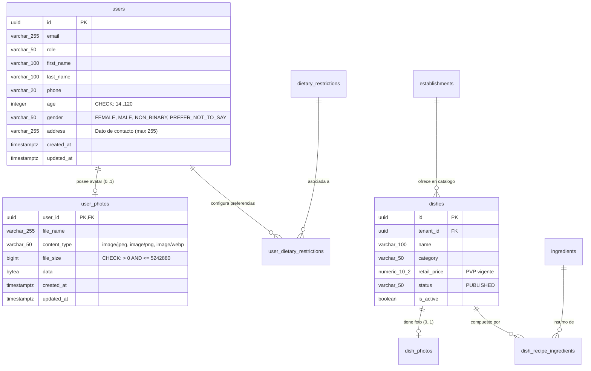
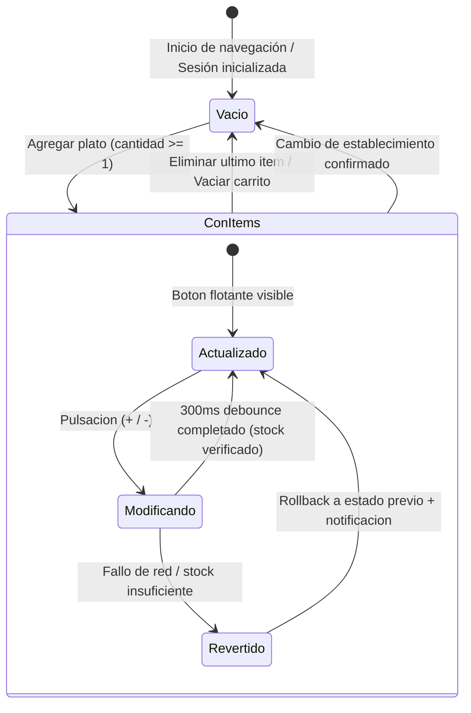
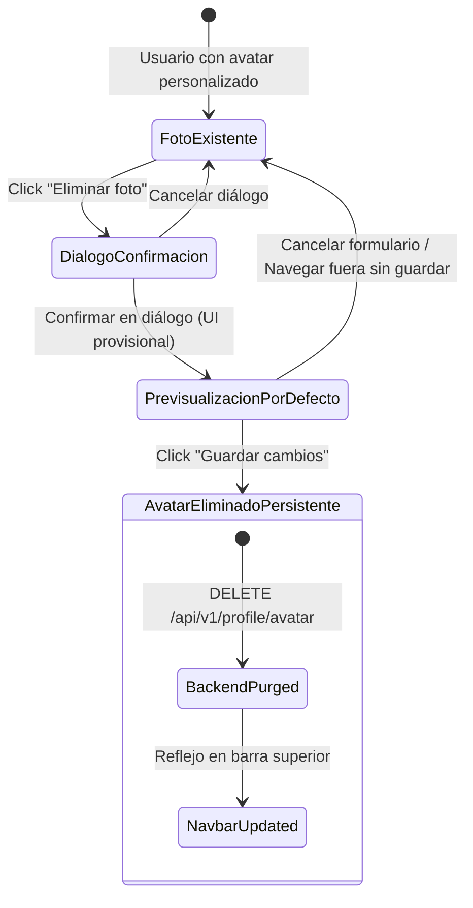

# Conceptual Data Model: Shopping Cart & Diner Demographics

**Feature Branch**: `009-shopping-cart`  
**Fecha**: 31/10/2026  
**Estado**: Completado  
**Referencia de Especificación**: [spec.md](./spec.md)

---

## 1. Entidades del Dominio y Mapeos de Persistencia

### 1.1. Carrito de Compras (`ShoppingCart`)
Representa el contenedor transitorio de la orden en construcción por parte del comensal. Reside en la sesión local del comensal (`sessionStorage`) y se encuentra estrictamente asociado al contexto del establecimiento gastronómico activo (`tenantId`).

| Atributo | Tipo Conceptual | Requerido | Descripción y Reglas de Dominio |
|---|---|---|---|
| `sessionId` | String / UUID | Sí | Identificador efímero de la sesión de navegación del comensal. |
| `tenantId` | UUID | Sí | Identificador del establecimiento gastronómico activo en el que se seleccionan los platos. |
| `items` | Array<CartItem> | Sí | Colección de platos incorporados a la orden actual. Sin líneas duplicadas para un mismo plato. |
| `totalCount` | Integer | Sí | Cantidad total acumulada de unidades: $\sum_{i=1}^{n} \text{quantity}_i$ (INV-1). |
| `totalAmount` | Decimal (2 dec) | Sí | Monto acumulado total en pesos: $\sum_{i=1}^{n} \text{subtotal}_i$, calculado con precisión monetaria exacta (INV-2). |
| `isFloatingButtonVisible` | Boolean | Sí | Derivado de regla biunívoca: $\text{totalCount} \ge 1 \land \text{isCatalogView}$ (INV-6, INV-7). |
| `hasConflictingItems` | Boolean | Sí | Indicador de si al menos un ítem presenta conflicto dietario con el perfil del comensal (Spec 003). |

- **Invariantes Locales**:
  - $\text{totalCount} \ge 0$.
  - $\text{totalAmount} \ge 0.00$.
  - Si $\text{totalCount} = 0 \implies \text{items} = [] \land \text{isFloatingButtonVisible} = \text{false}$.
- **Persistencia**: Sesión local en navegador (`sessionStorage`, clave `'easyeat_cart'`). No se persiste en base de datos hasta que el comensal avance al checkout formal (Sprint 4).

---

### 1.2. Ítem del Carrito (`CartItem`)
Representa cada plato gastronómico individual incorporado a la orden del comensal.

| Atributo | Tipo Conceptual | Requerido | Descripción y Reglas de Dominio |
|---|---|---|---|
| `dishId` | UUID | Sí | Identificador único del plato agregado (referencia a `dishes.id`). Clave única dentro de la colección `items`. |
| `name` | String (max 150) | Sí | Nombre comercial del plato, consumido del catálogo publicado. |
| `price` | Decimal (2 dec) | Sí | Precio unitario de venta al público (PVP vigente aprobado, `retail_price` de spec 007). |
| `quantity` | Integer | Sí | Unidades seleccionadas por el comensal. Entero estrictamente $\ge 1$ (INV-1). |
| `subtotal` | Decimal (2 dec) | Sí | Subtotal de la línea: $\text{price} \times \text{quantity}$, redondeo exacto a 2 decimales (INV-2). |
| `availableStock` | Integer | Sí | Disponibilidad máxima en cocina para dicho plato al momento de la consulta (INV-3). |
| `isCompliant` | Boolean | No | Cumplimiento del plato con el perfil dietario del comensal (heredado de spec 003). |
| `conflictingRestrictions` | Array<String> | No | Códigos de alérgenos o estilos de vida en conflicto (ej. `["CELIAC", "DAIRY"]`). |
| `riskConfirmed` | Boolean | Sí | Indica si el comensal confirmó explícitamente asumir el riesgo de salud al agregarlo. |

- **Invariantes Locales**:
  - $\text{quantity} \in \mathbb{Z}^+ \quad (1 \le \text{quantity} \le \text{availableStock})$.
  - $\text{subtotal} = \text{price} \times \text{quantity}$.
  - Al restar cuando $\text{quantity} = 1$, el ítem se elimina de la orden (no existen cantidades $\le 0$).

---

### 1.3. Referencia de Plato del Catálogo (`DishCatalogReference`)
Referencia de sólo lectura al plato disponible en el menú activo del establecimiento, consumido desde `com.easyeat.catalog` (specs 005, 007 y 008).

| Atributo | Tipo Conceptual | Requerido | Descripción y Reglas de Dominio |
|---|---|---|---|
| `id` | UUID | Sí | Identificador del plato en `dishes`. |
| `tenantId` | UUID | Sí | Establecimiento al que pertenece el plato. |
| `name` | String | Sí | Nombre del plato. |
| `category` | String | Sí | Categoría gastronómica (Entradas, Platos principales, Postres, Bebidas, Ensaladas). |
| `retailPrice` | Decimal (2 dec) | Sí | Precio vigente aprobado (PVP). |
| `isAvailable` | Boolean | Sí | Evaluación dinámica de stock: $\forall (i, q) \in \text{Recipe}: \text{Stock}(i) \ge q$ (Spec 008). |
| `photoUrl` | String | No | URL pública del recurso de imagen: `/api/v1/dishes/{id}/photo` o placeholder fallback. |

---

### 1.4. Perfil Demográfico del Comensal (`DinerDemographics`)
Extensión del expediente de usuario (`User` en `com.easyeat.auth.domain.User`) para almacenar información demográfica y de personalización del comensal.

| Atributo | Tipo BD / Columna | Requerido | Restricciones y Reglas de Dominio |
|---|---|---|---|
| `id` | UUID (`users.id`) | Sí | Identificador único del usuario comensal. Clave foránea y primaria. |
| `age` | INTEGER (`users.age`) | No | Edad del comensal. Entero biológicamente coherente: $14 \le \text{age} \le 120$ (INV-5). |
| `gender` | VARCHAR(50) (`users.gender`) | No | Género del comensal. Clasificación cerrada: `'FEMALE'`, `'MALE'`, `'NON_BINARY'`, `'PREFER_NOT_TO_SAY'`. |
| `address` | VARCHAR(255) (`users.address`)| No | Domicilio de contacto del comensal. Cadena de texto libre de hasta 255 caracteres (INV-8). |
| `avatarUrl` | String (derivado) | No | Ruta del avatar: `/api/v1/profile/avatar` si existe foto personalizada, o `null` (avatar por defecto). |

- **Invariantes Locales**:
  - Si $\text{age}$ está presente: $\text{age} \in \mathbb{Z} \land 14 \le \text{age} \le 120$.
  - Si $\text{address}$ está presente: $\text{length}(\text{address}) \le 255$.
  - $\text{address}$ se utiliza exclusivamente como información de contacto descriptiva; no admite geocodificación ni cálculos de logística (INV-8).
- **Persistencia**: Tabla `users` mediante migración Flyway `V10__extend_user_demographics_and_avatar.sql`.

---

### 1.5. Foto de Perfil / Avatar (`UserPhoto`)
Entidad relacional para el almacenamiento seguro del binario gráfico de la foto de perfil en base de datos PostgreSQL (`BYTEA`), aplicando el patrón de `dish_photos` (`V7`).

| Atributo | Tipo BD / Columna | Requerido | Restricciones y Reglas de Dominio |
|---|---|---|---|
| `userId` | UUID (`user_photos.user_id`) | Sí | Clave primaria y FK a `users(id)` con `ON DELETE CASCADE`. Un usuario posee a lo sumo una foto. |
| `fileName` | VARCHAR(255) | Sí | Nombre original del archivo de imagen subido. |
| `contentType` | VARCHAR(50) | Sí | Tipo MIME validado por magic bytes: `'image/jpeg'`, `'image/png'`, `'image/webp'`. |
| `fileSize` | BIGINT | Sí | Tamaño exacto en bytes: $0 < \text{fileSize} \le 5.242.880$ (5 MB exactos, INV-4). |
| `data` | BYTEA | Sí | Contenido binario de la imagen. |
| `createdAt` | TIMESTAMPTZ | Sí | Fecha y hora de creación (`NOW()`). |
| `updatedAt` | TIMESTAMPTZ | Sí | Fecha y hora de última modificación (`NOW()`). |

- **Invariantes Locales**:
  - $0 < \text{fileSize} \le 5.242.880$ bytes (límite inclusivo).
  - $\text{contentType} \in \{\text{'image/jpeg'}, \text{'image/png'}, \text{'image/webp'}\}$.
- **Persistencia**: Tabla `user_photos` (Flyway `V10`).

---

## 2. Diagrama Entidad-Relación (Mermaid)



---

## 3. Modelo Transaccional y Ciclos de Vida

### 3.1. Ciclo de Vida del Carrito en Sesión Local


### 3.2. Ciclo de Vida de Eliminación Diferida de Foto de Perfil


---

## 4. Script de Migración Flyway (`V10__extend_user_demographics_and_avatar.sql`)

```sql
-- ====================================================================
-- EasyEat V10: Diner Demographics & Profile Avatar Persistence
-- ====================================================================

-- 1. Tabla para fotos de perfil de comensales (almacenamiento BYTEA)
CREATE TABLE IF NOT EXISTS user_photos (
    user_id      UUID         PRIMARY KEY REFERENCES users(id) ON DELETE CASCADE,
    file_name    VARCHAR(255) NOT NULL,
    content_type VARCHAR(50)  NOT NULL,
    file_size    BIGINT       NOT NULL,
    data         BYTEA        NOT NULL,
    created_at   TIMESTAMPTZ  NOT NULL DEFAULT NOW(),
    updated_at   TIMESTAMPTZ  NOT NULL DEFAULT NOW(),
    CONSTRAINT chk_user_photos_content_type
        CHECK (content_type IN ('image/jpeg', 'image/png', 'image/webp')),
    CONSTRAINT chk_user_photos_file_size
        CHECK (file_size > 0 AND file_size <= 5242880)
);

-- 2. Extensión de users con datos demográficos (edad, género, domicilio de contacto)
ALTER TABLE users
    ADD COLUMN IF NOT EXISTS age        INTEGER,
    ADD COLUMN IF NOT EXISTS gender     VARCHAR(50),
    ADD COLUMN IF NOT EXISTS address    VARCHAR(255);

ALTER TABLE users
    ADD CONSTRAINT chk_users_age_range
        CHECK (age IS NULL OR (age >= 14 AND age <= 120)),
    ADD CONSTRAINT chk_users_gender_valid
        CHECK (gender IS NULL OR gender IN (
            'FEMALE', 'MALE', 'NON_BINARY', 'PREFER_NOT_TO_SAY',
            'Femenino', 'Masculino', 'No binario', 'Prefiero no responder'
        )),
    ADD CONSTRAINT chk_users_address_length
        CHECK (address IS NULL OR length(address) <= 255);
```
