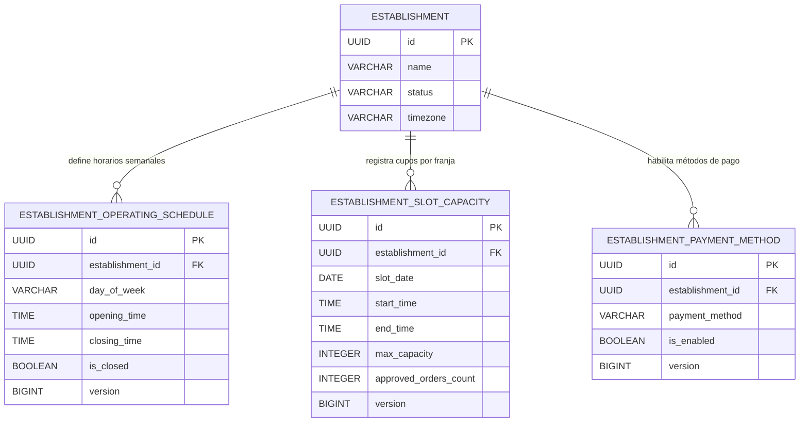
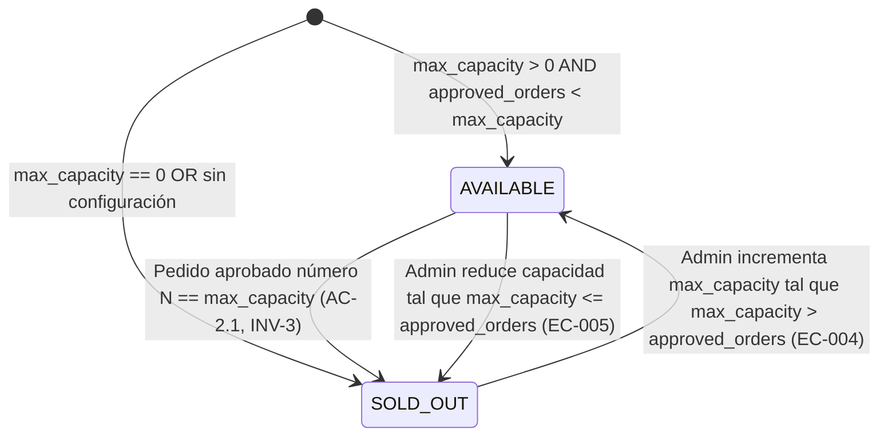

# Data Model: Restaurant Operation Configuration

**Feature**: `010-restaurant-operation-config` | **Date**: 31/10/2026 | **Spec**: [spec.md](./spec.md)

---

## 1. Conceptual Domain Entities

### 1.1 `HorarioComercial` (`EstablishmentOperatingSchedule`)
Representa el horario comercial y estado de apertura del restaurante para cada día de la semana.

- **Atributos**:
  - `id`: UUID (Identificador unívoco del horario).
  - `establishmentId`: UUID (Vínculo mandatorio con el establecimiento gastronómico / tenant).
  - `dayOfWeek`: `DayOfWeek` (Enum: `MONDAY`, `TUESDAY`, `WEDNESDAY`, `THURSDAY`, `FRIDAY`, `SATURDAY`, `SUNDAY`).
  - `openingTime`: `LocalTime` (Hora de apertura del turno, precisión de minutos `HH:mm`).
  - `closingTime`: `LocalTime` (Hora de cierre del turno, precisión de minutos `HH:mm`).
  - `isClosed`: `boolean` (Indicador booleano de si el restaurante se encuentra cerrado todo el día).
  - `version`: `Long` (Control de concurrencia optimista).
- **Invariantes locales**:
  - `INV-7`: Si `isClosed == false`, entonces `openingTime < closingTime`.
  - Unicidad: Solo puede existir una configuración por `(establishmentId, dayOfWeek)`.
  - Si un día no está registrado en el sistema, se interpreta como cerrado por defecto (`isClosed = true`, `EC-008`).

---

### 1.2 `FranjaHoraria` (`TimeSlot` - Objeto de Valor)
Bloque temporal discreto, continuo y determinístico de exactamente 15 minutos dentro de la jornada comercial.

- **Atributos**:
  - `slotDate`: `LocalDate` (Fecha calendario de la franja).
  - `startTime`: `LocalTime` (Hora de inicio del bloque, inclusive).
  - `endTime`: `LocalTime` (Hora de fin del bloque, exclusive, calculada como `startTime.plusMinutes(15)`).
- **Invariantes locales**:
  - `INV-5`: Toda franja tiene una duración estricta de 15 minutos: $\text{ChronoUnit.MINUTES.between}(startTime, endTime) = 15$.
  - Intervalo semi-abierto $[startTime, endTime)$.

---

### 1.3 `ConfiguracionCapacidadFranja` (`EstablishmentSlotCapacity`)
Entidad operativa que gobierna el volumen productivo máximo de la cocina para una franja horaria determinada y contabiliza los pedidos aprobados.

- **Atributos**:
  - `id`: UUID (Identificador unívoco).
  - `establishmentId`: UUID (Tenant ID).
  - `slotDate`: `LocalDate` (Fecha de la franja horaria).
  - `startTime`: `LocalTime` (Hora de inicio del bloque de 15 minutos).
  - `endTime`: `LocalTime` (Hora de fin del bloque, `startTime + 15 min`).
  - `maxCapacity`: `int` (Capacidad máxima de pedidos para la franja).
  - `approvedOrdersCount`: `int` (Contador atómico acumulado de pedidos aprobados).
  - `version`: `Long` (Versión para control de concurrencia).
- **Invariantes locales**:
  - `INV-6`: `maxCapacity >= 0`.
  - `approvedOrdersCount >= 0`.
  - `INV-2`: La admisión de un nuevo pedido exige `approvedOrdersCount < maxCapacity`.
  - `INV-3`: La franja se marca como "Agotada" en el selector del comensal si `approvedOrdersCount >= maxCapacity`.
  - Unicidad: `(establishmentId, slotDate, startTime)` es estrictamente único.
  - Franja no configurada: Si no existe fila en base de datos para una franja, el sistema la proyecta con `maxCapacity = 0` y `approvedOrdersCount = 0`, resultando en estado agotada (`EC-007`).

---

### 1.4 `MetodoPagoConfigurable` (`EstablishmentPaymentMethod`)
Representa la configuración de visibilidad administrativa para cada pasarela de pago online de la plataforma.

- **Atributos**:
  - `id`: UUID (Identificador unívoco).
  - `establishmentId`: UUID (Tenant ID).
  - `paymentMethod`: `PaymentMethod` (Enum tipado: `MERCADO_PAGO`, `STRIPE`).
  - `isEnabled`: `boolean` (Estado de visibilidad: `true` para encendido, `false` para apagado).
  - `version`: `Long` (Control de concurrencia optimista).
- **Invariantes locales**:
  - `INV-4`: El método es visible en el checkout del comensal si y solo si `isEnabled == true`.
  - `INV-9`: La transacción solo puede confirmarse si al momento del checkout `isEnabled == true`.
  - Costo cero: No almacena datos bancarios, claves de API privadas, cuentas corrientes ni secretos (`A-005`).

---

### 1.5 `ConfiguracionOperativaRestaurante` (`RestaurantOperationConfig` - Agregado de Consulta)
Agregado que consolida la visión completa de la administración para un establecimiento.

- **Atributos**:
  - `establishmentId`: UUID.
  - `establishmentName`: String.
  - `timezone`: String (ej. `America/Argentina/Buenos_Aires`).
  - `schedules`: `List<EstablishmentOperatingSchedule>`.
  - `paymentMethods`: `List<EstablishmentPaymentMethod>`.

---

### 1.6 `PedidoEnFranja` (`SlotOrderReference` - Integración con Órdenes)
Punto de integración conceptual con el flujo de pedidos existente (`A-002`, `A-003`).

- **Atributos**:
  - `orderId`: UUID.
  - `establishmentId`: UUID.
  - `slotDate`: `LocalDate`.
  - `slotStartTime`: `LocalTime`.
  - `status`: String (`PENDING_APPROVAL`, `APPROVED`, `REJECTED`).

---

## 2. Diagrama de Entidad-Relación Conceptual



---

## 3. Esquema Relacional de Base de Datos (DDL Flyway Preview)

El script de migración Flyway se ubicará en `easyeat/backend/src/main/resources/db/migration/V12__restaurant_operation_config.sql`:

```sql
-- 1. Tabla de Horarios Comerciales Semanales
CREATE TABLE IF NOT EXISTS establishment_operating_schedules (
    id               UUID         PRIMARY KEY DEFAULT gen_random_uuid(),
    establishment_id UUID         NOT NULL REFERENCES establishments(id) ON DELETE CASCADE,
    day_of_week      VARCHAR(15)  NOT NULL,
    opening_time     TIME         NOT NULL DEFAULT '11:00:00',
    closing_time     TIME         NOT NULL DEFAULT '23:00:00',
    is_closed        BOOLEAN      NOT NULL DEFAULT FALSE,
    version          BIGINT       NOT NULL DEFAULT 0,
    created_at       TIMESTAMPTZ  NOT NULL DEFAULT NOW(),
    updated_at       TIMESTAMPTZ  NOT NULL DEFAULT NOW(),
    CONSTRAINT uq_schedule_establishment_day UNIQUE (establishment_id, day_of_week),
    CONSTRAINT chk_schedule_day CHECK (day_of_week IN ('MONDAY', 'TUESDAY', 'WEDNESDAY', 'THURSDAY', 'FRIDAY', 'SATURDAY', 'SUNDAY')),
    CONSTRAINT chk_schedule_times CHECK (is_closed = TRUE OR opening_time < closing_time)
);

CREATE INDEX IF NOT EXISTS idx_operating_schedules_lookup
    ON establishment_operating_schedules(establishment_id, day_of_week);

-- 2. Tabla de Capacidad Operativa por Franja Horaria (15 minutos)
CREATE TABLE IF NOT EXISTS establishment_slot_capacities (
    id                    UUID         PRIMARY KEY DEFAULT gen_random_uuid(),
    establishment_id      UUID         NOT NULL REFERENCES establishments(id) ON DELETE CASCADE,
    slot_date             DATE         NOT NULL,
    start_time            TIME         NOT NULL,
    end_time              TIME         NOT NULL,
    max_capacity          INTEGER      NOT NULL DEFAULT 0,
    approved_orders_count INTEGER      NOT NULL DEFAULT 0,
    version               BIGINT       NOT NULL DEFAULT 0,
    created_at            TIMESTAMPTZ  NOT NULL DEFAULT NOW(),
    updated_at            TIMESTAMPTZ  NOT NULL DEFAULT NOW(),
    CONSTRAINT uq_slot_establishment_date_time UNIQUE (establishment_id, slot_date, start_time),
    CONSTRAINT chk_slot_max_capacity CHECK (max_capacity >= 0),
    CONSTRAINT chk_slot_approved_count CHECK (approved_orders_count >= 0),
    CONSTRAINT chk_slot_interval CHECK (start_time < end_time)
);

CREATE INDEX IF NOT EXISTS idx_slot_capacities_lookup
    ON establishment_slot_capacities(establishment_id, slot_date, start_time);

-- 3. Tabla de Configuración de Métodos de Pago Online
CREATE TABLE IF NOT EXISTS establishment_payment_methods (
    id               UUID         PRIMARY KEY DEFAULT gen_random_uuid(),
    establishment_id UUID         NOT NULL REFERENCES establishments(id) ON DELETE CASCADE,
    payment_method   VARCHAR(50)  NOT NULL,
    is_enabled       BOOLEAN      NOT NULL DEFAULT TRUE,
    version          BIGINT       NOT NULL DEFAULT 0,
    created_at       TIMESTAMPTZ  NOT NULL DEFAULT NOW(),
    updated_at       TIMESTAMPTZ  NOT NULL DEFAULT NOW(),
    CONSTRAINT uq_establishment_payment_method UNIQUE (establishment_id, payment_method),
    CONSTRAINT chk_payment_method_enum CHECK (payment_method IN ('MERCADO_PAGO', 'STRIPE'))
);

CREATE INDEX IF NOT EXISTS idx_payment_methods_lookup
    ON establishment_payment_methods(establishment_id, is_enabled);

-- 4. Sembrado inicial para los establecimientos existentes en V8
INSERT INTO establishment_payment_methods (establishment_id, payment_method, is_enabled)
SELECT id, 'MERCADO_PAGO', TRUE FROM establishments
ON CONFLICT DO NOTHING;

INSERT INTO establishment_payment_methods (establishment_id, payment_method, is_enabled)
SELECT id, 'STRIPE', TRUE FROM establishments
ON CONFLICT DO NOTHING;
```

---

## 4. Máquina de Estados y Ciclo de Vida de Franjas Horarias



