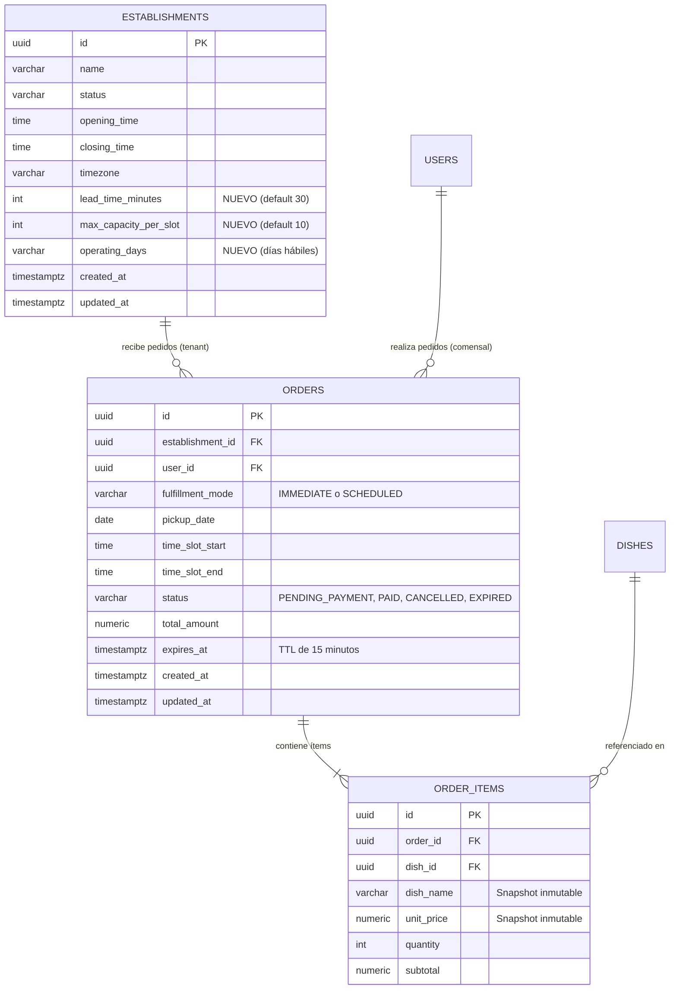
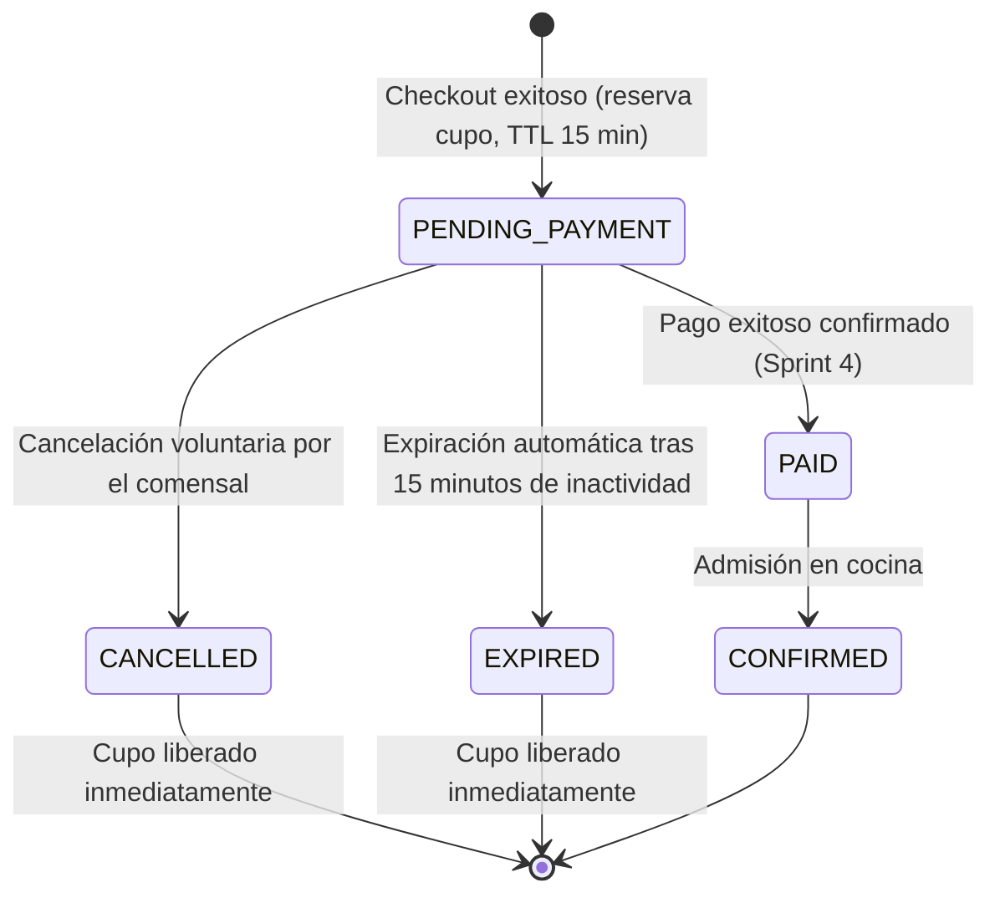

# Data Model: Selección de Modalidad de Retiro y Motor de Reservas por Franja Horaria

**Branch**: `012-diner-pickup-time-slots` | **Fecha**: 01/11/2026 | **Spec**: [spec.md](./spec.md)

---

## 1. Diagrama de entidades relacionales



---

## 2. Entidades de persistencia (PostgreSQL & Spring Data JPA)

### 2.1. Extensión de `Establishment` (`com.easyeat.catalog.domain.Establishment`)

Extiende el modelo introducido en la spec 008 para incorporar los parámetros operativos de capacidad y antelación.

| Campo | Tipo SQL | Tipo Java | Restricciones | Descripción |
|---|---|---|---|---|
| `id` | `UUID` | `UUID` | PK, Not Null | Identificador único del establecimiento. |
| `name` | `VARCHAR(150)` | `String` | Not Null | Razón social o nombre comercial. |
| `status` | `VARCHAR(50)` | `EstablishmentStatus` | Not Null, Default `'ACTIVE'` | Enum: `ACTIVE`, `PAUSED`, `DISABLED`. |
| `opening_time` | `TIME` | `LocalTime` | Not Null, Default `'11:00:00'` | Horario de apertura comercial. |
| `closing_time` | `TIME` | `LocalTime` | Not Null, Default `'23:00:00'` | Horario de cierre comercial. |
| `timezone` | `VARCHAR(50)` | `String` | Not Null, Default `'America/Argentina/Buenos_Aires'` | Zona horaria oficial del local. |
| `lead_time_minutes` | `INTEGER` | `Integer` | Not Null, Default `30`, Check `> 0` | Margen mínimo de preparación en minutos para el día de la fecha. |
| `max_capacity_per_slot` | `INTEGER` | `Integer` | Not Null, Default `10`, Check `> 0` | Capacidad máxima de órdenes simultáneas por franja de 15 minutos. |
| `operating_days` | `VARCHAR(100)` | `Set<DayOfWeek>` | Not Null, Default `'MONDAY,TUESDAY,...'` | Días operativos de atención comercial (vía `AttributeConverter`). |
| `created_at` | `TIMESTAMPTZ` | `Instant` | Not Null | Fecha y hora de creación. |
| `updated_at` | `TIMESTAMPTZ` | `Instant` | Not Null | Fecha y hora de última modificación. |

**Reglas de negocio asociadas**:
- `isOpenOn(LocalDate date)`: Determina si el día de la semana correspondiente a `date` pertenece a `operating_days`.
- `isSlotWithinOperatingHours(LocalTime start, LocalTime end)`: Valida que `start >= opening_time` y `end <= closing_time`.
- `calculateCurrentOngoingSlot(LocalTime now)`: Determina la franja horaria en curso (redondeada al cuarto de hora inferior más próximo).

---

### 2.2. Entidad `Order` (`com.easyeat.order.domain.Order`)

Representa la orden comercial generada por el comensal al completar el checkout.

| Campo | Tipo SQL | Tipo Java | Restricciones | Descripción |
|---|---|---|---|---|
| `id` | `UUID` | `UUID` | PK, Default `gen_random_uuid()` | Identificador único del pedido. |
| `establishment_id` | `UUID` | `UUID` | FK a `establishments(id)`, Not Null | Establecimiento gastronómico prestador del servicio (tenant). |
| `user_id` | `UUID` | `UUID` | FK a `users(id)`, Not Null | Comensal autenticado titular de la orden (`ROLE_COMENSAL`). |
| `fulfillment_mode` | `VARCHAR(30)` | `FulfillmentMode` | Not Null, Check `IN ('IMMEDIATE', 'SCHEDULED')` | Modalidad de retiro seleccionada. |
| `pickup_date` | `DATE` | `LocalDate` | Not Null | Fecha pautada de retiro (hoy si es `IMMEDIATE`, fecha elegida si es `SCHEDULED`). |
| `time_slot_start` | `TIME` | `LocalTime` | Not Null | Hora de inicio de la franja horaria de 15 minutos asignada. |
| `time_slot_end` | `TIME` | `LocalTime` | Not Null | Hora de finalización de la franja horaria (`time_slot_start + 15 min`). |
| `status` | `VARCHAR(30)` | `OrderStatus` | Not Null, Check `IN ('PENDING_PAYMENT', 'CONFIRMED', 'PAID', 'CANCELLED', 'EXPIRED')` | Estado del ciclo de vida de la orden. |
| `total_amount` | `DECIMAL(12, 2)` | `BigDecimal` | Not Null, Check `>= 0` | Importe total bruto del pedido. |
| `expires_at` | `TIMESTAMPTZ` | `Instant` | Nullable | Plazo fatal de expiración (exactamente 15 minutos tras su creación si está en `PENDING_PAYMENT`). |
| `created_at` | `TIMESTAMPTZ` | `Instant` | Not Null, Default `NOW()` | Marca temporal de auditoría de creación. |
| `updated_at` | `TIMESTAMPTZ` | `Instant` | Not Null, Default `NOW()` | Marca temporal de auditoría de actualización. |

**Índices para rendimiento y concurrencia**:
1. `idx_orders_slot_capacity`: `ON orders(establishment_id, pickup_date, time_slot_start, status, expires_at)`  
   Permite calcular en sub-milisegundos el conteo de órdenes activas de una franja bajo bloqueo pesimista.
2. `idx_orders_user_pending`: `ON orders(user_id, status)`  
   Garantiza la comprobación inmediata del invariante de orden única activa en `PENDING_PAYMENT` por comensal.
3. `idx_orders_expires_sweep`: `ON orders(status, expires_at)`  
   Optimiza el barrido periódico por lotes del proceso `@Scheduled`.

---

### 2.3. Entidad `OrderItem` (`com.easyeat.order.domain.OrderItem`)

Persiste el detalle inmutable de cada plato contenido en el carrito de compras del comensal.

| Campo | Tipo SQL | Tipo Java | Restricciones | Descripción |
|---|---|---|---|---|
| `id` | `UUID` | `UUID` | PK, Default `gen_random_uuid()` | Identificador de línea de pedido. |
| `order_id` | `UUID` | `UUID` | FK a `orders(id)` ON DELETE CASCADE, Not Null | Orden padre a la que pertenece la línea. |
| `dish_id` | `UUID` | `UUID` | FK a `dishes(id)`, Not Null | Identificador del plato del catálogo. |
| `dish_name` | `VARCHAR(150)` | `String` | Not Null | Snapshot del nombre del plato al momento de ordenar. |
| `unit_price` | `DECIMAL(10, 2)` | `BigDecimal` | Not Null, Check `> 0` | Snapshot del precio unitario al momento de ordenar. |
| `quantity` | `INTEGER` | `Integer` | Not Null, Check `> 0` | Cantidad de porciones solicitadas. |
| `subtotal` | `DECIMAL(12, 2)` | `BigDecimal` | Not Null, Check `> 0` | Importe subtotal calculado (`unit_price * quantity`). |

---

## 3. Máquina de estados y ciclo de vida de la orden



### Transiciones de estado permitidas

| Estado Origen | Evento Desencadenante | Estado Destino | Acción sobre el cupo |
|---|---|---|---|
| `[*]` | Confirmación de checkout en `POST /api/v1/orders` | `PENDING_PAYMENT` | **Consume 1 cupo** atómicamente de la franja horaria. |
| `PENDING_PAYMENT` | Comensal ejecuta `POST /api/v1/orders/{id}/cancel` | `CANCELLED` | **Libera 1 cupo** de forma inmediata. |
| `PENDING_PAYMENT` | Transcurren 15 minutos sin pago (`expires_at < NOW()`) | `EXPIRED` | **Libera 1 cupo** reactivamente en consulta y en barrido. |
| `PENDING_PAYMENT` | Webhook de pasarela aprueba cobro (Sprint 4) | `PAID` | **Retiene el cupo** como orden comercial firme. |

---

## 4. Proyección de dominio: `TimeSlotAvailability` (DTO)

No se persiste como fila en base de datos. Se proyecta dinámicamente en el servicio `PickupSlotService`.

```text
TimeSlotAvailability {
    startTime: LocalTime               // e.g. "13:00:00"
    endTime: LocalTime                 // e.g. "13:15:00"
    date: LocalDate                    // e.g. "2026-11-02"
    maxCapacity: int                   // e.g. 10
    bookedCount: int                   // e.g. 8
    occupancyPercentage: double        // e.g. 80.0
    status: SlotStatus                 // AVAILABLE | HIGH_DEMAND | SOLD_OUT | EXPIRED_OR_LEAD_TIME
    isSelectable: boolean              // true si está disponible y no expirado
}
```

### Clasificación y semántica de `SlotStatus`

| `SlotStatus` | Condición de negocio | `isSelectable` | Representación en UI |
|---|---|:---:|---|
| `AVAILABLE` | `occupancy < 80%` y cumple lead time | `true` | Botón estándar neutral. |
| `HIGH_DEMAND` | `80% <= occupancy < 100%` y cumple lead time | `true` | Botón ámbar con badge "Alta Demanda". Dispara aviso en resumen de checkout. |
| `SOLD_OUT` | `occupancy >= 100%` y dentro de horario | `false` | Botón gris deshabilitado con badge "Agotado". |
| `EXPIRED_OR_LEAD_TIME` | Franja pasada o `startTime < NOW() + 30m` en día actual | `false` | Botón gris atenuado no clickeable. |

