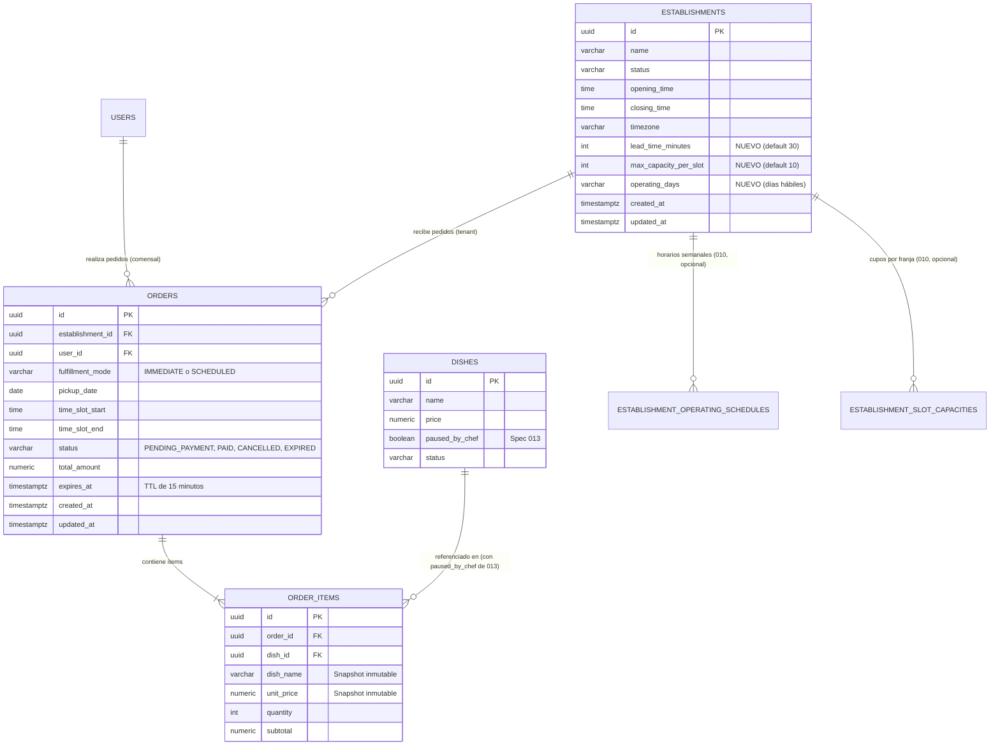
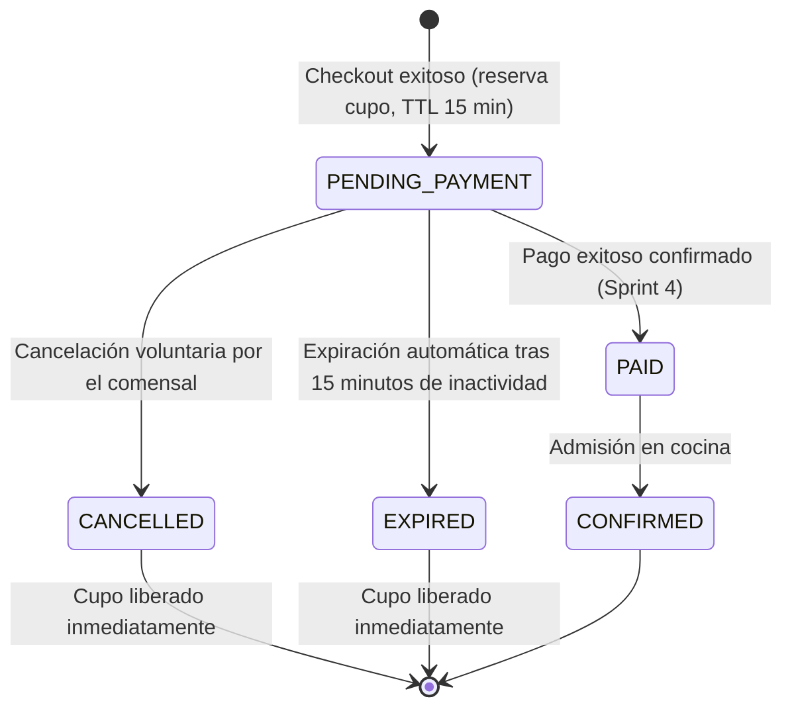

# Data Model: Selección de Modalidad de Retiro y Motor de Reservas por Franja Horaria

**Branch**: `012-diner-pickup-time-slots` | **Fecha**: 01/11/2026 | **Spec**: [spec.md](./spec.md)

---

## 1. Diagrama de entidades relacionales



---

## 2. Entidades de persistencia (PostgreSQL & Spring Data JPA)

### 2.1. Extensión de `Establishment` (`com.easyeat.catalog.domain.Establishment`)

Extiende el modelo introducido en la spec 008 para incorporar los parámetros operativos de capacidad y antelación.

| Campo | Tipo SQL | Tipo Java | Restricciones | Descripción |
|---|---|---|---|---|
| `id` | `UUID` | `UUID` | PK, Not Null | Identificador único del establecimiento. |
| `name` | `VARCHAR(150)` | `String` | Not Null | Razón social o nombre comercial. |
| `status` | `VARCHAR(50)` | `EstablishmentStatus` | Not Null, Default `'ACTIVE'` | Enum: `ACTIVE`, `PAUSED`, `DISABLED`. |
| `opening_time` | `TIME` | `LocalTime` | Not Null, Default `'11:00:00'` | Horario de apertura comercial. |
| `closing_time` | `TIME` | `LocalTime` | Not Null, Default `'23:00:00'` | Horario de cierre comercial. |
| `timezone` | `VARCHAR(50)` | `String` | Not Null, Default `'America/Argentina/Buenos_Aires'` | Zona horaria oficial del local. |
| `lead_time_minutes` | `INTEGER` | `Integer` | Not Null, Default `30`, Check `> 0` | Margen mínimo de preparación en minutos para el día de la fecha. |
| `max_capacity_per_slot` | `INTEGER` | `Integer` | Not Null, Default `10`, Check `> 0` | Capacidad máxima de órdenes simultáneas por franja de 15 minutos. |
| `operating_days` | `VARCHAR(100)` | `Set<DayOfWeek>` | Not Null, Default `'MONDAY,TUESDAY,...'` | Días operativos de atención comercial (vía `AttributeConverter`). |
| `created_at` | `TIMESTAMPTZ` | `Instant` | Not Null | Fecha y hora de creación. |
| `updated_at` | `TIMESTAMPTZ` | `Instant` | Not Null | Fecha y hora de última modificación. |

**Reglas de negocio asociadas**:
- `isOpenOn(LocalDate date)`: Determina si el día de la semana correspondiente a `date` pertenece a `operating_days`.
- `isSlotWithinOperatingHours(LocalTime start, LocalTime end)`: Valida que `start >= opening_time` y `end <= closing_time`.
- `calculateCurrentOngoingSlot(LocalTime now)`: Determina la franja horaria en curso (redondeada al cuarto de hora inferior más próximo).

---

### 2.2. Entidad `Order` (`com.easyeat.order.domain.Order`)

Representa la orden comercial generada por el comensal al completar el checkout.

| Campo | Tipo SQL | Tipo Java | Restricciones | Descripción |
|---|---|---|---|---|
| `id` | `UUID` | `UUID` | PK, Default `gen_random_uuid()` | Identificador único del pedido. |
| `establishment_id` | `UUID` | `UUID` | FK a `establishments(id)`, Not Null | Establecimiento gastronómico prestador del servicio (tenant). |
| `user_id` | `UUID` | `UUID` | FK a `users(id)`, Not Null | Comensal autenticado titular de la orden (`ROLE_COMENSAL`). |
| `fulfillment_mode` | `VARCHAR(30)` | `FulfillmentMode` | Not Null, Check `IN ('IMMEDIATE', 'SCHEDULED')` | Modalidad de retiro seleccionada. |
| `pickup_date` | `DATE` | `LocalDate` | Not Null | Fecha pautada de retiro (hoy si es `IMMEDIATE`, fecha elegida si es `SCHEDULED`). |
| `time_slot_start` | `TIME` | `LocalTime` | Not Null | Hora de inicio de la franja horaria de 15 minutos asignada. |
| `time_slot_end` | `TIME` | `LocalTime` | Not Null | Hora de finalización de la franja horaria (`time_slot_start + 15 min`). |
| `status` | `VARCHAR(30)` | `OrderStatus` | Not Null, Check `IN ('PENDING_PAYMENT', 'CONFIRMED', 'PAID', 'CANCELLED', 'EXPIRED')` | Estado del ciclo de vida de la orden. |
| `total_amount` | `DECIMAL(12, 2)` | `BigDecimal` | Not Null, Check `>= 0` | Importe total bruto del pedido. |
| `expires_at` | `TIMESTAMPTZ` | `Instant` | Nullable | Plazo fatal de expiración (exactamente 15 minutos tras su creación si está en `PENDING_PAYMENT`). |
| `created_at` | `TIMESTAMPTZ` | `Instant` | Not Null, Default `NOW()` | Marca temporal de auditoría de creación. |
| `updated_at` | `TIMESTAMPTZ` | `Instant` | Not Null, Default `NOW()` | Marca temporal de auditoría de actualización. |

**Índices para rendimiento y concurrencia**:
1. `idx_orders_slot_capacity`: `ON orders(establishment_id, pickup_date, time_slot_start, status, expires_at)`  
   Permite calcular en sub-milisegundos el conteo de órdenes activas de una franja bajo bloqueo pesimista.
2. `idx_orders_user_pending`: `ON orders(user_id, status)`  
   Garantiza la comprobación inmediata del invariante de orden única activa en `PENDING_PAYMENT` por comensal.
3. `idx_orders_expires_sweep`: `ON orders(status, expires_at)`  
   Optimiza el barrido periódico por lotes del proceso `@Scheduled`.

---

### 2.3. Entidad `OrderItem` (`com.easyeat.order.domain.OrderItem`)

Persiste el detalle inmutable de cada plato contenido en el carrito de compras del comensal.

| Campo | Tipo SQL | Tipo Java | Restricciones | Descripción |
|---|---|---|---|---|
| `id` | `UUID` | `UUID` | PK, Default `gen_random_uuid()` | Identificador de línea de pedido. |
| `order_id` | `UUID` | `UUID` | FK a `orders(id)` ON DELETE CASCADE, Not Null | Orden padre a la que pertenece la línea. |
| `dish_id` | `UUID` | `UUID` | FK a `dishes(id)`, Not Null | Identificador del plato del catálogo. |
| `dish_name` | `VARCHAR(150)` | `String` | Not Null | Snapshot del nombre del plato al momento de ordenar. |
| `unit_price` | `DECIMAL(10, 2)` | `BigDecimal` | Not Null, Check `> 0` | Snapshot del precio unitario al momento de ordenar. |
| `quantity` | `INTEGER` | `Integer` | Not Null, Check `> 0` | Cantidad de porciones solicitadas. |
| `subtotal` | `DECIMAL(12, 2)` | `BigDecimal` | Not Null, Check `> 0` | Importe subtotal calculado (`unit_price * quantity`). |

---

### 2.4. Articulación con modelos de datos de Specs 009, 010, 011 y 013

1. **Spec 009 (Shopping Cart)**:
   - Los ítems del carrito (`CartItem`: `dishId`, `quantity`) se reciben en el request de checkout (`CreateOrderRequest.items`).
   - Se revalida stock remanente en cocina (`currentStock >= quantity`, Spec 009 FR-014a) antes de persistir la orden.
2. **Spec 010 (Restaurant Operation Config)**:
   - *Horarios y Cierre Operativo (C-12)*: `PickupSlotService` y las validaciones de checkout consultan obligatoriamente los registros de `establishment_operating_schedules` para el día de la semana correspondiente (`day_of_week`). Si para ese día no existe configuración o `is_closed == true`, el establecimiento no atiende y se devuelven 0 franjas (`slots: []`). Si existe horario activo, se toman de forma estricta sus valores `opening_time` y `closing_time` para acotar los bloques de 15 minutos, descartando cualquier bloque fuera de ese rango. Si el establecimiento no tiene registros personalizados en Spec 010, se recurre a `Establishment` (`opening_time`, `closing_time`, `operating_days`).
   - *Capacidades*: Si existe configuración en `establishment_slot_capacities` para la fecha y franja horaria, se adopta su `max_capacity`; caso contrario, se aplica la capacidad por defecto `establishment.max_capacity_per_slot` (10 órdenes).
3. **Spec 011 (Dish Detail & Manual Filters)**:
   - Los precios unitarios y subtotales se procesan con aritmética exacta de dos decimales (BigInteger/BigDecimal), congelándose como snapshots inmutables en `order_items`.
4. **Spec 013 (Critical Stock & Chef Pause)**:
   - Al recibir la solicitud de checkout, el backend consulta `dishes.paused_by_chef`. Si algún plato tiene `paused_by_chef == true`, se aborta la creación de la orden (`DISH_PAUSED_BY_CHEF`, Spec 013 FR-019).

---

## 3. Máquina de estados y ciclo de vida de la orden



### Transiciones de estado permitidas

| Estado Origen | Evento Desencadenante | Estado Destino | Acción sobre el cupo |
|---|---|---|---|
| `[*]` | Confirmación de checkout en `POST /api/v1/orders` | `PENDING_PAYMENT` | **Consume 1 cupo** atómicamente de la franja horaria. |
| `PENDING_PAYMENT` | Comensal ejecuta `POST /api/v1/orders/{id}/cancel` | `CANCELLED` | **Libera 1 cupo** de forma inmediata. |
| `PENDING_PAYMENT` | Transcurren 15 minutos sin pago (`expires_at < NOW()`) | `EXPIRED` | **Libera 1 cupo** reactivamente en consulta y en barrido. |
| `PENDING_PAYMENT` | Webhook de pasarela aprueba cobro (Sprint 4) | `PAID` | **Retiene el cupo** como orden comercial firme. |

---

## 4. Proyección de dominio: `TimeSlotAvailability` (DTO)

No se persiste como fila en base de datos. Se proyecta dinámicamente en el servicio `PickupSlotService`.

```text
TimeSlotAvailability {
    startTime: LocalTime               // e.g. "13:00:00"
    endTime: LocalTime                 // e.g. "13:15:00"
    date: LocalDate                    // e.g. "2026-11-02"
    maxCapacity: int                   // e.g. 10
    bookedCount: int                   // e.g. 8
    occupancyPercentage: double        // e.g. 80.0
    status: SlotStatus                 // AVAILABLE | HIGH_DEMAND | SOLD_OUT | EXPIRED_OR_LEAD_TIME
    isSelectable: boolean              // true si está disponible y no expirado
}
```

### Clasificación y semántica de `SlotStatus`

Conforme a la regla C-12, **únicamente** se devuelven en la API y se renderizan en la interfaz aquellas franjas horarias con `isSelectable == true`. Los bloques horarios no seleccionables se omiten y ocultan completamente en lugar de mostrarse deshabilitados o en gris.

| `SlotStatus` | Condición de negocio | `isSelectable` | Tratamiento en API y Representación en UI (C-12) |
|---|---|:---:|---|
| `AVAILABLE` | `occupancy < 80%`, dentro de horario comercial y cumple lead time | `true` | **Devuelto en API y visible en UI**: Botón estándar neutral seleccionable. |
| `HIGH_DEMAND` | `80% <= occupancy < 100%`, dentro de horario comercial y cumple lead time | `true` | **Devuelto en API y visible en UI**: Botón ámbar con badge "Alta Demanda". Dispara aviso en resumen de checkout. |
| `SOLD_OUT` | `occupancy >= 100%` y dentro de horario | `false` | **Filtrado en API y ocultado en UI**: Omitido por completo. Si todos los turnos del día están agotados, se devuelve `slots: []` y la UI muestra *"No hay horarios de retiro disponibles para el día seleccionado"*. |
| `EXPIRED_OR_LEAD_TIME` | Franja pasada o `startTime < NOW() + 30m` en día actual | `false` | **Filtrado en API y ocultado en UI**: Omitido por completo. No se renderiza en gris ni ocupa espacio. |

---

## 5. Esquema Relacional de Base de Datos (DDL Flyway Preview)

Script de migración `easyeat/backend/src/main/resources/db/migration/V13__add_time_slot_and_order_fulfillment.sql` (sucede a `V12__extend_user_demographics_and_avatar.sql`):

```sql
-- 1. Extender tabla establishments con parámetros operativos
ALTER TABLE establishments
    ADD COLUMN IF NOT EXISTS lead_time_minutes INTEGER NOT NULL DEFAULT 30,
    ADD COLUMN IF NOT EXISTS max_capacity_per_slot INTEGER NOT NULL DEFAULT 10,
    ADD COLUMN IF NOT EXISTS operating_days VARCHAR(100) NOT NULL DEFAULT 'MONDAY,TUESDAY,WEDNESDAY,THURSDAY,FRIDAY,SATURDAY,SUNDAY';

ALTER TABLE establishments
    ADD CONSTRAINT chk_establishment_lead_time CHECK (lead_time_minutes > 0),
    ADD CONSTRAINT chk_establishment_slot_capacity CHECK (max_capacity_per_slot > 0);

-- 2. Crear tabla orders
CREATE TABLE IF NOT EXISTS orders (
    id                UUID           PRIMARY KEY DEFAULT gen_random_uuid(),
    establishment_id  UUID           NOT NULL REFERENCES establishments(id) ON DELETE RESTRICT,
    user_id           UUID           NOT NULL REFERENCES users(id) ON DELETE RESTRICT,
    fulfillment_mode  VARCHAR(30)    NOT NULL,
    pickup_date       DATE           NOT NULL,
    time_slot_start   TIME           NOT NULL,
    time_slot_end     TIME           NOT NULL,
    status            VARCHAR(30)    NOT NULL DEFAULT 'PENDING_PAYMENT',
    total_amount      DECIMAL(12, 2) NOT NULL,
    expires_at        TIMESTAMPTZ    NULL,
    created_at        TIMESTAMPTZ    NOT NULL DEFAULT NOW(),
    updated_at        TIMESTAMPTZ    NOT NULL DEFAULT NOW(),
    CONSTRAINT chk_order_fulfillment_mode CHECK (fulfillment_mode IN ('IMMEDIATE', 'SCHEDULED')),
    CONSTRAINT chk_order_status CHECK (status IN ('PENDING_PAYMENT', 'CONFIRMED', 'PAID', 'CANCELLED', 'EXPIRED')),
    CONSTRAINT chk_order_total_amount CHECK (total_amount >= 0),
    CONSTRAINT chk_order_slot_times CHECK (time_slot_start < time_slot_end)
);

CREATE INDEX IF NOT EXISTS idx_orders_slot_capacity
    ON orders(establishment_id, pickup_date, time_slot_start, status, expires_at);

CREATE INDEX IF NOT EXISTS idx_orders_user_pending
    ON orders(user_id, status);

CREATE INDEX IF NOT EXISTS idx_orders_expires_sweep
    ON orders(status, expires_at);

-- 3. Crear tabla order_items
CREATE TABLE IF NOT EXISTS order_items (
    id          UUID           PRIMARY KEY DEFAULT gen_random_uuid(),
    order_id    UUID           NOT NULL REFERENCES orders(id) ON DELETE CASCADE,
    dish_id     UUID           NOT NULL REFERENCES dishes(id) ON DELETE RESTRICT,
    dish_name   VARCHAR(150)   NOT NULL,
    unit_price  DECIMAL(10, 2) NOT NULL,
    quantity    INTEGER        NOT NULL,
    subtotal    DECIMAL(12, 2) NOT NULL,
    CONSTRAINT chk_order_item_quantity CHECK (quantity > 0),
    CONSTRAINT chk_order_item_unit_price CHECK (unit_price > 0),
    CONSTRAINT chk_order_item_subtotal CHECK (subtotal > 0)
);

CREATE INDEX IF NOT EXISTS idx_order_items_order_id
    ON order_items(order_id);
```

