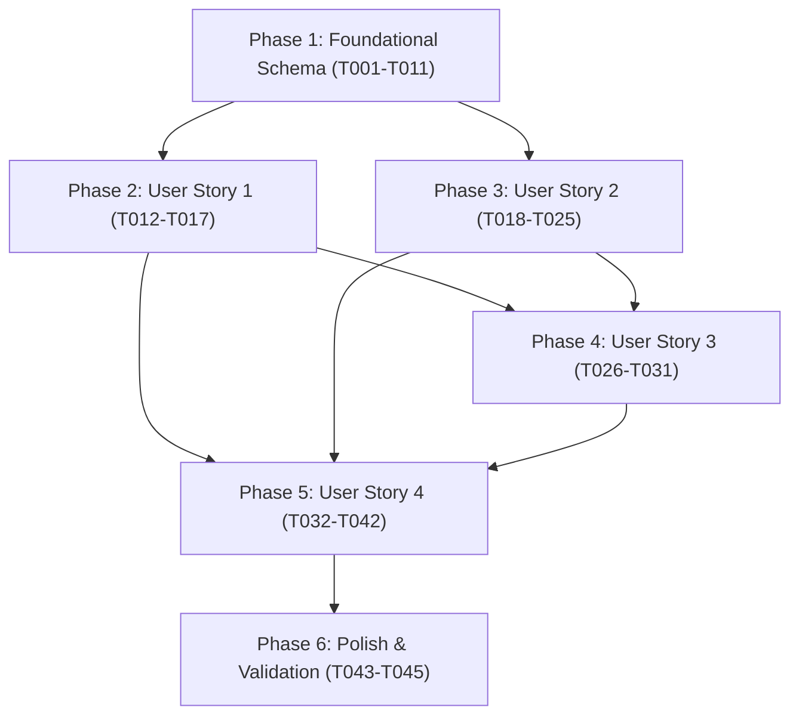

# Tasks: Diner Order Fulfillment Mode & Time-Slot Reservation Engine

**Input**: Design documents from `/specs/012-diner-pickup-time-slots/` (`spec.md`, `plan.md`, `data-model.md`, `contracts/openapi.yaml`, `quickstart.md`)  
**Prerequisites**: `plan.md` (required), `spec.md` (required), `data-model.md`, `contracts/openapi.yaml`, `quickstart.md`  
**Tests Approach**: Test-Driven Development (TDD) strictly test-first. For each capability, unit/component tests are defined first and must fail before production code is implemented.  
**Organization**: Tasks are grouped by User Story to enable independent implementation and testing of each vertical slice.

---

## Format: `[ID] [P?] [Story] Description`

- **[P]**: Can run in parallel (different files, no dependencies on incomplete tasks)
- **[Story]**: Which user story this task belongs to (`[US1]`, `[US2]`, `[US3]`, `[US4]`)
- Exact file paths are specified in every task under `easyeat/backend/` and `easyeat/frontend/`

---

## Phase 1: Setup & Foundational Schema (Prerequisites)

**Purpose**: Core schema migrations, domain enums, entities, repositories, and testing harness that MUST be complete before any user story can be implemented.

**⚠️ CRITICAL**: No user story implementation work can begin until this foundational phase is complete.

- [x] T001 Create Flyway database migration `easyeat/backend/src/main/resources/db/migration/V13__add_time_slot_and_order_fulfillment.sql` extending `establishments` (columns `lead_time_minutes`, `max_capacity_per_slot`, `operating_days`), creating table `orders` (`id`, `establishment_id`, `diner_id`, `fulfillment_mode`, `slot_date`, `slot_start_time`, `slot_end_time`, `status`, `expires_at`, `total_amount`, `created_at`, `updated_at`), and creating table `order_items` (`id`, `order_id`, `dish_id`, `quantity`, `unit_price`, `subtotal`, `dish_name_snapshot`) with indices and foreign keys per `data-model.md`.
- [x] T002 [P] Create `OrderStatus.java` enum in `easyeat/backend/src/main/java/com/easyeat/order/domain/OrderStatus.java` with values `PENDING_PAYMENT`, `PAID`, `CONFIRMED`, `CANCELLED`, `EXPIRED`.
- [x] T003 [P] Create `FulfillmentMode.java` enum in `easyeat/backend/src/main/java/com/easyeat/order/domain/FulfillmentMode.java` with values `IMMEDIATE`, `SCHEDULED`.
- [x] T004 [P] Extend `Establishment.java` entity in `easyeat/backend/src/main/java/com/easyeat/catalog/domain/Establishment.java` with fields `leadTimeMinutes`, `maxCapacityPerSlot`, and `operatingDays` (with defaults 30 min, 10 orders, and Monday-Sunday).
- [x] T005 [P] Create `OrderItem.java` JPA entity in `easyeat/backend/src/main/java/com/easyeat/order/domain/OrderItem.java` mapping table `order_items` with immutable dish snapshot and exact decimal pricing.
- [x] T006 Create `Order.java` JPA entity in `easyeat/backend/src/main/java/com/easyeat/order/domain/Order.java` mapping table `orders` with relationship to `OrderItem`, `FulfillmentMode`, `OrderStatus`, slot window bounds, and TTL expiration timestamp.
- [x] T007 [P] Extend `EstablishmentRepository.java` in `easyeat/backend/src/main/java/com/easyeat/catalog/repository/EstablishmentRepository.java` adding `@Lock(LockModeType.PESSIMISTIC_WRITE)` method `findByIdForUpdate(UUID id)` for atomic concurrency serialization.
- [x] T008 [P] Create `OrderItemRepository.java` in `easyeat/backend/src/main/java/com/easyeat/order/repository/OrderItemRepository.java` extending `JpaRepository<OrderItem, UUID>`.
- [x] T009 Create `OrderRepository.java` in `easyeat/backend/src/main/java/com/easyeat/order/repository/OrderRepository.java` with queries for counting active bookings by slot (`countActiveOrdersBySlot`), checking active diner reservation (`hasActivePendingOrder`), and finding expired pending orders (`findExpiredPendingOrders`).
- [x] T010 [P] Create TypeScript domain interfaces and enums in `easyeat/frontend/src/types/order.ts` defining `FulfillmentMode`, `OrderStatus`, `TimeSlotAvailability`, `PickupSlotCatalogResponse`, `CreateOrderRequest`, `OrderCreatedResponse`, `OrderDetailResponse`, and RFC 7807 `OrderErrorProblemDetail`.
- [x] T011 [P] Configure PostgreSQL Testcontainers base test fixture in `easyeat/backend/src/test/java/com/easyeat/order/BaseIntegrationTest.java` for transactional and concurrency integration tests.

**Checkpoint**: Foundation and schema ready — all domain models, repositories, and test fixtures are compiled and verified.

---

## Phase 2: User Story 1 - Selección de Modalidad de Retiro Excluyente [US1] (Priority: P1) 🎯 MVP

**Goal**: Allow diner to choose between mutually exclusive fulfillment modes ("Lo antes posible" vs "Para más tarde") during checkout, validating kitchen availability, resetting slot state when switching to immediate, and blocking checkout if dishes are paused by the chef (`FR-019`).

**Independent Test**: Mount the checkout view with items in `CartContext`. Toggle between "Lo antes posible" and "Para más tarde", verifying mutual exclusivity, immediate clearing of selected date/time slot upon switching to IMMEDIATE, and backend validation rejecting requests with missing or conflicting fulfillment modes.

### Tests for User Story 1 ⚠️

> **NOTE: Write these tests FIRST, ensure they FAIL before implementation**

- [x] T012 [P] [US1] Create unit tests in `easyeat/backend/src/test/java/com/easyeat/order/OrderServiceTest.java` verifying fulfillment mode exclusivity, validation error when mode is null or unrecognized, automatic clearing/omission of time slot when mode is `IMMEDIATE`, and blocking when a dish is paused by chef (`paused_by_chef == true`).
- [x] T013 [P] [US1] Create unit and component tests in `easyeat/frontend/src/test/checkout/FulfillmentModeSelector.test.tsx` verifying exclusive toggle selection, immediate clearing of date/slot selections when selecting `IMMEDIATE`, and disabling immediate mode when current slot is at 100% capacity.

### Implementation for User Story 1

- [x] T014 [P] [US1] Create request and response DTOs `CreateOrderRequest.java` and `OrderCreatedResponse.java` in `easyeat/backend/src/main/java/com/easyeat/order/dto/` with Jakarta validation annotations (`@NotNull`, `@Valid`, `@NotEmpty`).
- [x] T015 [US1] Implement fulfillment mode validation logic in `OrderService.java` in `easyeat/backend/src/main/java/com/easyeat/order/service/OrderService.java` ensuring mode exclusivity, clearing slot fields when mode is `IMMEDIATE`, and checking chef pause status (`FR-019`).
- [x] T016 [P] [US1] Implement checkout fulfillment state hook `useCheckoutFulfillment.ts` in `easyeat/frontend/src/hooks/useCheckoutFulfillment.ts` managing fulfillment mode, selected date, selected slot, and clearing slot when switching to `IMMEDIATE`.
- [x] T017 [US1] Implement `FulfillmentModeSelector.tsx` component in `easyeat/frontend/src/components/checkout/FulfillmentModeSelector.tsx` integrating with `useCheckoutFulfillment` and `CartContext` to provide radio toggle cards with icons and immediate capacity alert.

**Checkpoint**: User Story 1 is functional and testable independently: diners can toggle fulfillment modes with mutual exclusivity and validated state.

---

## Phase 3: User Story 2 - Programación de Reserva en Franjas de 15 Minutos [US2] (Priority: P1)

**Goal**: Allow diner to select an operating date (up to 7 operating days) and a discrete 15-minute time slot within opening hours, respecting a 30-minute lead time buffer in timezone `America/Argentina/Buenos_Aires`.

**Independent Test**: Query `GET /api/v1/establishments/{id}/pickup-slots?date=YYYY-MM-DD` and verify continuous 15-minute intervals, filtering out non-operating days, and marking past slots or slots within the 30-minute lead time buffer as unavailable/disabled.

### Tests for User Story 2 ⚠️

> **NOTE: Write these tests FIRST, ensure they FAIL before implementation**

- [x] T018 [P] [US2] Create unit tests in `easyeat/backend/src/test/java/com/easyeat/order/PickupSlotServiceTest.java` verifying 15-minute slot projection, 7 operating days calculation, exclusion of closed/non-operating days, and 30-minute lead time buffer enforcement in `America/Argentina/Buenos_Aires`.
- [x] T019 [P] [US2] Create component tests in `easyeat/frontend/src/test/checkout/TimeSlotGrid.test.tsx` verifying operating date selection, slot grid rendering, disabled visual state for past slots and lead-time violations, and selection callback.

### Implementation for User Story 2

- [x] T020 [P] [US2] Create DTOs `TimeSlotAvailability.java` and `PickupSlotCatalogResponse.java` in `easyeat/backend/src/main/java/com/easyeat/order/dto/` representing slot intervals (`startTime`, `endTime`), total capacity, reserved count, occupancy rate, and status per `openapi.yaml`.
- [x] T021 [US2] Implement slot catalog projection engine in `PickupSlotService.java` in `easyeat/backend/src/main/java/com/easyeat/order/service/PickupSlotService.java` generating daily slots from `Establishment` operating hours, filtering by 30-minute lead time buffer, and calculating booked orders.
- [x] T022 [US2] Implement `PickupSlotController.java` in `easyeat/backend/src/main/java/com/easyeat/order/controller/PickupSlotController.java` exposing `GET /api/v1/establishments/{id}/pickup-slots` with alias `/time-slots` (`@GetMapping({"/establishments/{id}/pickup-slots", "/establishments/{id}/time-slots"})` for Spec 010 interoperability) with role security `@PreAuthorize("hasRole('COMENSAL')")` and date parameter validation.
- [x] T023 [P] [US2] Implement API client functions in `easyeat/frontend/src/api/orderApi.ts` for `fetchPickupSlots`, `createOrder`, `getOrderById`, and `cancelOrder`.
- [x] T024 [US2] Implement `OperatingDatePicker.tsx` component in `easyeat/frontend/src/components/checkout/OperatingDatePicker.tsx` displaying up to 7 operating days horizontally with day/date cards, active state styling, and skipping non-operating days.
- [x] T025 [US2] Implement `TimeSlotGrid.tsx` component in `easyeat/frontend/src/components/checkout/TimeSlotGrid.tsx` rendering 15-minute slot chips, disabling unavailable/lead-time-violating slots, and highlighting active selection.

**Checkpoint**: User Stories 1 AND 2 are functional together: diners can select a valid operating date and 15-minute slot with lead time protection.

---

## Phase 4: User Story 3 - Visualización de Demanda y Alerta Preventiva [US3] (Priority: P2)

**Goal**: Provide visual occupancy saturation indicators on time slots (<80% normal neutral, 80-99% amber badge with "Alta Demanda" legend, 100% grey disabled with "Agotado") and display a non-blocking preventive warning notice in the checkout summary.

**Independent Test**: Simulate slot availability with occupancy at 50%, 85%, and 100%. Verify amber styling and "Alta Demanda" badge at 85%, disabled state at 100%, preventive warning message in `CheckoutSummary.tsx` on selecting an 85% slot, and smooth polling updates via `useTimeSlotPolling`.

### Tests for User Story 3 ⚠️

> **NOTE: Write these tests FIRST, ensure they FAIL before implementation**

- [ ] T026 [P] [US3] Create unit tests in `easyeat/backend/src/test/java/com/easyeat/order/TimeSlotOccupancyTest.java` verifying saturation tier calculation (<80% `NORMAL`, 80-99% `HIGH_DEMAND`, 100% `SOLD_OUT`) and occupancy percentage math.
- [ ] T027 [P] [US3] Create unit tests in `easyeat/frontend/src/test/checkout/useTimeSlotPolling.test.ts` verifying polling interval execution (5-10s), background refresh without unmounting/flashing, window focus handling, and cleanup on unmount.

### Implementation for User Story 3

- [ ] T028 [P] [US3] Update `PickupSlotService.java` in `easyeat/backend/src/main/java/com/easyeat/order/service/PickupSlotService.java` to compute saturation tier and demand flags in `TimeSlotAvailability`.
- [ ] T029 [P] [US3] Implement `useTimeSlotPolling.ts` hook in `easyeat/frontend/src/hooks/useTimeSlotPolling.ts` supporting periodic polling (every 5-10 seconds) with window focus awareness and abort controller on unmount.
- [ ] T030 [US3] Enhance `TimeSlotGrid.tsx` in `easyeat/frontend/src/components/checkout/TimeSlotGrid.tsx` with amber badge styling and "Alta Demanda" badge for 80-99% saturation, and disabled styling for 100% saturation.
- [ ] T031 [US3] Implement `CheckoutSummary.tsx` in `easyeat/frontend/src/components/checkout/CheckoutSummary.tsx` rendering order items, total amount formatted with 2 decimals, selected fulfillment mode/slot details, and preventive non-blocking amber alert: "Esta franja registra un alto volumen de cocina. Podrían producirse leves demoras en mostrador."

**Checkpoint**: User Stories 1, 2, and 3 are functional: demand transparency and preventive warnings guide diner decisions without blocking.

---

## Phase 5: User Story 4 - Capacidad Cero Overbooking, Concurrencia FCFS y Expiración TTL [US4] (Priority: P1)

**Goal**: Guarantee atomic Zero Overbooking via pessimistic write locking (`@Lock(LockModeType.PESSIMISTIC_WRITE)`) under FCFS policy, map 409 conflict exceptions, handle 15-minute TTL expiration via hybrid reactive check + `@Scheduled` background worker, and provide diner countdown, voluntary cancellation, and conflict modal in frontend.

**Independent Test**: Execute Testcontainers concurrency stress test with 20 threads competing for 1 remaining slot: exactly 1 order succeeds and 19 receive 409 `SLOT_SOLD_OUT`. Verify expired orders release capacity instantly.

### Tests for User Story 4 ⚠️

> **NOTE: Write these tests FIRST, ensure they FAIL before implementation**

- [ ] T032 [P] [US4] Create concurrency stress integration test in `easyeat/backend/src/test/java/com/easyeat/order/ZeroOverbookingConcurrencyIntegrationTest.java` with Testcontainers PostgreSQL launching 20 concurrent threads for the final slot, asserting exactly 1 success and 19 `SlotCapacityExceededException` (409 Conflict).
- [ ] T033 [P] [US4] Create TTL expiration lifecycle integration test in `easyeat/backend/src/test/java/com/easyeat/order/OrderExpirationIntegrationTest.java` verifying that orders past 15-minute TTL are ignored in capacity counts immediately and marked `EXPIRED` by the scheduler.
- [ ] T034 [P] [US4] Create component tests in `easyeat/frontend/src/test/checkout/PendingOrderCountdown.test.tsx` verifying 15:00 countdown timer, yellow/red warning banner when < 2:00 remains, voluntary cancel trigger, and auto-redirect when reaching 00:00.

### Implementation for User Story 4

- [ ] T035 [P] [US4] Create domain exceptions `SlotCapacityExceededException.java`, `ActiveReservationExistsException.java`, and `LeadTimeViolationException.java` in `easyeat/backend/src/main/java/com/easyeat/order/exception/` and register RFC 7807 `ProblemDetail` handlers in `GlobalExceptionHandler.java` (mapping to 409 `SLOT_SOLD_OUT`, 409 `ACTIVE_RESERVATION_EXISTS`, and 422 `LEAD_TIME_VIOLATION`).
- [ ] T036 [US4] Implement atomic FCFS reservation and cancellation in `OrderService.java` in `easyeat/backend/src/main/java/com/easyeat/order/service/OrderService.java` acquiring `@Lock(LockModeType.PESSIMISTIC_WRITE)` on `Establishment`, verifying diner has no other active reservation, checking slot count < maxCapacity, persisting `Order` + `OrderItem` snapshots with 15-minute TTL (`expires_at = now + 15 min`), and voluntary cancellation method.
- [ ] T037 [US4] Implement background sweep worker `OrderExpirationScheduler.java` in `easyeat/backend/src/main/java/com/easyeat/order/service/OrderExpirationScheduler.java` running `@Scheduled(fixedRate = 60000)` to transition expired `PENDING_PAYMENT` orders to `EXPIRED`.
- [ ] T038 [US4] Implement `OrderController.java` in `easyeat/backend/src/main/java/com/easyeat/order/controller/OrderController.java` exposing `POST /api/v1/orders` (201 Created), `GET /api/v1/orders/{id}`, and `POST /api/v1/orders/{id}/cancel` (200 OK) secured by `ROLE_COMENSAL`.
- [ ] T039 [P] [US4] Implement `ConflictNotificationModal.tsx` in `easyeat/frontend/src/components/checkout/ConflictNotificationModal.tsx` displaying friendly explanation when 409 `SLOT_SOLD_OUT` or `ACTIVE_RESERVATION_EXISTS` occurs, with actions to refresh slots or view existing reservation.
- [ ] T040 [US4] Implement `PendingOrderCountdown.tsx` in `easyeat/frontend/src/components/checkout/PendingOrderCountdown.tsx` rendering the 15:00 countdown timer, warning banner at < 2:00, voluntary cancel button, and navigation redirect on expiry.
- [ ] T041 [US4] Implement `CheckoutPage.tsx` page orchestration in `easyeat/frontend/src/pages/CheckoutPage.tsx` integrating `FulfillmentModeSelector`, `OperatingDatePicker`, `TimeSlotGrid`, `CheckoutSummary`, `ConflictNotificationModal`, and `PendingOrderCountdown`.
- [ ] T042 [US4] Register protected `/checkout` route in `easyeat/frontend/src/router/AppRoutes.tsx` with `RoleRouteGuard` for `ROLE_COMENSAL` and redirecting unauthenticated users to `/login`.

**Checkpoint**: All user stories complete. The reservation engine guarantees zero overbooking, handles high-concurrency races, provides TTL release, and presents complete UI feedback.

---

## Phase 6: Polish & Cross-Cutting Concerns

**Purpose**: End-to-end integration tests, edge case verification, and documentation validation across both backend and frontend.

- [ ] T043 [P] Create `OrderControllerIntegrationTest.java` in `easyeat/backend/src/test/java/com/easyeat/order/OrderControllerIntegrationTest.java` verifying MockMvc endpoints with role authorization, 401 unauthenticated, 400 bad request, 409 conflict, and 201 created.
- [ ] T044 [P] Create end-to-end checkout page integration test in `easyeat/frontend/src/test/checkout/CheckoutPage.test.tsx` verifying full diner checkout flow from cart loading to slot reservation and countdown screen.
- [ ] T045 Execute and validate quickstart scenarios in `specs/012-diner-pickup-time-slots/quickstart.md` ensuring all curl commands and frontend acceptance criteria pass.

---

## Dependencies & Execution Order

### Phase Dependencies

- **Phase 1 (Setup & Foundational)**: Blocks all user stories. Must complete first.
- **Phase 2 (User Story 1)**: Can begin immediately after Phase 1. Forms the MVP foundation for checkout.
- **Phase 3 (User Story 2)**: Can begin after Phase 1; provides slot projection engine and UI grid.
- **Phase 4 (User Story 3)**: Enhances Phase 3 grid with saturation badges and polling.
- **Phase 5 (User Story 4)**: Assembles the transactional FCFS engine, TTL worker, countdown screen, and route orchestration.
- **Phase 6 (Polish)**: Runs after all user stories are complete.

### User Story Dependencies

- **User Story 1 (P1)**: Independent of US2/US3/US4. Only requires Phase 1 foundation.
- **User Story 2 (P1)**: Independent of US1. Only requires Phase 1 foundation.
- **User Story 3 (P2)**: Extends US2 slot availability with saturation tiers (<80%, 80-99%, 100%).
- **User Story 4 (P1)**: Completes order reservation lifecycle. Integrates US1 mode and US2 slot selection into the atomic FCFS checkout transaction and TTL management.

### Within Each User Story (TDD Enforcement)

1. **Tests FIRST**: Unit and component tests are authored and verified failing before writing business logic.
2. **DTOs & Interfaces**: Data contracts and domain types established.
3. **Core Logic**: Services and repositories implemented to satisfy failing tests.
4. **Controllers & Components**: REST endpoints and React UI controls wired up.
5. **Integration**: Verified against acceptance criteria before closing the story.

---

## Parallel Execution Opportunities

### Phase 1: Setup & Foundational
- `T002` (OrderStatus), `T003` (FulfillmentMode), `T004` (Establishment), `T005` (OrderItem), `T007` (EstablishmentRepository), `T008` (OrderItemRepository), `T010` (order.ts), and `T011` (BaseIntegrationTest) can all be executed in parallel once `T001` (Flyway DDL) is defined.

### Phase 2: User Story 1
- `T012` (OrderServiceTest) and `T013` (FulfillmentModeSelector.test.tsx) can be written in parallel.
- `T014` (DTOs) and `T016` (useCheckoutFulfillment hook) can run in parallel.

### Phase 3: User Story 2
- `T018` (PickupSlotServiceTest) and `T019` (TimeSlotGrid.test.tsx) can be written in parallel.
- `T020` (DTOs) and `T023` (orderApi.ts) can run in parallel.
- `T024` (OperatingDatePicker) and `T025` (TimeSlotGrid) can run in parallel once DTOs/types are ready.

### Phase 4: User Story 3
- `T026` (TimeSlotOccupancyTest) and `T027` (useTimeSlotPolling.test.ts) can run in parallel.
- `T028` (PickupSlotService updates) and `T029` (useTimeSlotPolling.ts) can run in parallel.

### Phase 5: User Story 4
- `T032` (ZeroOverbookingConcurrencyIntegrationTest), `T033` (OrderExpirationIntegrationTest), and `T034` (PendingOrderCountdown.test.tsx) can be developed in parallel.
- `T035` (Exceptions & ProblemDetail) and `T039` (ConflictNotificationModal.tsx) can run in parallel.

---

## Implementation Strategy

### MVP First (Phases 1, 2, and basic US4 Order Creation)

1. Complete **Phase 1: Foundational Schema** (Flyway V13, enums, entities, repositories).
2. Complete **Phase 2: User Story 1** (Fulfillment mode selection, DTOs, basic `POST /orders` validation).
3. **Validate**: Test immediate order creation and mode exclusivity in isolation.

### Incremental Delivery

1. **Increment 1 (MVP)**: Foundational schema + Fulfillment mode selection.
2. **Increment 2 (Turnos Programados)**: Add User Story 2 (15-minute slot projection and grid selection).
3. **Increment 3 (Demand Transparency)**: Add User Story 3 (Saturation amber badges, polling, preventive warnings).
4. **Increment 4 (Robustness & FCFS)**: Add User Story 4 (Pessimistic locking, 409 conflict modal, TTL countdown, voluntary cancellation, `/checkout` route).
5. **Increment 5 (Polish)**: Cross-cutting tests and quickstart validation.

---

## Extension Hooks

**Optional Hook**: git
Command: `/speckit-git-commit`
Description: Commit task breakdown

Prompt: Commit task breakdown
To execute: `/speckit-git-commit`

