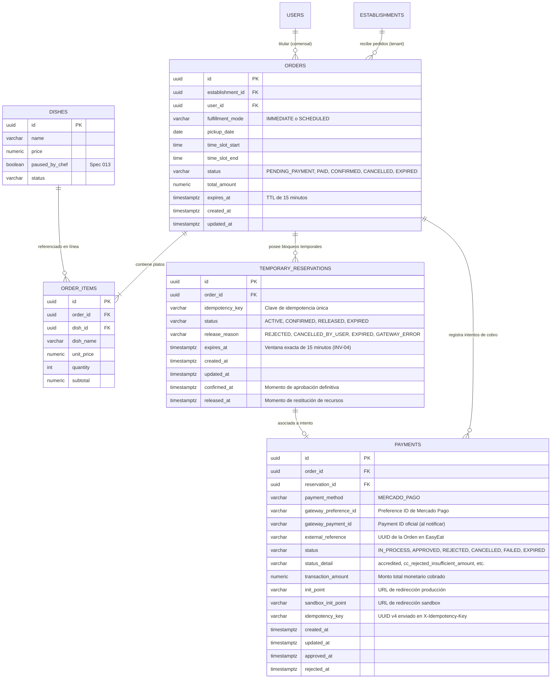
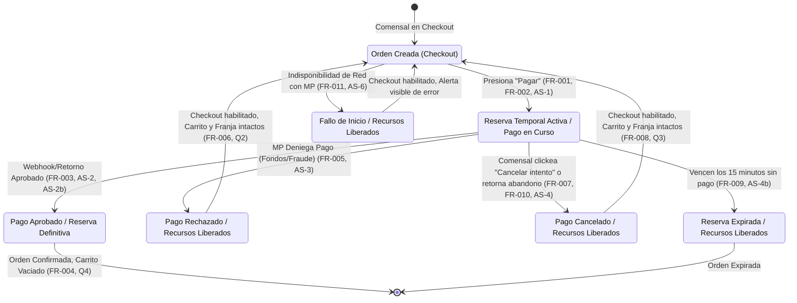

# Data Model: Pagar con Mercado Pago y Reservas Temporales Conjuntas

**Feature Branch**: `014-mercadopago-checkout`  
**Fecha**: 09/11/2026  
**Especificación**: [spec.md](./spec.md) | [research.md](./research.md)  
**Estado**: Completado  

---

## 1. Diagrama Entidad-Relación



---

## 2. Entidades Relacionales y Mapeo JPA

### 2.1. Entidad `Order` (`com.easyeat.order.domain.Order`) — Extensión y Compatibilidad

La entidad `Order` creada en la Spec 012 (`V16`) se preserva de forma aditiva y 100% compatible.  
Representa la intención comercial del comensal.

| Atributo | Columna SQL | Tipo Java | Restricciones | Semántica y Reglas |
|---|---|---|---|---|
| `id` | `id` | `UUID` | PK, Not Null | Identificador único de la orden. Usado como `external_reference` en Mercado Pago. |
| `establishmentId` | `establishment_id` | `UUID` | FK a `establishments(id)` | Restaurante gastronómico prestatario. |
| `userId` | `user_id` | `UUID` | FK a `users(id)` | Comensal autenticado titular del pedido. |
| `fulfillmentMode` | `fulfillment_mode` | `FulfillmentMode` | Enum: `IMMEDIATE`, `SCHEDULED` | Modalidad de entrega definida en Spec 012. |
| `pickupDate` | `pickup_date` | `LocalDate` | Not Null | Fecha programada o inmediata de retiro. |
| `timeSlotStart` | `time_slot_start` | `LocalTime` | Not Null | Inicio de la franja horaria de 15 minutos. |
| `timeSlotEnd` | `time_slot_end` | `LocalTime` | Not Null | Fin de la franja horaria (`start + 15 min`). |
| `status` | `status` | `OrderStatus` | Enum: `PENDING_PAYMENT`, `PAID`, `CONFIRMED`, `CANCELLED`, `EXPIRED` | Estado operativo general del pedido. |
| `totalAmount` | `total_amount` | `BigDecimal` | Not Null, Check `>= 0` | Monto bruto total a cobrar. Valida `totalAmount > 0` (FR-001). |
| `expiresAt` | `expires_at` | `Instant` | Nullable | Plazo fatal de expiración (exactamente 15 min mientras está en pago). |
| `createdAt` | `created_at` | `Instant` | Not Null | Marca temporal de auditoría de creación. |
| `updatedAt` | `updated_at` | `Instant` | Not Null | Marca temporal de última modificación. |

**Compatibilidad con Spec 012**:  
La consulta `countActiveOrdersBySlot` de `OrderRepository` considera activas las órdenes con `status IN ('CONFIRMED', 'PAID')` o `(status = 'PENDING_PAYMENT' AND expires_at > :now)`. Cuando una reserva temporal se libera por rechazo o cancelación, el estado de la orden permanece `PENDING_PAYMENT` pero su reserva temporal se cancela, o bien se actualiza según el flujo de reintento.

---

### 2.2. Entidad `TemporaryReservation` (`com.easyeat.order.domain.TemporaryReservation`) — Nueva

Representa el bloqueo atómico y conjunto del cupo de franja y el stock de cocina (INV-01), sujeto al TTL estricto de 15 minutos (INV-04).

| Atributo | Columna SQL | Tipo Java | Restricciones | Semántica y Reglas |
|---|---|---|---|---|
| `id` | `id` | `UUID` | PK, Not Null | Identificador único de la reserva temporal. |
| `order` | `order_id` | `Order` (`UUID`) | FK a `orders(id)`, Not Null | Orden asociada a la reserva. |
| `idempotencyKey` | `idempotency_key` | `String` | VARCHAR(100), Unique, Not Null | Clave única de idempotencia que identifica este intento de reserva. |
| `status` | `status` | `ReservationStatus` | Enum: `ACTIVE`, `CONFIRMED`, `RELEASED`, `EXPIRED` | Estado actual de vigencia de la reserva. |
| `releaseReason` | `release_reason` | `ReleaseReason` | Nullable, Enum: `REJECTED`, `CANCELLED_BY_USER`, `EXPIRED`, `GATEWAY_ERROR` | Motivo documentado de restitución de recursos (INV-03). |
| `expiresAt` | `expires_at` | `Instant` | Not Null | Marca de tiempo exacta de expiración (`created_at + 15 min`). |
| `createdAt` | `created_at` | `Instant` | Not Null, Default `NOW()` | Creación de la reserva. |
| `updatedAt` | `updated_at` | `Instant` | Not Null | Última actualización. |
| `confirmedAt` | `confirmed_at` | `Instant` | Nullable | Momento en que pasó a ser definitiva tras aprobación (INV-02). |
| `releasedAt` | `released_at` | `Instant` | Nullable | Momento en que los recursos fueron devueltos a cocina y franja. |

**Reglas de negocio e invariantes**:
1. **Unicidad de reserva activa por orden (INV-05)**:  
   Garantizada a nivel de motor de datos con índice único condicional:
   ```sql
   CREATE UNIQUE INDEX idx_unique_active_reservation_per_order
   ON temporary_reservations (order_id)
   WHERE status = 'ACTIVE';
   ```
2. **Atomicidad e Indivisibilidad (INV-01)**:  
   La entidad solo se persiste si tanto la franja horaria como el stock de cada plato están disponibles concurrentemente al momento de presionar "Pagar".
3. **Cálculo de Stock Comprometido**:  
   `DishAvailabilityEngine` consulta las reservas temporales activas para restar las porciones de platos en tránsito:
   $$\text{StockDisponible}(plato) = \text{StockCocina}(plato) - \sum_{\text{reservas activas}} \text{cantidad}(plato)$$

---

### 2.3. Entidad `Payment` (`com.easyeat.order.domain.Payment`) — Nueva

Registra el intento transaccional delegado a la pasarela externa de Mercado Pago y su resultado fehaciente (INV-08).

| Atributo | Columna SQL | Tipo Java | Restricciones | Semántica y Reglas |
|---|---|---|---|---|
| `id` | `id` | `UUID` | PK, Not Null | Identificador único de la transacción en EasyEat. |
| `order` | `order_id` | `Order` (`UUID`) | FK a `orders(id)`, Not Null | Orden sobre la cual se efectúa el cobro. |
| `reservation` | `reservation_id` | `TemporaryReservation` (`UUID`) | FK a `temporary_reservations(id)`, Not Null | Reserva temporal que respalda este cobro. |
| `paymentMethod` | `payment_method` | `PaymentMethod` | Not Null, Default `'MERCADO_PAGO'` | Pasarela utilizada (Enum `PaymentMethod`: `MERCADO_PAGO`, extensible a `STRIPE`). |
| `gatewayPreferenceId` | `gateway_preference_id` | `String` | VARCHAR(100), Nullable | Identificador de preferencia devuelto por Mercado Pago. |
| `gatewayPaymentId` | `gateway_payment_id` | `String` | VARCHAR(100), Nullable | Identificador numérico del pago provisto por Mercado Pago en webhook. |
| `externalReference` | `external_reference` | `String` | VARCHAR(100), Not Null | ID de la orden en formato String. |
| `status` | `status` | `PaymentStatus` | Enum: `IN_PROCESS`, `APPROVED`, `REJECTED`, `CANCELLED`, `FAILED`, `EXPIRED` | Estado transaccional del pago. |
| `statusDetail` | `status_detail` | `String` | VARCHAR(100), Nullable | Detalle del estado retornado por MP (`accredited`, `cc_rejected_insufficient_amount`, etc.). |
| `transactionAmount` | `transaction_amount` | `BigDecimal` | Not Null, Precision 12, Scale 2 | Importe exacto enviado a la pasarela. |
| `initPoint` | `init_point` | `String` | VARCHAR(500), Nullable | URL oficial de redirección en producción. |
| `sandboxInitPoint` | `sandbox_init_point` | `String` | VARCHAR(500), Nullable | URL oficial de redirección en Sandbox de prueba. |
| `idempotencyKey` | `idempotency_key` | `String` | VARCHAR(100), Unique, Not Null | UUID v4 enviado en `X-Idempotency-Key` a Mercado Pago. |
| `createdAt` | `created_at` | `Instant` | Not Null, Default `NOW()` | Inicio del intento de pago. |
| `updatedAt` | `updated_at` | `Instant` | Not Null | Última modificación del intento. |
| `approvedAt` | `approved_at` | `Instant` | Nullable | Marca temporal de cobro exitoso. |
| `rejectedAt` | `rejected_at` | `Instant` | Nullable | Marca temporal de cobro denegado. |

**Índices para rendimiento e idempotencia**:
```sql
CREATE INDEX idx_payments_order_status ON payments (order_id, status);
CREATE UNIQUE INDEX idx_payments_gateway_id ON payments (gateway_payment_id) WHERE gateway_payment_id IS NOT NULL;
CREATE UNIQUE INDEX idx_payments_idempotency_key ON payments (idempotency_key);
```

---

## 3. Especificación Taxativa: Qué se Persiste y Qué NO se Persiste

En estricto cumplimiento de **FR-013**, **INV-11** y el criterio de éxito **SC-009**:

### Lo que SÍ se persiste en EasyEat
- Identificadores de enlace de la pasarela: `gateway_preference_id`, `gateway_payment_id`, `external_reference`.
- Estado general y detalle de resultado de la transacción: `status` (`approved`, `rejected`, `in_process`), `status_detail` (`accredited`, `cc_rejected_insufficient_amount`, etc.).
- Importe bruto verificado de la transacción (`transaction_amount`) y tipo de moneda (`ARS`).
- Marcas de tiempo de auditoría (`created_at`, `approved_at`, `rejected_at`, `expires_at`).
- URLs de redirección provistas por la API de Preferencias (`init_point`, `sandbox_init_point`).
- Claves de idempotencia generadas internamente por EasyEat (`idempotency_key`).

### Lo que NUNCA se solicita, procesa ni persiste en EasyEat (PROHIBIDO)
> [!CAUTION]
> Queda terminantemente prohibido almacenar, procesar, transmitir o recibir en los servidores o pantallas de EasyEat cualquiera de los siguientes datos:
> 1. Número de tarjeta de crédito o débito (PAN, Primary Account Number) completo o parcial.
> 2. Código de seguridad o valor de verificación de tarjeta (CVV, CVC, CID).
> 3. Fecha de caducidad o vencimiento de la tarjeta (mes / año).
> 4. Nombre y apellido del titular tal como figura en el plástico o documento bancario.
> 5. Datos de pista magnética (Track 1 / Track 2), chip o PIN bancario.
> 6. Tokens temporales de tarjeta generados por SDKs embebidos en el cliente.
>
> Toda interacción con estos datos ocurre pura y exclusivamente dentro del dominio seguro de Mercado Pago (`*.mercadopago.com` / `*.mercadopago.com.ar`).

---

## 4. Máquina de Estados y Ciclo de Vida Integrado



### Tabla de Transiciones del Ecosistema

| Estado Origen (`Reservation` / `Payment`) | Evento Desencadenante | Estado Destino `Reservation` | Estado Destino `Payment` | Estado Destino `Order` | Impacto en Cupo y Stock |
|---|---|---|---|---|---|
| `[Ninguno]` | Presiona "Pagar" con recursos disponibles | `ACTIVE` | `IN_PROCESS` | `PENDING_PAYMENT` | **Bloquea 1 cupo** de franja y reserva temporalmente el stock de los platos del carrito. |
| `ACTIVE` / `IN_PROCESS` | Notificación aprobada de MP (`approved`) | `CONFIRMED` | `APPROVED` | `CONFIRMED` | **Reserva pasa a definitiva** (INV-02). Se vacía el carrito local del comensal. |
| `ACTIVE` / `IN_PROCESS` | Notificación o retorno de rechazo (`rejected`) | `RELEASED` | `REJECTED` | `PENDING_PAYMENT` | **Libera inmediatamente el cupo y el stock** (INV-03). Carrito y franja preservados para reintento. |
| `ACTIVE` / `IN_PROCESS` | Comensal ejecuta "Cancelar intento" en panel | `RELEASED` | `CANCELLED` | `PENDING_PAYMENT` | **Libera inmediatamente el cupo y el stock** (INV-03, Q3). Re-habilita botón "Pagar". |
| `ACTIVE` / `IN_PROCESS` | Transcurren 15 min sin resolución (`expires_at < now`) | `EXPIRED` | `EXPIRED` | `EXPIRED` | **Libera automáticamente el cupo y el stock** (INV-04, FR-009). |
| `[Inicio]` | Excepción de red o error 5xx al crear preferencia | `RELEASED` (o Rollback) | `FAILED` | `PENDING_PAYMENT` | **Reversión instantánea**. Recursos nunca quedan comprometidos (FR-011, AS-6). |

---

## 5. DDL de Migración de Base de Datos (Flyway `V18`)

El archivo `V18__mercadopago_checkout_and_reservations.sql` aplica los cambios de forma idempotente y aditiva:

```sql
-- ====================================================================
-- EasyEat V18: Mercado Pago Checkout Integration and Atomic Reservations
-- ====================================================================

-- 1. Tabla de reservas temporales conjuntas (INV-01, INV-04, INV-05)
CREATE TABLE IF NOT EXISTS temporary_reservations (
    id                 UUID         PRIMARY KEY DEFAULT gen_random_uuid(),
    order_id           UUID         NOT NULL REFERENCES orders(id) ON DELETE CASCADE,
    idempotency_key    VARCHAR(100) NOT NULL,
    status             VARCHAR(30)  NOT NULL DEFAULT 'ACTIVE',
    release_reason     VARCHAR(50)  NULL,
    expires_at         TIMESTAMPTZ  NOT NULL,
    created_at         TIMESTAMPTZ  NOT NULL DEFAULT NOW(),
    updated_at         TIMESTAMPTZ  NOT NULL DEFAULT NOW(),
    confirmed_at       TIMESTAMPTZ  NULL,
    released_at        TIMESTAMPTZ  NULL,
    CONSTRAINT chk_reservation_status CHECK (status IN ('ACTIVE', 'CONFIRMED', 'RELEASED', 'EXPIRED')),
    CONSTRAINT chk_reservation_release_reason CHECK (release_reason IS NULL OR release_reason IN ('REJECTED', 'CANCELLED_BY_USER', 'EXPIRED', 'GATEWAY_ERROR')),
    CONSTRAINT uq_reservation_idempotency_key UNIQUE (idempotency_key)
);

-- Garantiza que una orden sólo tenga una reserva activa simultánea (INV-05)
CREATE UNIQUE INDEX IF NOT EXISTS idx_unique_active_reservation_per_order
    ON temporary_reservations (order_id)
    WHERE status = 'ACTIVE';

CREATE INDEX IF NOT EXISTS idx_reservations_sweep
    ON temporary_reservations (status, expires_at);

-- 2. Tabla de transacciones de pago delegadas a Mercado Pago
CREATE TABLE IF NOT EXISTS payments (
    id                    UUID           PRIMARY KEY DEFAULT gen_random_uuid(),
    order_id              UUID           NOT NULL REFERENCES orders(id) ON DELETE CASCADE,
    reservation_id        UUID           NOT NULL REFERENCES temporary_reservations(id) ON DELETE CASCADE,
    payment_method        VARCHAR(30)    NOT NULL DEFAULT 'MERCADO_PAGO',
    gateway_preference_id VARCHAR(100)   NULL,
    gateway_payment_id    VARCHAR(100)   NULL,
    external_reference    VARCHAR(100)   NOT NULL,
    status                VARCHAR(30)    NOT NULL DEFAULT 'IN_PROCESS',
    status_detail         VARCHAR(100)   NULL,
    transaction_amount    DECIMAL(12, 2) NOT NULL,
    init_point            VARCHAR(500)   NULL,
    sandbox_init_point    VARCHAR(500)   NULL,
    idempotency_key       VARCHAR(100)   NOT NULL,
    created_at            TIMESTAMPTZ    NOT NULL DEFAULT NOW(),
    updated_at            TIMESTAMPTZ    NOT NULL DEFAULT NOW(),
    approved_at           TIMESTAMPTZ    NULL,
    rejected_at           TIMESTAMPTZ    NULL,
    CONSTRAINT chk_payment_status CHECK (status IN ('IN_PROCESS', 'APPROVED', 'REJECTED', 'CANCELLED', 'FAILED', 'EXPIRED')),
    CONSTRAINT chk_payment_amount CHECK (transaction_amount > 0),
    CONSTRAINT uq_payment_idempotency_key UNIQUE (idempotency_key)
);

CREATE INDEX IF NOT EXISTS idx_payments_order_status
    ON payments (order_id, status);

CREATE UNIQUE INDEX IF NOT EXISTS idx_payments_gateway_id
    ON payments (gateway_payment_id)
    WHERE gateway_payment_id IS NOT NULL;
```

