# Tasks: Pagar con Mercado Pago en checkout EasyEat

**Input**: Documentos de diseño desde `/specs/014-mercadopago-checkout/` (`spec.md`, `plan.md`, `research.md`, `data-model.md`, `contracts/`, `quickstart.md`)  
**Prerequisites**: [plan.md](./plan.md) (requerido), [spec.md](./spec.md) (requerido), [research.md](./research.md), [data-model.md](./data-model.md), [contracts/](./contracts/), [quickstart.md](./quickstart.md)  
**Tests Approach**: Test-Driven Development (TDD) estricto (Red Test primero, Green Test después).  
**Organization**: Tareas agrupadas por User Story para permitir desarrollo, pruebas y despliegue independientes.  

---

## Format: `- [ ] [TaskID] [P?] [Story?] Description with file path`

- **[P]**: Ejecución en paralelo permitida (archivos independientes sin dependencias bloqueantes).
- **[Story]**: Etiqueta de trazabilidad con la historia de usuario (`[US1]`).
- Rutas explícitas para cada tarea (`easyeat/backend/...`, `easyeat/frontend/...`).

---

## Phase 1: Setup (Infraestructura Compartida) [Issue #283](https://github.com/ValentinoCarmonaS/G12---GDSI/issues/283)

**Propósito**: Inicialización de esquemas de base de datos relacional, migraciones Flyway, configuración tipada y definiciones de tipos base.

- [x] T001 Crear migración Flyway `V18__mercadopago_checkout_and_reservations.sql` creando las tablas `temporary_reservations` y `payments` con índices y restricciones de unicidad en `easyeat/backend/src/main/resources/db/migration/V18__mercadopago_checkout_and_reservations.sql`
- [x] T002 [P] Crear enums de dominio `ReservationStatus` (`ACTIVE`, `CONFIRMED`, `RELEASED`, `EXPIRED`) y `ReleaseReason` (`REJECTED`, `CANCELLED_BY_USER`, `EXPIRED`, `GATEWAY_ERROR`) en `easyeat/backend/src/main/java/com/easyeat/order/domain/ReservationStatus.java` y `easyeat/backend/src/main/java/com/easyeat/order/domain/ReleaseReason.java`
- [x] T003 [P] Crear enum de dominio `PaymentStatus` (`IN_PROCESS`, `APPROVED`, `REJECTED`, `CANCELLED`, `FAILED`, `EXPIRED`) en `easyeat/backend/src/main/java/com/easyeat/order/domain/PaymentStatus.java`
- [x] T004 [P] Crear clase de configuración tipada `MercadoPagoProperties` vinculada al prefijo `mercadopago` en `easyeat/backend/src/main/java/com/easyeat/order/config/MercadoPagoProperties.java`
- [x] T005 [P] Definir tipos TypeScript para pagos, reservas temporales, estados de pasarela y respuestas de checkout en `easyeat/frontend/src/types/payment.ts`

---

## Phase 2: Foundational (Prerrequisitos Bloqueantes) [Issue #284](https://github.com/ValentinoCarmonaS/G12---GDSI/issues/284)

**Propósito**: Entidades relacionales JPA, repositorios, DTOs y abstracción universal de pasarela (`PaymentGatewayPort` / `PaymentGatewayResolver`) que desbloquean la implementación de la historia de usuario.

**⚠️ CRITICAL**: Ninguna tarea de User Story puede comenzar hasta completar esta fase.

- [x] T006 Crear la entidad JPA `TemporaryReservation` con mapping a tabla `temporary_reservations` y relación con `Order` en `easyeat/backend/src/main/java/com/easyeat/order/domain/TemporaryReservation.java`
- [x] T007 [P] Crear la entidad JPA `Payment` con mapping a tabla `payments`, relación con `Order` y `TemporaryReservation`, y metadatos de pasarela en `easyeat/backend/src/main/java/com/easyeat/order/domain/Payment.java`
- [x] T008 [P] Crear repositorio JPA `TemporaryReservationRepository` con métodos para consultar reservas activas por orden y barrido de expiradas en `easyeat/backend/src/main/java/com/easyeat/order/repository/TemporaryReservationRepository.java`
- [x] T009 [P] Crear repositorio JPA `PaymentRepository` con métodos para búsqueda por `gatewayPaymentId`, `orderId` y `gatewayPreferenceId` en `easyeat/backend/src/main/java/com/easyeat/order/repository/PaymentRepository.java`
- [x] T010 [P] Crear DTOs de request y response para inicio de pago, cancelación y estado consolidado de orden en `easyeat/backend/src/main/java/com/easyeat/order/dto/PaymentInitiationRequest.java`, `easyeat/backend/src/main/java/com/easyeat/order/dto/PaymentInitiationResponse.java`, `easyeat/backend/src/main/java/com/easyeat/order/dto/CancelPaymentRequest.java`, `easyeat/backend/src/main/java/com/easyeat/order/dto/CancelPaymentResponse.java` y `easyeat/backend/src/main/java/com/easyeat/order/dto/OrderPaymentStatusResponse.java`
- [x] T011 [P] Crear interfaz de puerto universal de pasarelas `PaymentGatewayPort` y DTOs de comando/resultado de pasarela en `easyeat/backend/src/main/java/com/easyeat/order/service/PaymentGatewayPort.java`
- [x] T012 [P] Implementar el resolutor dinámico de pasarelas `PaymentGatewayResolver` para inyección de componentes basada en el enum `PaymentMethod` en `easyeat/backend/src/main/java/com/easyeat/order/service/PaymentGatewayResolver.java`

**Checkpoint**: Base relacional, repositorios y puertos desacoplados listos — la implementación de User Story 1 puede comenzar de forma independiente.

---

## Phase 3: User Story 1 — COM-7.1: Pagar con Mercado Pago (Priority: P1) 🎯 MVP

**Goal**: Brindar al comensal una vía confiable y segura para completar el pago de su orden a través de Mercado Pago Checkout Pro sin capturar datos de tarjeta en EasyEat, con reserva temporal conjunta de stock y franja horaria durante exactamente 15 minutos (TTL), confirmación fehaciente por aprobación y restitución inmediata de recursos ante rechazos o cancelaciones.

**Independent Test**: Iniciar un flujo de checkout con carrito mayor a cero, verificar la creación atómica de la reserva temporal y redirección a Sandbox de Mercado Pago, y validar los 8 escenarios de aceptación:
1. Inicio de pago y reserva conjunta de franja y stock con redirección a pasarela (AS-1).
2. Pago aprobado con retorno y consolidación definitiva con vaciado automático del carrito (AS-2, Q4).
3. Pago aprobado sin retorno con confirmación autónoma vía webhook (AS-2b).
4. Pago rechazado por fondos insuficientes o fraude con restitución inmediata y alerta en checkout (AS-3, Q2).
5. Abandono voluntario con retorno y re-habilitación inmediata del checkout (AS-4, Q2).
6. Abandono sin retorno y liberación automática al cumplirse los 15 minutos (AS-4b).
7. Prevención de cobro y reserva duplicada ante pago en curso con panel informativo (AS-5, Q3).
8. Fallo en inicio de pago con reversión instantánea de reservas y código 502 (AS-6).

### Tests para User Story 1 (TDD - Escribir PRIMERO y verificar estado ROJO) ⚠️ [Issue #285](https://github.com/ValentinoCarmonaS/G12---GDSI/issues/285)

> **NOTE: Escribir estos tests PRIMERO y verificar que fallen en ROJO antes de implementar el código de producción.**

- [x] T013 [P] [US1] Escribir test unitario `WebhookSignatureValidatorTest.java` verificando cálculo HMAC-SHA256 de `x-signature`, rechazo por desfasaje temporal > 5 min y comparación en tiempo constante (INV-08) en `easyeat/backend/src/test/java/com/easyeat/order/WebhookSignatureValidatorTest.java`
- [x] T014 [P] [US1] Escribir test de integración `AtomicReservationConcurrencyIntegrationTest.java` con 20 hilos compitiendo concurrentemente por el último cupo de franja y última unidad de stock (INV-01, INV-07, CB-10, SC-005) en `easyeat/backend/src/test/java/com/easyeat/order/AtomicReservationConcurrencyIntegrationTest.java`
- [x] T015 [P] [US1] Escribir test de integración `CheckoutPaymentIntegrationTest.java` validando inicio de pago, reserva conjunta de 15 min y redirección a Sandbox (AS-1, FR-001, FR-002) en `easyeat/backend/src/test/java/com/easyeat/order/CheckoutPaymentIntegrationTest.java`
- [x] T016 [P] [US1] Escribir test de integración `PaymentWebhookProcessingIntegrationTest.java` validando confirmación fehaciente autónoma vía webhook sin retorno (AS-2b, FR-003, INV-02) e idempotencia ante eventos repetidos (INV-06, CB-07, SC-008) en `easyeat/backend/src/test/java/com/easyeat/order/PaymentWebhookProcessingIntegrationTest.java`
- [x] T017 [P] [US1] Escribir test de integración `PaymentRejectionAndCancellationIntegrationTest.java` validando restitución integral inmediata de recursos ante rechazo por fondos/fraude y cancelación voluntaria (AS-3, AS-4, FR-005, FR-007, INV-03) en `easyeat/backend/src/test/java/com/easyeat/order/PaymentRejectionAndCancellationIntegrationTest.java`
- [x] T018 [P] [US1] Extender suite de tests en `OrderExpirationSchedulerTest.java` verificando barrido automático cada 60 s y liberación coordinada de reservas temporales al cumplirse los 15 minutos sin retención indefinida (AS-4b, FR-009, INV-04, SC-004) en `easyeat/backend/src/test/java/com/easyeat/order/OrderExpirationSchedulerTest.java`
- [x] T019 [P] [US1] Escribir test de integración `MercadoPagoGatewayFailureIntegrationTest.java` con simulación controlada de fallos de red / 5xx verificando rollback inmediato de reservas y código 502 (AS-6, FR-011, CB-06) en `easyeat/backend/src/test/java/com/easyeat/order/MercadoPagoGatewayFailureIntegrationTest.java`
- [x] T020 [P] [US1] Escribir test de seguridad y aislamiento financiero `CardDataIsolationTest.java` verificando que ningún endpoint, entidad o payload reciba o persista datos de tarjetas bancarias (FR-013, INV-11, SC-009) en `easyeat/backend/src/test/java/com/easyeat/order/CardDataIsolationTest.java`
- [x] T021 [P] [US1] Escribir pruebas unitarias y de integración de frontend para el flujo de pago en `CheckoutPage` verificando estado del botón "Pagar", inicio de redirección y preservación de carrito/franja ante fallos en `easyeat/frontend/src/test/checkout/CheckoutPaymentFlow.test.tsx`
- [x] T022 [P] [US1] Escribir pruebas de frontend para el componente `InProcessPaymentPanel` verificando panel sin cuenta regresiva, botón "Pagar" deshabilitado, y acciones "Retomar pago" y "Cancelar intento" (AS-5, FR-010, Q3) en `easyeat/frontend/src/test/checkout/InProcessPaymentPanel.test.tsx`
- [x] T023 [P] [US1] Escribir pruebas de frontend para la página de retorno `PaymentReturnPage` verificando vaciado automático de carrito tras pago aprobado (`clearCart()`) y redirección a checkout con alerta ante rechazos (AS-2, AS-3, AS-4, Q2, Q4) en `easyeat/frontend/src/test/checkout/PaymentReturnPage.test.tsx`

### Implementación Backend para User Story 1 (Hacer pasar los tests - Estado VERDE) [Issue #286](https://github.com/ValentinoCarmonaS/G12---GDSI/issues/286)

- [x] T024 [US1] Implementar el validador criptográfico `WebhookSignatureValidator` para cálculo HMAC-SHA256 con verificación en tiempo constante en `easyeat/backend/src/main/java/com/easyeat/order/service/WebhookSignatureValidator.java`
- [x] T025 [US1] Implementar el adaptador `MercadoPagoGatewayAdapter` integrando la API de Preferencias de Mercado Pago Checkout Pro (`POST /checkout/preferences`) con cabecera `X-Idempotency-Key` y consulta de pagos (`GET /v1/payments/{id}`) en `easyeat/backend/src/main/java/com/easyeat/order/service/MercadoPagoGatewayAdapter.java`
- [x] T026 [US1] Extender `DishAvailabilityEngine` para que deduzca del stock disponible las cantidades comprometidas por órdenes con reservas temporales activas (`status = 'ACTIVE' AND expires_at > NOW()`) en `easyeat/backend/src/main/java/com/easyeat/catalog/service/DishAvailabilityEngine.java`
- [x] T027 [US1] Implementar el servicio `CheckoutPaymentService` con orquestación transaccional pesimista: validación conjunta de franja y stock, creación de `Order` y `TemporaryReservation`, delegación al puerto de pasarela y registro de `Payment` en `easyeat/backend/src/main/java/com/easyeat/order/service/CheckoutPaymentService.java`
- [x] T028 [US1] Extender el proceso programado `OrderExpirationScheduler` inyectando `TemporaryReservationRepository` para barrido periódico coordinado de órdenes y reservas vencidas (> 15 min) en `easyeat/backend/src/main/java/com/easyeat/order/service/OrderExpirationScheduler.java`
- [x] T029 [US1] Implementar el controlador REST `CheckoutPaymentController` con endpoints `POST /api/v1/checkout/pay` y `POST /api/v1/checkout/cancel-payment` en `easyeat/backend/src/main/java/com/easyeat/order/controller/CheckoutPaymentController.java`
- [x] T030 [US1] Implementar el controlador REST `PaymentWebhookController` con endpoint `POST /api/v1/payments/{provider}/webhook` para recepción desacoplada de webhooks en `easyeat/backend/src/main/java/com/easyeat/order/controller/PaymentWebhookController.java`
- [x] T031 [US1] Implementar el controlador REST `OrderPaymentStatusController` con endpoint `GET /api/v1/orders/{orderId}/payment-status` con evaluación perezosa de expiración en `easyeat/backend/src/main/java/com/easyeat/order/controller/OrderPaymentStatusController.java`

### Implementación Frontend para User Story 1 (Hacer pasar los tests - Estado VERDE) [Issue #287](https://github.com/ValentinoCarmonaS/G12---GDSI/issues/287)

- [x] T032 [P] [US1] Implementar cliente Axios `paymentApi.ts` para inicio de pago, cancelación y consulta de estado en `easyeat/frontend/src/api/paymentApi.ts`
- [x] T033 [P] [US1] Crear componente `InProcessPaymentPanel.tsx` sin cuenta regresiva en pantalla con acciones "Retomar pago" y "Cancelar intento" en `easyeat/frontend/src/components/checkout/InProcessPaymentPanel.tsx`
- [x] T034 [P] [US1] Crear componente `PaymentAlertBanner.tsx` para alertas visibles de rechazo y cancelación en `easyeat/frontend/src/components/checkout/PaymentAlertBanner.tsx`
- [ ] T035 [US1] Actualizar `CheckoutPage.tsx` integrando verificación de pago en curso, deshabilitación preventiva del botón "Pagar", despliegue del panel y preservación de carrito/franja ante rechazos en `easyeat/frontend/src/pages/CheckoutPage.tsx`
- [ ] T036 [US1] Implementar la página de retorno `PaymentReturnPage.tsx` con verificación fehaciente contra el backend, vaciado automático de carrito (`clearCart()`) y mensaje de éxito en `easyeat/frontend/src/pages/PaymentReturnPage.tsx`
- [ ] T037 [US1] Registrar la ruta `/checkout/payment-return` en `AppRoutes.tsx` bajo perímetro comensal en `easyeat/frontend/src/router/AppRoutes.tsx`

**Checkpoint**: User Story 1 completamente funcional y testeable de forma independiente. Representa el MVP funcional de pagos del producto.

---

## Phase 4: Polish & Cross-Cutting Concerns [Issue #288](https://github.com/ValentinoCarmonaS/G12---GDSI/issues/288)

**Propósito**: Verificaciones transversales de seguridad, ejecución determinística en Sandbox, pruebas de regresión y consistencia documental.

- [ ] T038 [P] Ejecutar validación de aislamiento de datos de tarjeta mediante script de auditoría estricta (`git grep` sin coincidencias de PAN/CVV) en `easyeat/`
- [ ] T039 [P] Ejecutar validación paso a paso de los escenarios de aceptación en Sandbox con tarjetas de prueba oficiales (`APRO`, `FUND`, `OTHE`) según `specs/014-mercadopago-checkout/quickstart.md`
- [ ] T040 Ejecutar la suite completa de tests de backend (`./mvnw clean test`) y frontend (`npm test`) verificando cero regresiones en módulos preexistentes
- [ ] T041 Ejecutar análisis de consistencia cruzada de artefactos (`speckit-analyze`) para verificar coherencia entre `spec.md`, `plan.md`, `data-model.md`, `contracts/` y `tasks.md`

---

## Dependencies & Execution Order

### Phase Dependencies

- **Setup (Phase 1)**: Sin dependencias previas — se ejecuta inmediatamente al iniciar el incremento.
- **Foundational (Phase 2)**: Depende de la finalización de Phase 1 (migración DDL y enums compilados). Bloquea Phase 3.
- **User Story 1 (Phase 3)**: Depende de la finalización de Phase 2 (entidades JPA, repositorios y puertos de pasarela listos).
  - Los tests T013 a T023 se ejecutan y validan en ROJO antes de iniciar el código de producción.
  - T024 a T037 implementan el backend y frontend hasta que todos los tests pasen a VERDE.
- **Polish (Phase 4)**: Depende de la finalización de User Story 1.

### Diagrama de Flujo de Dependencias

```mermaid
flowchart TD
    subgraph P1["Phase 1: Setup"]
        T001["T001: Flyway V18"]
        T002["T002: Enums Reservation"]
        T003["T003: Enum PaymentStatus"]
        T004["T004: MercadoPagoProperties"]
        T005["T005: TypeScript payment.ts"]
    end

    subgraph P2["Phase 2: Foundational"]
        T006["T006: TemporaryReservation JPA"]
        T007["T007: Payment JPA"]
        T008["T008: ReservationRepository"]
        T009["T009: PaymentRepository"]
        T010["T010: DTOs Checkout"]
        T011["T011: PaymentGatewayPort"]
        T012["T012: PaymentGatewayResolver"]
    end

    subgraph P3T["Phase 3: TDD Tests (ROJO)"]
        T013["T013: WebhookSignatureValidatorTest"]
        T014["T014: ConcurrencyIntegrationTest"]
        T015["T015: CheckoutPaymentIntegrationTest"]
        T016["T016: WebhookProcessingIntegrationTest"]
        T017["T017: RejectionCancellationIntegrationTest"]
        T018["T018: ExpirationSchedulerTest"]
        T019["T019: GatewayFailureIntegrationTest"]
        T020["T020: CardDataIsolationTest"]
        T021["T021: CheckoutPaymentFlow.test.tsx"]
        T022["T022: InProcessPaymentPanel.test.tsx"]
        T023["T023: PaymentReturnPage.test.tsx"]
    end

    subgraph P3I["Phase 3: Implementation (VERDE)"]
        T024["T024: WebhookSignatureValidator"]
        T025["T025: MercadoPagoGatewayAdapter"]
        T026["T026: DishAvailabilityEngine (Stock en tránsito)"]
        T027["T027: CheckoutPaymentService"]
        T028["T028: OrderExpirationScheduler Extendido"]
        T029["T029: CheckoutPaymentController"]
        T030["T030: PaymentWebhookController"]
        T031["T031: OrderPaymentStatusController"]
        T032["T032: paymentApi.ts"]
        T033["T033: InProcessPaymentPanel.tsx"]
        T034["T034: PaymentAlertBanner.tsx"]
        T035["T035: CheckoutPage.tsx"]
        T036["T036: PaymentReturnPage.tsx"]
        T037["T037: AppRoutes.tsx"]
    end

    subgraph P4["Phase 4: Polish"]
        T038["T038: Card Isolation Audit"]
        T039["T039: Sandbox Validation"]
        T040["T040: Regression Tests"]
        T041["T041: speckit-analyze"]
    end

    P1 --> P2
    P2 --> P3T
    P3T --> P3I
    P3I --> P4
```



---

## Parallel Execution Examples

### Paralelismo en Phase 1 (Setup)
```bash
# Pueden desarrollarse simultáneamente al no compartir archivos:
- T002: "Crear enums ReservationStatus y ReleaseReason en order/domain/"
- T003: "Crear enum PaymentStatus en order/domain/"
- T004: "Crear configuración MercadoPagoProperties en order/config/"
- T005: "Definir tipos TypeScript en frontend/src/types/payment.ts"
```

### Paralelismo en Phase 2 (Foundational)
```bash
# Desarrollo simultáneo de repositorios y puertos:
- T007: "Crear entidad JPA Payment en order/domain/Payment.java"
- T008: "Crear TemporaryReservationRepository en order/repository/"
- T009: "Crear PaymentRepository en order/repository/"
- T010: "Crear DTOs de checkout en order/dto/"
- T011: "Crear PaymentGatewayPort en order/service/"
```

### Paralelismo en Phase 3 (TDD Tests)
```bash
# Escritura concurrente de tests unitarios, de integración y componentes UI:
- T013: "WebhookSignatureValidatorTest en backend/src/test/"
- T014: "AtomicReservationConcurrencyIntegrationTest en backend/src/test/"
- T015: "CheckoutPaymentIntegrationTest en backend/src/test/"
- T020: "CardDataIsolationTest en backend/src/test/"
- T021: "CheckoutPaymentFlow.test.tsx en frontend/src/test/"
- T022: "InProcessPaymentPanel.test.tsx en frontend/src/test/"
- T023: "PaymentReturnPage.test.tsx en frontend/src/test/"
```

---

## Implementation Strategy

### MVP First (User Story 1 Focus)
1. Completar **Phase 1 (Setup)**: DDL de Flyway `V18` y enums base.
2. Completar **Phase 2 (Foundational)**: Entidades JPA, repositorios y puertos de pasarela.
3. Ejecutar **Phase 3 (User Story 1)** en dos tiempos TDD:
   - Escribir tests T013 a T023 y constatar su fallo en ROJO.
   - Implementar T024 a T037 hasta lograr estado VERDE en toda la suite.
4. **Validación Independiente**: Ejecutar `quickstart.md` contra Sandbox de Mercado Pago.
5. Completar **Phase 4 (Polish)** con auditoría de aislamiento de tarjetas y regresión general.

---

## Notes

- **Aislamiento de tarjetas (INV-11, SC-009)**: Ninguna tarea debe solicitar, mapear o almacenar campos de tarjetas de crédito o débito en ningún archivo de backend o frontend.
- **Idempotencia (INV-06)**: Las tareas de webhook y confirmación deben garantizar que la repetición de notificaciones o recargas de pantalla no alteren por segunda vez el stock ni el cupo de la franja.
- **TDD estricto**: Cada test debe compilar y fallar en rojo antes de escribir el código productivo correspondiente.

