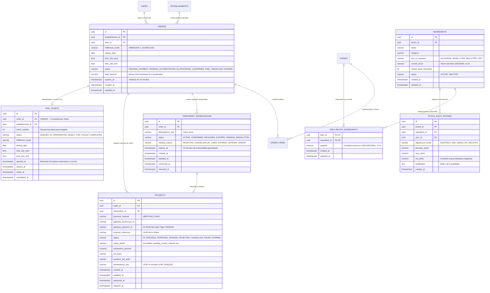

# Data Model: Pago de Carrito Individual y Descuento de Stock Transaccional

**Feature Branch**: `015-individual-checkout-stock-deduction`  
**Fecha**: 09/11/2026  
**Especificación**: [spec.md](./spec.md) | [research.md](./research.md)  
**Estado**: Completado  

---

## 1. Diagrama Entidad-Relación Integral



---

## 2. Entidades Relacionales y Mapeo JPA

### 2.1. Entidad `Order` (`com.easyeat.order.domain.Order`) — Extensión de Estados

Se extiende la entidad `Order` (creada en Spec 012 / V16) mediante la ampliación del ciclo de vida en `OrderStatus.java`:

| Atributo | Columna SQL | Tipo Java | Restricciones | Semántica y Reglas de Negocio |
|---|---|---|---|---|
| `id` | `id` | `UUID` | PK, Not Null | Identificador único del pedido. Actúa como `external_reference` en Mercado Pago y como clave foránea en `kds_tickets`. |
| `establishmentId` | `establishment_id` | `UUID` | FK, Not Null | Identificador del restaurante (tenant). |
| `userId` | `user_id` | `UUID` | FK, Not Null | Identificador del comensal solitario (`ROLE_COMENSAL`). |
| `fulfillmentMode` | `fulfillment_mode` | `FulfillmentMode` | Enum, Not Null | Modalidad de retiro: `IMMEDIATE` o `SCHEDULED`. |
| `pickupDate` | `pickup_date` | `LocalDate` | Not Null | Fecha de retiro asignada. |
| `timeSlotStart` | `time_slot_start` | `LocalTime` | Not Null | Inicio de la franja horaria. |
| `timeSlotEnd` | `time_slot_end` | `LocalTime` | Not Null | Fin de la franja horaria. |
| `status` | `status` | `OrderStatus` | Enum, Not Null | Ciclo de vida: `PENDING_PAYMENT`, `PENDING_ACCREDITATION`, `IN_PROGRESS`, `CONFIRMED`, `PAID`, `CANCELLED`, `EXPIRED`. |
| `totalAmount` | `total_amount` | `BigDecimal` | Not Null, $\ge 0$ | Importe total. Si la orden tiene bonificación del 100%, su valor es exactamente `0.00` (FR-005, CB-04). |
| `expiresAt` | `expires_at` | `Instant` | Nullable | Momento de vencimiento de la ventana temporal de 15 minutos (Spec 012 / 014). |
| `createdAt` | `created_at` | `Instant` | Not Null, Updatable=False | Fecha y hora de creación de la orden. |
| `updatedAt` | `updated_at` | `Instant` | Not Null | Fecha y hora de última modificación. |
| `items` | N/A | `List<OrderItem>` | OneToMany, Cascade ALL | Colección de platos y cantidades que integran la orden. |

#### Ciclo de Vida y Transiciones de `OrderStatus`:
- `PENDING_PAYMENT`: Estado inicial de una orden con monto $> 0$. Cuenta con reserva temporal activa durante 15 minutos.
- `PENDING_ACCREDITATION`: La pasarela externa devolvió estado `pending` (CB-05, AS-5). La retención de stock y franja se mantiene congelada/activa; **no se debita stock real ni se despacha al KDS** hasta la aprobación final asíncrona.
- `IN_PROGRESS`: Orden en curso de elaboración en cocina (FR-001, FR-005). Se alcanza única y exclusivamente tras cobro aprobado o bonificación 100%, acompañado del débito atómico de stock. Posee comanda activa en `kds_tickets` (INV-04).
- `CONFIRMED` / `PAID`: Estados terminales / complementarios del flujo comercial.
- `CANCELLED`: Pago rechazado por la pasarela, cancelación voluntaria del usuario, rechazo por agotamiento concurrente de insumos (AS-2) o interrupción por franja saturada (AS-3).
- `EXPIRED`: Ventana temporal de 15 minutos superada por inactividad o abandono del comensal sin pago en curso reportado.

---

### 2.2. Entidad `KdsTicket` (`com.easyeat.order.domain.KdsTicket`) — Nueva Entidad

Representa el registro formal de la comanda en la cola de trabajo del sistema de cocina (KDS).

| Atributo | Columna SQL | Tipo Java | Restricciones | Semántica y Reglas de Negocio |
|---|---|---|---|---|
| `id` | `id` | `UUID` | PK, Not Null | Identificador único de la comanda en KDS. |
| `orderId` | `order_id` | `UUID` | FK, Not Null, **UNIQUE** | Identificador de la orden asociada. La restricción de unicidad garantiza físicamente el cumplimiento de INV-07 (cero comandas duplicadas). |
| `establishmentId` | `establishment_id` | `UUID` | FK, Not Null | Restaurante al que pertenece la cocina. |
| `ticketNumber` | `ticket_number` | `Integer` | Not Null | Número correlativo diario para visualización clara de la brigada de cocina (ej: #1, #2). |
| `status` | `status` | `KdsTicketStatus` | Enum, Not Null | Estado operativo en cocina: `QUEUED` (En cola), `IN_PREPARATION` (En preparación), `READY_FOR_PICKUP` (Para retirar), `COMPLETED` (Completada). |
| `fulfillmentMode` | `fulfillment_mode` | `FulfillmentMode` | Enum, Not Null | Modalidad de retiro (`IMMEDIATE` / `SCHEDULED`). |
| `pickupDate` | `pickup_date` | `LocalDate` | Not Null | Fecha de entrega. |
| `timeSlotStart` | `time_slot_start` | `LocalTime` | Not Null | Inicio del turno de entrega. |
| `timeSlotEnd` | `time_slot_end` | `LocalTime` | Not Null | Fin del turno de entrega. |
| `queuedAt` | `queued_at` | `Instant` | Not Null | Momento en que la orden ingresó a la cola de cocina tras validación de pago y débito de stock. |
| `startedAt` | `started_at` | `Instant` | Nullable | Momento en que el chef pasa la comanda a preparación. |
| `readyAt` | `ready_at` | `Instant` | Nullable | Momento en que el plato queda terminado para entrega. |
| `completedAt` | `completed_at` | `Instant` | Nullable | Momento en que el comensal retira su comanda. |

---

### 2.3. Entidades de Inventario y Receta (Reutilización y Consolidación)

#### `DishRecipeIngredient` (`com.easyeat.dish.domain.DishRecipeIngredient`)
- Clave primaria compuesta: `DishRecipeIngredientId` (`dish_id`, `ingredient_id`).
- Atributo clave: `quantity` (`BigDecimal`, escala 4, mayor a 0).
- Semántica: Especificación técnica de ingredientes necesarios para producir una unidad del plato terminado.

#### `Ingredient` (`com.easyeat.inventory.entity.Ingredient`)
- Atributos clave:
  - `id`: UUID.
  - `tenantId`: UUID.
  - `name`: Nombre de la materia prima.
  - `unitOfMeasure`: `KILOGRAM`, `GRAM`, `LITER`, `MILLILITER`, `UNIT`.
  - `currentStock`: `BigDecimal` (escala 4, Not Null). Representa el stock físico real existente en cocina.
  - `status`: `ACTIVE`, `INACTIVE`.
  - `criticalStockThreshold`: Umbral de alerta para reposición.
- Operación de concurrencia: Bloqueo pesimista mediante consulta `findByIdAndTenantIdForUpdate` ordenado por `id ASC`.

#### `StockAuditEntry` (`com.easyeat.inventory.entity.StockAuditEntry`)
- Registra cada deducción física con precisión de auditoría:
  - `adjustmentMode`: `SUBTRACT`.
  - `previousStock`: Existencia previa al débito.
  - `newStock`: Existencia posterior (`previousStock - netDelta`).
  - `netDelta`: Cantidad restada (valor numérico con 4 decimales).
  - `justification`: `"Deducción automática por confirmación de Orden <orderId>"`.

---

### 2.4. Entidad `Payment` y `TemporaryReservation` (Ampliación de Spec 014)

#### `Payment` (`com.easyeat.order.domain.Payment`)
- Modela la transacción financiera con Mercado Pago:
  - `status`: `IN_PROCESS`, `APPROVED`, `PENDING`, `REJECTED`, `CANCELLED`, `FAILED`, `EXPIRED`.
  - `statusDetail`: Código detallado devuelto por la pasarela (`accredited`, `pending_contingency`, `pending_review_manual`, `cc_rejected_insufficient_amount`, etc.).
  - `gatewayPaymentId`: ID oficial asignado por Mercado Pago (`UNIQUE`).
  - `idempotencyKey`: Clave de idempotencia única saliente (`X-Idempotency-Key`).

#### `TemporaryReservation` (`com.easyeat.order.domain.TemporaryReservation`)
- Modela el bloqueo temporal de 15 minutos:
  - `status`: `ACTIVE`, `CONFIRMED`, `RELEASED`, `EXPIRED`, `PENDING_RESOLUTION`.
  - `releaseReason`: `REJECTED`, `CANCELLED_BY_USER`, `EXPIRED`, `GATEWAY_ERROR`.
  - En caso de estado pendiente (`PENDING_ACCREDITATION`), la reserva pasa a estado congelado (`PENDING_RESOLUTION` o `ACTIVE` con bandera de suspensión del barredor) para no ser liberada por el scheduler de 15 minutos hasta que la pasarela emita el veredicto definitivo.

---

## 3. Demostración Explícita de Invariantes de Datos

### 3.1. Garantía de INV-01: Atomicidad y Estrictez Absoluta del Descuento de Stock
- **Mecanismo**: Transacción ACID de base de datos (`@Transactional(isolation = Isolation.READ_COMMITTED)`).
- **Algoritmo**:
  1. Se bloquean concurrentemente todos los insumos involucrados mediante `SELECT ... FOR UPDATE` ordenados por `id ASC`.
  2. Se acumula la demanda total por ingrediente considerando la multiplicidad de platos en la orden (`orderItem.quantity * line.quantity`).
  3. Se evalúa la suficiencia de cada ingrediente:
     $$\forall i \in \text{Insumos}: \text{currentStock}(i) \ge \text{demandaTotal}(i)$$
  4. Si cualquiera falla, se arroja `InsufficientIngredientStockException`. Spring intercepta la excepción no chequeada y ejecuta **rollback inmediato y total**. No se deduce ni un gramo de ningún ingrediente.
  5. Solo si todos son suficientes, se aplican los `currentStock.subtract(...)`, se insertan los registros de auditoría y se procede con la orden.

### 3.2. Garantía de INV-08: Resolución Atómica de Colisiones y Garantía de Ventana
- **Al presionar "Pagar"**: Se adquieren los bloqueos de establecimiento (`findByIdForUpdate`) e insumos. Quien primero confirme el inicio obtiene la `TemporaryReservation`. Quienes lleguen después y encuentren stock agotado son rechazados de inmediato sin cobro (`HTTP 409 Conflict - INSUFFICIENT_STOCK`, AS-2).
- **Durante 15 minutos**: `DishAvailabilityEngine` descuenta el stock comprometido en reservas activas. La reserva es inexpugnable durante este lapso (Q1, INV-08).
- **Tras 15 minutos**: La reserva expira automáticamente. Si el usuario intenta reanudar y la franja horaria se saturó por reservas de otros clientes, el sistema interrumpe la transacción sin cobrar (`HTTP 409 Conflict - SLOT_CAPACITY_EXCEEDED`, AS-3).

### 3.3. Garantía de INV-03: Diferenciación Ontológica entre Retención Temporal y Débito Real
- **Retención Temporal (Estado Pendiente / Checkout)**:
  - `Ingredient.currentStock` permanece intacto.
  - La cantidad retenida existe únicamente como un compromiso virtual en memoria y en la tabla `temporary_reservations`.
  - Cero comandas emitidas a cocina (`kds_tickets` vacío para esa orden).
- **Débito Real (Pago Aprobado o Bonificación 100%)**:
  - `Ingredient.currentStock` se descuenta físicamente en base de datos.
  - Se genera un registro indeleble en `stock_audit_entries`.
  - Se emite e inserta de forma indivisible la comanda en `kds_tickets` y la orden pasa a `IN_PROGRESS`.

### 3.4. Garantía de INV-07: Idempotencia de Inventario y KDS
- **Nivel Físico (Database Constraints)**:
  - `uq_kds_tickets_order_id`: Imposibilita a nivel de motor de datos insertar dos comandas para la misma orden.
  - `uq_payments_gateway_payment_id`: Imposibilita registrar dos cobros exitosos para el mismo identificador de Mercado Pago.
- **Nivel Lógico (Idempotency Guards)**:
  - Si el servicio de confirmación recibe un webhook o retorno sobre una orden cuyo estado ya es `IN_PROGRESS`, omite cualquier deducción de inventario y omite inserciones en el KDS, respondiendo confirmación exitosa de inmediato.

### 3.5. Cumplimiento de FR-013 e INV-10: Alineación Inmediata de la Carta
- La disponibilidad de platos en `DishAvailabilityEngine` no utiliza tablas intermedias cacheadas que requieran sincronización asíncrona.
- Al debitarse el stock real en `ingredients`, la siguiente consulta al catálogo ejecuta la comprobación directa de recetas. Si el ingrediente se agotó, el plato se expone de inmediato como `available = false`.

---

## 4. Política Estricta de Aislamiento de Datos Financieros (PCI-DSS SAQ A)

Para dar estricto cumplimiento a FR-013 de Spec 014, INV-11 de Spec 014 y SC-009 de Spec 015, se define taxativamente:

### Lo que NUNCA se Captura, Recibe ni Almacena en EasyEat:
- ❌ Primary Account Number (PAN / Número de tarjeta de 16 dígitos).
- ❌ Card Verification Value (CVV / CVC / Código de seguridad).
- ❌ Fecha de expiración (Mes/Año de vencimiento).
- ❌ Datos del titular de la tarjeta (Nombre impreso en tarjeta bancaria).
- ❌ PIN bancario o claves personales.

### Lo que SÍ se Persiste como Constancia Transaccional:
- ✅ Identificador de la preferencia (`gateway_preference_id`).
- ✅ Identificador de la transacción devuelto por MP (`gateway_payment_id`).
- ✅ Estado general (`status`: `approved`, `pending`, `rejected`).
- ✅ Detalle del estado (`status_detail`: `accredited`, `pending_contingency`, etc.).
- ✅ Monto total monetario procesado (`transaction_amount`).
- ✅ Timestamps de aprobación o rechazo (`approved_at`, `rejected_at`).
- ✅ Identificador de la orden en EasyEat (`external_reference`).

---

## 5. Compatibilidad y Riesgos de Regresión con Specs Previas

| Especificación | Punto de Contacto | Estrategia de Compatibilidad | Riesgo de Regresión Mitigado |
|---|---|---|---|
| **Spec 009 (Shopping Cart)** | Vaciado de carrito tras pago aprobado o bonificación 100%; preservación de carrito ante rechazo o franja saturada. | Se mantiene el contrato de `CartContext` en frontend (`clearCart()` solo tras éxito fehaciente). | Pérdida prematura del carrito si el pago falla o queda pendiente. |
| **Spec 010 (Restaurant Config)** | Capacidad de franja y días operativos. | Se reutilizan las columnas de `establishments` (`max_capacity_per_slot`, `lead_time_minutes`). | Desincronización con las políticas horarias del restaurante. |
| **Spec 012 (Time-Slots Engine)** | Reserva de turnos y expiración con TTL de 15 min. | Se mantiene la estructura de `orders` (`time_slot_start`, `time_slot_end`, `expires_at`). | Sobrecupo en franjas horarias por colisiones concurrentes (Zero Overbooking). |
| **Spec 013 (Chef Pause & Stock)** | Pausa manual de platos y umbrales críticos. | `DishAvailabilityEngine` evalúa `paused_by_chef` junto con el stock de insumos. | Ofrecer platos pausados por el chef o agotados en cocina. |
| **Spec 014 (Mercado Pago)** | Checkout Pro, webhooks HMAC, idempotencia. | Esta spec absorbe los casos delegados (monto cero, estado pendiente) y conecta la confirmación de pago con el débito real de stock. | Desconexión entre la pasarela y la cocina real. |

---

## 6. Script DDL de Migración Flyway: `V23__individual_checkout_stock_deduction_and_kds.sql`

```sql
-- ====================================================================
-- EasyEat V23: Individual Checkout, Stock Deduction & KDS Queue Dispatch
-- ====================================================================

-- 1. Ampliar el check constraint de status en la tabla orders para incluir PENDING_ACCREDITATION e IN_PROGRESS
ALTER TABLE orders DROP CONSTRAINT IF EXISTS chk_order_status;
ALTER TABLE orders ADD CONSTRAINT chk_order_status 
    CHECK (status IN (
        'PENDING_PAYMENT', 
        'PENDING_ACCREDITATION', 
        'IN_PROGRESS', 
        'READY_FOR_PICKUP',
        'COMPLETED',
        'CONFIRMED', 
        'PAID', 
        'CANCELLED', 
        'EXPIRED'
    ));

-- 2. Crear tabla kds_tickets para la cola del Kitchen Display System
CREATE TABLE IF NOT EXISTS kds_tickets (
    id                UUID           PRIMARY KEY DEFAULT gen_random_uuid(),
    order_id          UUID           NOT NULL REFERENCES orders(id) ON DELETE RESTRICT,
    establishment_id  UUID           NOT NULL REFERENCES establishments(id) ON DELETE RESTRICT,
    ticket_number     INTEGER        NOT NULL,
    status            VARCHAR(30)    NOT NULL DEFAULT 'QUEUED',
    fulfillment_mode  VARCHAR(30)    NOT NULL,
    pickup_date       DATE           NOT NULL,
    time_slot_start   TIME           NOT NULL,
    time_slot_end     TIME           NOT NULL,
    queued_at         TIMESTAMPTZ    NOT NULL DEFAULT NOW(),
    started_at        TIMESTAMPTZ    NULL,
    ready_at          TIMESTAMPTZ    NULL,
    completed_at      TIMESTAMPTZ    NULL,
    CONSTRAINT uq_kds_tickets_order_id UNIQUE (order_id),
    CONSTRAINT chk_kds_ticket_status CHECK (status IN ('QUEUED', 'IN_PREPARATION', 'READY_FOR_PICKUP', 'COMPLETED')),
    CONSTRAINT chk_kds_fulfillment_mode CHECK (fulfillment_mode IN ('IMMEDIATE', 'SCHEDULED')),
    CONSTRAINT chk_kds_ticket_number CHECK (ticket_number > 0)
);

CREATE INDEX IF NOT EXISTS idx_kds_tickets_establishment_status 
    ON kds_tickets(establishment_id, status, pickup_date, time_slot_start);

CREATE INDEX IF NOT EXISTS idx_kds_tickets_order_id 
    ON kds_tickets(order_id);

-- 3. Crear secuencia o soporte para ticket_number por día/restaurante
CREATE SEQUENCE IF NOT EXISTS kds_ticket_daily_seq START 1;
```

