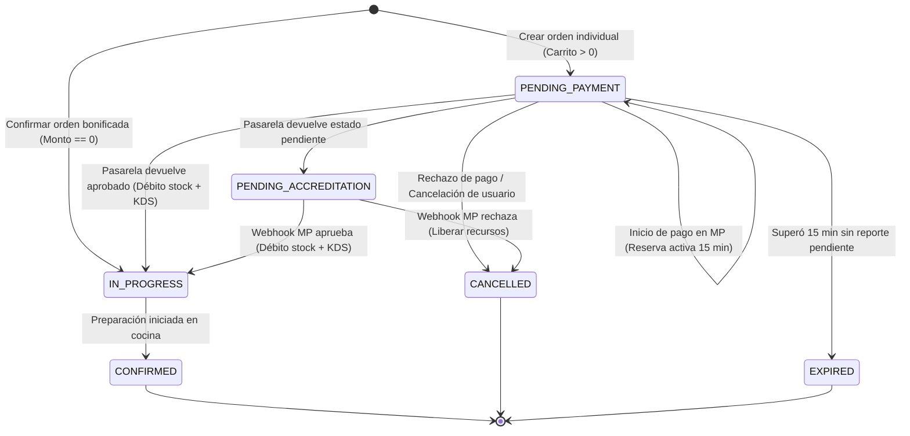

# Phase 0: Research & Architectural Decisions — Pago de Carrito Individual y Descuento de Stock Transaccional

**Feature Branch**: `015-individual-checkout-stock-deduction`  
**Fecha**: 09/11/2026  
**Especificación**: [spec.md](./spec.md)  
**Estado**: Completado  

---

## 1. Resumen de Decisiones Arquitectónicas

| Área Técnica | Decisión Seleccionada | Alternativas Descartadas | Rationale Principal |
|---|---|---|---|
| **Modelo de Descuento Atómico de Stock por Receta** | **Bloqueo pesimista ordenado (`PESSIMISTIC_WRITE`) sobre insumos (`ingredients`) con deducción matemática exacta y registro en `stock_audit_entries`** | Deducción optimista con reintentos, deducción asíncrona post-confirmación, bloqueo a nivel de tabla | Cumple estrictamente con INV-01, FR-007 y FR-008: se debitan todos los insumos de todas las recetas o no se debita ninguno. El ordenamiento por `ingredient_id ASC` erradica el riesgo de deadlocks entre transacciones concurrentes con platos que comparten ingredientes (C3). |
| **Resolución Atómica de Concurrencia y Garantía de Ventana** | **Validación y bloqueo conjunto de stock y franja horaria al presionar "Pagar" con ventana de exclusividad de 15 min (heredada de Spec 012/014)** | Verificación diferida tras el cobro de pasarela, reservas flotantes sin bloqueo | Garantiza INV-08 y Q1: dentro de los 15 minutos el comensal tiene garantizado su stock y su cupo. Si los insumos se agotaron antes de consolidar el bloqueo, se rechaza de inmediato sin cobro (AS-2, CB-02). Si demoró más de 15 min y la franja se saturó, se interrumpe sin cobro y se reabre la selección de horario (AS-3, CB-03). |
| **Idempotencia de Inventario y KDS** | **Doble barrera: Restricción de unicidad en base de datos (`kds_tickets.order_id UNIQUE`, `payments.gateway_payment_id UNIQUE`) y guarda idempotente en servicio** | Verificación en memoria, colas de mensajería sin clave de idempotencia | Cumple con INV-07, FR-012 y CB-12: ni reenvíos de webhooks ni recargas de página pueden debitar dos veces ingredientes ni emitir comandas duplicadas a cocina. |
| **Máquina de Estados de Orden y Pago** | **Ampliación formal de `OrderStatus` con `PENDING_ACCREDITATION` e `IN_PROGRESS`, integrando flujo de bonificación 100% y retención provisoria** | Flags booleanos en `Order`, reutilizar `PENDING_PAYMENT` para estados pendientes | Modela explícitamente el ciclo de vida del pedido, permitiendo congelar la reserva provisoria ante pagos pendientes sin pasar a KDS (CB-05, AS-5) y transicionar directamente pedidos con monto cero sin pasarela (CB-04, AS-4). |
| **Mecanismo de Cola del KDS** | **Entidad relacional `KdsTicket` vinculada 1:1 con `Order` (`kds_tickets`), con estados de comanda (`QUEUED`, `IN_PREPARATION`, `READY_FOR_PICKUP`, `COMPLETED`) y ordenamiento por fecha/hora de retiro** | Mensajería externa transaccional (Kafka/RabbitMQ), almacenamiento embebido en `Order` sin tabla dedicada | Brinda persistencia relacional transaccional indivisible con el débito de stock (INV-04), alimenta directamente los 4 contadores de `KitchenWorkspacePage.tsx` y garantiza cero comandas duplicadas mediante `UNIQUE(order_id)`. |
| **Actualización Inmediata del Catálogo por Agotamiento** | **Evaluación dinámica basada en stock real en `DishAvailabilityEngine`** | Cache distribuido con invalidación asíncrona, batch periódico de actualización | Cumple con FR-013 e INV-10 sin añadir infraestructura nueva: ni bien un débito transaccional agota un insumo, cualquier consulta del catálogo evalúa en tiempo real `currentStock < recipeQuantity` y marca los platos dependientes como no disponibles. |
| **Integración con Mercado Pago y Webhooks** | **Reutilización y extensión del adaptador desacoplado `PaymentGatewayPort` / `MercadoPagoGatewayAdapter` heredado de Spec 014** | Rediseño de pasarela, SDK embebido monolítico | Preserva la arquitectura Hexagonal y SOLID del repo, verificando firmas HMAC-SHA256 (`x-signature`) y soportando procesamiento autónomo en servidor sin retorno del comensal (AS-1b, CB-11, C5). |
| **Experiencia y Sincronización en Frontend** | **Extensión de `CheckoutPage.tsx` y `PaymentReturnPage.tsx` con manejo de estados `IN_PROGRESS`, `PENDING_ACCREDITATION`, aterrizaje con preservación de carrito y reapertura de franjas** | Rediseño completo de checkout, web sockets dedicados | Reutiliza los contextos existentes (`CartContext`), garantiza que ante rechazos o interrupciones no se pierda el carrito (AS-2, AS-3) y ofrece navegación fluida y reactiva vía Axios + React Router. |
| **Estrategia Sandbox y Reproducibilidad** | **Operación determinística contra Sandbox de Mercado Pago con tarjetas oficiales (`APRO`, `FUND`, `OTHE`) y tests de estrés con Testcontainers** | Mockeo superficial, pruebas en producción con dinero real | Cumple con RT-1 (costo cero), RT-2 (equivalencia funcional 1:1) y RT-3 (reproducibilidad determinística de resultados). |
| **Manejo de Secretos y Configuración** | **Propiedades centralizadas tipadas en `MercadoPagoProperties` inyectadas por variables de entorno y perfiles Spring** | Hardcoding en código o archivos commiteados | Garantiza aislamiento total de credenciales sensibles y respeto estricto a las normas de seguridad del repositorio. |

---

## 2. Investigación Detallada por Área Técnica

### 2.1. Modelo de Descuento Atómico de Stock por Receta (INV-01, FR-007, FR-008, CB-08)

#### Decisión
Implementar el descuento de stock de insumos por receta dentro de una transacción única de base de datos (`@Transactional`), ejecutando un bloqueo pesimista ordenado sobre las filas de `ingredients`:
1. **Recolección y Multiplicación de Insumos (FR-009)**:
   Para cada ítem del pedido (`OrderItem`), se consultan las líneas de su receta técnica (`DishRecipeIngredient`). Se multiplican las cantidades requeridas por la cantidad de platos solicitados:
   $$\text{demandaTotal}(i) = \sum_{p \in \text{Items}} (\text{receta}(p, i) \times \text{cantidad}(p))$$
2. **Prevención de Deadlocks en Insumos Compartidos (C3, CB-06)**:
   Si dos órdenes concurrentes contienen platos que comparten uno o más ingredientes (ej: "Pan de hamburguesa" y "Carne vacuna"), ambas transacciones adquieren los bloqueos de los insumos ordenados ascendentemente por su clave primaria (`ingredient_id ASC`). Esto elimina formalmente la posibilidad de espera circular (condición de Coffman):
   ```sql
   SELECT * FROM ingredients 
   WHERE id IN (:ingredientIds) AND tenant_id = :tenantId 
   ORDER BY id ASC 
   FOR UPDATE;
   ```
3. **Validación Indivisible de Existencias (INV-01, FR-008)**:
   Se evalúa de manera estricta si $\text{current\_stock}(i) \ge \text{demandaTotal}(i)$ para cada insumo. Si tan solo un insumo tiene stock insuficiente, se lanza una excepción de dominio (`InsufficientIngredientStockException`) que dispara el rollback completo de la transacción, registrando cero descuentos de stock.
4. **Débito y Registro en Auditoría (CB-07, SC-009)**:
   Si todos los insumos cuentan con existencias suficientes, se actualiza `current_stock = current_stock - demandaTotal` con precisión decimal de 4 dígitos (`BigDecimal`), y se crea un registro en `stock_audit_entries` por cada insumo con `adjustment_mode = 'SUBTRACT'`, `justification = 'Deducción automática por confirmación de Orden <orderId>'`.

#### Alternativas Descartadas
- **Control optimista con versión (`@Version`)**: Descartado porque ante alta concurrencia gastronómica sobre las últimas unidades de un insumo, provoca excepciones `OptimisticLockingFailureException` recurrentes que requerirían loops de reintento complejos y costosos.
- **Deducción posterior asíncrona (Eventual Consistency)**: Descartada de plano porque viola el principio fundamental INV-02 e INV-04: no se puede confirmar una orden al comensal ni mandarla al KDS sin la garantía previa de que los insumos físicos ya fueron reservados y debitados en el inventario.

---

### 2.2. Resolución Atómica de Concurrencia y Garantía de Ventana de 15 Minutos (INV-08, Q1, C3, C4, AS-2, AS-3)

#### Decisión
Estructurar el flujo de cobro y reserva en dos etapas perfectamente sincronizadas:
1. **Al presionar "Pagar" (Inicio de Checkout / Creación de Preferencia)**:
   - Se inicia una transacción pesimista que bloquea la fila del establecimiento (`EstablishmentRepository.findByIdForUpdate`) para evaluar cupo de franja, y adquiere bloqueo sobre los insumos de la orden.
   - **Caso AS-2 (Insumos agotados por concurrencia)**: Si otro comensal reservó los últimos insumos instantes antes, el sistema detecta la falta de stock remanente, aborta la transacción, devuelve `HTTP 409 Conflict` con código `INSUFFICIENT_STOCK` y la lista de platos afectados. No se debita dinero, no se genera preferencia en Mercado Pago, el carrito se conserva en el cliente y se marcan los platos no disponibles.
   - **Caso Normal**: Si hay cupo y stock, se crea la `TemporaryReservation` en estado `ACTIVE` con `expires_at = NOW() + 15 min`. Durante estos 15 minutos, los insumos y la franja están estrictamente blindados para ese comensal (Q1, INV-08).
2. **Durante la ventana de 15 minutos**:
   - `DishAvailabilityEngine` y el selector de franjas descuentan las cantidades comprometidas en reservas activas. Ningún comensal concurrente puede arrebatarle el stock ni la franja a quien tiene una reserva activa vigente.
3. **Tras la expiración de los 15 minutos (AS-3, CB-03)**:
   - Si el comensal demora más de 15 minutos en completar el formulario de pago en Mercado Pago, la reserva expira (`EXPIRED`), liberando los recursos a la cocina y a otros usuarios.
   - Si otros usuarios agotaron la franja horaria durante su ausencia y el comensal intenta reanudar o completar el pago, el backend detecta que la franja se encuentra saturada (`SlotCapacityExceededException`), interrumpe la transacción sin cobrar dinero, devuelve `HTTP 409 Conflict` con código `SLOT_CAPACITY_EXCEEDED`, preserva el carrito y reabre el selector de horarios para que elija un nuevo turno.

---

### 2.3. Idempotencia de Inventario y KDS (INV-07, FR-012, CB-12)

#### Decisión
Garantizar idempotencia a nivel de base de datos y de servicio de aplicación:
1. **Constraint de Unicidad**:
   - Tabla `kds_tickets`: `CONSTRAINT uq_kds_tickets_order_id UNIQUE (order_id)`.
   - Tabla `payments`: `CONSTRAINT uq_payments_gateway_payment_id UNIQUE (gateway_payment_id)`.
2. **Guarda Idempotente en el Servicio de Confirmación**:
   Antes de ejecutar cualquier deducción de stock o despacho a cocina, el servicio inspecciona el estado actual de la orden:
   ```java
   if (order.getStatus() == OrderStatus.IN_PROGRESS) {
       log.info("Idempotent webhook/return received for order {}. Order already in progress. Ignoring duplicate debit.", orderId);
       return new PaymentConfirmationResult(orderId, OrderStatus.IN_PROGRESS, true);
   }
   ```
3. **Comportamiento ante Reintentos y Webhooks Repetidos (CB-12)**:
   Si Mercado Pago retransmite el webhook de aprobación o el comensal recarga repetidamente la página de retorno, el sistema detecta que la orden ya está `IN_PROGRESS`, omite la deducción de ingredientes, omite la creación de comandas en KDS y responde `HTTP 200 OK` inmediatamente.

---

### 2.4. Máquina de Estados de la Orden y Transacciones de Pago

#### Decisión
Extender el enum `OrderStatus` y el enum `PaymentStatus` para reflejar todas las etapas de la especificación:



1. **Estado `PENDING_ACCREDITATION` (CB-05, AS-5, FR-006)**:
   - Se aplica cuando Mercado Pago devuelve `status = 'pending'`.
   - La orden pasa a `PENDING_ACCREDITATION`.
   - La `TemporaryReservation` se congela (se actualiza su estado o se marca como `PENDING_RESOLUTION`), evitando que el barredor programado `@Scheduled` la libere prematuramente.
   - **No se debita stock real** en la tabla `ingredients`.
   - **No se envía la orden al KDS**.
   - La interfaz muestra al comensal una pantalla clara: "Tu pago está pendiente de confirmación. Tu pedido pasará a la cocina ni bien se reciba la aprobación final".
   - Al llegar el webhook definitivo: si `approved`, debita stock atómico y encola en KDS; si `rejected`, pasa a `CANCELLED` y libera stock y franja.
2. **Estado `IN_PROGRESS` (Órdenes en Cocina - FR-001, FR-005, FR-010)**:
   - Es el estado operativo "en curso" estipulado por la especificación funcional.
   - Se alcanza de forma exclusiva bajo dos justificaciones válidas (INV-09):
     a) Pago aprobado por la pasarela con débito real exitoso.
     b) Orden bonificada al 100% (monto cero) con débito real exitoso.
   - Es la condición previa e indispensable para que exista un registro en `kds_tickets` (INV-04).
3. **Flujo de Bonificación 100% (CB-04, AS-4, AS-6b, FR-005)**:
   - Si `order.total_amount.compareTo(BigDecimal.ZERO) == 0`:
   - Se omite la llamada a Mercado Pago y la redirección externa.
   - Se ejecuta el débito atómico de stock por receta.
   - Se transiciona la orden directamente a `IN_PROGRESS`.
   - Se genera la comanda en KDS.
   - Se devuelve confirmación inmediata al comensal y se vacía el carrito local.

---

### 2.5. Mecanismo de Cola del KDS (Kitchen Display System)

#### Decisión
Modelar la comanda del KDS mediante la entidad relacional `KdsTicket` (`kds_tickets`), perfectamente integrada al esquema relacional de Spring Data JPA:
1. **Campos Principales**:
   - `id`: UUID (Primary Key).
   - `order_id`: UUID (Foreign Key a `orders.id`, con restricción de unicidad estricta `UNIQUE`).
   - `establishment_id`: UUID (Foreign Key a `establishments.id`).
   - `ticket_number`: Secuencial diario o correlativo legible por cocina (ej: #101).
   - `status`: Enum (`QUEUED`, `IN_PREPARATION`, `READY_FOR_PICKUP`, `COMPLETED`).
   - `fulfillment_mode`: `IMMEDIATE` o `SCHEDULED`.
   - `pickup_date`, `time_slot_start`, `time_slot_end`: Datos de entrega derivados de la orden.
   - `queued_at`: Timestamp de inserción automática.
2. **Integración con la UI de Cocina (`KitchenWorkspacePage.tsx`)**:
   La tabla `kds_tickets` proporciona la fuente de verdad directa para los 4 contadores del dashboard del chef:
   - `QUEUED` $\rightarrow$ "En Cola".
   - `IN_PREPARATION` $\rightarrow$ "En Preparación".
   - `READY_FOR_PICKUP` $\rightarrow$ "Para Retirar".
   - `COMPLETED` $\rightarrow$ "Completadas hoy".
3. **Garantía Transaccional Indivisible (INV-04)**:
   La inserción en `kds_tickets` se realiza dentro de la misma transacción de base de datos que la deducción de ingredientes y el cambio de estado de la orden a `IN_PROGRESS`. Si falla la deducción de stock o la inserción del ticket, ninguna de las dos operaciones queda registrada.

---

### 2.6. Actualización Inmediata del Catálogo por Agotamiento de Insumos (FR-013, INV-10)

#### Decisión
Aprovechar el diseño de evaluación en tiempo real ya existente en `DishAvailabilityEngine.java`:
1. `DishAvailabilityEngine.isDishAvailable(UUID dishId, UUID tenantId)` evalúa las existencias reales en `ingredients` para cada componente de la receta (`DishRecipeIngredient`).
2. Cuando el débito transaccional de un pedido confirmado reduce el `current_stock` de un ingrediente por debajo de la cantidad requerida por una receta (o a cero), la siguiente invocación a `isDishAvailable` devuelve inmediatamente `false`.
3. Al consultar el catálogo (`GET /api/v1/catalog`), los platos dependientes figuran automáticamente con `available = false`.
4. En el frontend, si un comensal tenía el plato en su carrito, al intentar iniciar el checkout el backend rechaza la transacción conforme al Caso Borde CB-02 / AS-2, impidiendo la venta de comida no preparable (INV-02).

---

### 2.7. Experiencia de Usuario y Comportamiento en Frontend

#### Decisión
Extender los componentes de checkout existentes sin alterar la arquitectura de la aplicación:
1. **Botón "Pagar"**:
   - Estados: `Habilitado`, `Cargando/Deshabilitado` (durante la llamada API de inicio), `Deshabilitado con alerta` (si hay platos no disponibles).
   - Para pedidos bonificados al 100%, el botón exhibe el texto **"Confirmar pedido ($0)"** y ejecuta el flujo directo a cocina sin redirección a Mercado Pago.
2. **Pantalla de Estado Pendiente (`/checkout/payment-pending` o vista en `PaymentReturnPage.tsx`)**:
   - Despliega un mensaje informativo claro: *"Tu pago está en proceso de acreditación por la pasarela de pagos. Tu pedido pasará a cocina tan pronto como se reciba la confirmación final."*
   - No expone cuenta regresiva.
   - Conserva la orden en seguimiento y permite al usuario regresar a la vista de inicio o a su perfil.
3. **Aterrizaje tras Rechazo por Insumos Agotados (AS-2, CB-02)**:
   - El comensal es devuelto al Checkout.
   - El carrito se conserva intacto en `CartContext`.
   - Se muestra un banner de advertencia destacado: *"Algunos ingredientes de tu pedido se agotaron por alta demanda concurrente. Por favor, modificá tu carrito para continuar."*
   - Los platos afectados se resaltan visualmente como no disponibles.
4. **Aterrizaje tras Interrupción por Franja Saturada (AS-3, CB-03)**:
   - El carrito se conserva íntegro.
   - Se reabre automáticamente el selector de franjas horarias con un banner visible: *"La franja horaria previamente seleccionada ha alcanzado su cupo máximo tras expirar la ventana de 15 minutos. Por favor, elegí un nuevo horario de retiro disponible."*
5. **Aprobación sin Retorno del Comensal (AS-1b, CB-11, C5)**:
   - Si el comensal cierra el navegador tras pagar en Mercado Pago, el backend procesa el webhook de manera totalmente desatendida. Cuando el usuario vuelva a ingresar al sitio y visite su perfil o historial de pedidos, encontrará su pedido en estado `IN_PROGRESS` ("En preparación en cocina").

---

### 2.8. Estrategia Sandbox, Tarjetas de Prueba y Reproducibilidad Determinística (RT-1, RT-2, RT-3)

#### Decisión
Utilizar la infraestructura de pruebas de Mercado Pago Argentina documentada oficialmente:
- **Sandbox**: `mercadopago.sandbox = true`, utilizando `sandbox_init_point` y tokens de prueba.
- **Tarjetas de prueba oficiales de Mercado Pago Argentina**:
  - Aprobado directo (`approved`): Visa terminada en `3704` con titular `APRO Test`.
  - Rechazado por fondos insuficientes (`rejected`): Visa terminada en `3704` con titular `FUND Test`.
  - Rechazado por fraude/seguridad (`rejected`): Mastercard terminada en `0604` con titular `OTHE Test`.
- **Simulación de Concurrencia**:
  Tests de integración con Testcontainers PostgreSQL y `ExecutorService` con 20 hilos compitiendo por el stock del último plato y el último cupo de franja, comprobando que solo el primer comensal obtiene la reserva y los 19 restantes son rechazados sin cobro ni inconsistencias.

---

### 2.9. Manejo de Secretos y Configuración por Entornos

#### Decisión
Reutilizar la configuración tipada `MercadoPagoProperties` definida en Spec 014:
- Inyección mediante variables de entorno: `MERCADOPAGO_ACCESS_TOKEN`, `MERCADOPAGO_PUBLIC_KEY`, `MERCADOPAGO_WEBHOOK_SECRET`, `MERCADOPAGO_SANDBOX`.
- Perfiles Spring: `application-dev.yml` (sandbox habilitado), `application-test.yml` (mocks/sandbox), `application-local.yml`.
- `.env.example` actualizado con variables documentadas sin credenciales reales.
- **Prohibición estricta de datos de tarjetas**: Ni PAN, ni CVV, ni fechas de vencimiento viajan por la red de EasyEat ni se almacenan en base de datos ni logs (PCI-DSS SAQ A).

