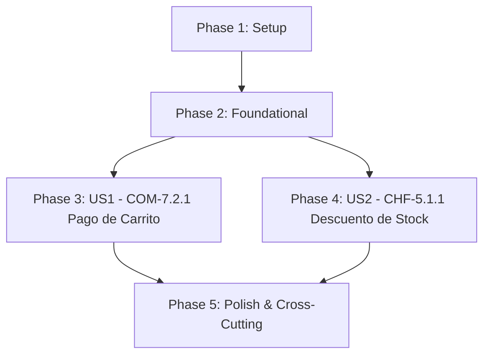

# Tasks: Pago de Carrito Individual y Descuento de Stock Transaccional

**Input**: Documentos de diseño desde `/specs/015-individual-checkout-stock-deduction/`  
**Prerequisites**: [plan.md](./plan.md) (requerido), [spec.md](./spec.md) (requerido), [research.md](./research.md), [data-model.md](./data-model.md), [contracts/](./contracts/), [quickstart.md](./quickstart.md)  
**Tests**: Estrategia TDD estricta requerida explícitamente (Red Test primero, Green Test después).  
**Organization**: Tareas agrupadas por User Story para permitir desarrollo y verificación independiente.  

---

## Format: `- [ ] [TaskID] [P?] [Story?] Description with file path`

- **[P]**: Ejecución en paralelo permitida (archivos independientes sin dependencias bloqueantes).
- **[Story]**: Etiqueta de trazabilidad con la historia de usuario (`[US1]`, `[US2]`).
- Rutas explícitas para cada tarea (`easyeat/backend/...`, `easyeat/frontend/...`).

---

## Phase 1: Setup (Infraestructura Compartida)

**Propósito**: Inicialización de esquemas, migraciones y tipos base compartidos.

- [ ] T001 Crear migración Flyway `V19__individual_checkout_stock_deduction_and_kds.sql` ampliando el check constraint de `orders.status` e incorporando la tabla `kds_tickets` con índices en `easyeat/backend/src/main/resources/db/migration/V19__individual_checkout_stock_deduction_and_kds.sql`
- [ ] T002 [P] Extender el enum `OrderStatus` incorporando los estados `PENDING_ACCREDITATION` e `IN_PROGRESS` en `easyeat/backend/src/main/java/com/easyeat/order/domain/OrderStatus.java`
- [ ] T003 [P] Crear el enum `KdsTicketStatus` con los estados `QUEUED`, `IN_PREPARATION`, `READY_FOR_PICKUP` y `COMPLETED` en `easyeat/backend/src/main/java/com/easyeat/order/domain/KdsTicketStatus.java`
- [ ] T004 [P] Definir tipos TypeScript para respuestas de confirmación de checkout, pedidos bonificados y estados de comandas en `easyeat/frontend/src/types/checkout.ts` y `easyeat/frontend/src/types/kds.ts`

---

## Phase 2: Foundational (Prerrequisitos Bloqueantes)

**Propósito**: Infraestructura de persistencia, entidades y DTOs que desbloquean la implementación de las historias de usuario.

**⚠️ CRITICAL**: Ninguna tarea de User Story puede comenzar hasta completar esta fase.

- [ ] T005 Crear la entidad relacional JPA `KdsTicket` con restricción de unicidad `UNIQUE (order_id)` y auditoría de timestamps en `easyeat/backend/src/main/java/com/easyeat/order/domain/KdsTicket.java`
- [ ] T006 [P] Crear el repositorio JPA `KdsTicketRepository` para consultas operativas por establecimiento, fecha de entrega y orden en `easyeat/backend/src/main/java/com/easyeat/order/repository/KdsTicketRepository.java`
- [ ] T007 [P] Extender la entidad `Order` con métodos de soporte de ciclo de vida (`isPendingAccreditation`, `isInProgress`) en `easyeat/backend/src/main/java/com/easyeat/order/domain/Order.java`
- [ ] T008 [P] Crear la excepción de dominio `InsufficientIngredientStockException` para abortar débitos atómicos con rollback en `easyeat/backend/src/main/java/com/easyeat/inventory/exception/InsufficientIngredientStockException.java`
- [ ] T009 [P] Crear DTOs inmutables para confirmación de pagos, estados pendientes, pedidos bonificados y resúmenes de KDS en `easyeat/backend/src/main/java/com/easyeat/order/dto/PaymentConfirmationRequest.java`, `PaymentConfirmationResponse.java`, `PendingPaymentRequest.java`, `PendingPaymentResponse.java`, `ZeroAmountOrderRequest.java`, `ZeroAmountOrderResponse.java`, `KdsTicketSummaryDto.java` y `KdsDashboardSummaryResponse.java`

**Checkpoint**: Base relacional y tipada lista — la implementación de User Stories puede comenzar de forma independiente.

---

## Phase 3: User Story 1 — COM-7.2.1: Pago de Carrito Individual (Priority: P1) 🎯 MVP

**Goal**: Permitir al comensal pagar el 100% de su orden individual y confirmarla de inmediato hacia la cocina, resolviendo pago aprobado, procesamiento autónomo de webhooks sin retorno, rechazo por stock agotado por concurrencia, interrupción por franja horaria saturada tras 15 minutos, pedidos con bonificación al 100% y retención provisoria ante estado pendiente.

**Independent Test**: Verificar de punta a punta que:
1. Pagos aprobados transicionan la orden a `IN_PROGRESS`, debitan stock real y encolan en KDS (AS-1, AS-1b).
2. Si los insumos se agotan concurrentemente al presionar pagar, se rechaza de inmediato con `HTTP 409 Conflict` (`INSUFFICIENT_STOCK`), preservando el carrito y sin cobro monetario (AS-2).
3. Si el comensal demora más de 15 minutos y la franja se satura, se interrumpe con `HTTP 409 Conflict` (`SLOT_CAPACITY_EXCEEDED`), preservando el carrito y reabriendo el selector de horarios (AS-3).
4. Carritos con monto cero por bonificación 100% omiten pasarela y confirman directo a cocina (AS-4).
5. Estados pendientes de pasarela transicionan a `PENDING_ACCREDITATION`, congelan la reserva y no envían a cocina hasta confirmación final (AS-5).

### Tests para User Story 1 (TDD - Escribir PRIMERO y verificar estado ROJO) ⚠️

- [ ] T010 [P] [US1] Escribir test de integración para pago aprobado y procesamiento autónomo de webhooks sin retorno del comensal (AS-1, AS-1b, CB-11) en `easyeat/backend/src/test/java/com/easyeat/order/IndividualCheckoutIntegrationTest.java`
- [ ] T011 [P] [US1] Escribir test de integración para rechazo inmediato por insumos de receta agotados por concurrencia al iniciar cobro (AS-2, CB-02) en `easyeat/backend/src/test/java/com/easyeat/order/ConcurrencyStockExhaustionIntegrationTest.java`
- [ ] T012 [P] [US1] Escribir test de integración para interrupción por franja horaria saturada tras superar ventana de 15 minutos (AS-3, CB-03) en `easyeat/backend/src/test/java/com/easyeat/order/SlotSaturationInterruptionIntegrationTest.java`
- [ ] T013 [P] [US1] Escribir test de integración para confirmación directa de orden bonificada al 100% con monto cero (AS-4, CB-04) en `easyeat/backend/src/test/java/com/easyeat/order/ZeroAmountCheckoutIntegrationTest.java`
- [ ] T014 [P] [US1] Escribir test de integración para retención provisoria ante estado pendiente de pasarela sin envío a KDS y resolución asíncrona (AS-5, CB-05) en `easyeat/backend/src/test/java/com/easyeat/order/PendingPaymentResolutionIntegrationTest.java`
- [ ] T015 [P] [US1] Escribir pruebas unitarias y de integración de frontend para el flujo de pago individual, botón de confirmación de bonificación ($0) y vista de pago pendiente en `easyeat/frontend/tests/checkout/IndividualCheckoutPayment.test.tsx`
- [ ] T016 [P] [US1] Escribir pruebas de frontend para visualización de modal de alerta de stock agotado y reapertura de horarios por franja saturada en `easyeat/frontend/tests/checkout/ConcurrencyAlerts.test.tsx`

### Implementación para User Story 1 (Hacer pasar los tests - Estado VERDE)

- [ ] T017 [US1] Implementar la interfaz y servicio `KdsQueueService` y `KdsQueueServiceImpl` para inserción atómica e idempotente de tickets en la cola de cocina en `easyeat/backend/src/main/java/com/easyeat/order/service/KdsQueueService.java` y `easyeat/backend/src/main/java/com/easyeat/order/service/KdsQueueServiceImpl.java`
- [ ] T018 [US1] Implementar `CheckoutConfirmationService` para orquestar la validación de cobro, delegación de débito de stock, transición a `IN_PROGRESS` y despacho a KDS en `easyeat/backend/src/main/java/com/easyeat/order/service/CheckoutConfirmationService.java`
- [ ] T019 [US1] Implementar `WebhookProcessingService` para procesar notificaciones asíncronas de Mercado Pago en backend con validación HMAC-SHA256 y reconciliación REST en `easyeat/backend/src/main/java/com/easyeat/order/service/WebhookProcessingService.java`
- [ ] T020 [US1] Extender `CheckoutPaymentController` con endpoints `/confirm-payment`, `/pending-payment` y `/confirm-zero-amount` en `easyeat/backend/src/main/java/com/easyeat/order/controller/CheckoutPaymentController.java`
- [ ] T021 [P] [US1] Implementar `KitchenKdsController` exponiendo endpoints `/api/v1/kitchen/orders` y `/api/v1/kitchen/dashboard/summary` para la brigada de cocina en `easyeat/backend/src/main/java/com/easyeat/order/controller/KitchenKdsController.java`
- [ ] T022 [P] [US1] Implementar clientes Axios en frontend para endpoints de checkout (`confirm-payment`, `pending-payment`, `confirm-zero-amount`) y KDS en `easyeat/frontend/src/api/checkoutApi.ts` y `easyeat/frontend/src/api/kitchenKdsApi.ts`
- [ ] T023 [P] [US1] Crear el componente visual `PendingAccreditationBanner` para informar al comensal que su pago está pendiente de confirmación en `easyeat/frontend/src/components/checkout/PendingAccreditationBanner.tsx`
- [ ] T024 [P] [US1] Crear el componente visual `ConcurrencyAlertModal` para gestionar alertas de insumos agotados y saturación de franjas horarias con acciones de usuario en `easyeat/frontend/src/components/checkout/ConcurrencyAlertModal.tsx`
- [ ] T025 [US1] Actualizar `CheckoutPage.tsx` para soportar confirmación directa de pedidos bonificados ($0), alertas de concurrencia y preservación del carrito en `easyeat/frontend/src/pages/CheckoutPage.tsx`
- [ ] T026 [US1] Actualizar `PaymentReturnPage.tsx` para gestionar la confirmación fehaciente, vaciado de carrito y aterrizaje de pagos pendientes en `easyeat/frontend/src/pages/PaymentReturnPage.tsx`
- [ ] T027 [P] [US1] Conectar `KitchenWorkspacePage.tsx` con `kitchenKdsApi` para actualizar dinámicamente en tiempo real las cuatro tarjetas del tablero de KDS en `easyeat/frontend/src/pages/KitchenWorkspacePage.tsx`

**Checkpoint**: User Story 1 (COM-7.2.1) completamente funcional y testeable de forma independiente. Representa el MVP comercial.

---

## Phase 4: User Story 2 — CHF-5.1.1: Descuento de Stock Transaccional (Priority: P1)

**Goal**: Descontar automáticamente del inventario la cantidad matemática exacta de ingredientes de las recetas técnicas (enteras y fraccionarias) de forma atómica y estricta en el momento en que se confirma y paga un pedido, reflejando de inmediato platos no disponibles en el catálogo si un insumo se agota.

**Independent Test**: Configurar recetas con medidas enteras y fraccionarias, procesar pagos aprobados y confirmar que se descuentan las existencias exactas en `ingredients`, que se crean los registros correspondientes en `stock_audit_entries`, que la falta de un solo insumo cancela la totalidad de la deducción sin descuentos parciales, y que transacciones concurrentes con insumos compartidos no generan deadlocks.

### Tests para User Story 2 (TDD - Escribir PRIMERO y verificar estado ROJO) ⚠️

- [ ] T028 [P] [US2] Escribir test de integración para deducción atómica de recetas con cantidades enteras y decimales fraccionarias, y verificación "todo o nada" ante insuficiencia parcial (AS-6, CB-07, CB-08) en `easyeat/backend/src/test/java/com/easyeat/inventory/AtomicStockDeductionIntegrationTest.java`
- [ ] T029 [P] [US2] Escribir test de integración para deducción atómica de materias primas en pedidos con bonificación al 100% (AS-6b, CB-04) en `easyeat/backend/src/test/java/com/easyeat/inventory/ZeroAmountStockDeductionIntegrationTest.java`
- [ ] T030 [P] [US2] Escribir test de concurrencia pesimista con 20 hilos verificando ordenamiento anti-deadlock (`ingredient_id ASC`) en platos que comparten ingredientes (C3, CB-06) en `easyeat/backend/src/test/java/com/easyeat/inventory/SharedIngredientsDeadlockConcurrencyTest.java`
- [ ] T031 [P] [US2] Escribir test de integración verificando la actualización visual inmediata del catálogo de platos (`available = false`) al agotarse un insumo de receta (FR-013, INV-10) en `easyeat/backend/src/test/java/com/easyeat/catalog/CatalogStockExhaustionSyncIntegrationTest.java`

### Implementación para User Story 2 (Hacer pasar los tests - Estado VERDE)

- [ ] T032 [US2] Incorporar consulta de bloqueo pesimista en lote ordenado `findAllByIdInOrderByIdAscForUpdate` en `easyeat/backend/src/main/java/com/easyeat/inventory/repository/IngredientRepository.java`
- [ ] T033 [US2] Definir la interfaz de dominio `StockDeductionService` con el contrato transaccional de deducción atómica en `easyeat/backend/src/main/java/com/easyeat/inventory/service/StockDeductionService.java`
- [ ] T034 [US2] Implementar `StockDeductionServiceImpl` con cálculo de demanda agregada por receta (`quantity * orderQuantity`), validación estricta de existencias con `BigDecimal` (escala 4) y registro en `stock_audit_entries` en `easyeat/backend/src/main/java/com/easyeat/inventory/service/StockDeductionServiceImpl.java`
- [ ] T035 [US2] Integrar `StockDeductionService` dentro del flujo transaccional de `CheckoutConfirmationService` para asegurar que el débito sea previo a la transición a `IN_PROGRESS` y al envío a KDS en `easyeat/backend/src/main/java/com/easyeat/order/service/CheckoutConfirmationService.java`
- [ ] T036 [US2] Reforzar `DishAvailabilityEngine.isDishAvailable` para garantizar que ni bien el stock físico de un insumo caiga por debajo de la receta, el plato se reporte como no disponible en `easyeat/backend/src/main/java/com/easyeat/catalog/service/DishAvailabilityEngine.java`

**Checkpoint**: User Story 2 (CHF-5.1.1) completamente funcional e integrada con el flujo comercial.

---

## Phase 5: Polish & Cross-Cutting Concerns

**Propósito**: Verificaciones transversales de seguridad, idempotencia, regresión y validación determinística.

- [ ] T037 [P] Escribir test de integración de idempotencia verificando que webhooks duplicados o recargas de página no re-debiten insumos ni dupliquen comandas en KDS (INV-07, CB-12) en `easyeat/backend/src/test/java/com/easyeat/order/KdsIdempotencyIntegrationTest.java`
- [ ] T038 [P] Escribir test automatizado de seguridad auditando esquemas y logs para verificar que jamás se capturen, almacenen o registren datos de tarjetas (PAN/CVV) en `easyeat/backend/src/test/java/com/easyeat/order/CardDataIsolationSecurityTest.java`
- [ ] T039 Ejecutar validación determinística en Sandbox de Mercado Pago siguiendo paso a paso la guía de `quickstart.md` en `specs/015-individual-checkout-stock-deduction/quickstart.md`
- [ ] T040 Ejecutar suite completa de verificación en backend (`./mvnw clean verify`) y frontend (`npm run build && npm test`) asegurando cumplimiento de gates Jacoco ($\ge 80\%$) y cero regresiones

---

## Dependencies & Execution Order

### Dependencias entre Fases

- **Phase 1 (Setup)**: Sin dependencias previas. Comienza de inmediato.
- **Phase 2 (Foundational)**: Depende de Phase 1. Bloquea el inicio de las historias de usuario.
- **Phase 3 (User Story 1)**: Depende de Phase 2. Se puede implementar en paralelo con US2 o de forma incremental.
- **Phase 4 (User Story 2)**: Depende de Phase 2. Provee la lógica transaccional de stock que consume US1 al confirmar pedidos.
- **Phase 5 (Polish)**: Depende de la finalización de US1 y US2.

### Orden de Ejecución dentro de cada User Story (TDD)

1. **Red Test**: Escribir los tests de contrato, integración y componentes antes de escribir código productivo (`T010-T016` en US1; `T028-T031` en US2).
2. **Fail Verification**: Comprobar que los tests fallen por las razones correctas (código no implementado aún).
3. **Green Implementation**: Implementar modelos, repositorios, servicios y componentes UI hasta que la totalidad de los tests pasen (`T017-T027` en US1; `T032-T036` en US2).
4. **Refactor & Integrate**: Integrar y validar la interacción de dominio sin romper contratos existentes.

---

## Parallel Execution Opportunities

### Oportunidades en Phase 1 (Setup) y Phase 2 (Foundational)
- `T002`, `T003` y `T004` pueden ejecutarse en paralelo (enums independientes en backend y tipos en frontend).
- `T006`, `T007`, `T008` y `T009` pueden ejecutarse en paralelo una vez creada la entidad `KdsTicket` (`T005`).

### Oportunidades en Tests de User Story 1
- `T010`, `T011`, `T012`, `T013`, `T014`, `T015` y `T016` tocan archivos de test separados y pueden redactarse en paralelo.

### Oportunidades en Implementación de User Story 1
- `T021` (`KitchenKdsController`) y `T022` (`checkoutApi.ts` / `kitchenKdsApi.ts`) pueden implementarse en paralelo con `T018` (`CheckoutConfirmationService`).
- `T023` (`PendingAccreditationBanner.tsx`) y `T024` (`ConcurrencyAlertModal.tsx`) pueden construirse en paralelo.

### Oportunidades en User Story 2
- Todos los tests `T028`, `T029`, `T030` y `T031` residen en archivos de test aislados y pueden redactarse simultáneamente.

---

## Implementation Strategy

### Estrategia MVP (User Story 1 Primero)
1. Completar **Phase 1: Setup** y **Phase 2: Foundational**.
2. Implementar **Phase 3: User Story 1** con un mock transaccional de stock.
3. **Validar MVP**: Comprobar que un comensal puede pagar su pedido, recibir confirmación y ver su orden encolada.

### Entrega Incremental Completa
1. Implementar **Phase 4: User Story 2** incorporando el débito atómico real de insumos por receta y bloqueos ordenados anti-deadlock.
2. Integrar US2 dentro de `CheckoutConfirmationService` (`T035`).
3. Ejecutar **Phase 5: Polish & Cross-Cutting** para certificar idempotencia, aislamiento financiero PCI-DSS y escenarios en Sandbox.

