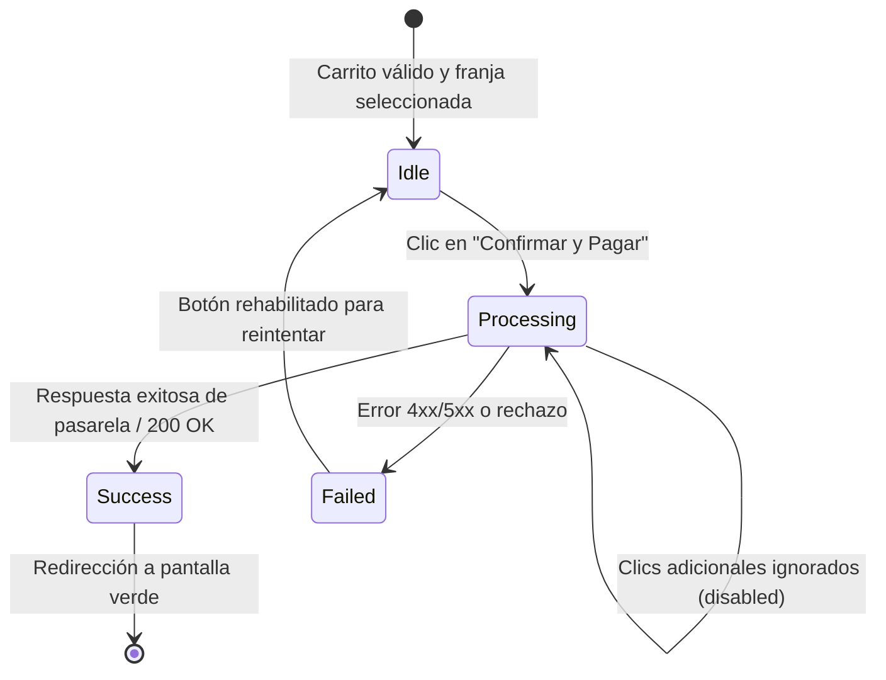

# Contrato 03: Bloqueo de Interfaz y Prevención de Cobros Duplicados

**Ruta de Frontend**: `/checkout`  
**Componente Responsable**: `CheckoutPage.tsx` / `CheckoutSummary.tsx`  
**Canal**: Eventos de interfaz en el cliente y validación de idempotencia en backend  
**Trazabilidad**: Cubre **AS-4**, **FR-004**, **INV-003**, **CB-003**, **SC-004**.

---

## 1. Descripción

Este contrato gobierna el protocolo de salvaguarda de interfaz y concurrencia durante el inicio y procesamiento del pago.  
- **Invariante INV-003**: Al dispararse el procesamiento, los controles de envío se inhabilitan de inmediato. Esta acción es estrictamente no bloqueante para la recepción del resultado final de la pasarela y previene dobles peticiones de cobro.
- **Doble Barrera**:
  1. *Barrera de Cliente*: Estado reactivo inmediato que inhabilita el botón, bloquea clics repetidos y muestra animación de espera.
  2. *Barrera de Servidor*: Clave de idempotencia `X-Idempotency-Key` en cabeceras HTTP y restricción `UNIQUE` en la base de datos para impedir procesamientos concurrentes redundantes.

---

## 2. Máquina de Estados del Botón de Pago



---

## 3. Especificación Observable del Comportamiento en Frontend

### 3.1. Estado `Processing`
- Atributo del botón: `disabled = true` y `aria-busy = "true"`.
- Clases CSS aplicadas: `opacity-60 cursor-not-allowed pointer-events-none`.
- Contenido visual: El texto `"Confirmar y Pagar"` se reemplaza por:
  ```html
  <span class="inline-flex items-center gap-2">
    <svg class="animate-spin h-5 w-5 text-white" ...></svg>
    <span>Procesando pago seguro...</span>
  </span>
  ```
- Supresión de atajos: Se capturan e ignoran eventos de tecla `Enter` sobre el formulario mientras `isSubmitting === true`.

### 3.2. Estado `Failed` (Rehabilitación)
- Si la pasarela rechaza el cobro o falla la red, el estado transmuta a `isSubmitting = false`.
- El botón se rehabilita inmediatamente para permitir un nuevo intento con un solo clic.

---

## 4. Semántica de Idempotencia en Backend

```http
POST /api/v1/checkout/orders/{orderId}/pay
Authorization: Bearer <jwt-token-comensal>
X-Idempotency-Key: 7b2f6b89-4977-44bc-b12a-579e0a0d92f5
```

Si el backend detecta dos llamadas concurrentes con la misma clave de idempotencia:
- La primera llamada adquiere el candado transaccional.
- La segunda llamada retorna de inmediato:
```json
{
  "type": "https://easyeat.com/errors/concurrent-payment-processing",
  "title": "Procesamiento en Curso",
  "status": 409,
  "detail": "Ya existe una solicitud de pago en procesamiento para esta orden."
}
```
Cero cobros duplicados (**SC-004**).

