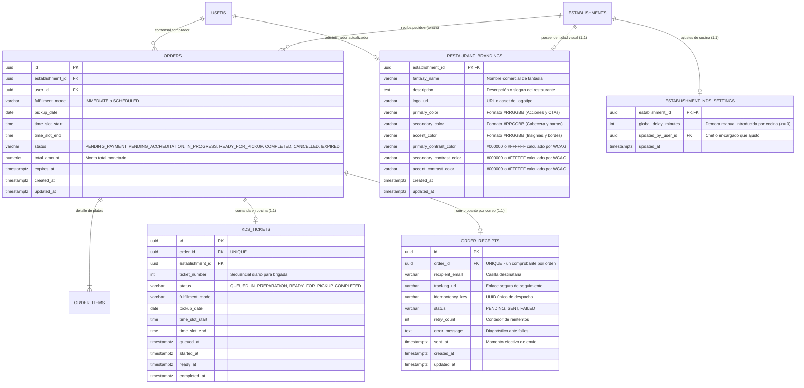

# Data Model: Confirmación de Pago, Seguimiento en Vivo y Branding Multi-Tenant

**Feature Branch**: `016-payment-confirmation-tracking-branding`  
**Fecha**: 09/11/2026  
**Especificación**: [spec.md](./spec.md) | [research.md](./research.md)  
**Estado**: Completado  

---

## 1. Diagrama Entidad-Relación Integral



---

## 2. Entidades de Dominio y Modelado Relacional

### 2.1. Entidad `Order` (Extendida)

- **Tabla**: `orders`
- **Mapeo JPA**: `com.easyeat.order.domain.Order`
- **Propósito**: Registro formal de la orden de compra del comensal.
- **Campos**:
  - `id` (UUID, PK): Identificador inmutable de la orden.
  - `establishment_id` (UUID, FK `establishments.id`): Establecimiento receptor (tenant).
  - `user_id` (UUID, FK `users.id`): Comensal que ordenó.
  - `fulfillment_mode` (`VARCHAR(30)`): `IMMEDIATE` o `SCHEDULED`.
  - `pickup_date` (`DATE`): Fecha asignada de entrega.
  - `time_slot_start` (`TIME`): Inicio de la franja horaria.
  - `time_slot_end` (`TIME`): Fin de la franja horaria.
  - `status` (`VARCHAR(30)`): Estado del ciclo de vida. Valores válidos:
    - `PENDING_PAYMENT` (estado inicial de reserva).
    - `PENDING_ACCREDITATION` (pago en proceso asíncrono en pasarela).
    - `IN_PROGRESS` (pago aprobado, stock debitado, encolada en KDS).
    - **`READY_FOR_PICKUP`** (**Nuevo estado en Spec 016**: comida elaborada, lista para ser retirada en mostrador).
    - `COMPLETED` (orden entregada al comensal).
    - `CANCELLED` (cancelada por usuario o rechazo).
    - `EXPIRED` (expirada tras superar la ventana de 15 min).
  - `total_amount` (`DECIMAL(12,2)`): Importe total en ARS.
  - `expires_at` (`TIMESTAMPTZ`): Momento límite de retención temporal.
  - `created_at`, `updated_at` (`TIMESTAMPTZ`).

---

### 2.2. Entidad `OrderReceipt` (Comprobante de Orden)

- **Tabla**: `order_receipts`
- **Mapeo JPA**: `com.easyeat.order.domain.OrderReceipt`
- **Propósito**: Garantizar la emisión universal, asíncrona, auditable e idempotente del comprobante por correo electrónico ante todo pago aprobado (**AS-2**, **FR-002**, **INV-002**, **Q4/A4**).
- **Campos**:
  - `id` (UUID, PK): Identificador del registro de comprobante.
  - `order_id` (UUID, FK `orders.id`, `UNIQUE NOT NULL`): Garantiza una única emisión por orden.
  - `recipient_email` (`VARCHAR(255) NOT NULL`): Correo del comensal.
  - `tracking_url` (`VARCHAR(500) NOT NULL`): Enlace directo a `/pedidos/{orderId}/seguimiento`.
  - `idempotency_key` (`VARCHAR(100) UNIQUE NOT NULL`): Clave de idempotencia única generada al aprobarse la transacción (`receipt-{orderId}`).
  - `status` (`VARCHAR(30) NOT NULL`): Estado del despacho (`PENDING`, `SENT`, `FAILED`).
  - `retry_count` (`INTEGER NOT NULL DEFAULT 0`): Intentos de envío realizados ante errores de red SMTP.
  - `error_message` (`TEXT NULL`): Registro del último error SMTP en caso de contingencia.
  - `sent_at` (`TIMESTAMPTZ NULL`): Timestamp en que el servidor SMTP aceptó el mensaje.
  - `created_at`, `updated_at` (`TIMESTAMPTZ NOT NULL`).

---

### 2.3. Entidad `RestaurantBranding` (Identidad Visual del Restaurante)

- **Tabla**: `restaurant_brandings`
- **Mapeo JPA**: `com.easyeat.catalog.domain.RestaurantBranding`
- **Propósito**: Personalización estética y presencia de marca por establecimiento gastronómico (**AS-9**, **ADM-2.1.1**, **FR-009**, **INV-009**, **Q7/A7**).
- **Campos**:
  - `establishment_id` (UUID, PK, FK `establishments.id` `ON DELETE CASCADE`): Aislamiento estricto multi-tenant (1:1 con el restaurante).
  - `fantasy_name` (`VARCHAR(150) NULL`): Denominación de fantasía del restaurante.
  - `description` (`TEXT NULL`): Texto descriptivo de la propuesta culinaria.
  - `logo_url` (`VARCHAR(500) NULL`): Ruta pública o URI del isotipo/logo.
  - `primary_color` (`VARCHAR(7) NOT NULL DEFAULT '#10B981'`): Color hexadecimal para botones y CTAs principales.
  - `secondary_color` (`VARCHAR(7) NOT NULL DEFAULT '#065F46'`): Color hexadecimal para cabeceras y barras de navegación.
  - `accent_color` (`VARCHAR(7) NOT NULL DEFAULT '#F59E0B'`): Color hexadecimal para badges, etiquetas y bordes de selección.
  - `primary_contrast_color` (`VARCHAR(7) NOT NULL DEFAULT '#FFFFFF'`): `#000000` o `#FFFFFF` calculado automáticamente según fórmula WCAG 2.1.
  - `secondary_contrast_color` (`VARCHAR(7) NOT NULL DEFAULT '#FFFFFF'`): `#000000` o `#FFFFFF` calculado automáticamente.
  - `accent_contrast_color` (`VARCHAR(7) NOT NULL DEFAULT '#000000'`): `#000000` o `#FFFFFF` calculado automáticamente.
  - `created_at`, `updated_at` (`TIMESTAMPTZ NOT NULL`).

---

### 2.4. Entidad `EstablishmentKdsSettings` (Ajustes Operativos de Cocina)

- **Tabla**: `establishment_kds_settings`
- **Mapeo JPA**: `com.easyeat.order.domain.EstablishmentKdsSettings`
- **Propósito**: Almacenar modificadores temporales de cocina que impactan el cálculo dinámico del tiempo estimado (**AS-7**, **FR-007**, **INV-007**).
- **Campos**:
  - `establishment_id` (UUID, PK, FK `establishments.id` `ON DELETE CASCADE`): Identificador del restaurante.
  - `global_delay_minutes` (`INTEGER NOT NULL DEFAULT 0`): Minutos agregados manualmente por la brigada de cocina ante cuellos de botella (`CHECK (global_delay_minutes >= 0)`).
  - `updated_by_user_id` (UUID, FK `users.id` `NULL`): Auditoría del último usuario que modificó el parámetro.
  - `updated_at` (`TIMESTAMPTZ NOT NULL DEFAULT NOW()`).

---

### 2.5. Modelo de Lectura / Vista Derivada: `OrderLiveTracking`

No constituye una tabla independiente, sino un DTO consolidado (`OrderLiveTrackingResponse`) construido en lectura por `OrderLiveTrackingService`:
- `orderId`: Identificador unívoco del pedido.
- `ticketNumber`: Número de orden / comanda en gran formato para retiro.
- `status`: Estado actual (`IN_PROGRESS`, `READY_FOR_PICKUP`, `COMPLETED`).
- `fulfillmentMode`: `IMMEDIATE` o `SCHEDULED`.
- `pickupDate`: Fecha de retiro.
- `timeSlotStart`, `timeSlotEnd`: Franja horaria pactada.
- `isCountdownActive`: Booleano que indica si la cuenta regresiva en vivo está habilitada:
  - Para `IMMEDIATE`: Siempre `true` (mientras no esté en `READY_FOR_PICKUP`).
  - Para `SCHEDULED`: `false` si faltan más de 15 min; `true` si faltan $\le$ 15 min (**INV-006**, **Q1/A1**).
- `estimatedMinutesRemaining`: Minutos calculados restantes hasta la entrega (o `null` si la comanda está lista para retirar o si es reserva diferida en fase estática).
- `progressPercentage`: Entero entre 0 y 100 representativo del avance en cocina.
- `isReadyForPickup`: Booleano indicador de disponibilidad en mostrador (`status == 'READY_FOR_PICKUP'`).
- `branding`: Objeto con la identidad visual del establecimiento correspondiente.

---

## 3. Matriz de Cumplimiento de Invariantes de Negocio

| Invariante | Descripción | Mecanismo de Garantía en el Modelo |
|---|---|---|
| **INV-001** | Pantalla verde solo con aprobación autoritativa | El estado `READY_FOR_PICKUP` o `IN_PROGRESS` solo es asignable tras la verificación criptográfica del webhook o la confirmación formal de `PaymentGatewayPort`. El frontend nunca fuerza este estado. |
| **INV-002** | Garantía incondicional de comprobante por correo | La tabla `order_receipts` posee constraint `UNIQUE(order_id)`. Se genera el registro de comprobante inmediatamente ante la transición a `IN_PROGRESS` o bonificación al 100%, desacoplado del navegador. |
| **INV-003** | Bloqueo de UI sin perder resultado de pasarela | Estado reactivo `isSubmitting` en `CheckoutPage` + clave de idempotencia transaccional en `payments`. |
| **INV-004** | Completitud informativa de la confirmación | El contrato `OrderConfirmationTrackingResponse` exige en su esquema la presencia obligatoria de `orderId`, `ticketNumber`, `timeSlotStart`, `timeSlotEnd` y `trackingUrl`. |
| **INV-005** | Tiempo dinámico según saturación real de KDS | Consulta en tiempo real de `COUNT(*)` sobre `kds_tickets` con `status IN ('QUEUED', 'IN_PREPARATION')` más `global_delay_minutes`. Cero valor estático inmutable. |
| **INV-006** | Exclusión de contador para reservas > 15 min | La bandera `isCountdownActive` se evalúa mediante `Duration.between(now, slotStart).toMinutes() <= 15`. Si es mayor, el campo de tiempo remanente es nulo y la UI muestra exclusivamente el horario estático. |
| **INV-007** | Actualización silenciosa ante ajustes KDS | Al modificar `global_delay_minutes`, la siguiente petición de polling (cada 5s) computa el nuevo valor numérico y actualiza el reloj del comensal sin modales ni alertas. |
| **INV-008** | Irreversibilidad de 'Listo para retirar' y supresión de tiempo | La transición a `READY_FOR_PICKUP` establece `estimatedMinutesRemaining = null` y desactiva el hook de polling. |
| **INV-009** | Consistencia multi-tenant del branding | `RESTAURANT_BRANDINGS.establishment_id` es clave primaria y foránea estricta. Todo filtro y consulta está parametrizado por tenant. |
| **INV-010** | Fallback institucional de EasyEat | En ausencia de fila en `restaurant_brandings`, el mapper inyecta las constantes base de la plataforma con contraste garantizado. |

---

## 4. Política de Aislamiento y Datos No Almacenados (PCI-DSS SAQ A)

EasyEat **NO** captura, procesa ni almacena bajo ninguna circunstancia:
- Número primario de tarjeta de crédito/débito (PAN).
- Código de seguridad bancario (CVV / CVC).
- Fecha de vencimiento de la tarjeta.
- Datos de banda magnética o chips EMV.
- Credenciales bancarias o contraseñas de cuentas de comensales.

---

## 5. Script DDL de Migración Flyway: `V20`

Ruta: `easyeat/backend/src/main/resources/db/migration/V20__payment_confirmation_tracking_and_branding.sql`

```sql
-- ====================================================================
-- EasyEat V20: Payment Confirmation, Live Tracking & Multi-Tenant Branding
-- Governs: restaurant_brandings, establishment_kds_settings, order_receipts
-- and extends orders.status with READY_FOR_PICKUP.
-- ====================================================================

-- 1. Ampliar chk_order_status en la tabla orders para incorporar READY_FOR_PICKUP y COMPLETED
ALTER TABLE orders DROP CONSTRAINT IF EXISTS chk_order_status;

ALTER TABLE orders
    ADD CONSTRAINT chk_order_status CHECK (
        status IN (
            'PENDING_PAYMENT',
            'PENDING_ACCREDITATION',
            'IN_PROGRESS',
            'READY_FOR_PICKUP',
            'COMPLETED',
            'CANCELLED',
            'EXPIRED'
        )
    );

-- 2. Crear tabla restaurant_brandings
CREATE TABLE IF NOT EXISTS restaurant_brandings (
    establishment_id         UUID         PRIMARY KEY REFERENCES establishments(id) ON DELETE CASCADE,
    fantasy_name             VARCHAR(150) NULL,
    description              TEXT         NULL,
    logo_url                 VARCHAR(500) NULL,
    primary_color            VARCHAR(7)   NOT NULL DEFAULT '#10B981',
    secondary_color          VARCHAR(7)   NOT NULL DEFAULT '#065F46',
    accent_color             VARCHAR(7)   NOT NULL DEFAULT '#F59E0B',
    primary_contrast_color   VARCHAR(7)   NOT NULL DEFAULT '#FFFFFF',
    secondary_contrast_color VARCHAR(7)   NOT NULL DEFAULT '#FFFFFF',
    accent_contrast_color    VARCHAR(7)   NOT NULL DEFAULT '#000000',
    created_at               TIMESTAMPTZ  NOT NULL DEFAULT NOW(),
    updated_at               TIMESTAMPTZ  NOT NULL DEFAULT NOW(),
    CONSTRAINT chk_primary_color_hex CHECK (primary_color ~* '^#[0-9A-F]{6}$'),
    CONSTRAINT chk_secondary_color_hex CHECK (secondary_color ~* '^#[0-9A-F]{6}$'),
    CONSTRAINT chk_accent_color_hex CHECK (accent_color ~* '^#[0-9A-F]{6}$'),
    CONSTRAINT chk_primary_contrast CHECK (primary_contrast_color IN ('#000000', '#FFFFFF')),
    CONSTRAINT chk_secondary_contrast CHECK (secondary_contrast_color IN ('#000000', '#FFFFFF')),
    CONSTRAINT chk_accent_contrast CHECK (accent_contrast_color IN ('#000000', '#FFFFFF'))
);

CREATE INDEX IF NOT EXISTS idx_brandings_establishment
    ON restaurant_brandings(establishment_id);

-- 3. Crear tabla establishment_kds_settings para demoras globales
CREATE TABLE IF NOT EXISTS establishment_kds_settings (
    establishment_id     UUID        PRIMARY KEY REFERENCES establishments(id) ON DELETE CASCADE,
    global_delay_minutes INTEGER     NOT NULL DEFAULT 0,
    updated_by_user_id   UUID        NULL REFERENCES users(id) ON DELETE SET NULL,
    updated_at           TIMESTAMPTZ NOT NULL DEFAULT NOW(),
    CONSTRAINT chk_kds_delay_positive CHECK (global_delay_minutes >= 0)
);

-- 4. Crear tabla order_receipts para despacho garantizado de correo
CREATE TABLE IF NOT EXISTS order_receipts (
    id               UUID         PRIMARY KEY DEFAULT gen_random_uuid(),
    order_id         UUID         NOT NULL UNIQUE REFERENCES orders(id) ON DELETE CASCADE,
    recipient_email  VARCHAR(255) NOT NULL,
    tracking_url     VARCHAR(500) NOT NULL,
    idempotency_key  VARCHAR(100) NOT NULL UNIQUE,
    status           VARCHAR(30)  NOT NULL DEFAULT 'PENDING',
    retry_count      INTEGER      NOT NULL DEFAULT 0,
    error_message    TEXT         NULL,
    sent_at          TIMESTAMPTZ  NULL,
    created_at       TIMESTAMPTZ  NOT NULL DEFAULT NOW(),
    updated_at       TIMESTAMPTZ  NOT NULL DEFAULT NOW(),
    CONSTRAINT chk_receipt_status CHECK (status IN ('PENDING', 'SENT', 'FAILED'))
);

CREATE INDEX IF NOT EXISTS idx_order_receipts_order
    ON order_receipts(order_id);

CREATE INDEX IF NOT EXISTS idx_order_receipts_status
    ON order_receipts(status);

-- 5. Sembrado inicial de KDS settings para establecimientos existentes
INSERT INTO establishment_kds_settings (establishment_id, global_delay_minutes)
SELECT id, 0 FROM establishments
ON CONFLICT (establishment_id) DO NOTHING;
```

