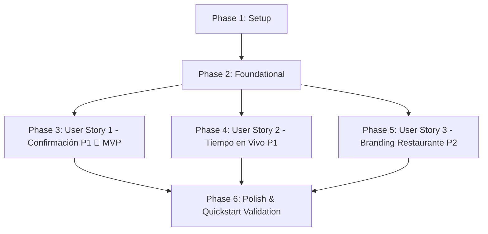

# Tasks: Confirmación de Pago, Tiempo Estimado en Vivo y Branding del Restaurante

**Input**: Documentos de diseño desde `/specs/016-payment-confirmation-tracking-branding/`  
**Prerequisites**: [plan.md](./plan.md) (requerido), [spec.md](./spec.md) (requerido), [research.md](./research.md), [data-model.md](./data-model.md), [contracts/](./contracts/), [quickstart.md](./quickstart.md)  
**GitHub Issues**: [#277](https://github.com/ValentinoCarmonaS/G12---GDSI/issues/277), [#278](https://github.com/ValentinoCarmonaS/G12---GDSI/issues/278), [#279](https://github.com/ValentinoCarmonaS/G12---GDSI/issues/279), [#280](https://github.com/ValentinoCarmonaS/G12---GDSI/issues/280), [#281](https://github.com/ValentinoCarmonaS/G12---GDSI/issues/281), [#282](https://github.com/ValentinoCarmonaS/G12---GDSI/issues/282)  
**Upstream Integration**: Asume contractualmente el consumo de los artefactos de la Spec 014 (flujo de pago) y Spec 015 (comanda de cocina KDS y tabla `kds_tickets`) al momento de su ejecución.  
**Tests**: Estrategia TDD estricta requerida explícitamente (Red Test primero, Green Test después).  
**Organization**: Tareas agrupadas por User Story para permitir desarrollo, pruebas y despliegue independientes.  

---

## Format: `- [ ] [TaskID] [P?] [Story?] Description with file path`

- **[P]**: Ejecución en paralelo permitida (archivos independientes sin dependencias bloqueantes).
- **[Story]**: Etiqueta de trazabilidad con la historia de usuario (`[US1]`, `[US2]`, `[US3]`).
- Rutas explícitas para cada tarea (`easyeat/backend/...`, `easyeat/frontend/...`).

---

## Phase 1: Setup (Infraestructura Compartida) — [Issue #277](https://github.com/ValentinoCarmonaS/G12---GDSI/issues/277)

**Propósito**: Inicialización de esquemas de base de datos, migraciones Flyway y definiciones de tipos base.

- [x] T001 Crear migración Flyway `V20__payment_confirmation_tracking_and_branding.sql` ampliando el constraint `chk_order_status` de `orders`, creando las tablas `restaurant_brandings`, `establishment_kds_settings` y `order_receipts` en `easyeat/backend/src/main/resources/db/migration/V20__payment_confirmation_tracking_and_branding.sql`
- [x] T002 [P] Extender el enum `OrderStatus` incorporando los estados `READY_FOR_PICKUP` y `COMPLETED` en `easyeat/backend/src/main/java/com/easyeat/order/domain/OrderStatus.java`
- [x] T003 [P] Definir tipos TypeScript para confirmación de pago, seguimiento en vivo, KDS y branding multi-tenant en `easyeat/frontend/src/types/orderTracking.ts` y `easyeat/frontend/src/types/branding.ts`

---

## Phase 2: Foundational (Prerrequisitos Bloqueantes) — [Issue #278](https://github.com/ValentinoCarmonaS/G12---GDSI/issues/278)

**Propósito**: Entidades relacionales JPA, repositorios y DTOs transversales que desbloquean la implementación de las historias de usuario.

**⚠️ CRITICAL**: Ninguna tarea de User Story puede comenzar hasta completar esta fase.

- [x] T004 Crear la entidad relacional JPA `OrderReceipt` con clave foránea unívoca `order_id` y auditoría en `easyeat/backend/src/main/java/com/easyeat/order/domain/OrderReceipt.java`
- [x] T005 [P] Crear el repositorio JPA `OrderReceiptRepository` para persistencia y comprobación de idempotencia en `easyeat/backend/src/main/java/com/easyeat/order/repository/OrderReceiptRepository.java`
- [x] T006 [P] Crear la entidad JPA `EstablishmentKdsSettings` y su repositorio `EstablishmentKdsSettingsRepository` en `easyeat/backend/src/main/java/com/easyeat/order/domain/EstablishmentKdsSettings.java` y `easyeat/backend/src/main/java/com/easyeat/order/repository/EstablishmentKdsSettingsRepository.java`
- [x] T007 [P] Crear la entidad JPA `RestaurantBranding` y su repositorio `RestaurantBrandingRepository` en `easyeat/backend/src/main/java/com/easyeat/catalog/domain/RestaurantBranding.java` y `easyeat/backend/src/main/java/com/easyeat/catalog/repository/RestaurantBrandingRepository.java`
- [x] T008 [P] Crear el evento de dominio `OrderPaymentApprovedEvent` y DTOs inmutables de confirmación y seguimiento en `easyeat/backend/src/main/java/com/easyeat/order/event/OrderPaymentApprovedEvent.java`, `easyeat/backend/src/main/java/com/easyeat/order/dto/OrderConfirmationTrackingResponse.java` y `easyeat/backend/src/main/java/com/easyeat/order/dto/OrderLiveTrackingResponse.java`

**Checkpoint**: Base relacional, eventos y contratos DTO listos — la implementación de User Stories puede comenzar de forma independiente.

---

## Phase 3: User Story 1 — COM-7.3.1: Confirmación de Pago (Priority: P1) 🎯 MVP — [Issue #279](https://github.com/ValentinoCarmonaS/G12---GDSI/issues/279)

**Goal**: Proveer al comensal confirmación visual inmediata mediante pantalla verde animada con número de orden y detalle de franja de retiro, bloqueo preventivo de interfaz durante el cobro para evitar pagos duplicados, y despacho universal, asíncrono e incondicional de correo electrónico con comprobante formal y enlace de seguimiento incluso ante interrupciones de navegación.

**Independent Test**: Simular pago aprobado desde pasarela verificando redirección a pantalla verde con animación, número de orden visible, detalle de franja, botón de seguimiento activo, bloqueo del botón de pago ante clics compulsivos (0 cobros duplicados), y despacho garantizado de correo ante cierre prematuro de ventana con verificación de idempotencia.

### Tests para User Story 1 (TDD - Escribir PRIMERO y verificar estado ROJO) ⚠️

- [x] T009 [P] [US1] Escribir test de integración para despacho garantizado, asíncrono e incondicional del comprobante por correo electrónico ante pago aprobado (AS-2, FR-002, INV-002, CB-002) en `easyeat/backend/src/test/java/com/easyeat/order/OrderReceiptEmailDispatchIntegrationTest.java`
- [x] T010 [P] [US1] Escribir test de integración para no duplicación de correos e idempotencia estricta ante webhooks repetidos (`order_receipts.order_id UNIQUE`) (INV-002, SC-002) en `easyeat/backend/src/test/java/com/easyeat/order/OrderReceiptIdempotencyIntegrationTest.java`
- [x] T011 [P] [US1] Escribir test de controlador MockMvc para `GET /api/v1/orders/{orderId}/confirmation-tracking` verificando datos completos de confirmación verde y franja (AS-1, AS-3, INV-001, INV-004) en `easyeat/backend/src/test/java/com/easyeat/order/OrderConfirmationTrackingControllerTest.java`
- [x] T012 [P] [US1] Escribir pruebas unitarias y de integración de frontend para bloqueo de interfaz (`disabled = true`, spinner de espera) ante clics repetidos en `CheckoutPage` (AS-4, INV-003, CB-003, SC-004) en `easyeat/frontend/src/test/checkout/CheckoutInteractionLock.test.tsx`
- [x] T013 [P] [US1] Escribir pruebas de frontend para pantalla verde de confirmación con animación de verificación, número de orden y detalle de franja en `easyeat/frontend/src/test/tracking/OrderConfirmationPage.test.tsx`
- [x] T014 [P] [US1] Escribir pruebas de frontend para persistencia y convivencia unificada de confirmación y seguimiento ante recarga (F5) o reingreso desde email (Q2/A2, CB-012) en `easyeat/frontend/src/test/tracking/OrderConfirmationPersistence.test.tsx`

### Implementación para User Story 1 (Hacer pasar los tests - Estado VERDE)

- [x] T015 [US1] Implementar el servicio `OrderReceiptEmailService` con método `@Async` para armado y despacho de comprobante HTML con enlace directo de seguimiento en `easyeat/backend/src/main/java/com/easyeat/order/service/OrderReceiptEmailService.java`
- [x] T016 [US1] Implementar listener de eventos de dominio para capturar `OrderPaymentApprovedEvent` y disparar `OrderReceiptEmailService` de forma desacoplada del ciclo HTTP en `easyeat/backend/src/main/java/com/easyeat/order/service/OrderPaymentEventListener.java`
- [x] T017 [US1] Implementar el servicio `OrderConfirmationTrackingService` para ensamblar la respuesta consolidada de confirmación y seguimiento, asegurando la publicación de `OrderPaymentApprovedEvent` ante pagos aprobados en `easyeat/backend/src/main/java/com/easyeat/order/service/OrderConfirmationTrackingService.java`
- [x] T018 [US1] Implementar el controlador REST `OrderConfirmationTrackingController` exponiendo `GET /api/v1/orders/{orderId}/confirmation-tracking` en `easyeat/backend/src/main/java/com/easyeat/order/controller/OrderConfirmationTrackingController.java`
- [x] T019 [P] [US1] Implementar cliente Axios `orderTrackingApi.ts` para endpoints de confirmación y seguimiento en `easyeat/frontend/src/api/orderTrackingApi.ts`
- [x] T020 [P] [US1] Crear el componente visual `OrderSuccessGreenBanner` con icono animado de verificación, número de orden y detalle de franja horaria en `easyeat/frontend/src/components/tracking/OrderSuccessGreenBanner.tsx`
- [x] T021 [US1] Actualizar `CheckoutPage.tsx` implementando bloqueo preventivo de interfaz durante el cobro (`isSubmitting`, controles disabled y supresión de envíos repetidos) en `easyeat/frontend/src/pages/CheckoutPage.tsx`
- [x] T022 [US1] Implementar la página unificada `OrderConfirmationTrackingPage.tsx` y registrar la ruta `/checkout/confirmacion/:orderId` (con alias `/pedidos/:orderId/seguimiento`) en `easyeat/frontend/src/pages/OrderConfirmationTrackingPage.tsx` y `easyeat/frontend/src/router/AppRoutes.tsx`

**Checkpoint**: User Story 1 completamente funcional y testeable de forma independiente. Representa el MVP funcional del flujo post-pago.

---

## Phase 4: User Story 2 — COM-7.3.2: Tiempo Estimado en Vivo (Priority: P1) — [Issue #280](https://github.com/ValentinoCarmonaS/G12---GDSI/issues/280)

**Goal**: Ofrecer visibilidad continua en tiempo real del progreso del pedido: cálculo dinámico según saturación de cocina en retiro inmediato, horario pactado fijo y activación automática de cuenta regresiva al ingresar en el umbral T-15 min en reservas programadas, sincronización reactiva y silenciosa del reloj ante demoras de cocina, y transición destacada a "listo para retirar" por mostrador al finalizar la orden en el KDS.

**Independent Test**: Validar con orden de retiro inmediato la barra de progreso y cálculo reactivo según comandas activas; simular ajuste global de cocina (+10 min) y constatar actualización silenciosa del reloj sin popups; validar con reserva programada el horario fijo a > 15 min y la conmutación automática a cuenta regresiva al restar $\le 15$ min; y marcar el ticket como finalizado en KDS verificando la desaparición del tiempo, banner destacado verde y número gigante de retiro.

### Tests para User Story 2 (TDD - Escribir PRIMERO y verificar estado ROJO) ⚠️

- [x] T023 [P] [US2] Escribir test de servicio para cálculo dinámico del tiempo estimado según saturación de cola en KDS y ajustes globales de cocina (AS-5, AS-7, INV-005, CB-004) en `easyeat/backend/src/test/java/com/easyeat/order/LiveTrackingSaturationCalculationTest.java`
- [x] T024 [P] [US2] Escribir test de servicio para regla de cuenta regresiva en reservas programadas: horario estático a > 15 min y activación regresiva a $\le 15$ min (AS-6, INV-006, Q1/A1, CB-005, CB-006) en `easyeat/backend/src/test/java/com/easyeat/order/LiveTrackingScheduledCountdownTest.java`
- [x] T025 [P] [US2] Escribir test de integración para ajuste de demoras globales en cocina (`PUT /api/v1/kitchen/delay`) y reflejo reactivo en seguimiento comensal (AS-7, INV-007, Q6/A6, CB-007) en `easyeat/backend/src/test/java/com/easyeat/order/KitchenGlobalDelayIntegrationTest.java`
- [x] T026 [P] [US2] Escribir test de integración para finalización de ticket en KDS (`POST /api/v1/kitchen/tickets/{id}/ready-for-pickup`), transición a `READY_FOR_PICKUP` y supresión definitiva de tiempo (AS-8, INV-008, CB-008) en `easyeat/backend/src/test/java/com/easyeat/order/KitchenReadyForPickupIntegrationTest.java`
- [x] T027 [P] [US2] Escribir test unitario del hook `useOrderLiveTrackingPolling` verificando cadencia adaptativa (5s/3s), Page Visibility API y detención en estado terminal en `easyeat/frontend/src/test/hooks/useOrderLiveTrackingPolling.test.ts`
- [x] T028 [P] [US2] Escribir pruebas de frontend para widget de seguimiento en vivo con barra de progreso y actualización silenciosa del minutero sin modales ni alertas en `easyeat/frontend/src/test/tracking/LiveTrackingWidget.test.tsx`
- [x] T029 [P] [US2] Escribir pruebas de frontend para conmutación de horario fijo a cuenta regresiva dinámica en reservas programadas en `easyeat/frontend/src/test/tracking/ScheduledSlotCountdown.test.tsx`
- [x] T030 [P] [US2] Escribir pruebas de frontend para llamado a mostrador "listo para retirar" con número gigante y supresión de tiempos en `easyeat/frontend/src/test/tracking/ReadyForPickupCallout.test.tsx`

### Implementación para User Story 2 (Hacer pasar los tests - Estado VERDE)

- [x] T031 [US2] Implementar el servicio `OrderLiveTrackingService` resolviendo la fórmula de saturación KDS, regla temporal T-15 y estado de comanda en `easyeat/backend/src/main/java/com/easyeat/order/service/OrderLiveTrackingService.java`
- [x] T032 [US2] Implementar endpoint `GET /api/v1/orders/{orderId}/live-tracking` en `OrderConfirmationTrackingController.java` en `easyeat/backend/src/main/java/com/easyeat/order/controller/OrderConfirmationTrackingController.java`
- [x] T033 [US2] Implementar `KitchenTicketDispatchController` con endpoints `/api/v1/kitchen/tickets/{ticketId}/ready-for-pickup` y `/api/v1/kitchen/delay` en `easyeat/backend/src/main/java/com/easyeat/order/controller/KitchenTicketDispatchController.java`
- [x] T034 [P] [US2] Implementar hook personalizado `useOrderLiveTrackingPolling` con soporte para Visibility API, AbortController y cadencia 5s/3s en `easyeat/frontend/src/hooks/useOrderLiveTrackingPolling.ts`
- [x] T035 [P] [US2] Crear el componente visual `ScheduledSlotCountdown` que alterna entre tarjeta estática de turno y minutero regresivo segundo a segundo en `easyeat/frontend/src/components/tracking/ScheduledSlotCountdown.tsx`
- [x] T036 [P] [US2] Crear el componente visual `ReadyForPickupCallout` con animación destacada verde y número de orden en gran formato en `easyeat/frontend/src/components/tracking/ReadyForPickupCallout.tsx`
- [x] T037 [US2] Crear el componente contenedor `LiveTrackingWidget` que orquesta barra de progreso, tiempo dinámico, actualización silenciosa y transición a listo en `easyeat/frontend/src/components/tracking/LiveTrackingWidget.tsx`
- [x] T038 [US2] Integrar `LiveTrackingWidget` dentro de `OrderConfirmationTrackingPage.tsx` y actualizar `KitchenWorkspacePage.tsx` con control de demora global y botón de finalización de comanda en `easyeat/frontend/src/pages/OrderConfirmationTrackingPage.tsx` y `easyeat/frontend/src/pages/KitchenWorkspacePage.tsx`

**Checkpoint**: User Stories 1 y 2 completamente operativas. El comensal posee certeza de confirmación, respaldo por correo y seguimiento dinámico en vivo.

---

## Phase 5: User Story 3 — ADM-2.1.1: Configurar Branding del Restaurante (Priority: P2) — [Issue #281](https://github.com/ValentinoCarmonaS/G12---GDSI/issues/281)

**Goal**: Permitir a los administradores de restaurantes configurar su logotipo, nombre de fantasía, descripción comercial y tríada cromática `#RRGGBB` desde "Mi Local", calculando automáticamente el contraste para textos e iconos legibles, reflejando dinámicamente dicha marca en la vista del comensal con aislamiento multi-tenant y proveyendo fallback institucional neutro de EasyEat.

**Independent Test**: Acceder con rol Administrador a `/admin/mi-local`, cargar logo, editar textos y seleccionar colores hexadecimales; constatar guardado y cálculo de contraste; ingresar como comensal al restaurante y verificar que cabecera, botones CTAs y distintivos adopten los estilos de marca; ingresar a un local sin branding y constatar que aplique la identidad neutra base de EasyEat sin fallas de renderizado.

### Tests para User Story 3 (TDD - Escribir PRIMERO y verificar estado ROJO) ⚠️

- [x] T039 [P] [US3] Escribir test unitario para `BrandingColorContrastCalculator` verificando la fórmula de luminancia relativa WCAG 2.1 y contraste `#000000` / `#FFFFFF` (AS-9, Q5/A5) en `easyeat/backend/src/test/java/com/easyeat/catalog/BrandingColorContrastCalculatorTest.java`
- [x] T040 [P] [US3] Escribir test de validación para formato hexadecimal `^#[0-9A-Fa-f]{6}$` y rechazo de valores malformados con HTTP 422 en `easyeat/backend/src/test/java/com/easyeat/catalog/BrandingColorValidationTest.java`
- [x] T041 [P] [US3] Escribir test de integración para endpoints administrativos de branding (`GET/PUT /api/v1/admin/establishments/{id}/branding`) con aislamiento estricto de tenant (AS-9, INV-009, CB-009) en `easyeat/backend/src/test/java/com/easyeat/catalog/AdminBrandingIntegrationTest.java`
- [x] T042 [P] [US3] Escribir test de integración para endpoint público `GET /api/v1/establishments/{id}/branding` verificando marca configurada y fallback institucional neutro (INV-010, Q3/A3, CB-011) en `easyeat/backend/src/test/java/com/easyeat/catalog/DinerBrandingFallbackIntegrationTest.java`
- [x] T043 [P] [US3] Escribir pruebas unitarias en TypeScript para utilidad `colorContrastUtils.ts` verificando luminancia y contraste en cliente en `easyeat/frontend/src/test/utils/colorContrastUtils.test.ts`
- [x] T044 [P] [US3] Escribir pruebas de frontend para el formulario "Mi Local" (`AdminBrandingPage.tsx`) con previsualización en vivo de tríada cromática y subida de logo en `easyeat/frontend/src/test/admin/AdminBrandingPage.test.tsx`
- [x] T045 [P] [US3] Escribir pruebas de frontend para adopción de variables CSS de branding y fallback neutro en el catálogo del comensal en `easyeat/frontend/src/test/catalog/DinerCatalogBranding.test.tsx`

### Implementación para User Story 3 (Hacer pasar los tests - Estado VERDE)

- [x] T046 [US3] Implementar `BrandingColorContrastCalculator` con la fórmula matemática de luminancia relativa estándar WCAG 2.1 en `easyeat/backend/src/main/java/com/easyeat/catalog/service/BrandingColorContrastCalculator.java`
- [x] T047 [US3] Implementar `BrandingLogoStorageService` para validación y almacenamiento local seguro de archivos de logotipo (PNG, JPG, WEBP, SVG) en `easyeat/backend/src/main/java/com/easyeat/catalog/service/BrandingLogoStorageService.java`
- [x] T048 [US3] Implementar `RestaurantBrandingService` resolviendo guardado, cálculo de contraste y fallback institucional neutro de EasyEat en `easyeat/backend/src/main/java/com/easyeat/catalog/service/RestaurantBrandingService.java`
- [x] T049 [US3] Implementar `AdminBrandingController` y `DinerBrandingController` exponiendo los endpoints administrativos y públicos de branding en `easyeat/backend/src/main/java/com/easyeat/catalog/controller/AdminBrandingController.java` y `easyeat/backend/src/main/java/com/easyeat/catalog/controller/DinerBrandingController.java`
- [x] T050 [P] [US3] Implementar cliente `brandingApi.ts` y utilidad `colorContrastUtils.ts` en `easyeat/frontend/src/api/brandingApi.ts` y `easyeat/frontend/src/utils/colorContrastUtils.ts`
- [x] T051 [P] [US3] Crear componentes `ColorPickerInput` y `LogoUploader` con previsualización reactiva de contraste en `easyeat/frontend/src/components/admin/ColorPickerInput.tsx` y `easyeat/frontend/src/components/admin/LogoUploader.tsx`
- [x] T052 [US3] Implementar la página "Mi Local" (`AdminBrandingPage.tsx`), enlazarla en `AdminWorkspacePage.tsx`, crear el hook `useRestaurantBranding` y el componente `BrandThemeProvider` para aplicar la tríada en `CatalogPage.tsx` y `AppRoutes.tsx` en `easyeat/frontend/src/pages/AdminBrandingPage.tsx`, `easyeat/frontend/src/hooks/useRestaurantBranding.ts`, `easyeat/frontend/src/components/common/BrandThemeProvider.tsx` y `easyeat/frontend/src/pages/CatalogPage.tsx`

**Checkpoint**: Todas las historias de usuario (US1, US2, US3) implementadas y verificadas de forma independiente.

---

## Phase 6: Polish & Cross-Cutting Concerns — [Issue #282](https://github.com/ValentinoCarmonaS/G12---GDSI/issues/282)

**Propósito**: Validación de extremo a extremo, verificación contra regresiones y hardening de seguridad.

- [x] T053 Ejecutar y validar íntegramente los 10 escenarios de prueba de la guía en `specs/016-payment-confirmation-tracking-branding/quickstart.md`
- [x] T054 [P] Verificar cumplimiento estricto de PCI-DSS SAQ A (cero captura, almacenamiento o exposición de PAN/CVV en logs, entidades o DTOs) en toda la suite de pruebas
- [x] T055 [P] Ejecutar la suite completa de tests de regresión de backend (`mvn clean test`) y frontend (`npm test -- --run`) asegurando 100% de tests en verde
- [x] T056 [P] Actualizar documentación de endpoints y variables de configuración en `easyeat/README.md`

---

## Dependencies & Execution Order

### Phase Dependencies



- **Setup (Fase 1)**: Sin dependencias — inicia de inmediato.
- **Foundational (Fase 2)**: Depende de Setup — **BLOQUEA** todas las user stories.
- **User Story 1 (Fase 3 - P1 🎯 MVP)**: Depende de Foundational — Puede implementarse y desplegarse como primer incremento de valor.
- **User Story 2 (Fase 4 - P1)**: Depende de Foundational — Se integra armónicamente sobre la pantalla de US1.
- **User Story 3 (Fase 5 - P2)**: Depende de Foundational — Puede desarrollarse en paralelo con US1 o US2.
- **Polish (Fase 6)**: Depende de la finalización de las historias de usuario deseadas.

### Reglas de Ejecución Dentro de Cada User Story (TDD Estricto)
1. **Tests Primero (ROJO)**: Escribir tests unitarios, de integración y de componentes. Verificar que fallen antes de escribir la lógica.
2. **Modelos / Entidades**: Antes de servicios.
3. **Servicios de Dominio**: Antes de controladores REST.
4. **Endpoints y Clientes API**: Antes de componentes de interfaz.
5. **Componentes y Vistas**: Antes de integración final.
6. **Verificación (VERDE)**: Correr la suite de pruebas de la historia y verificar estado verde.

---

## Parallel Opportunities

- **Fase 1 (Setup)**: T002 y T003 pueden ejecutarse en paralelo tras T001.
- **Fase 2 (Foundational)**: T005, T006, T007 y T008 pueden ejecutarse en paralelo tras T004.
- **Fase 3 (US1)**:
  - Tests en paralelo: T009, T010, T011, T012, T013 y T014.
  - Implementación frontend: T019, T020 en paralelo con T015-T018.
- **Fase 4 (US2)**:
  - Tests en paralelo: T023, T024, T025, T026, T027, T028, T029 y T030.
  - Componentes frontend: T034, T035, T036 en paralelo con T031-T033.
- **Fase 5 (US3)**:
  - Tests en paralelo: T039, T040, T041, T042, T043, T044 y T045.
  - Componentes frontend: T050, T051 en paralelo con T046-T049.

---

## Parallel Example: User Story 1

```bash
# Lanzar tests de User Story 1 en paralelo (TDD Red):
Task: "T009 [P] [US1] Escribir test de integración para despacho garantizado de correo"
Task: "T010 [P] [US1] Escribir test de integración para idempotencia de correo"
Task: "T011 [P] [US1] Escribir test de controlador para confirmación y franja"
Task: "T012 [P] [US1] Escribir pruebas de frontend para bloqueo de interfaz en checkout"
Task: "T013 [P] [US1] Escribir pruebas de frontend para pantalla verde de confirmación"
Task: "T014 [P] [US1] Escribir pruebas de frontend para persistencia y recarga F5"

# Una vez implementado el backend, construir componentes frontend en paralelo:
Task: "T019 [P] [US1] Implementar cliente Axios orderTrackingApi.ts"
Task: "T020 [P] [US1] Crear el componente visual OrderSuccessGreenBanner"
```

---

## Implementation Strategy

### MVP First (Solo User Story 1)
1. Completar Fase 1: Setup (Migración V20 y tipos).
2. Completar Fase 2: Foundational (Entidades y repositorios).
3. Completar Fase 3: User Story 1 (Confirmación de pago, pantalla verde, correo garantizado y bloqueo de UI).
4. **Validación Independiente**: Probar el flujo completo de checkout a confirmación.
5. Desplegar MVP comercial operativo.

### Incremental Delivery
1. **Incremento 1**: Setup + Foundational + User Story 1 (MVP confirmación de pago y correo).
2. **Incremento 2**: User Story 2 (Seguimiento en vivo, tiempo dinámico de KDS, cuenta regresiva T-15 y listo para retirar).
3. **Incremento 3**: User Story 3 (Módulo "Mi Local", personalización de marca multi-tenant y cálculo de contraste).
4. **Incremento 4**: Polish, ejecución completa de quickstart y hardening.

