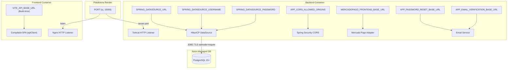
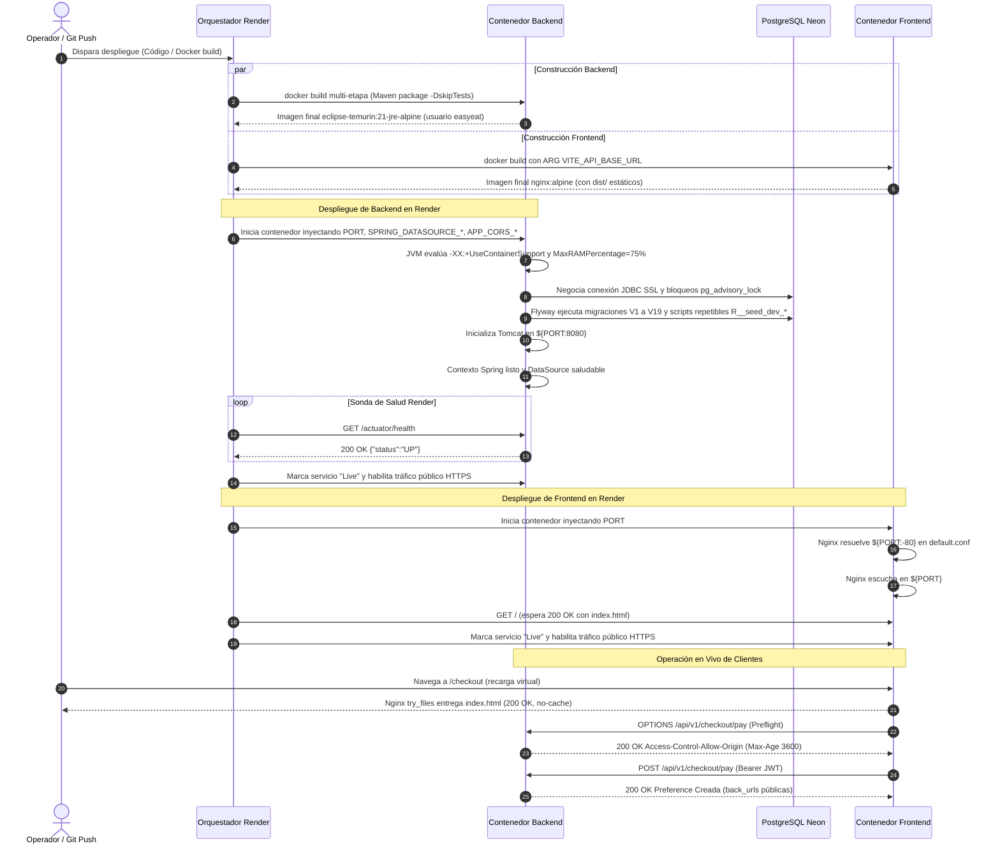

# Deployment Model: 017 Render Deploy Docker

**Branch**: `017-render-deploy-docker` | **Fecha**: 10/11/2026 | **Spec**: [spec.md](./spec.md)  
**Estado**: Completado  

---

## 1. Introducción

A diferencia de las especificaciones funcionales centradas en tablas relacionales de negocio, la Spec 017 modela la **topología de infraestructura, artefactos de empaquetado, variables de entorno y ciclo de vida de los servicios desplegados** de EasyEat. Este modelo formaliza las entidades operativas, sus restricciones, los contratos de red entre servicios y el flujo determinístico de inicialización.

---

## 2. Artefactos de Despliegue

```mermaid
classDiagram
    class DockerfileBackend {
        +String buildStage: maven:3.9.9-eclipse-temurin-21-alpine
        +String runtimeStage: eclipse-temurin:21-jre-alpine
        +String nonRootUser: easyeat:easyeat
        +String entrypoint: java -XX:+UseContainerSupport -XX:MaxRAMPercentage=75.0 -jar /app/app.jar
        +validateAbsenceOfSourceCode()
        +validateMemoryGovernance()
    }

    class DockerfileFrontend {
        +String buildStage: node:20-alpine
        +String buildArg: VITE_API_BASE_URL
        +String runtimeStage: nginx:alpine
        +String portVariable: PORT
        +validateAssetsHashing()
        +validateDynamicPortBinding()
    }

    class NginxConfig {
        +String listenPort: ${PORT}
        +String spaRewrite: try_files $uri $uri/ /index.html
        +String htmlCacheControl: no-cache
        +String assetsCacheControl: public, max-age=31536000, immutable
        +validateZero404OnVirtualRoutes()
    }

    class Dockerignore {
        +List~String~ excludedPatterns
        +validateMinimalContext()
    }

    DockerfileBackend --> Dockerignore: respaldado por
    DockerfileFrontend --> Dockerignore: respaldado por
    DockerfileFrontend --> NginxConfig: empaqueta en runtime
```

### 2.1. Catálogo de Artefactos Físicos

| Artefacto | Ubicación en Repo | Función Operativa | Restricciones Críticas |
|---|---|---|---|
| `Dockerfile` (Backend) | `easyeat/backend/Dockerfile` | Empaquetado multi-etapa Maven JDK 21 a Alpine JRE 21 | Cero `.java` o `.m2` en runtime; ejecución bajo usuario no root `easyeat`; flags `-XX:+UseContainerSupport` y `-XX:MaxRAMPercentage=75.0`. |
| `.dockerignore` (Backend) | `easyeat/backend/.dockerignore` | Exclusión de archivos locales en el build context | Excluye `target/`, `.git/`, `.idea/`, `.env*`, `*.md`. |
| `Dockerfile` (Frontend) | `easyeat/frontend/Dockerfile` | Empaquetado multi-etapa Node 20 a Nginx Alpine | Admite `ARG VITE_API_BASE_URL` para inyección estática en build; expone puerto configurable vía `PORT`. |
| `.dockerignore` (Frontend) | `easyeat/frontend/.dockerignore` | Exclusión de dependencias locales en el build context | Excluye `node_modules/`, `dist/`, `.git/`, `coverage/`, `.env*`. |
| `nginx.conf` (Frontend) | `easyeat/frontend/nginx.conf` | Servidor HTTP de estáticos y enrutamiento SPA | `try_files` a `/index.html`; `no-cache` para HTML; `immutable` para `/assets/*`; resolución dinámica de `${PORT}`. |

---

## 3. Matriz de Variables de Entorno



### 3.1. Detalle Operativo de Parámetros

| Variable | Consumidor | Formato / Ejemplo en Render | Valor Fallback Local | Obligatoriedad | Riesgo ante Omisión o Error |
|---|---|---|---|---|---|
| `PORT` | Backend (`application.yml`) y Frontend (`nginx.conf`) | `10000` | Backend: `8080`<br>Frontend: `80` | Opcional (inyectada por Render) | Render suspende el contenedor por timeout de puerto al no poder enlazar el tráfico. |
| `SPRING_DATASOURCE_URL` | Backend (`HikariCP`, `Flyway`) | `jdbc:postgresql://ep-xyz.neon.tech/easyeat?sslmode=require` | `jdbc:postgresql://localhost:5432/easyeat` | Requerida en Render | El backend falla en el arranque (`Connection refused` o rechazo por SSL), impidiendo el despliegue. |
| `SPRING_DATASOURCE_USERNAME` | Backend (`HikariCP`) | `easyeat_owner` | `easyeat` | Requerida en Render | Error de autenticación `28P01` (password authentication failed). |
| `SPRING_DATASOURCE_PASSWORD` | Backend (`HikariCP`) | `<secret_password>` | `easyeat_dev_password` | Requerida en Render | Error de autenticación en PostgreSQL. |
| `APP_CORS_ALLOWED_ORIGINS` | Backend (`SecurityConfig`) | `https://easyeat-frontend.onrender.com` | `http://localhost:3000` | Requerida en Render | El navegador del comensal o staff bloquea llamadas a la API por política de mismo origen. |
| `VITE_API_BASE_URL` | Frontend (`Dockerfile` ARG/ENV) | `https://easyeat-backend.onrender.com/api/v1` | `/api/v1` | Requerida en Build Render | La SPA emite peticiones a rutas locales relativas en Nginx provocando fallos 404 de API. |
| `MERCADOPAGO_FRONTEND_BASE_URL` | Backend (`MercadoPagoProperties`) | `https://easyeat-frontend.onrender.com` | `http://localhost:3000` (o `5173`) | Requerida en Render | Mercado Pago redirige al comensal a `localhost` tras pagar, rompiendo la confirmación de orden. |
| `APP_PASSWORD_RESET_BASE_URL` | Backend (`application.yml`) | `https://easyeat-frontend.onrender.com/reset-password` | `http://localhost:3000/reset-password` | Requerida en Render | Enlaces de recuperación de cuenta inaccesibles para usuarios reales. |
| `APP_EMAIL_VERIFICATION_BASE_URL` | Backend (`application.yml`) | `https://easyeat-frontend.onrender.com/verificar-email` | `http://localhost:3000/verificar-email` | Requerida en Render | Enlaces de activación de cuenta inaccesibles para usuarios reales. |

---

## 4. Topología de Servicios y Red

```mermaid
graph LR
    subgraph Clientes Externos
        USER(("Navegador Web Comensal/Staff"))
        MP_GW(("Pasarela Mercado Pago"))
    end

    subgraph Cloud Render
        FE_SRV["Frontend Web Service<br>(Docker Nginx SPA)"]
        BE_SRV["Backend Web Service<br>(Docker Spring Boot)"]
    end

    subgraph Cloud Neon
        NEON_PG[("PostgreSQL 15+<br>(Direct Connection + SSL)")]
    end

    USER -->|HTTPS :443| FE_SRV
    USER -->|HTTPS :443 /api/v1 (CORS)| BE_SRV
    FE_SRV -.->|Llamadas API Client| BE_SRV
    BE_SRV -->|JDBC SSL :5432| NEON_PG
    BE_SRV -->|HTTPS REST| MP_GW
    MP_GW -->|Webhook POST /api/v1/payments/*/webhook| BE_SRV
    MP_GW -.->|Redirección navegador back_urls| FE_SRV
```

### 4.1. Contratos de Comunicación entre Componentes

1. **Frontend ↔ Backend (CORS / REST API)**:
   - Protocolo: HTTPS sobre puerto estándar 443 público en Render.
   - Autenticación: Cabecera `Authorization: Bearer <jwt>` para rutas privadas; exenta para públicas y preflights.
   - Negociación: Preflight `OPTIONS` respondido con 200 OK, `Access-Control-Allow-Origin: <frontend_url>`, `Access-Control-Allow-Credentials: true`, `Access-Control-Max-Age: 3600`.
2. **Backend ↔ Neon Database (PostgreSQL Relacional)**:
   - Protocolo: JDBC sobre puerto 5432 directo con TLS mandatorio (`sslmode=require`).
   - Pool local: HikariCP dimensionado para bajo consumo (`maximum-pool-size: 5`, `connection-timeout: 30000`).
   - Migraciones: Flyway serializa mediante bloqueos consultivos de sesión (`pg_advisory_lock`), garantizado por conexión directa sin pooler.
3. **Plataforma Render ↔ Contenedores (Health & Routing)**:
   - Backend Sonda: `GET /actuator/health` sobre `${PORT}`. Espera HTTP 200 `{"status":"UP"}`. Margen de tolerancia de arranque (cold start): hasta 60 segundos.
   - Frontend Sonda: `GET /` sobre `${PORT}`. Espera HTTP 200 con `index.html`.
4. **Mercado Pago ↔ Backend (Webhooks)**:
   - Endpoint: `POST /api/v1/payments/{provider}/webhook` accesible públicamente vía HTTPS.
   - Seguridad: Sin JWT; autenticación criptográfica vía cabecera `x-signature` y cálculo HMAC-SHA256 con `MERCADOPAGO_WEBHOOK_SECRET`.

---

## 5. Ciclo de Vida y Flujo Operativo de Inicialización



---

## 6. Verificación de Invariantes del Modelo

- **Inv-Dep-1 (Aislamiento de Secretos)**: Cero credenciales sensibles de Neon o Mercado Pago en archivos versionados. Todas se inyectan en tiempo de ejecución vía variables de plataforma.
- **Inv-Dep-2 (Gobernanza de Memoria)**: El contenedor Java nunca excede los 512 MB de la instancia Render gracias a la cuota estricta del 75% para Heap y reserva nativa para Metaspace.
- **Inv-Dep-3 (Retrocompatibilidad Local)**: Ejecutar el backend o frontend en local sin variables de entorno utiliza los fallbacks por omisión (`8080`, `80`, `http://localhost:3000`, `/api/v1`), preservando la productividad de desarrollo.
- **Inv-Dep-4 (Cero 404 en Navegación)**: La regla de reescritura `try_files` en Nginx absorbe cualquier ruta de React Router y retorna `index.html`.

