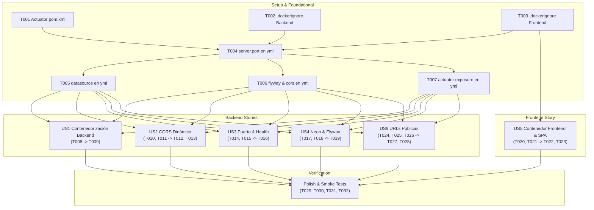

# Tasks: Despliegue de EasyEat en Render con Docker, CORS, Health Check, PostgreSQL en Neon y URLs Públicas

**Input**: Documentos de diseño desde `/specs/017-render-deploy-docker/`  
**Prerequisites**: [plan.md](./plan.md) (requerido), [spec.md](./spec.md) (requerido), [research.md](./research.md), [deployment-model.md](./deployment-model.md), [contracts/](./contracts/), [quickstart.md](./quickstart.md)  
**GitHub Issues**: [#302](https://github.com/ValentinoCarmonaS/G12---GDSI/issues/302), [#303](https://github.com/ValentinoCarmonaS/G12---GDSI/issues/303), [#304](https://github.com/ValentinoCarmonaS/G12---GDSI/issues/304), [#305](https://github.com/ValentinoCarmonaS/G12---GDSI/issues/305), [#306](https://github.com/ValentinoCarmonaS/G12---GDSI/issues/306), [#307](https://github.com/ValentinoCarmonaS/G12---GDSI/issues/307), [#308](https://github.com/ValentinoCarmonaS/G12---GDSI/issues/308), [#309](https://github.com/ValentinoCarmonaS/G12---GDSI/issues/309), [#310](https://github.com/ValentinoCarmonaS/G12---GDSI/issues/310)  
**Tests**: Estrategia TDD estricta requerida explícitamente (Red Test primero, Green Test después).  
**Organization**: Tareas agrupadas por User Story para permitir desarrollo, pruebas y verificación independientes.  

---

## Format: `- [ ] [TaskID] [P?] [Story?] Description with file path`

- **[P]**: Ejecución en paralelo permitida (archivos independientes sin dependencias bloqueantes).
- **[Story]**: Etiqueta de trazabilidad con la historia de usuario (`[US1]`, `[US2]`, `[US3]`, `[US4]`, `[US5]`, `[US6]`).
- Rutas explícitas para cada tarea (`easyeat/backend/...`, `easyeat/frontend/...`).

---

## Phase 1: Setup (Infraestructura de Despliegue Compartida) — [Issue #302](https://github.com/ValentinoCarmonaS/G12---GDSI/issues/302)

**Propósito**: Inicialización de dependencias base de monitoreo y reglas de exclusión de build context en ambos proyectos.

- [x] T001 Incorporar la dependencia oficial de Spring Boot Actuator (`org.springframework.boot:spring-boot-starter-actuator`) en `easyeat/backend/pom.xml`
- [x] T002 [P] Crear el archivo `.dockerignore` del backend excluyendo `target/`, `.git/`, `.idea/`, `.env*` y artefactos de desarrollo en `easyeat/backend/.dockerignore`
- [x] T003 [P] Crear el archivo `.dockerignore` del frontend excluyendo `node_modules/`, `dist/`, `.git/`, `coverage/` y archivos temporales en `easyeat/frontend/.dockerignore`

---

## Phase 2: Foundational (Prerrequisitos Bloqueantes de Configuración) — [Issue #303](https://github.com/ValentinoCarmonaS/G12---GDSI/issues/303)

**Propósito**: Estructuración centralizada de propiedades dinámicas en `application.yml` requeridas por todas las historias de despliegue.

**⚠️ CRITICAL**: Ninguna tarea de User Story del backend puede comenzar hasta completar esta fase.

- [x] T004 Configurar el puerto dinámico del servidor web con fallback (`server.port: ${PORT:8080}`) en `easyeat/backend/src/main/resources/application.yml`
- [x] T005 [P] Declarar las propiedades centralizadas de conexión a base de datos con soporte SSL y pool HikariCP optimizado (`connection-timeout: 30000`, `validation-timeout: 5000`, `maximum-pool-size: 5`) en `easyeat/backend/src/main/resources/application.yml`
- [x] T006 [P] Configurar el escaneo de migraciones y semillas de Flyway (`classpath:db/migration` y `classpath:db/dev`) y la propiedad de orígenes CORS (`app.cors.allowed-origins: ${APP_CORS_ALLOWED_ORIGINS:http://localhost:3000}`) en `easyeat/backend/src/main/resources/application.yml`
- [x] T007 [P] Configurar la exposición del endpoint de salud de Actuator restringiendo los detalles a usuarios autorizados (`management.endpoints.web.exposure.include: health` y `management.endpoint.health.show-details: when-authorized`) en `easyeat/backend/src/main/resources/application.yml`

**Checkpoint**: Configuración transversal lista — la implementación de User Stories puede comenzar en paralelo.

---

## Phase 3: User Story 1 — HU-01: Contenedorización multi-etapa del backend (Docker) (Priority: P1) 🎯 MVP — [Issue #304](https://github.com/ValentinoCarmonaS/G12---GDSI/issues/304)

**Goal**: Empaquetar y ejecutar la aplicación Spring Boot en una imagen liviana Alpine JRE 21, ejecutada por un usuario no privilegiado (`easyeat`), con gobernanza estricta de memoria JVM (`-XX:+UseContainerSupport -XX:MaxRAMPercentage=75.0`) y exclusión de código fuente para operar dentro del límite de 512 MB de Render sin OOMKilled.

**Independent Test**: Construir la imagen localmente con `docker build`, comprobar que `whoami` retorne `easyeat` (UID no root), verificar que `find / -name '*.java'` retorne 0, y validar que los flags JVM de memoria estén presentes en la línea de comandos de inicio.

### Tests para User Story 1 (TDD - Escribir PRIMERO y verificar estado ROJO) ⚠️

- [x] T008 [P] [US1] Escribir script de test automatizado de verificación de contrato de imagen backend comprobando base Alpine JRE 21, usuario no root `easyeat`, flags JVM `-XX:+UseContainerSupport` y `-XX:MaxRAMPercentage=75.0`, y ausencia de código fuente `.java` o herramientas Maven (AS-1, AS-2, AS-3, SC-001, SC-002) en `easyeat/backend/src/test/resources/scripts/verify-backend-image.sh`

### Implementación para User Story 1 (Hacer pasar los tests - Estado VERDE)

- [x] T009 [US1] Crear el `Dockerfile` multi-etapa del backend con etapa build (`maven:3.9.9-eclipse-temurin-21-alpine` con `mvn clean package -DskipTests`) y etapa runtime (`eclipse-temurin:21-jre-alpine` con creación de usuario `easyeat:easyeat`, copia exclusiva de `/app/app.jar`, `chown`, conmutación a `USER easyeat` y ENTRYPOINT de memoria gobernada) (FR-001, FR-002, FR-003, FR-004) en `easyeat/backend/Dockerfile`

**Checkpoint**: User Story 1 completamente construida y verificada. La imagen del backend es liviana (< 200 MB), segura y gobierna los 512 MB de RAM.

---

## Phase 4: User Story 2 — HU-02: Habilitación de CORS dinámico en Spring Security (Priority: P1) — [Issue #305](https://github.com/ValentinoCarmonaS/G12---GDSI/issues/305)

**Goal**: Autorizar solicitudes cross-origin entre el frontend público desplegado en Render y el backend Spring Boot, sanitizando sintaxis de orígenes (trim y remoción de barras finales), optimizando preflights mediante `Access-Control-Max-Age: 3600`, admitiendo credenciales y aplicando fallback automático a `http://localhost:3000`.

**Independent Test**: Emitir solicitudes preflight HTTP `OPTIONS` con header `Origin` permitido y comprobar respuesta 200 OK con `Access-Control-Allow-Origin`, `Access-Control-Allow-Credentials: true` y `Access-Control-Max-Age: 3600` sin exigir token JWT; emitir desde origen no permitido y certificar la ausencia de cabeceras de autorización CORS.

### Tests para User Story 2 (TDD - Escribir PRIMERO y verificar estado ROJO) ⚠️

- [x] T010 [P] [US2] Escribir prueba unitaria para el mecanismo de sanitización y binding de orígenes CORS verificando recorte de espacios (`trim`), remoción de barras diagonales finales (`/+$`), división por comas y fallback a `http://localhost:3000` (AS-5, AS-6, FR-006, FR-007, Q6) en `easyeat/backend/src/test/java/com/easyeat/config/SecurityCorsConfigurationTest.java`
- [x] T011 [P] [US2] Escribir test de integración MockMvc para solicitudes preflight HTTP `OPTIONS` hacia endpoints públicos y protegidos verificando respuesta 200 OK, cabeceras `Access-Control-Allow-Origin`, `Access-Control-Allow-Credentials: true`, `Access-Control-Max-Age: 3600`, y rechazo de orígenes no autorizados sin requerir JWT (AS-4, AS-7, AS-8, FR-005, FR-008, FR-009, SC-003) en `easyeat/backend/src/test/java/com/easyeat/config/SecurityCorsIntegrationTest.java`

### Implementación para User Story 2 (Hacer pasar los tests - Estado VERDE)

- [ ] T012 [US2] Implementar el bean `CorsConfigurationSource` en `SecurityConfig.java` inyectando `@Value("${app.cors.allowed-origins:http://localhost:3000}")`, aplicando sanitización trim, remoción de barras finales, métodos universales (`GET, POST, PUT, PATCH, DELETE, OPTIONS`), cabeceras en comodín (`*`), `allowCredentials = true` y `maxAge = 3600L` (FR-005, FR-006, FR-007, Q6, Q8) en `easyeat/backend/src/main/java/com/easyeat/config/SecurityConfig.java`
- [ ] T013 [US2] Integrar el soporte de CORS en la cadena de filtros `SecurityFilterChain` mediante `.cors(cors -> cors.configurationSource(corsConfigurationSource(allowedOriginsConfig)))` en `easyeat/backend/src/main/java/com/easyeat/config/SecurityConfig.java`

**Checkpoint**: User Story 2 lista. El backend autoriza dinámicamente las llamadas cross-origin del frontend con caché de preflight de 1 hora.

---

## Phase 5: User Story 3 — HU-03: Adaptabilidad de puerto dinámico y health check del backend (Priority: P1) — [Issue #306](https://github.com/ValentinoCarmonaS/G12---GDSI/issues/306)

**Goal**: Permitir que Tomcat enlace en el puerto inyectado por la plataforma en la variable `PORT` (con fallback a 8080) y publicar el endpoint de monitoreo `/actuator/health` accesible públicamente sin autenticación, respondiendo HTTP 200 `{"status":"UP"}` ante servicio saludable y HTTP 503 `{"status":"DOWN"}` ante degradación.

**Independent Test**: Iniciar el backend con `PORT=10000` y certificar enlace en dicho puerto; iniciar sin `PORT` y certificar enlace en 8080; consultar `GET /actuator/health` sin token JWT y comprobar recepción inmediata de HTTP 200 con `{"status":"UP"}` en menos de 2 segundos.

### Tests para User Story 3 (TDD - Escribir PRIMERO y verificar estado ROJO) ⚠️

- [ ] T014 [P] [US3] Escribir test de integración MockMvc verificando que el endpoint `GET /actuator/health` sea accesible públicamente sin token JWT, responda código HTTP 200 con payload `{"status":"UP"}` cuando el DataSource está activo, y no exponga detalles internos de infraestructura a clientes anónimos (AS-11, AS-12, FR-012, FR-013, SC-004) en `easyeat/backend/src/test/java/com/easyeat/config/ActuatorHealthEndpointIntegrationTest.java`
- [ ] T015 [P] [US3] Escribir test de verificación de resolución dinámica de puerto comprobando que Tomcat adopte la propiedad `${PORT:8080}` tanto con variable definida como aplicando fallback a 8080 en ausencia de la misma (AS-9, FR-010, SC-010) en `easyeat/backend/src/test/java/com/easyeat/config/ServerPortConfigurationTest.java`

### Implementación para User Story 3 (Hacer pasar los tests - Estado VERDE)

- [ ] T016 [US3] Declarar explícitamente en la regla `authorizeHttpRequests` de `SecurityConfig.java` el acceso público sin autenticación (`.requestMatchers("/actuator/health").permitAll()`) para permitir el monitoreo de la sonda de Render (FR-012) en `easyeat/backend/src/main/java/com/easyeat/config/SecurityConfig.java`

**Checkpoint**: User Story 3 lista. Render puede sondear la salud del contenedor y rutear tráfico al puerto asignado.

---

## Phase 6: User Story 4 — HU-04: Conexión a PostgreSQL en Neon y migraciones completas (Priority: P1) — [Issue #307](https://github.com/ValentinoCarmonaS/G12---GDSI/issues/307)

**Goal**: Conectar de forma segura a Neon mediante conexión directa JDBC con SSL mandatorio (`sslmode=require`), credenciales leídas exclusivamente de variables de entorno, tolerancia al scale-to-zero mediante timeout de conexión HikariCP de 30 segundos, y ejecución secuencial e idempotente de la totalidad de migraciones Flyway `V1` a `V19` y datos semilla `R__seed_dev_*`.

**Independent Test**: Iniciar el backend contra una base de datos PostgreSQL vacía con SSL activo, observando en los logs de Flyway la aplicación exitosa de las 19 migraciones versionadas y los 3 scripts repetibles, constatando la creación de tablas e inserción de usuarios semilla sin fallos de bloqueo consultivo (`pg_advisory_lock`).

### Tests para User Story 4 (TDD - Escribir PRIMERO y verificar estado ROJO) ⚠️

- [ ] T017 [P] [US4] Escribir test de integración con Testcontainers verificando la ejecución secuencial completa de migraciones Flyway desde `V1` hasta `V19` y la idempotencia de los scripts repetibles `R__seed_dev_*` ante reinicios sucesivos sin violaciones de clave única (AS-15, AS-16, FR-016, FR-017, Q1, SC-005) en `easyeat/backend/src/test/java/com/easyeat/order/FlywayFullMigrationIntegrationTest.java`
- [ ] T018 [P] [US4] Escribir test unitario de configuración de DataSource verificando la compatibilidad de la cadena JDBC con parámetros SSL (`?sslmode=require`), externalización de credenciales `SPRING_DATASOURCE_*` y configuración de timeouts en HikariCP (`connection-timeout: 30000`, `validation-timeout: 5000`) para tolerar el scale-to-zero de Neon (AS-13, AS-14, FR-014, FR-015, Q7, Q11) en `easyeat/backend/src/test/java/com/easyeat/config/NeonDataSourceConfigurationTest.java`

### Implementación para User Story 4 (Hacer pasar los tests - Estado VERDE)

- [ ] T019 [US4] Validar y asegurar en `application.yml` que las propiedades del DataSource y Flyway consuman directamente `SPRING_DATASOURCE_URL`, `SPRING_DATASOURCE_USERNAME`, `SPRING_DATASOURCE_PASSWORD` y mantengan las rutas `classpath:db/migration` y `classpath:db/dev` en el perfil predeterminado de ejecución en contenedor (FR-014, FR-015, FR-016, FR-017) en `easyeat/backend/src/main/resources/application.yml`

**Checkpoint**: User Story 4 lista. La base de datos en Neon inicializa su esquema completo y tolera suspensiones por inactividad.

---

## Phase 7: User Story 5 — HU-05: Contenedorización del frontend con Nginx y enrutamiento SPA (Priority: P1) — [Issue #308](https://github.com/ValentinoCarmonaS/G12---GDSI/issues/308)

**Goal**: Empaquetar la SPA de React en una imagen Nginx Alpine liviana con inyección de `ARG VITE_API_BASE_URL` en build time, resolución dinámica del puerto de escucha `${PORT:-80}`, reescritura `try_files` para eliminar errores 404 en recargas virtuales, y directivas de caché HTTP (`no-cache` para `index.html` y caché inmutable de 1 año para `/assets/*`).

**Independent Test**: Construir la imagen del frontend pasando `ARG VITE_API_BASE_URL`, levantar el contenedor con `PORT=9000` y ejecutar peticiones `GET` a `/checkout`, `/catalog` y `/reset-password` certificando que devuelvan HTTP 200 con `index.html` y cabecera `Cache-Control: no-cache`; consultar un activo bajo `/assets/` y certificar `max-age=31536000, immutable`.

### Tests para User Story 5 (TDD - Escribir PRIMERO y verificar estado ROJO) ⚠️

- [ ] T020 [P] [US5] Escribir test unitario en frontend con Vitest verificando que `apiClient.ts` adopte `import.meta.env.VITE_API_BASE_URL` si está definida o aplique fallback a `/api/v1` en su defecto (AS-19, FR-020) en `easyeat/frontend/src/test/config/apiClientBaseUrl.test.ts`
- [ ] T021 [P] [US5] Escribir script de test automatizado de verificación de servidor Nginx validando la reescritura de rutas virtuales SPA (`try_files` a `/index.html` con 200 OK y 0 errores 404), la entrega de `Cache-Control: no-cache` para HTML, la entrega de `Cache-Control: public, max-age=31536000, immutable` para `/assets/*`, y el enlace en `${PORT:-80}` (AS-17, AS-18, AS-20, FR-018, FR-019, FR-021, Q2, Q5, SC-006, SC-010) en `easyeat/frontend/src/test/scripts/verify-nginx-spa.sh`

### Implementación para User Story 5 (Hacer pasar los tests - Estado VERDE)

- [ ] T022 [US5] Crear el archivo de configuración `nginx.conf` con directiva `try_files $uri $uri/ /index.html =404;`, compresión gzip, bloque `/assets/` con `Cache-Control: public, max-age=31536000, immutable`, bloque raíz `/` con `Cache-Control: no-cache`, y plantilla de escucha en `${PORT}` (FR-019, Q5) en `easyeat/frontend/nginx.conf`
- [ ] T023 [US5] Crear el `Dockerfile` multi-etapa del frontend con etapa build (`node:20-alpine` ejecutando `npm ci` y `npm run build` recibiendo `ARG VITE_API_BASE_URL` y exportando `ENV VITE_API_BASE_URL=$VITE_API_BASE_URL`) y etapa runtime (`nginx:alpine` copiando `/app/dist` a `/usr/share/nginx/html`, copiando `nginx.conf` y resolviendo `${PORT:-80}` mediante envsubst en el arranque) (FR-018, FR-020, FR-021, Q2) en `easyeat/frontend/Dockerfile`

**Checkpoint**: User Story 5 lista. La SPA se sirve de forma ultra liviana (< 30 MB), absorbe recargas sin 404 y adopta el puerto de Render.

---

## Phase 8: User Story 6 — HU-06: Sincronización de URLs públicas para Mercado Pago y correos (Priority: P1) — [Issue #309](https://github.com/ValentinoCarmonaS/G12---GDSI/issues/309)

**Goal**: Garantizar que las redirecciones de pasarela externa de pago (Mercado Pago Checkout Pro) y los hipervínculos transaccionales de correo electrónico apunten a los dominios públicos HTTPS de Render (cero referencias a `localhost`), y mantener el webhook `/api/v1/payments/*/webhook` accesible públicamente sin token JWT.

**Independent Test**: Iniciar una preferencia de pago en Mercado Pago y verificar que `back_urls` apunte a `https://<frontend>/checkout/payment-return`; realizar una solicitud `POST` anónima al webhook de pagos y comprobar que no sea rechazada por Spring Security; solicitar reseteo de clave y comprobar que el enlace enviado por correo use la URL pública del frontend.

### Tests para User Story 6 (TDD - Escribir PRIMERO y verificar estado ROJO) ⚠️

- [ ] T024 [P] [US6] Escribir test de integración MockMvc verificando que el webhook de pagos `/api/v1/payments/mercadopago/webhook` y `/api/v1/payments/*/webhook` sea accesible públicamente sin token JWT ni cabeceras de autorización (AS-23, FR-023, SC-009) en `easyeat/backend/src/test/java/com/easyeat/order/PaymentWebhookSecurityIntegrationTest.java`
- [ ] T025 [P] [US6] Escribir test unitario para `MercadoPagoGatewayAdapter` verificando que la construcción de `back_urls` (`success`, `pending`, `failure`) utilice el valor inyectado en `MERCADOPAGO_FRONTEND_BASE_URL` concatenando `/checkout/payment-return` y no contenga referencias a `localhost` (AS-21, AS-22, FR-022, Q3, SC-007) en `easyeat/backend/src/test/java/com/easyeat/order/service/MercadoPagoPublicUrlTest.java`
- [ ] T026 [P] [US6] Escribir test unitario para servicios de despacho de correos verificando que los enlaces de recuperación de clave y verificación de casilla se construyan a partir de `APP_PASSWORD_RESET_BASE_URL` y `APP_EMAIL_VERIFICATION_BASE_URL` con dominios públicos configurados (AS-24, FR-024, SC-008) en `easyeat/backend/src/test/java/com/easyeat/auth/service/PublicUrlEmailLinkTest.java`

### Implementación para User Story 6 (Hacer pasar los tests - Estado VERDE)

- [ ] T027 [US6] Habilitar explícitamente en `SecurityConfig.java` el acceso público sin autenticación (`.requestMatchers("/api/v1/payments/*/webhook", "/api/v1/payments/mercadopago/webhook").permitAll()`) para permitir notificaciones externas de Mercado Pago (FR-023) en `easyeat/backend/src/main/java/com/easyeat/config/SecurityConfig.java`
- [ ] T028 [US6] Verificar y asegurar el mapeo de variables de entorno de URLs públicas (`MERCADOPAGO_FRONTEND_BASE_URL`, `APP_PASSWORD_RESET_BASE_URL`, `APP_EMAIL_VERIFICATION_BASE_URL`) en `application.yml` garantizando compatibilidad con entornos locales y cloud (FR-022, FR-024, Q3) en `easyeat/backend/src/main/resources/application.yml`

**Checkpoint**: User Story 6 lista. Los pagos de Mercado Pago retornan al dominio público y los enlaces de correo no apuntan a localhost.

---

## Phase 9: Polish, Smoke Testing & Cross-Cutting Verification — [Issue #310](https://github.com/ValentinoCarmonaS/G12---GDSI/issues/310)

**Propósito**: Ejecución determinística de la suite de pruebas de humo y validación de extremo a extremo cubriendo todos los criterios de éxito de la Spec 017.

- [ ] T029 Ejecutar la suite completa de pruebas unitarias y de integración del backend con Maven asegurando cobertura Jacoco (`mvn clean verify`) en `easyeat/backend/`
- [ ] T030 [P] Ejecutar la suite completa de pruebas del frontend con Vitest (`npm test`) en `easyeat/frontend/`
- [ ] T031 Ejecutar el escenario local de pruebas de humo definido en `quickstart.md` levantando los contenedores de backend y frontend con Docker, validando AS-1 a AS-24, SC-001 a SC-010 y cero errores 404 o rechazos de CORS
- [ ] T032 [P] Validar y completar la lista de chequeo de despliegue en `specs/017-render-deploy-docker/checklists/deployment.md`

---

## Dependencias y Orden de Ejecución

---

## Oportunidades de Ejecución en Paralelo

1. **Setup y Foundational**: `T002` y `T003` (.dockerignore) pueden ejecutarse en paralelo con `T001`. `T005`, `T006` y `T007` pueden definirse en conjunto en `application.yml`.
2. **Pruebas TDD Iniciales (Estado Rojo)**:
   - `T010`, `T011` (CORS tests)
   - `T014`, `T015` (Health check y port tests)
   - `T017`, `T018` (Flyway y Neon tests)
   - `T020`, `T021` (Frontend API baseURL y Nginx tests)
   - `T024`, `T025`, `T026` (Webhook y URLs públicas tests)
   Todos estos tests pueden escribirse de forma independiente en paralelo antes de alterar las clases de configuración.
3. **Frontend vs Backend**: La User Story 5 (Contenedorización frontend en Nginx) es 100% independiente de las tareas de código Java del backend y puede implementarse en paralelo con US1, US2, US3, US4 y US6.

---

## Estrategia de Entrega Incremental

1. **Incremento 1 (MVP)**: Completar Setup + Foundational + US1 (Dockerfile Backend) y US3 (Health Check). Provee un contenedor backend ejecutable que inicia, gobierna su memoria en 512 MB y responde a la sonda de salud de Render.
2. **Incremento 2 (Conectividad & Seguridad)**: Completar US2 (CORS) y US4 (Neon PostgreSQL con Flyway). El backend conecta a la base de datos cloud con SSL y autoriza solicitudes web del navegador.
3. **Incremento 3 (Frontend & SPA)**: Completar US5 (Dockerfile Frontend y Nginx). La aplicación cliente se empaqueta, enlaza en `$PORT` y absorbe recargas virtuales sin errores 404.
4. **Incremento 4 (Sincronización Transaccional)**: Completar US6 (URLs Públicas y Webhooks). Pagos con Mercado Pago y correos redirigen a la nube sin tocar `localhost`.
5. **Incremento 5 (Validación Final)**: Ejecución de `quickstart.md` smoke tests y checklist de despliegue.
