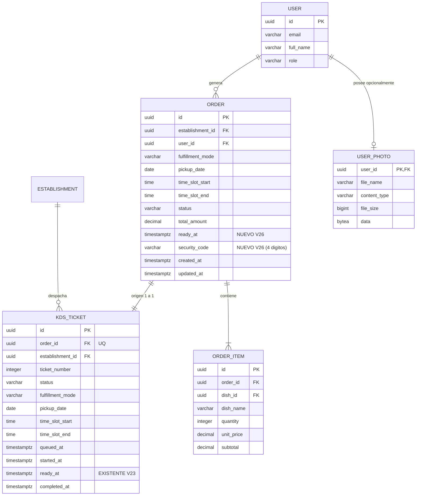
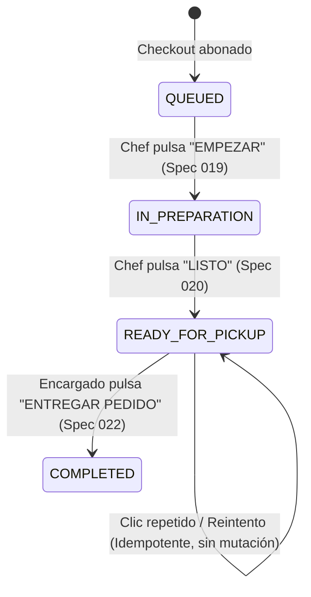

# Modelo de datos: despacho a mostrador y sincronización de pedidos listos

**Identificador de especificación**: `020-counter-dispatch-ready-orders`  
**Rama de trabajo**: `020-counter-dispatch-ready-orders`  
**Fecha de elaboración**: 15/11/2026  
**Estado**: Completo  

---

## 1. Entidades del dominio y persistencia

El modelo se apoya en la infraestructura relacional de PostgreSQL administrada por Flyway, reutilizando las entidades preexistentes `KdsTicket`, `Order`, `OrderItem`, `User` y `UserPhoto`, incorporando las extensiones indispensables mediante la migración incremental `V26__counter_dispatch_and_security_code.sql`.



---

## 2. Auditoría de campos: estado actual vs. extensiones requeridas

### 2.1 Tabla `orders`

| Campo | Tipo | Nullable | Estado en el repo | Propósito en Spec 020 |
| :--- | :--- | :---: | :--- | :--- |
| `id` | `UUID` | No | Existente (PK) | Identificador global de la orden |
| `establishment_id` | `UUID` | No | Existente (FK) | Aislamiento multi-tenant por restaurante |
| `user_id` | `UUID` | No | Existente (FK) | Vinculación con el comensal titular |
| `fulfillment_mode` | `VARCHAR(30)` | No | Existente | Modo de entrega (`IMMEDIATE`, `SCHEDULED`) |
| `pickup_date` | `DATE` | No | Existente | Fecha comprometida para el retiro |
| `time_slot_start` | `TIME` | No | Existente | Inicio del rango horario pactado |
| `time_slot_end` | `TIME` | No | Existente | Fin del rango horario pactado |
| `status` | `VARCHAR(30)` | No | Existente | Estado operativo general de la orden |
| `total_amount` | `DECIMAL(12,2)` | No | Existente | Importe total (excluido de mostrador) |
| **`ready_at`** | **`TIMESTAMPTZ`** | **Sí** | **Nuevo (Migración V26)** | **Instante exacto de finalización en cocina** |
| **`security_code`** | **`VARCHAR(4)`** | **Sí** | **Nuevo (Migración V26)** | **Código de seguridad oral de 4 dígitos** |
| `created_at` | `TIMESTAMPTZ` | No | Existente | Creación de la orden |
| `updated_at` | `TIMESTAMPTZ` | No | Existente | Última modificación de la orden |

### 2.2 Tabla `kds_tickets`

| Campo | Tipo | Nullable | Estado en el repo | Propósito en Spec 020 |
| :--- | :--- | :---: | :--- | :--- |
| `id` | `UUID` | No | Existente (PK) | Identificador de comanda de cocina |
| `order_id` | `UUID` | No | Existente (FK, UQ) | Relación 1:1 estricta con la orden |
| `establishment_id` | `UUID` | No | Existente (FK) | Sucursal del restaurante |
| `ticket_number` | `INTEGER` | No | Existente | Número correlativo del ticket diario |
| `status` | `VARCHAR(30)` | No | Existente | Estado KDS (`QUEUED`, `IN_PREPARATION`, `READY_FOR_PICKUP`, `COMPLETED`) |
| `fulfillment_mode` | `VARCHAR(30)` | No | Existente | `IMMEDIATE` o `SCHEDULED` |
| `pickup_date` | `DATE` | No | Existente | Fecha de retiro |
| `time_slot_start` | `TIME` | No | Existente | Hora inicio franja |
| `time_slot_end` | `TIME` | No | Existente | Hora fin franja |
| `queued_at` | `TIMESTAMPTZ` | No | Existente | Encolado en cocina |
| `started_at` | `TIMESTAMPTZ` | Sí | Existente | Inicio de preparación activa |
| `ready_at` | `TIMESTAMPTZ` | Sí | Existente | Instante en que el chef pulsa "LISTO" |
| `completed_at` | `TIMESTAMPTZ` | Sí | Existente | Cierre de entrega final (Spec 022) |

---

## 3. Migración Flyway: `V26__counter_dispatch_and_security_code.sql`

```sql
-- ====================================================================
-- EasyEat V26: Counter Dispatch, Coincident Timestamps & Security Code
-- ====================================================================

-- 1. Agregar columna ready_at a la tabla orders para coincidencia temporal estricta con kds_tickets
ALTER TABLE orders 
    ADD COLUMN IF NOT EXISTS ready_at TIMESTAMPTZ NULL;

-- 2. Agregar columna security_code (4 dígitos numéricos) a la tabla orders
ALTER TABLE orders 
    ADD COLUMN IF NOT EXISTS security_code VARCHAR(4) NULL;

-- 3. Constraint de formato para security_code (exactamente 4 dígitos entre 1000 y 9999)
ALTER TABLE orders DROP CONSTRAINT IF EXISTS chk_orders_security_code;
ALTER TABLE orders 
    ADD CONSTRAINT chk_orders_security_code 
    CHECK (security_code IS NULL OR security_code ~ '^[1-9][0-9]{3}$');

-- 4. Backfill para órdenes existentes sin código de seguridad
UPDATE orders 
SET security_code = LPAD(FLOOR(1000 + RANDOM() * 9000)::TEXT, 4, '0')
WHERE security_code IS NULL;

-- 5. Sincronizar ready_at para órdenes que ya figuren en READY_FOR_PICKUP a partir de kds_tickets
UPDATE orders o
SET ready_at = k.ready_at
FROM kds_tickets k
WHERE k.order_id = o.id
  AND o.status = 'READY_FOR_PICKUP'
  AND o.ready_at IS NULL
  AND k.ready_at IS NOT NULL;

-- 6. Crear índice compuesto especializado para la cola de mostrador (filtrado por establecimiento, jornada y estado; orden determinista por ready_at y ticket_number)
CREATE INDEX IF NOT EXISTS idx_kds_tickets_counter_ready 
    ON kds_tickets (establishment_id, status, pickup_date, ready_at ASC, ticket_number ASC);
```

---

## 4. Máquina de estados y transiciones



### Reglas de transición para `ready-for-pickup`:
1. **Precondición**: El ticket debe encontrarse en estado `IN_PREPARATION` (o excepcionalmente `QUEUED` si la preparación no requirió inicio previo).
2. **Mutación atómica**:
   ```text
   Instant now = clock.instant();
   kdsTicket.status = KdsTicketStatus.READY_FOR_PICKUP;
   kdsTicket.readyAt = now;
   order.status = OrderStatus.READY_FOR_PICKUP;
   order.readyAt = now;
   order.updatedAt = now;
   ```
3. **Idempotencia**: Si `kdsTicket.status == READY_FOR_PICKUP`, se devuelve inmediatamente `200 OK` retornando el `kdsTicket.readyAt` original sin modificar ninguna entidad.
4. **Coincidencia temporal inmutable**: `kdsTicket.readyAt` y `order.readyAt` son exactamente idénticos en milisegundos.

---

## 5. Proyecciones y Data Transfer Objects (DTOs)

### 5.1 DTO de respuesta para finalización en cocina: `KdsTicketResponse` (Reutilizado)

Se reutiliza el DTO preexistente `com.easyeat.order.dto.KdsTicketResponse` que ya expone de forma idéntica los atributos requeridos por la operación atómica de finalización en cocina:

```java
package com.easyeat.order.dto;

import com.easyeat.order.domain.OrderStatus;
import java.time.Instant;
import java.util.UUID;

public record KdsTicketResponse(
        UUID ticketId,
        UUID orderId,
        Integer ticketNumber,
        OrderStatus status,
        Instant readyAt
) {}
```

### 5.2 DTO de pedido listo para mostrador: `CounterReadyOrderResponse`

```java
package com.easyeat.order.dto;

import java.time.Instant;
import java.time.LocalTime;
import java.util.List;
import java.util.UUID;

public record CounterReadyOrderResponse(
        UUID ticketId,
        UUID orderId,
        Integer ticketNumber,
        TimeSlotDto timeSlot,
        Instant readyAt,
        CustomerSummaryDto customer,
        String securityCode,
        List<CounterOrderItemDto> items
) {
    public record TimeSlotDto(
            @JsonFormat(pattern = "HH:mm")
            LocalTime start,
            @JsonFormat(pattern = "HH:mm")
            LocalTime end
    ) {}

    public record CustomerSummaryDto(
            UUID userId,
            String fullName,
            String photoUrl // null si no tiene foto cargada
    ) {}

    public record CounterOrderItemDto(
            Integer quantity,
            String dishName
    ) {}
}
```

> [!IMPORTANT]
> **Agnosticismo monetario estricto**: Obsérvese que `CounterReadyOrderResponse` no contiene ningún atributo relativo a precios, monedas, subtotales ni totales financieros, dando estricto cumplimiento al `RF-013` y al `Invariante 10`.

---

## 6. Consulta de cola en base de datos (`KdsTicketRepository`)

Dado que en `KdsTicket` el atributo `orderId` es un identificador escalar (`UUID`) y no una asociación relacional gestionada (`@OneToOne`), la consulta JPQL recupera directamente las comandas listas ordenadas determinísticamente por índice, delegando la hidratación de órdenes, ítems y clientes a la capa de servicio (`orderRepository.findAllById(...)`) para evitar errores sintácticos de JPA (`cannot fetch join a non-association`):

```java
@Query("""
    SELECT k FROM KdsTicket k
    WHERE k.establishment.id = :establishmentId
      AND k.status = com.easyeat.order.domain.KdsTicketStatus.READY_FOR_PICKUP
      AND k.pickupDate = :today
    ORDER BY k.readyAt ASC, k.ticketNumber ASC
""")
List<KdsTicket> findCounterReadyTickets(
        @Param("establishmentId") UUID establishmentId,
        @Param("today") LocalDate today
);
```

Plan de ejecución respaldado por el índice `idx_kds_tickets_counter_ready`, garantizando escaneo de índice acotado con ordenamiento ya resuelto por el motor de PostgreSQL.
