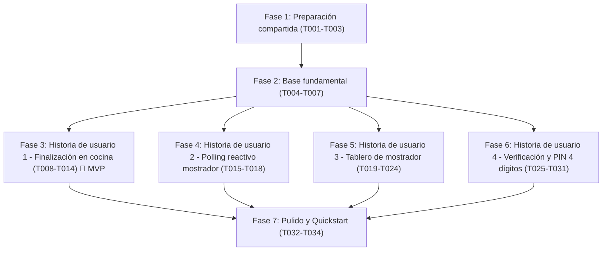

# Lista de tareas: despacho a mostrador y sincronización de pedidos listos

**Entrada**: Documentos de diseño desde `/specs/020-counter-dispatch-ready-orders/`  
**Prerrequisitos**: [spec.md](./spec.md), [plan.md](./plan.md), [research.md](./research.md), [data-model.md](./data-model.md), [quickstart.md](./quickstart.md), [contracts/counter-dispatch-contract.md](./contracts/counter-dispatch-contract.md)

## Formato de tareas: `[ID] [P?] [Historia] Descripción con ruta de archivo`

- **[P]**: Puede ejecutarse en paralelo (archivos distintos y sin dependencia de tareas incompletas en la misma fase).
- **[USx]**: Historia de usuario a la que pertenece la tarea (`US1`, `US2`, `US3`, `US4`), omitida en preparación compartida, base fundamental y pulido final.
- **Enfoque TDD**: En cada historia de usuario, las tareas de prueba (*Red Tests*) se redactan y ejecutan primero para constatar el fallo antes de abordar la implementación (*Green Implementation*).

---

## Fase 1: Preparación compartida (Setup) — [GitHub Issue #345](https://github.com/ValentinoCarmonaS/G12---GDSI/issues/345)

**Propósito**: Crear los DTOs y tipos de transporte compartidos requeridos por los contratos HTTP en backend y frontend.

- [X] T001 [P] Crear DTO de mostrador `CounterReadyOrderResponse.java` y validar reutilización de `KdsTicketResponse.java` en `easyeat/backend/src/main/java/com/easyeat/order/dto/`.
- [X] T002 [P] Definir tipos TypeScript de mostrador en `easyeat/frontend/src/types/counter.ts` incorporando `CounterReadyOrder`, `CounterTimeSlot`, `CounterCustomerSummary`, `CounterOrderItem` y `CounterOrdersPollingState`.
- [X] T003 [P] Crear cliente de API de mostrador en `easyeat/frontend/src/api/counterApi.ts` exponiendo la función tipada `fetchCounterOrders`.

**Checkpoint**: Modelos de transporte definidos y consistentes entre backend y frontend.

---

## Fase 2: Base fundamental (Foundational) — [GitHub Issue #346](https://github.com/ValentinoCarmonaS/G12---GDSI/issues/346)

**Propósito**: Establecer la migración de base de datos Flyway V26 (`orders.ready_at`, `orders.security_code`, índice compuesto de mostrador), mapeo de entidades JPA y utilidades de tiempo antes de implementar las historias operativas.

- [X] T004 [P] Crear migración Flyway `V26__counter_dispatch_and_security_code.sql` en `easyeat/backend/src/main/resources/db/migration/` incorporando columnas `ready_at`, `security_code` en `orders`, backfill seguro e índice compuesto `idx_kds_tickets_counter_ready` en `kds_tickets`.
- [X] T005 [P] Extender entidades JPA `Order.java` y `KdsTicket.java` en `easyeat/backend/src/main/java/com/easyeat/order/domain/` mapeando `readyAt`, `securityCode` y el nuevo índice compuesto.
- [X] T006 [P] Extender `KdsTicketRepository.java` en `easyeat/backend/src/main/java/com/easyeat/order/repository/` incorporando `findByIdForUpdate` con `@Lock(LockModeType.PESSIMISTIC_WRITE)` y `findCounterReadyTickets` ordenado determinísticamente por `readyAt ASC, ticketNumber ASC` filtrando por `establishmentId`, `status = READY_FOR_PICKUP` y `pickupDate = :today`.
- [X] T007 [P] Crear utilitario de temporización y formateo de espera en `easyeat/frontend/src/utils/counterTimeUtils.ts` (`calculateWaitMinutes`, `formatWaitMinutes`).

**Checkpoint**: Base de persistencia (columnas, índice y repositorio) y utilidades de tiempo disponibles para las historias.

---

## Fase 3: Historia de usuario 1 — Finalizar comanda completa y pasar a estado "Listo" (Prioridad: P1) 🎯 MVP — [GitHub Issue #347](https://github.com/ValentinoCarmonaS/G12---GDSI/issues/347)

**Objetivo**: Botón directo y prominente "LISTO" en la Columna 2 de cocina, transición atómica e indivisible a `READY_FOR_PICKUP` de `KdsTicket` y `Order` con `ready_at` idéntico, bloqueo pesimista `PESSIMISTIC_WRITE`, idempotencia estricta y remoción inmediata de la comanda en KDS sin checklist ni confirmaciones emergentes (`CHF-4.1.3` — `RF-001` a `RF-004`).

**Prueba independiente**: Ubicar una comanda en Columna 2 de cocina; pulsar "LISTO"; verificar remoción instantánea en UI, persistencia atómica con idéntico `ready_at` en `orders` y `kds_tickets`, y respuesta `200 OK` sin duplicación ni reescritura de timestamps ante llamadas repetidas.

### Pruebas TDD de US1 (Red Tests)

> **NOTA TDD**: Escribir primero estas pruebas y confirmar que fallan antes de implementar `T011`–`T014`.

- [X] T008 [P] [US1] Crear prueba de integración en `easyeat/backend/src/test/java/com/easyeat/order/KitchenReadyForPickupIntegrationTest.java` verificando `POST /api/v1/kitchen/tickets/{ticketId}/ready-for-pickup` (transición atómica conjunta de `KdsTicket` y `Order`, coincidencia temporal de `ready_at`, respuesta 200, errores 404, 403 y 409).
- [X] T009 [P] [US1] Crear prueba de idempotencia y concurrencia pesimista en `easyeat/backend/src/test/java/com/easyeat/order/KdsReadyForPickupIdempotencyTest.java` verificando que peticiones concurrentes o reintentos ejecutan un único cambio de estado y preservan el `ready_at` original.
- [X] T010 [P] [US1] Crear prueba de componente en `easyeat/frontend/tests/components/KitchenTicketReadyDispatch.test.tsx` verificando botón prominente "LISTO" en Columna 2, ausencia de diálogos emergentes, llamada a la API y remoción inmediata de la tarjeta del estado local de cocina.

### Implementación de US1 (Green Implementation)

- [X] T011 [US1] Refactorizar `markTicketReadyForPickup` en `easyeat/backend/src/main/java/com/easyeat/order/service/OrderLiveTrackingService.java` implementando bloqueo pesimista `findByIdForUpdate`, verificación de idempotencia y actualización atómica de `KdsTicket.readyAt`, `KdsTicket.status`, `Order.readyAt` y `Order.status`.
- [X] T012 [US1] Asegurar el endpoint `POST /api/v1/kitchen/tickets/{ticketId}/ready-for-pickup` en `easyeat/backend/src/main/java/com/easyeat/order/controller/KitchenTicketDispatchController.java` restringido a roles autorizados (`CHEF`, `ENCARGADO`, `ADMINISTRADOR`).
- [X] T013 [P] [US1] Consolidar la función `markTicketReadyForPickup` en `easyeat/frontend/src/api/orderTrackingApi.ts`.
- [X] T014 [US1] Conectar el botón "LISTO" en `easyeat/frontend/src/pages/KitchenWorkspacePage.tsx` (y tablero KDS asociado) ejecutando la llamada a la API y la remoción inmediata de la tarjeta de la Columna 2 tras la confirmación exitosa.

**Checkpoint**: `US1` completa e independientemente verificable como MVP (despacho transaccional en cocina con remoción inmediata).

---

## Fase 4: Historia de usuario 2 — Sincronización reactiva con la cola de mostrador (Prioridad: P1) — [GitHub Issue #348](https://github.com/ValentinoCarmonaS/G12---GDSI/issues/348)

**Objetivo**: Polling silencioso en mostrador cada 4 s con cabeceras `Cache-Control: no-cache`, cancelación con `AbortController` al desmontar, pausa en pestaña oculta, backoff acotado e insignia sutil no bloqueante ("Sin conexión — Reintentando...") tras >15 s sin respuesta exitosa, con retiro automático al restablecer la conexión (`CHF-4.2.3` — `RF-014`, `RF-018`).

**Prueba independiente**: Finalizar orden en cocina y verificar que aparece en mostrador en menos de 5 s sin recarga manual; simular corte de red de 16 s comprobando la aparición de la insignia sin colapsar tarjetas ni ocultar pedidos; restablecer red y comprobar desaparición automática de la advertencia.

### Pruebas TDD de US2 (Red Tests)

> **NOTA TDD**: Escribir primero estas pruebas y confirmar que fallan antes de implementar `T017`–`T018`.

- [X] T015 [P] [US2] Crear pruebas unitarias en `easyeat/frontend/tests/hooks/useCounterOrdersPolling.test.ts` verificando ciclo periódico de 4 segundos, cabeceras `no-cache`, cancelación con `AbortController` al desmontar, suspensión ante `document.visibilityState === 'hidden'` y reactivación inmediata al volver a `visible`.
- [X] T016 [P] [US2] Ampliar `easyeat/frontend/tests/hooks/useCounterOrdersPolling.test.ts` verificando que ante fallos continuados de red superiores a 15 segundos se activa el flag `isDisconnected = true`, y se restablece a `false` tras el primer sondeo exitoso.

### Implementación de US2 (Green Implementation)

- [X] T017 [US2] Implementar hook `useCounterOrdersPolling` en `easyeat/frontend/src/hooks/useCounterOrdersPolling.ts` consumiendo `counterApi.fetchCounterOrders` con temporizador nominal de 4 s, cabeceras `no-cache`, `visibilitychange`, `AbortController` y seguimiento de umbral de 15 s para `isDisconnected`.
- [X] T018 [US2] Implementar componente de insignia de estado de conexión `CounterConnectionBanner.tsx` en `easyeat/frontend/src/components/counter/` exhibiendo la leyenda "Sin conexión — Reintentando..." de forma sutil y no bloqueante.

**Checkpoint**: `US1 + US2` integradas (despacho en cocina sincronizado con la cola de mostrador en tiempo cuasi-real con resiliencia de conectividad).

---

## Fase 5: Historia de usuario 3 — Tablero de pedidos listos para entrega: diseño plegable/expandible (Prioridad: P1) — [GitHub Issue #349](https://github.com/ValentinoCarmonaS/G12---GDSI/issues/349)

**Objetivo**: Pantalla `/mostrador` con grilla de tarjetas compactas cerradas por defecto (`#ticketNumber`, turno `HH:mm - HH:mm`, contador Count-Up `MM min` derivado de `ready_at`), toggle en cabecera/zona neutral con protección `stopPropagation` interior, soporte simultáneo de múltiples tarjetas abiertas en `expandedTicketIds`, orden determinista `ready_at ASC, ticket_number ASC` y estado vacío neutral (`ENC-2.1.1` — `RF-005` a `RF-011`, `RF-015` a `RF-017`, `RF-019`).

**Prueba independiente**: Acceder a `/mostrador`; verificar tarjetas cerradas por defecto con métricas correctas; expandir tarjeta con clic en cabecera; comprobar que clics interiores no colapsan la tarjeta y clic en cabecera la cierra; desplegar varias tarjetas a la vez; verificar que los ciclos de refresco no colapsan tarjetas abiertas ni duplican elementos; verificar avance del contador a `1 min` a los 60 s exactos.

### Pruebas TDD de US3 (Red Tests)

> **NOTA TDD**: Escribir primero estas pruebas y confirmar que fallan antes de implementar `T022`–`T024`.

- [X] T019 [P] [US3] Crear prueba `@WebMvcTest` en `easyeat/backend/src/test/java/com/easyeat/order/CounterOrderControllerIntegrationTest.java` verificando `GET /api/v1/counter/orders` con rol `ENCARGADO`, filtro de jornada actual `pickup_date = hoy`, ordenamiento total `ready_at ASC, ticket_number ASC`, y exclusión de fechas futuras.
- [ ] T020 [P] [US3] Crear pruebas unitarias en `easyeat/frontend/tests/utils/counterTimeUtils.test.ts` verificando `calculateWaitMinutes` con valor inicial `0 min` entre 0 y 59 segundos, conmutación determinista a `1 min` a los 60 segundos y compensación de desfasaje de reloj servidor/cliente.
- [ ] T021 [P] [US3] Crear pruebas de componente en `easyeat/frontend/tests/components/CounterTicketCard.test.tsx` y `easyeat/frontend/tests/pages/CounterWorkspacePage.test.tsx` verificando renderizado cerrado inicial, alternancia al hacer clic en cabecera, detención de propagación en clics interiores y mensaje neutral de estado vacío.

### Implementación de US3 (Green Implementation)

- [ ] T022 [US3] Implementar controlador `CounterOrderController.java` en `easyeat/backend/src/main/java/com/easyeat/order/controller/` exponiendo `GET /api/v1/counter/orders` con anotación `@PreAuthorize("hasAnyRole('ENCARGADO', 'ADMINISTRADOR')")` consumiendo `kdsTicketRepository.findCounterReadyTickets`.
- [ ] T023 [US3] Implementar componente `CounterTicketCard.tsx` en `easyeat/frontend/src/components/counter/` soportando modo cerrado (cabecera con `#ticketNumber`, franja horaria `HH:mm - HH:mm`, contador Count-Up) y modo desplegado con `e.stopPropagation()` en el cuerpo interior.
- [ ] T024 [US3] Actualizar `CounterWorkspacePage.tsx` en `easyeat/frontend/src/pages/` integrando `useCounterOrdersPolling`, gestión de `expandedTicketIds: Set<string>`, grilla de tarjetas `CounterTicketCard`, `CounterConnectionBanner` y mensaje neutral de estado vacío ("No hay pedidos listos para entrega").

**Checkpoint**: `US1 + US2 + US3` funcionales (tablero interactivo completo en mostrador con soporte de tarjetas plegables y contador de espera continuo).

---

## Fase 6: Historia de usuario 4 — Verificación rápida de comanda física en mostrador (Prioridad: P2) — [GitHub Issue #350](https://github.com/ValentinoCarmonaS/G12---GDSI/issues/350)

**Objetivo**: Tarjeta desplegada exhibe código de seguridad oral de 4 dígitos, nombre completo del comensal, fotografía de perfil (u omisión limpia), desglose completo de platos en formato `[Cantidad]x [Plato]`, contenedor visual del botón de entrega y omisión estricta de importes o datos financieros (`ENC-2.1.2` — `RF-012`, `RF-013`).

**Prueba independiente**: Desplegar tarjeta en mostrador; verificar presencia de PIN de 4 dígitos con espaciado amplio, nombre del comensal, foto u omisión limpia alineando el texto, lista de platos formateada `[N]x [Plato]` y contenedor visual del botón de entrega sin precios, subtotales ni totales monetarios.

### Pruebas TDD de US4 (Red Tests)

> **NOTA TDD**: Escribir primero estas pruebas y confirmar que fallan antes de implementar `T028`–`T031`.

- [ ] T025 [P] [US4] Crear prueba en `easyeat/backend/src/test/java/com/easyeat/profile/controller/ProfileAvatarStaffControllerTest.java` verificando `GET /api/v1/profile/users/{userId}/avatar` con rol `ENCARGADO` (retorno de stream binario para usuario con avatar y 404 para usuario sin avatar).
- [ ] T026 [P] [US4] Ampliar `CounterOrderControllerIntegrationTest.java` en `easyeat/backend/src/test/java/com/easyeat/order/` verificando que el payload JSON de `GET /api/v1/counter/orders` contiene `securityCode` de 4 dígitos, `customer.fullName`, `customer.photoUrl`, `items` tipados y ausencia total de campos de precio (`unitPrice`, `subtotal`, `totalAmount`).
- [ ] T027 [P] [US4] Ampliar pruebas de componente en `easyeat/frontend/tests/components/CounterTicketCard.test.tsx` verificando renderizado de código de 4 dígitos con tipografía monospace, nombre del comensal, omisión limpia del contenedor de imagen cuando `photoUrl` es nulo, formateo de platos `[Cantidad]x [Plato]` y presencia de contenedor del botón de entrega sin datos monetarios.

### Implementación de US4 (Green Implementation)

- [ ] T028 [US4] Implementar generación de `securityCode` de 4 dígitos (`1000..9999`) al confirmar órdenes en `easyeat/backend/src/main/java/com/easyeat/order/service/OrderService.java` (y backfill en migración V26).
- [ ] T029 [US4] Implementar endpoint de lectura de avatares `GET /api/v1/profile/users/{userId}/avatar` en `easyeat/backend/src/main/java/com/easyeat/profile/controller/ProfileAvatarController.java` (refactorizando el mapeo de clase a `@RequestMapping("/api/v1/profile")`) protegido para roles `ENCARGADO`, `CHEF`, `ADMINISTRADOR`.
- [ ] T030 [US4] Mapear `securityCode`, `customer` (`fullName`, `photoUrl`) e `items` en `CounterOrderController.java` y `CounterReadyOrderResponse.java` garantizando estricta exclusión de datos financieros.
- [ ] T031 [US4] Actualizar la sección expandida de `CounterTicketCard.tsx` en `easyeat/frontend/src/components/counter/` renderizando el código de seguridad de 4 dígitos con espaciado amplio, nombre del comensal, elemento `` condicional (omisión limpia), lista de platos `[Cantidad]x [Plato]` y contenedor visual del botón de entrega.

**Checkpoint**: Todas las historias de usuario (`US1` a `US4`) completas y verificables de extremo a extremo.

---

## Fase 7: Pulido y aspectos transversales (Polish & Cross-Cutting Concerns) — [GitHub Issue #351](https://github.com/ValentinoCarmonaS/G12---GDSI/issues/351)

**Propósito**: Validar la consistencia global, documentación y ejecución completa de pruebas sin regresiones.

- [ ] T032 [P] Actualizar documentación de endpoints y variables de entorno en `easyeat/backend/README.md` y `easyeat/frontend/README.md`.
- [ ] T033 Ejecutar validación de escenarios de extremo a extremo según la guía `specs/020-counter-dispatch-ready-orders/quickstart.md`.
- [ ] T034 [P] Ejecutar suite completa de pruebas unitarias y de integración en backend (`mvn test`) y frontend (`npm test`) verificando 100% de éxito.

---

## Dependencias y orden de ejecución



### Reglas de precedencia:
1. **Fase 1 (Setup)**: Sin dependencias previas; define DTOs y tipos.
2. **Fase 2 (Foundational)**: Bloquea todas las historias de usuario; aplica migración Flyway V26, extiende entidades y crea utilitarios compartidos.
3. **Fase 3 (US1)**: Puede ejecutarse inmediatamente tras la Base fundamental como MVP independiente de producción en cocina.
4. **Fase 4 (US2)**, **Fase 5 (US3)** y **Fase 6 (US4)**: Pueden desarrollarse de forma paralela o secuencial (`US1 → US2 → US3 → US4`) tras la base fundamental.
5. **Dentro de cada historia**:
   - Pruebas TDD (*Red Tests*) escritas y ejecutadas primero comprobando su fallo antes de la implementación.
   - Entidades/Migraciones antes que Servicios.
   - Servicios antes que Controladores / Hooks.
   - Controladores / Hooks antes que Componentes de interfaz.

---

## Oportunidades de ejecución paralela

### En Fase 1 (Setup):
```bash
# Lanzar DTOs y tipos simultáneamente:
Task T001: DTOs en backend (CounterReadyOrderResponse.java, reutilización de KdsTicketResponse.java)
Task T002: Tipos TypeScript en frontend (types/counter.ts)
Task T003: Cliente API en frontend (api/counterApi.ts)
```

### En Fase 2 (Foundational):
```bash
# Lanzar base de datos y utilitarios simultáneamente:
Task T004: Migración Flyway V26
Task T005: Mapeo de entidades JPA (Order, KdsTicket)
Task T006: Métodos de repositorio en KdsTicketRepository (findByIdForUpdate, findCounterReadyTickets)
Task T007: Utilitario de tiempo en frontend (counterTimeUtils.ts)
```

### En Fase 3 (US1):
```bash
# Lanzar pruebas Red simultáneamente:
Task T008: KitchenReadyForPickupIntegrationTest.java (Backend)
Task T009: KdsReadyForPickupIdempotencyTest.java (Backend)
Task T010: KitchenTicketReadyDispatch.test.tsx (Frontend)
```

### En Fase 5 (US3) y Fase 6 (US4):
```bash
# Lanzar pruebas de controlador y utilitarios en paralelo:
Task T019: CounterOrderControllerIntegrationTest.java
Task T020: counterTimeUtils.test.ts
Task T021: CounterTicketCard.test.tsx
Task T025: ProfileAvatarStaffControllerTest.java
Task T027: CounterTicketCard expanded tests
```

---

## Estrategia de entrega incremental (MVP First)

1. **Paso 1 (Cimientos)**: Completar Fase 1 y Fase 2. Base de datos con migración V26 lista y tipos consistentes.
2. **Paso 2 (MVP Operativo de Cocina — US1)**: Completar Fase 3. El chef ya puede presionar "LISTO" en la Columna 2, la comanda se retira al instante y la base de datos queda actualizada atómica e idempotentemente.
3. **Paso 3 (Sincronización Silenciosa — US2)**: Completar Fase 4. El cliente de mostrador sondea cada 4 segundos con manejo de cortes de red (>15 s).
4. **Paso 4 (Tablero y Tarjetas Plegables — US3)**: Completar Fase 5. El personal de mostrador visualiza la grilla de pedidos listos en tarjetas cerradas con contador de espera y puede desplegarlas.
5. **Paso 5 (Cotejo Oral y Desglose — US4)**: Completar Fase 6. Las tarjetas desplegadas exhiben el código de 4 dígitos, avatar limpio y desglose de platos sin importes monetarios.
6. **Paso 6 (Cierre y Validación)**: Completar Fase 7 ejecutando la guía reproducible [quickstart.md](./quickstart.md) y suites completas de prueba.
