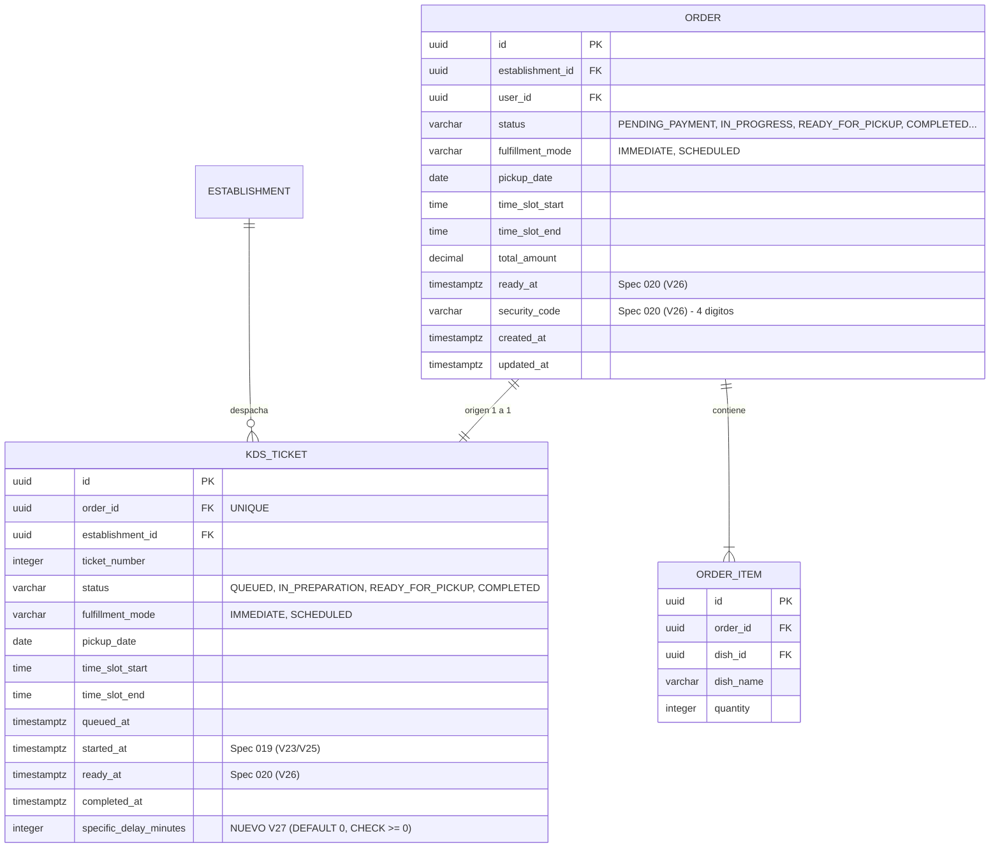
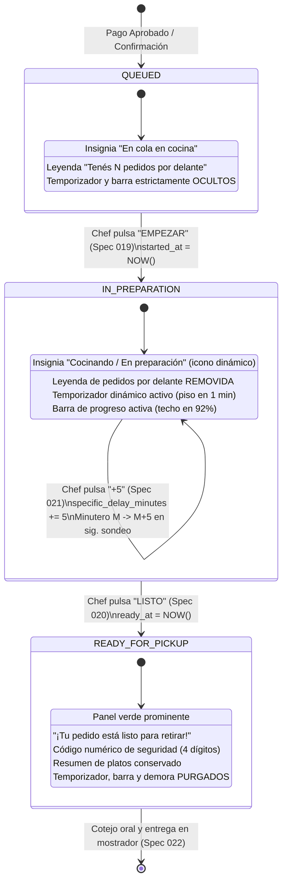

# Modelo de datos y transiciones de estado: seguimiento en vivo y demora granular (+5)

**Identificador de especificación**: `021-live-tracking-delay-adjustment`  
**Rama de trabajo**: `021-live-tracking-delay-adjustment`  
**Fecha de elaboración**: 15/11/2026  
**Estado**: Completo  

---

## 1. Entidades del dominio y persistencia relacional

El modelo de datos se monta de forma incremental sobre las tablas relacionales existentes en PostgreSQL (`orders`, `kds_tickets`, `order_items`), incorporando la persistencia de la demora específica por comanda a través de la migración incremental `V27__kds_specific_delay_minutes.sql`.



---

## 2. Esquema relacional detallado y migraciones

### 2.1 Migración incremental Flyway: `V27__kds_specific_delay_minutes.sql`

```sql
-- ====================================================================
-- EasyEat V27: Granular Kitchen Delay (+5) on KDS Tickets (Spec 021)
-- ====================================================================

ALTER TABLE kds_tickets
    ADD COLUMN IF NOT EXISTS specific_delay_minutes INTEGER NOT NULL DEFAULT 0;

ALTER TABLE kds_tickets
    DROP CONSTRAINT IF EXISTS chk_kds_specific_delay_minutes;

ALTER TABLE kds_tickets
    ADD CONSTRAINT chk_kds_specific_delay_minutes
    CHECK (specific_delay_minutes >= 0);

COMMENT ON COLUMN kds_tickets.specific_delay_minutes IS 
    'Demora acumulada en minutos (+5 por pulsacion) agregada por el personal de cocina.';
```

### 2.2 Tabla `kds_tickets` (Estado resultante con Spec 021)

| Columna | Tipo SQL | Nullable | Restricción / Valor por defecto | Origen / Estado | Propósito de negocio |
| :--- | :--- | :---: | :--- | :--- | :--- |
| `id` | `UUID` | No | Primary Key (`gen_random_uuid()`) | Existente (V23) | Identificador unívoco del ticket KDS. Desempate final de orden FIFO. |
| `order_id` | `UUID` | No | `UNIQUE`, FK `orders(id)` | Existente (V23) | Enlace 1 a 1 estricto con la orden del comensal. |
| `establishment_id` | `UUID` | No | FK `establishments(id)` | Existente (V23) | Aislamiento multi-tenant. |
| `ticket_number` | `INTEGER` | No | `CHECK (ticket_number > 0)` | Existente (V23) | Número visible en KDS y pantalla de comensal. |
| `status` | `VARCHAR(30)` | No | Default `'QUEUED'`, `CHECK (status IN ('QUEUED', 'IN_PREPARATION', 'READY_FOR_PICKUP', 'COMPLETED'))` | Existente (V23) | Estado operativo en cocina. |
| `fulfillment_mode` | `VARCHAR(30)` | No | `CHECK (fulfillment_mode IN ('IMMEDIATE', 'SCHEDULED'))` | Existente (V23) | Modalidad de entrega. |
| `pickup_date` | `DATE` | No | Indexado | Existente (V23) | Fecha de retiro asignada. |
| `time_slot_start` | `TIME` | No | Indexado | Existente (V23) | Inicio de franja horaria. |
| `time_slot_end` | `TIME` | No | Ninguna | Existente (V23) | Fin de franja horaria. |
| `queued_at` | `TIMESTAMPTZ` | No | Default `NOW()` | Existente (V23) | Timestamp de confirmación y encolado. |
| `started_at` | `TIMESTAMPTZ` | Sí | `NULL` en cola; marca temporal en preparación | Existente (V23/019) | Ancla temporal inmutable del inicio de cocción. |
| `ready_at` | `TIMESTAMPTZ` | Sí | `NULL` hasta que cocina presiona "LISTO" | Existente (V23/020) | Timestamp de conmutación a mostrador. |
| `completed_at` | `TIMESTAMPTZ` | Sí | `NULL` hasta entrega final | Existente (V23/022) | Timestamp de cierre de orden. |
| `specific_delay_minutes` | `INTEGER` | No | Default `0`, `CHECK (specific_delay_minutes >= 0)` | **NUEVO (V27)** | Minutos acumulados de demora (+5 por clic táctil en Columna 2). |

---

## 3. Máquina de estados y transiciones operativas



---

## 4. Reglas deterministas de cálculo de métricas

### 4.1 Cálculo determinista de posición FIFO ($N$) en `QUEUED`

Para una comanda $T$ en estado `QUEUED`, $N$ representa la cantidad exacta de comandas pendientes que le anteceden cronológicamente en la cocina:

$$N = \left| \left\{ K \in \text{KdsTickets} \;\middle|\; \begin{aligned} &K.\text{establishment\_id} = T.\text{establishment\_id} \\ &\land K.\text{status} = \text{'QUEUED'} \\ &\land K.\text{pickup\_date} \le \text{hoy} \\ &\land (K.\text{pickup\_date}, K.\text{time\_slot\_start}, K.\text{queued\_at}, K.\text{id}) < (T.\text{pickup\_date}, T.\text{time\_slot\_start}, T.\text{queued\_at}, T.\text{id}) \end{aligned} \right\} \right|$$

- **Caso $N = 0$**: La comanda se encuentra en el tope de la cola (es la siguiente en iniciar). El frontend renderiza literalmente: `"Tenés 0 pedidos por delante"`.
- **Exclusión de `IN_PREPARATION`**: Las órdenes que ya están siendo cocinadas no computan dentro de $N$, asegurando que la primera orden de la Columna 1 del chef siempre indique $N = 0$ al comensal.

### 4.2 Cálculo del temporizador y barra en `IN_PREPARATION`

- **Ancla temporal de inicio**: Se toma `started_at` persistido en la base de datos (Spec 019).
- **Minutos transcurridos**:
  $$\text{elapsed\_minutes} = \max\left(0, \left\lfloor \frac{\text{now} - \text{started\_at}}{60} \right\rfloor \right)$$
- **Tiempo total estimado**:
  $$\text{estimated\_total\_minutes} = 20 + \text{specific\_delay\_minutes}$$
- **Minutos restantes (con regla de piso en 1 min)**:
  $$\text{raw\_remaining} = \text{estimated\_total\_minutes} - \text{elapsed\_minutes}$$
  $$\text{remaining\_minutes} = \max(1, \text{raw\_remaining})$$
- **Barra de progreso porcentual (con regla de techo en 92%)**:
  $$\text{ratio} = \frac{\text{elapsed\_minutes}}{\text{estimated\_total\_minutes}}$$
  $$\text{raw\_progress} = \lfloor 15 + (\text{ratio} \times 77) \rfloor$$
  $$\text{progress\_percent} = \min(92, \max(15, \text{raw\_progress}))$$

### 4.3 Comportamiento ante acción táctil "+5"

1. Chef pulsa "+5" en Columna 2 del KDS.
2. `POST /api/v1/kitchen/tickets/{ticketId}/add-delay` ejecuta bajo `PESSIMISTIC_WRITE`:
   $$\text{specific\_delay\_minutes} \leftarrow \text{specific\_delay\_minutes} + 5$$
3. La comanda de cocina actualiza su insignia contigua a `+5 min` (o `+10 min`, `+15 min`, etc.).
4. En el siguiente ciclo de sondeo del comensal (5–8 s):
   - $\text{estimated\_total\_minutes}$ crece en 5 minutos.
   - $\text{remaining\_minutes}$ aumenta en 5 minutos ($M \to M + 5$).
   - $\text{progress\_percent}$ recalcula suavemente contra el nuevo divisor ampliado.

### 4.4 Purga visual en `READY_FOR_PICKUP`

Al registrarse la transición a `READY_FOR_PICKUP`:
- `remainingMinutes = null`
- `progressPercent = null`
- `specificDelayMinutes = null` (purgado de la vista)
- `positionAhead = null`
- `securityCode = order.securityCode` (4 dígitos exhibidos)
- **Persistencia en backend**: `kds_tickets.specific_delay_minutes` permanece intacto en la base de datos para auditoría histórica.

---

## 5. DTOs y modelos de transferencia

### 5.1 Backend (`easyeat/backend/src/main/java/com/easyeat/order/dto/`)

#### 5.1.1 `KdsDelayIncrementResponse`

```java
package com.easyeat.order.dto;

import java.time.Instant;
import java.util.UUID;

public record KdsDelayIncrementResponse(
        UUID ticketId,
        UUID orderId,
        Integer ticketNumber,
        int specificDelayMinutes,
        int estimatedTotalMinutes,
        Instant updatedAt
) {}
```

#### 5.1.2 Extensión de `OrderLiveTrackingResponse`

```java
package com.easyeat.order.dto;

import com.easyeat.order.domain.FulfillmentMode;
import com.easyeat.order.domain.OrderStatus;

import java.time.Instant;
import java.util.List;
import java.util.UUID;

public record OrderLiveTrackingResponse(
        UUID orderId,
        Integer ticketNumber,
        OrderStatus status,
        FulfillmentMode fulfillmentMode,
        boolean isCountdownActive,
        Integer estimatedMinutesRemaining, // Alias/compatibilidad retroactiva
        Integer progressPercentage,        // Alias/compatibilidad retroactiva
        boolean isReadyForPickup,
        KdsQueueSaturationDto kdsQueueSaturation,
        String message,
        Instant serverTime,
        // --- Nuevos campos Spec 021 ---
        Integer positionAhead,          // N en QUEUED; null en otros estados
        Integer estimatedTotalMinutes,  // 20 + specificDelayMinutes en IN_PREPARATION
        Integer elapsedMinutes,         // Minutos transcurridos desde startedAt
        Integer remainingMinutes,       // Minutos restantes con piso 1 en IN_PREPARATION
        Integer progressPercent,        // Porcentaje de progreso con techo 92 en IN_PREPARATION
        Integer specificDelayMinutes,   // Demora acumulada (null en READY_FOR_PICKUP)
        String securityCode,            // Código de 4 dígitos (solo en READY_FOR_PICKUP)
        Instant startedAt,              // Instante de inicio de cocción
        Instant readyAt,                // Instante de despacho a mostrador
        List<LiveTrackingItemDto> items // Resumen de platos del pedido
) {
    public record KdsQueueSaturationDto(
            int activeOrdersAhead,
            String kitchenStatus,
            int globalDelayAppliedMinutes
    ) {}

    public record LiveTrackingItemDto(
            String dishName,
            int quantity
    ) {}
}
```

### 5.2 Frontend (`easyeat/frontend/src/types/orderTracking.ts`)

```typescript
export interface LiveTrackingItem {
  dishName: string;
  quantity: number;
}

export interface OrderLiveTrackingData {
  orderId: string;
  ticketNumber: number | null;
  status: 'PENDING_PAYMENT' | 'PENDING_ACCREDITATION' | 'CONFIRMED' | 'PAID' | 'IN_PROGRESS' | 'READY_FOR_PICKUP' | 'COMPLETED' | 'CANCELLED' | 'EXPIRED';
  fulfillmentMode: 'IMMEDIATE' | 'SCHEDULED';
  isCountdownActive: boolean;
  estimatedMinutesRemaining: number | null;
  progressPercentage: number | null;
  isReadyForPickup: boolean;
  message: string;
  serverTime: string;
  // Spec 021 fields
  positionAhead: number | null;
  estimatedTotalMinutes: number | null;
  elapsedMinutes: number | null;
  remainingMinutes: number | null;
  progressPercent: number | null;
  specificDelayMinutes: number | null;
  securityCode: string | null;
  startedAt: string | null;
  readyAt: string | null;
  items: LiveTrackingItem[];
}

export interface KdsDelayIncrementResponse {
  ticketId: string;
  orderId: string;
  ticketNumber: number;
  specificDelayMinutes: number;
  estimatedTotalMinutes: number;
  updatedAt: string;
}
```

---

## 6. Fronteras e invariantes con specs adyacentes

1. **Frontera con Spec 019 (KDS Cocina)**:
   - La Columna 2 de cocina incorpora el botón táctil "+5" y la insignia `+X min`.
   - El cronómetro Count-Up de la Columna 2 de cocina (que mide el tiempo físico transcurrido desde `started_at`) **no se altera**: sigue contando hacia arriba de forma puramente cronológica.
2. **Frontera con Spec 020 (Mostrador de despacho)**:
   - La pantalla `/mostrador` computa `tiempo_en_mostrador` midiendo los minutos transcurridos desde `ready_at`. No lee ni es alterada por `specific_delay_minutes`.
3. **Frontera con Spec 022 (Validación de PIN y entrega)**:
   - La pantalla del comensal en `READY_FOR_PICKUP` muestra el código de 4 dígitos exclusivamente para ser recitado verbalmente en mostrador. No implementa interfaces de cotejo ni cierre de orden.
