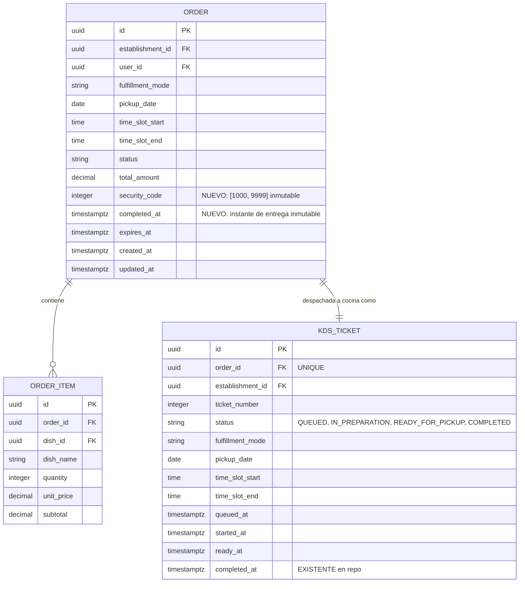
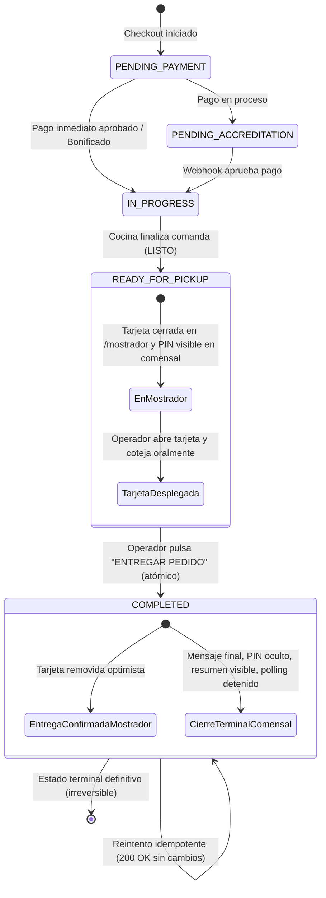

# Modelo de datos: protocolo antifraude de entrega y cierre de orden

**Especificación**: `022-pin-antifraud-delivery-completion`  
**Rama**: `022-pin-antifraud-delivery-completion`  
**Fecha**: 15/11/2026  
**Estado**: Consolidado  

---

## 1. Diagrama de entidades y relaciones



---

## 2. Definición detallada de entidades

### 2.1. Entidad `Order` (tabla `orders`)

Representa la orden comercial y el ciclo de vida del pedido del comensal.

| Campo | Tipo SQL | Tipo Java | Nullable | Restricciones / Invariantes | Descripción |
|---|---|---|---|---|---|
| `id` | `UUID` | `UUID` | No | PK, autogenerado | Identificador universal único de la orden. |
| `establishment_id` | `UUID` | `UUID` | No | FK a `establishments(id)` | Establecimiento gastronómico receptor. |
| `user_id` | `UUID` | `UUID` | No | FK a `users(id)` | Comensal titular que realizó el pedido. |
| `fulfillment_mode` | `VARCHAR(30)` | `FulfillmentMode` | No | `IN ('IMMEDIATE', 'SCHEDULED')` | Modalidad de retiro pactada. |
| `pickup_date` | `DATE` | `LocalDate` | No | | Fecha programada para el retiro. |
| `time_slot_start` | `TIME` | `LocalTime` | No | | Hora de inicio de la franja horaria. |
| `time_slot_end` | `TIME` | `LocalTime` | No | `time_slot_start < time_slot_end` | Hora de fin de la franja horaria. |
| `status` | `VARCHAR(30)` | `OrderStatus` | No | `IN ('PENDING_PAYMENT', 'PENDING_ACCREDITATION', 'IN_PROGRESS', 'READY_FOR_PICKUP', 'COMPLETED', ...)` | Estado operativo actual. Transiciona a `COMPLETED`. |
| `total_amount` | `DECIMAL(12,2)` | `BigDecimal` | No | `>= 0` | Importe monetario total de la orden. |
| `security_code` | `INTEGER` | `Integer` | Sí (para órdenes heredadas) | `CHECK (security_code IS NULL OR (security_code >= 1000 AND security_code <= 9999))` | **NUEVO**. Código numérico de seguridad de 4 dígitos generado en `@PrePersist` en rango [1000, 9999]. Inmutable (`updatable = false`). |
| `completed_at` | `TIMESTAMPTZ` | `Instant` | Sí | Inmutable una vez asignado | **NUEVO**. Instante exacto en que la entrega física fue confirmada en mostrador. |
| `expires_at` | `TIMESTAMPTZ` | `Instant` | Sí | | Límite temporal para completar el pago. |
| `created_at` | `TIMESTAMPTZ` | `Instant` | No | Inmutable | Instante de creación del registro. |
| `updated_at` | `TIMESTAMPTZ` | `Instant` | No | | Instante de última mutación. |

### 2.2. Entidad `KdsTicket` (tabla `kds_tickets`)

Representa la comanda operativa en la cocina (Kitchen Display System). Ya se encuentra modelada en la base de datos (migración `V23`).

| Campo | Tipo SQL | Tipo Java | Nullable | Restricciones / Invariantes | Descripción |
|---|---|---|---|---|---|
| `id` | `UUID` | `UUID` | No | PK, autogenerado | Identificador único de la comanda. |
| `order_id` | `UUID` | `UUID` | No | FK a `orders(id)`, `UNIQUE` | Orden comercial asociada (relación 1 a 1). |
| `establishment_id` | `UUID` | `UUID` | No | FK a `establishments(id)` | Sucursal gastronómica. |
| `ticket_number` | `INTEGER` | `Integer` | No | `ticket_number > 0` | Número correlativo diario de retiro (`#ticketNumber`). |
| `status` | `VARCHAR(30)` | `KdsTicketStatus` | No | `IN ('QUEUED', 'IN_PREPARATION', 'READY_FOR_PICKUP', 'COMPLETED')` | Estado operativo de cocina. Transiciona a `COMPLETED`. |
| `queued_at` | `TIMESTAMPTZ` | `Instant` | No | | Instante de ingreso a la cola de cocina. |
| `started_at` | `TIMESTAMPTZ` | `Instant` | Sí | | Instante en que se inició la cocción. |
| `ready_at` | `TIMESTAMPTZ` | `Instant` | Sí | | Instante en que cocina marcó "LISTO". |
| `completed_at` | `TIMESTAMPTZ` | `Instant` | Sí | Coincidencia exacta con `orders.completed_at` | **EXISTENTE en tabla**. Instante de entrega física final en mostrador. |

---

## 3. Máquina de estados y transiciones



---

## 4. Migración de base de datos Flyway

Se define la migración incremental en el repositorio:
`easyeat/backend/src/main/resources/db/migration/V25__add_security_code_and_completed_at_to_orders.sql`

```sql
-- ====================================================================
-- EasyEat V25: Security Code (PIN Antifraud) and Completed Timestamp in Orders
-- Conforms to ENC-3.2.1, ENC-3.3.1, ENC-3.3.2 (Spec 022)
-- ====================================================================

-- 1. Agregar columna de código numérico de seguridad de 4 dígitos [1000, 9999]
ALTER TABLE orders
    ADD COLUMN IF NOT EXISTS security_code INTEGER;

-- 2. Restricción de rango estricto para el código de seguridad (sin ceros a la izquierda)
ALTER TABLE orders
    ADD CONSTRAINT chk_order_security_code
    CHECK (security_code IS NULL OR (security_code >= 1000 AND security_code <= 9999));

-- 3. Agregar columna completed_at para registrar el instante de entrega definitiva
ALTER TABLE orders
    ADD COLUMN IF NOT EXISTS completed_at TIMESTAMPTZ;

-- 4. Índice para optimizar consultas de auditoría y análisis de órdenes completadas
CREATE INDEX IF NOT EXISTS idx_orders_establishment_completed
    ON orders(establishment_id, status, completed_at);
```

---

## 5. Invariantes del modelo de datos

1. **Rango numérico estricto**: $1000 \le \text{security\_code} \le 9999$. No se admiten números negativos, números menores a 1000 ni mayores a 9999.
2. **Inmutabilidad de `security_code`**: Una vez persistido, ningún `UPDATE` modifica este campo.
3. **Atomicidad de `completed_at`**: En la transición a `COMPLETED`, tanto `orders.completed_at` como `kds_tickets.completed_at` se actualizan al mismo `Instant` dentro de la misma transacción de base de datos.
4. **Inmutabilidad de `completed_at`**: La primera confirmación exitosa fija el valor permanentemente. Las llamadas idempotentes subsecuentes devuelven el valor preexistente sin sobreescribirlo.
5. **Irreversibilidad de `COMPLETED`**: Ninguna orden ni ticket en estado `COMPLETED` puede retornar a `READY_FOR_PICKUP`, `IN_PROGRESS` ni cancelarse.
6. **Tolerancia a inconsistencias (Caso Borde 10)**: La columna `security_code` admite valores nulos en base de datos para no invalidar órdenes históricas creadas antes de la spec 022. La lógica de negocio maneja la ausencia de PIN con un fallback neutral `- - - -` permitiendo completar la entrega.