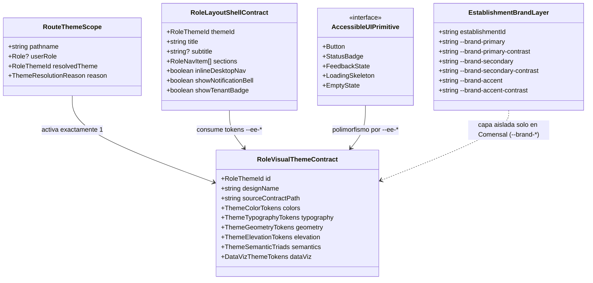
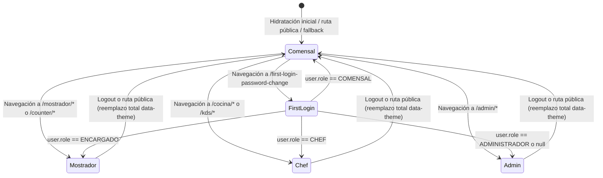

# Modelo de datos y contratos visuales (Phase 1): Arquitectura de temas visuales por rol y primitivos base accesibles

**Especificación**: `specs/024-ui-theme-architecture/spec.md`  
**Rama**: `feat/024-ui-theme-architecture`  
**Fecha**: 21/11/2026

Esta especificación es exclusiva de frontend (`single-tier frontend-only`, autorizada bajo Principio X). No introduce entidades persistidas en base de datos ni cambios en contratos REST. Las entidades modeladas corresponden al dominio de arquitectura visual en el cliente: contratos de tema por rol, ámbito de enrutamiento, contenedores de navegación, capa de marca de establecimiento y primitivos base accesibles.

---

## 1. Entidades principales y relaciones

---

## 2. Entidad 1 — Contrato visual de rol (`RoleVisualThemeContract`)

### 2.1 Estructura y reglas de validación

- **Identificador (`RoleThemeId`)**: enumeración cerrada `'comensal' | 'mostrador' | 'chef' | 'admin'`.
- **Fuente única de verdad**: cada instancia de `RoleVisualThemeContract` define tanto los tokens declarativos CSS (`--ee-*`) como la lectura programática tipada (`dataViz`), prohibiendo duplicar códigos hexadecimales fuera del registro central.
- **Invariantes WCAG 2.2 AA**:
  - `colors.text` y `colors.textSecondary` sobre `colors.surface` y `colors.surfaceElevated`: contraste `>= 4.5:1`.
  - `colors.onPrimary` sobre `colors.primary` y `colors.primaryHover`: contraste `>= 4.5:1`.
  - `colors.onSecondary` sobre `colors.secondary` y `colors.secondaryHover`: contraste `>= 4.5:1`.
  - `colors.onDanger` sobre `colors.dangerSolid` y `colors.dangerHover`: contraste `>= 4.5:1`.
  - `colors.borderStrong`, `colors.primaryBorder`, `colors.secondaryBorder` y `colors.focusRing` sobre `colors.surface` y `colors.surfaceElevated`: contraste `>= 3.0:1`.
  - En cada tríada semántica (`neutral`, `info`, `success`, `warning`, `danger`): `fg` sobre `bg` `>= 4.5:1`, y `border` sobre `colors.surface` `>= 3.0:1`.
  - En `dataViz`: cada una de las 5+ series sobre `colors.surface` y `colors.surfaceElevated` `>= 3.0:1` (en la paleta remediada, todas superan además `4.5:1`); `axisStroke` sobre `colors.surface` `>= 3.0:1`; `axisLabelFg` sobre `colors.surface` y `colors.surfaceElevated` `>= 4.5:1`; `tooltip.fg` sobre `tooltip.bg` `>= 4.5:1`.
  - **Prohibición Zero AI-Slop**: ningún campo tipográfico puede contener `Inter`.

### 2.2 Matriz exacta de tokens remediados por rol (`FR-001`, `FR-002`, `FR-003`, `FR-019`)

#### Colores estructurales, acentos y foco

| Token semántico (`--ee-*`) | Comensal (`Bento`) | Mostrador (`Bold`) | Chef (`Brutalism`) | Administrador (`Glassmorphism`) |
|---|---|---|---|---|
| `--ee-surface` | `#FFF5E6` | `#111111` | `#FFFFFF` | `#F4F7FC` |
| `--ee-surface-elevated` | `#FFFFFF` | `#1C1C1F` | `#F4F4F0` | `#FFFFFF` (glass: `rgba(255,255,255,0.82)` + `blur(12px)`) |
| `--ee-surface-subtle` | `#F5E6D0` | `#26262B` | `#E7E7E0` | `#E8EEF8` |
| `--ee-text` | `#111827` (`16.44:1`) | `#F8FAFC` (`18.05:1`) | `#111827` (`17.74:1`) | `#141414` (`17.16:1`) |
| `--ee-text-secondary` | `#475569` (`7.02:1`) | `#CBD5E1` (`12.72:1`) | `#374151` (`10.31:1`) | `#475569` (`7.06:1`) |
| `--ee-border-subtle` | `#D6C2A8` | `#3F3F46` | `#737373` | `#CBD5E1` |
| `--ee-border-strong` | `#7A6855` (`4.94:1`) | `#71717A` (`3.91:1`) | `#111827` (`17.74:1`) | `#64748B` (`4.43:1`) |
| `--ee-primary` | `#FAD4C0` | `#0077BC` | `#DD614C` | `#1856FF` |
| `--ee-on-primary` | `#111827` (`12.88:1`) | `#FFFFFF` (`4.81:1`) | `#111827` (`4.97:1`) | `#FFFFFF` (`5.51:1`) |
| `--ee-primary-hover` | `#F3BEA2` (`10.73:1`) | `#00639E` (`6.41:1`) | `#E67966` (`6.16:1`) | `#0F45DB` (`7.26:1`) |
| `--ee-primary-border` | `#9A4A24` (`5.76:1`) | `#38BDF8` (`8.81:1`) | `#111827` (`17.74:1`) | `#1856FF` (`5.13:1`) |
| `--ee-secondary` | `#80A1C1` | `#009866` | `#DAA144` | `#3A344E` |
| `--ee-on-secondary` | `#111827` (`6.58:1`) | `#0A0A0A` (`5.36:1`) | `#111827` (`7.74:1`) | `#FFFFFF` (`11.79:1`) |
| `--ee-secondary-hover` | `#6B90B4` (`5.30:1`) | `#00B377` (`7.27:1`) | `#C68D32` (`6.13:1`) | `#2B263B` (`14.55:1`) |
| `--ee-secondary-border` | `#3B5E82` (`6.26:1`) | `#34D399` (`9.82:1`) | `#111827` (`17.74:1`) | `#3A344E` (`10.98:1`) |
| `--ee-danger-solid` | `#B91C1C` | `#DC2626` | `#B91C1C` | `#C81433` |
| `--ee-on-danger` | `#FFFFFF` (`6.47:1`) | `#FFFFFF` (`4.83:1`) | `#FFFFFF` (`6.47:1`) | `#FFFFFF` (`5.83:1`) |
| `--ee-danger-hover` | `#991B1B` (`8.31:1`) | `#B91C1C` (`6.47:1`) | `#991B1B` (`8.31:1`) | `#A60F29` (`7.72:1`) |
| `--ee-focus-ring` | `#1E40AF` (`8.08:1`) | `#38BDF8` (`8.81:1`) | `#111827` (`17.74:1`) | `#1856FF` (`5.13:1`) |

#### Tríadas semánticas accesibles (`bg` / `fg` / `border`)

| Estado | Comensal (`Bento`) | Mostrador (`Bold`) | Chef (`Brutalism`) | Administrador (`Glassmorphism`) |
|---|---|---|---|---|
| `neutral` | `#EFE3D0` / `#1F2937` / `#7A6855` | `#27272A` / `#F4F4F5` / `#71717A` | `#F3F4F6` / `#111827` / `#111827` | `#EEF2F6` / `#1E293B` / `#64748B` |
| `info` | `#E0F2FE` / `#0C4A6E` / `#0369A1` | `#082F49` / `#BAE6FD` / `#38BDF8` | `#E0F2FE` / `#0C4A6E` / `#0369A1` | `#E8F0FF` / `#0F369E` / `#1856FF` |
| `success` | `#DCFCE7` / `#14532D` / `#15803D` | `#052E16` / `#BBF7D0` / `#22C55E` | `#DCFCE7` / `#14532D` / `#15803D` | `#E6FBF0` / `#045D33` / `#059652` |
| `warning` | `#FEF3C7` / `#78350F` / `#B45309` | `#451A03` / `#FDE68A` / `#F59E0B` | `#FEF3C7` / `#78350F` / `#B45309` | `#FEF2E8` / `#8A3E0A` / `#C25E18` |
| `danger` | `#FEE2E2` / `#7F1D1D` / `#B91C1C` | `#450A0A` / `#FECACA` / `#F87171` | `#FEE2E2` / `#7F1D1D` / `#B91C1C` | `#FDECEF` / `#9E0E27` / `#C81433` |

#### Tipografía, geometría y elevación por rol

| Dimensión | Comensal (`Bento`) | Mostrador (`Bold`) | Chef (`Brutalism`) | Administrador (`Glassmorphism`) |
|---|---|---|---|---|
| `--ee-font-display` | `'DM Sans', ui-sans-serif, system-ui, sans-serif` | `'Archivo Black', 'Arial Black', sans-serif` | `'Darker Grotesque', ui-sans-serif, system-ui, sans-serif` | `'Plus Jakarta Sans', ui-sans-serif, system-ui, sans-serif` |
| `--ee-font-sans` | `'DM Sans', ui-sans-serif, system-ui, sans-serif` | `'Archivo', ui-sans-serif, system-ui, sans-serif` | `'Darker Grotesque', ui-sans-serif, system-ui, sans-serif` | `'Plus Jakarta Sans', ui-sans-serif, system-ui, sans-serif` |
| `--ee-font-mono` | `'JetBrains Mono', ui-monospace, monospace` | `'JetBrains Mono', ui-monospace, monospace` | `'JetBrains Mono', ui-monospace, monospace` | `'JetBrains Mono', ui-monospace, monospace` |
| Pesos activos | Sans `400/500/600/700`, Mono `400/500/600` | Display `400`, Body `400/500/600/700`, Mono `400/500/600` | Display/Body `500/600/700/800`, Mono `400/500/600` | Display/Body `400/500/600/700`, Mono `400/500/600` |
| `--ee-radius-sm` / `-md` / `-lg` | `8px` / `14px` / `20px` | `4px` / `8px` / `12px` | `0px` / `2px` / `4px` | `6px` / `12px` / `16px` |
| `--ee-border-width` | `1px` | `2px` | `2px` | `1px` |
| `--ee-shadow-elevated` | `0 2px 10px rgba(17,24,39,0.06)` | `0 8px 24px rgba(0,0,0,0.45)` | `4px 4px 0px #111827` | `0 8px 28px rgba(24,86,255,0.08)` |
| `--ee-backdrop-blur` | `none` | `none` | `none` | `blur(12px)` |
| Escala de espaciado | `4 / 8 / 12 / 16 / 24 / 32 px` | `4 / 8 / 12 / 16 / 24 / 32 px` | `4 / 8 / 12 / 16 / 24 / 32 px` | `8 / 12 / 16 / 24 / 32 px` (cómoda) |

#### Sub-contrato de visualización de datos (`DataVizThemeTokens` — `FR-019`)

| Token de visualización | Comensal (`Bento`) | Mostrador (`Bold`) | Chef (`Brutalism`) | Administrador (`Glassmorphism`) |
|---|---|---|---|---|
| `series[0..4]` | `#9A4A24`, `#2B5B84`, `#15803D`, `#B45309`, `#B91C1C` | `#38BDF8`, `#34D399`, `#FBBF24`, `#F87171`, `#C084FC` | `#B83B28`, `#8F6210`, `#15803D`, `#1D4ED8`, `#374151` | `#1856FF`, `#3A344E`, `#047843`, `#B85410`, `#C81433` |
| `gridStroke` | `#D6C2A8` | `#2E2E34` | `#D4D4CE` | `#CBD5E1` |
| `axisStroke` | `#7A6855` | `#71717A` | `#111827` | `#64748B` |
| `axisLabelFg` | `#374151` | `#CBD5E1` | `#111827` | `#334155` |
| `tooltip` (`bg` / `fg` / `border`) | `#111827` / `#FFF5E6` / `#9A4A24` | `#1C1C1F` / `#F8FAFC` / `#71717A` | `#111827` / `#FFFFFF` / `#111827` | `#141414` / `#FFFFFF` / `#64748B` |
| `cursorFill` | `rgba(154, 74, 36, 0.10)` | `rgba(56, 189, 248, 0.14)` | `rgba(17, 24, 39, 0.08)` | `rgba(24, 86, 255, 0.10)` |
| `fontFamilySans` | `'DM Sans', ui-sans-serif, system-ui, sans-serif` | `'Archivo', ui-sans-serif, system-ui, sans-serif` | `'Darker Grotesque', ui-sans-serif, system-ui, sans-serif` | `'Plus Jakarta Sans', ui-sans-serif, system-ui, sans-serif` |
| `fontFamilyMono` | `'JetBrains Mono', ui-monospace, monospace` | `'JetBrains Mono', ui-monospace, monospace` | `'JetBrains Mono', ui-monospace, monospace` | `'JetBrains Mono', ui-monospace, monospace` |

---

## 3. Entidad 2 — Ámbito de tema por ruta (`RouteThemeScope` — `FR-004`, `FR-005`)

### Reglas deterministas de resolución (en orden estricto de precedencia)

| Precedencia | Patrón de ruta (`pathname` normalizado) | Condición de sesión / navegación | Tema resuelto (`RoleThemeId`) |
|---|---|---|---|
| 1 | `/first-login-password-change` | `user.role === 'ENCARGADO'` → `'mostrador'`; `'CHEF'` → `'chef'`; `'ADMINISTRADOR'` → `'admin'`; `'COMENSAL'` → `'comensal'`; rol ausente/nulo → `'admin'` | Rol autenticado (respaldo `'admin'`) |
| 2 | `/` (redirección por rol) | Si `user.role` está presente: `'ENCARGADO'` → `'mostrador'`, `'CHEF'` → `'chef'`, `'ADMINISTRADOR'` → `'admin'`, `'COMENSAL'` → `'comensal'`. Sin sesión → pasa a precedencia 7 | Rol destino (o `'comensal'` sin sesión) |
| 3 | `/login` | Si `location.state.from` (`fromPath`) apunta a ruta de personal (`/mostrador*`, `/counter*` → `'mostrador'`; `/cocina*`, `/kds*` → `'chef'`; `/admin*` → `'admin'`); sin deep-link de personal → `'comensal'` | Rol destino de staff o `'comensal'` |
| 4 | `/mostrador`, `/mostrador/*`, `/counter`, `/counter/*` | Independiente | `'mostrador'` |
| 5 | `/cocina`, `/cocina/*`, `/kds`, `/kds/*` | Independiente | `'chef'` |
| 6 | `/admin`, `/admin/*` | Independiente | `'admin'` |
| 7 | `/register`, `/forgot-password`, `/reset-password`, `/auth/reset-password`, `/verificar-email`, `/verify-email`, rutas Comensal (`/descubrimiento`, `/discovery`, `/catalogo/*`, `/catalog/*`, `/perfil`, `/profile`, `/checkout/*`, `/pedidos/*`, `/seguimiento/*`), `/` sin sesión y `*` | Independiente | `'comensal'` (fallback público/comensal) |

### Transiciones de estado del ámbito de tema

---

## 4. Entidad 3 — Contenedor operativo por rol (`RoleLayoutShellContract` — `FR-007` a `FR-010`)

### Mapa de navegación y controles por rol

| Rol (`Role`) | Tema | Secciones en menú hamburguesa (móvil y escritorio) | Excepción cabecera escritorio | Controles esenciales en cabecera |
|---|---|---|---|---|
| `COMENSAL` (autenticado) | `comensal` | `Descubrimiento` (`/descubrimiento`), `Catálogo` (`/catalogo`), `Mis pedidos` (`/perfil#pedidos`), `Mi perfil` (`/perfil`) + `Cerrar sesión` | Ninguna (barra minimalista) | Marca, título, botón hamburguesa, avatar navegable (`/perfil`), `Cerrar sesión` |
| Invitado (`user === null`) | `comensal` | Sin menú de rol autenticado | Ninguna | Marca, título, enlaces `Iniciar sesión` (`/login`) y `Registrarse` (`/register`) |
| `ENCARGADO` | `mostrador` | `Despacho en mostrador` (`/mostrador`) + metadatos de cuenta y `Cerrar sesión` (sin enlace a `/perfil`) | Ninguna (barra minimalista) | Marca, título, botón hamburguesa, badge `Local` (`tenant-badge`), avatar informativo (no navegable), `Cerrar sesión` |
| `CHEF` | `chef` | `Comandas KDS` (`/cocina`), `Gestionar Platos` (`/cocina/platos`), `Ingredientes` (`/cocina/ingredientes`) + metadatos de cuenta y `Cerrar sesión` (sin enlace a `/perfil`) | **Sí (C-08)**: los 3 accesos directos visibles en cabecera en `>= 768px` (`md:flex`) con `aria-current="page"` | Marca, título, nav directo escritorio (`Secciones de cocina`), botón hamburguesa, badge `Local`, avatar informativo (no navegable), `Cerrar sesión` |
| `ADMINISTRADOR` | `admin` | `Panel` (`/admin`), `Auditoría` (`/admin/dishes`), `Personal` (`/admin/staff`), `Inventario` (`/admin/inventory`), `Operaciones` (`/admin/operations`), `Mi local` (`/admin/mi-local`), `Métricas` (`/admin/analytics`) + metadatos de cuenta y `Cerrar sesión` (sin enlace a `/perfil`) | Ninguna (barra minimalista) | Marca, título, botón hamburguesa, badge `Local`, `AdminNotificationBell` (WCAG 2.2 AA), avatar informativo (no navegable), `Cerrar sesión` |

### Máquina de estados del menú desplegable hamburguesa (`FR-010`)

- **Cerrado (`isOpen = false`)**: disparador con `aria-expanded="false"`, `aria-controls="ee-role-menu-panel"`, `aria-label="Abrir menú de navegación"`. Panel no interactivo / desmontado.
- **Abierto (`isOpen = true`)**: disparador con `aria-expanded="true"`, `aria-label="Cerrar menú de navegación"`. Panel visible con navegación por `Tab` / `Shift+Tab`, ítem activo marcado con `aria-current="page"`.
- **Eventos de cierre**:
  1. Selección de cualquier enlace de navegación → `isOpen = false` (cambio de ruta).
  2. Tecla `Escape` → `isOpen = false` + retorno determinista de foco al botón disparador (`triggerRef.current.focus()`).
  3. Clic o toque fuera del contenedor del menú (`mousedown` / `touchstart` externo) → `isOpen = false`.
  4. Cambio de `pathname` o `hash` → `isOpen = false`.

---

## 5. Entidad 4 — Capa de marca del establecimiento (`EstablishmentBrandLayer` — `FR-006`)

- **Ámbito exclusivo**: subárbol envuelto por `BrandThemeProvider` dentro de la experiencia del Comensal (`CatalogPage` y vistas de tienda).
- **Variables permitidas**: únicamente `--brand-primary`, `--brand-primary-contrast`, `--brand-secondary`, `--brand-secondary-contrast`, `--brand-accent`, `--brand-accent-contrast`.
- **Invariante de aislamiento**: nunca altera variables `--ee-*`, nunca se monta en `/mostrador/*`, `/cocina/*` ni `/admin/*`, y revierte automáticamente a `DEFAULT_NEUTRAL_BRANDING` cuando cambia a un establecimiento sin personalización o sin `establishmentId`.

---

## 6. Entidad 5 — Catálogo de primitivos base accesibles (`AccessibleUIPrimitive` — `FR-011` a `FR-017`)

Todos los primitivos consumen exclusivamente tokens `--ee-*` y prohíben condicionales por `RoleThemeId` o `Role`:

1. **`Button`**: variantes `'primary' | 'secondary' | 'ghost' | 'outline' | 'danger'`; tamaños `'sm' | 'md' | 'lg'` (`md` y `lg` `>= 44×44 px`; `sm` `>= 24×24 px`, preferentemente `32px`); estados `disabled` y `loading` (`aria-busy="true"`, `disabled`, prevención de doble envío, ícono animado sujeto a `motion-reduce:animate-none`).
2. **`StatusBadge`**: variantes `'neutral' | 'info' | 'success' | 'warning' | 'danger'`; soporte opcional de `icon` o `prefix`; etiqueta textual obligatoria (nunca comunica estado solo por color); contraste `>= 4.5:1`.
3. **`FeedbackState`**: variantes `'info' | 'success' | 'warning' | 'danger'`; `title?`, `message`, acción opcional `actionLabel`/`onAction` y cierre `onDismiss`; región viva diferenciada (`role="alert"` + `aria-live="assertive"` para `danger`; `role="status"` + `aria-live="polite"` para `info`, `success`, `warning`).
4. **`LoadingSkeleton`**: variantes `'text' | 'block' | 'circle'`; figuras decorativas con `aria-hidden="true"`; contenedor opcional con `role="status"` y texto accesible (`sr-only`, por defecto `"Cargando contenido..."`); animación desactivada bajo `prefers-reduced-motion: reduce`.
5. **`EmptyState`**: `icon?`, `title`, `description`, acción principal opcional (`actionLabel` + `onAction`, renderizada mediante el primitivo `Button` del tema activo).
